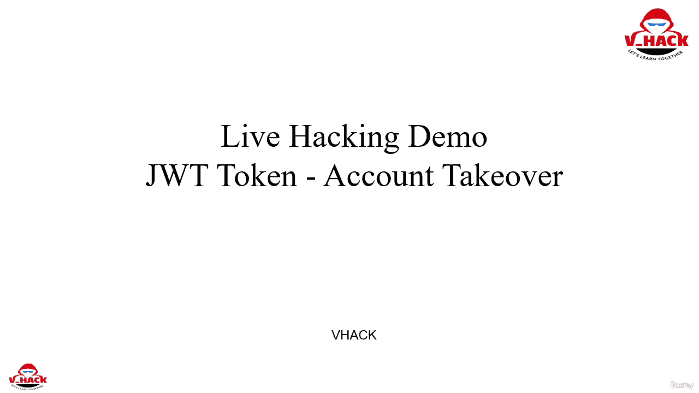

# 道德黑客：第21课：JWT Token – 账户接管实战演示 🔐

在本节课中我们将要学习如何利用 JWT Token 的弱点进行账户接管。通过一个真实的靶场演示，我们会一步步拦截登录响应，解码其中的令牌，修改其中的权限字段，最后成功进入管理员后台。这堂课适合刚开始接触 Web 渗透的初学者，我们会用大白话把每一个动作都讲清楚，确保你看完之后能够独立理解整个攻击流程。

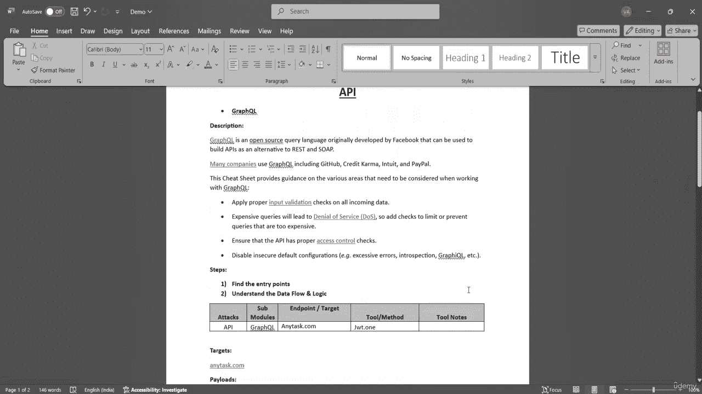

---

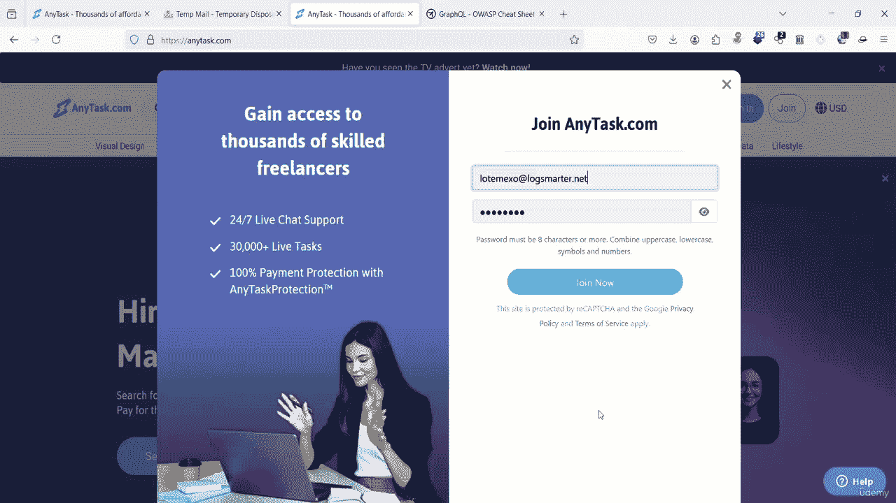

## 第一部分：靶场访问与登录获取令牌 🔑

首先，我们需要进入目标靶场环境，完成普通用户的登录操作，从服务器响应中抓取出 JWT 令牌。

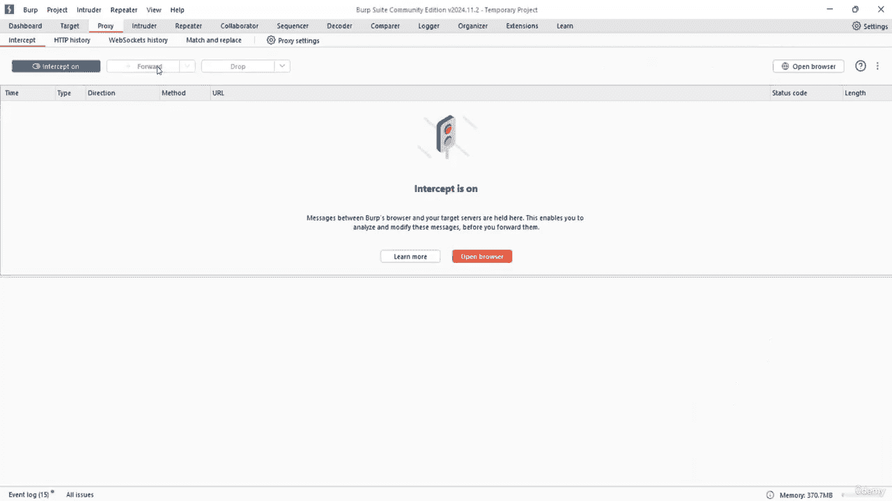

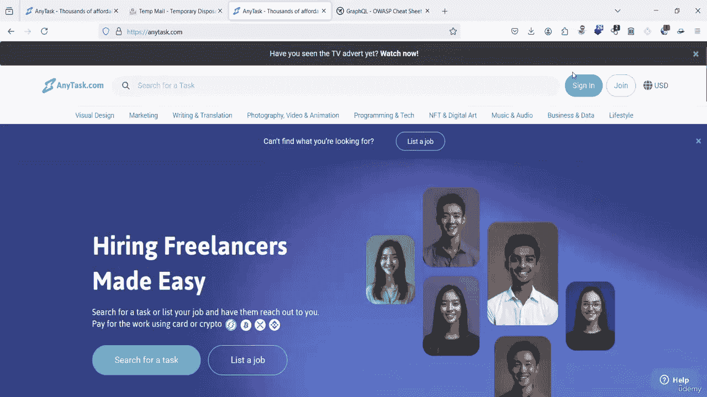

打开浏览器并访问靶场地址，域名类似于 E dotask do co，具体地址以靶场提供的为准。进入页面后找到登录入口，输入正确的用户名和密码完成登录。在此过程中，使用抓包工具拦截登录响应包，直接转发请求并等待服务器返回。在返回的响应包中，我们可以看到服务器给出了一个 token，这段字符串并不是人类可读的格式，因此需要后续借助工具进行解码。

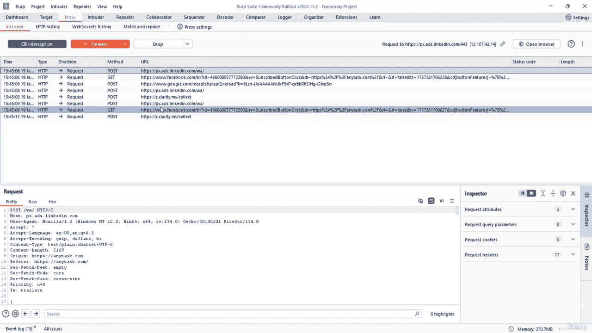

以下是登录获取 token 的简化请求流程：

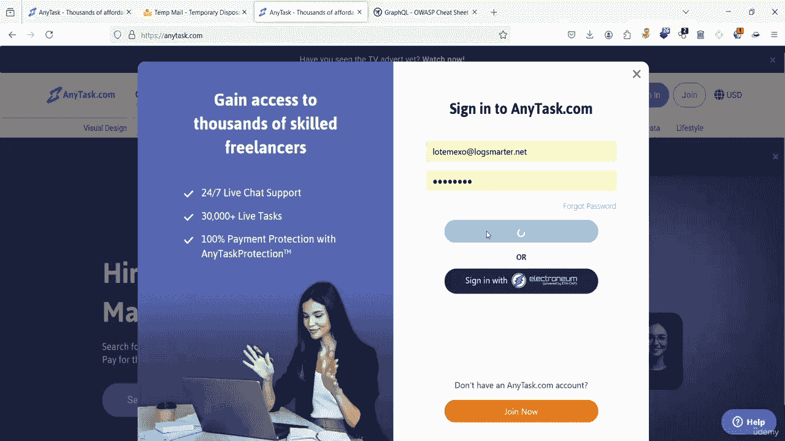

```
[浏览器] --> [发送登录请求] --> [服务器]
     <-- [响应包含 JWT Token] --
```

拿到原始 token 之后，我们需要把它解码出来，看看里面到底藏着什么信息，这也是下一节要重点分析的内容。

---

## 第二部分：解码 JWT Token 并分析字段 🔍

上一节我们介绍了如何从登录响应中获取 JWT 令牌，本节中我们来看看如何解码并分析其中的负载内容。

JWT 的基本结构可以用下面的公式表示：

`JWT = Header.Base64Url(Payload).Signature`

将复制的 token 粘贴到 jwt.io 等在线解码工具中进行解码。解码完成后，你可以看到负载部分包含以下几个字段：

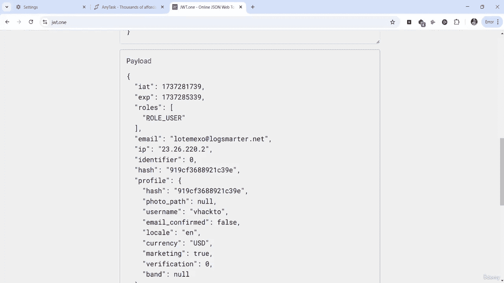

- email：登录时使用的邮箱地址，用于标识当前登录账号。
- username：当前用户的用户名，示例中显示为 two。
- roles：用户角色字段，示例中显示为 Manche's role_user，表明当前账号的权限等级是普通用户。

以下是解码后常见的 JWT 负载字段示例：

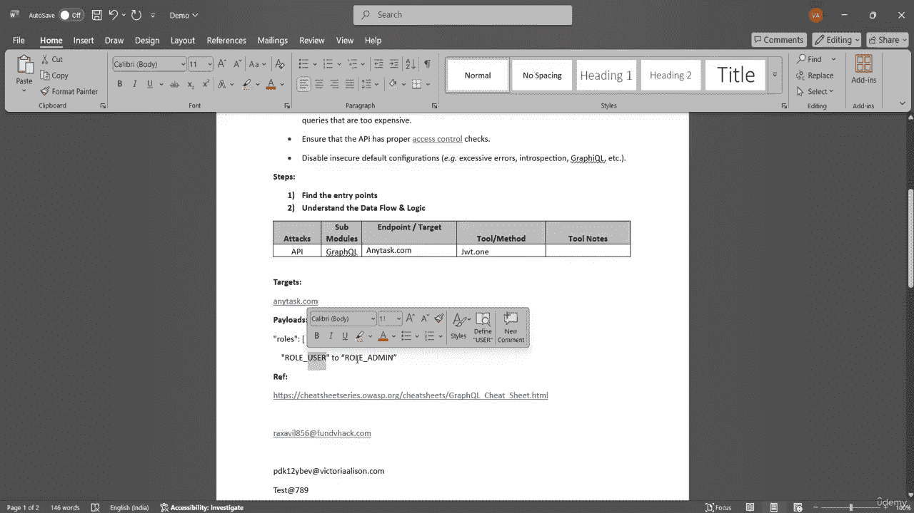

```json
{
  "email": "user@example.com",
  "username": "two",
  "roles": "role_user"
}
```

字段分析完成后，我们发现 roles 字段决定了当前账号的权限等级，如果能把这个字段从普通用户改成管理员，就有可能实现权限提升。下一节就是重点，我们来看看如何修改这个字段并构造伪造 token。

---

## 第三部分：修改权限字段构造伪造 Token 🛠️

上一节我们介绍了 JWT 负载中的角色字段，本节中我们来看看如何把普通用户角色改成管理员角色。

在解码工具中，将 roles 字段从 role_user 修改为 role_admin。修改完成后，对应的 JWT token 签名部分也会随之发生变化，工具会自动重新计算生成新的 token 字符串。此时，你需要把修改后生成的新 token 完整复制下来，准备后续发送给服务器。

拿到伪造的管理员 token 之后，我们需要把它发回给服务器，尝试获取提升后的权限，这正是下一节要演示的账户接管过程。

---

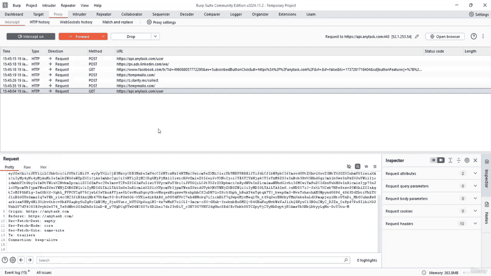

## 第四部分：利用伪造 Token 实现账户接管 🚪

上一节我们介绍了如何构造带有管理员角色的伪造 token，本节中我们来看看如何利用这个 token 进入管理后台。

将新生成的 token 粘贴回原请求中，替换掉原来的 token。将请求重新发送给服务器，服务器会验证 token 并根据其中的角色字段返回对应权限的页面。在响应页面中，你会发现出现了一个名为 advent dashboard 的管理门户入口。点击进入该门户，即可成功以管理员身份登录系统，完成账户接管。

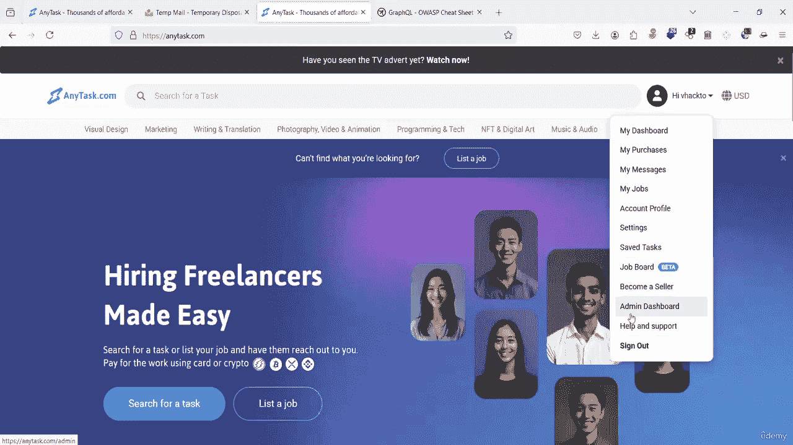

以下是账户接管的关键操作步骤：

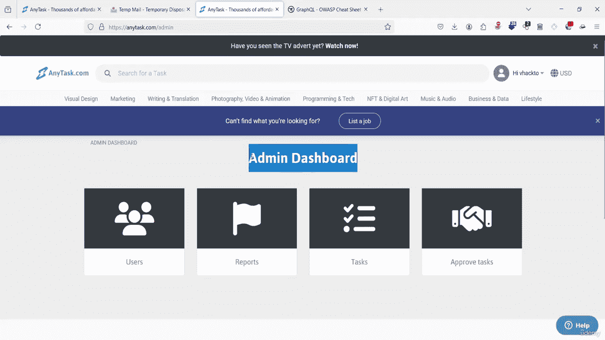

1. 替换原有 token 为伪造的管理员 token
2. 发送请求并等待服务器响应
3. 访问管理员仪表盘路径，例如 /admin/dashboard
4. 确认成功进入管理后台

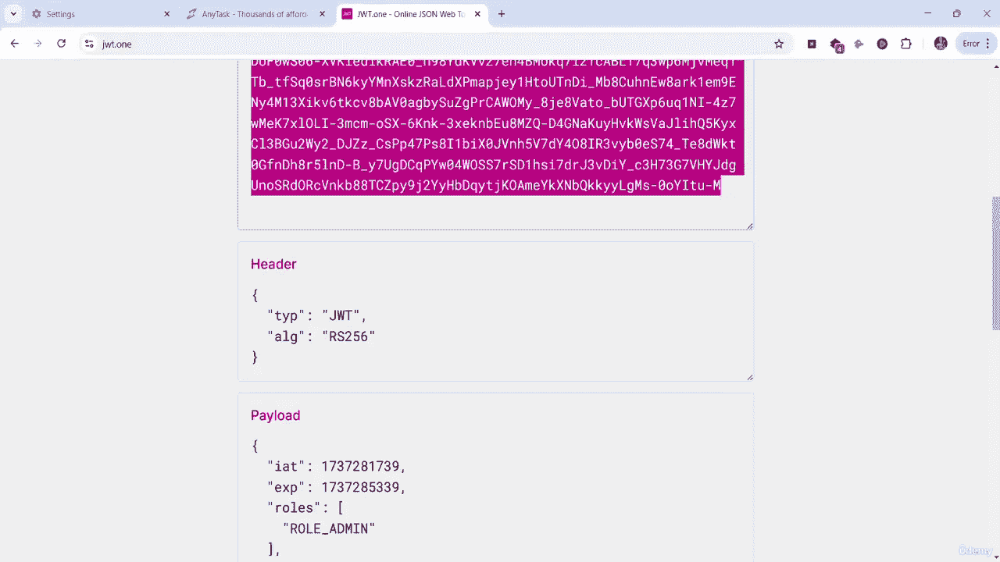

为了更直观地展示权限差异，我们可以对比普通用户和管理员用户登录后看到的页面区别，这是下一节要做的验证工作。

---

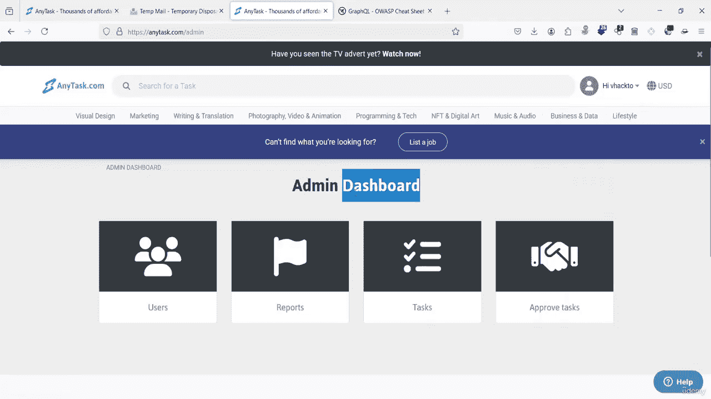

## 第五部分：权限对比验证与课程总结 ✅

上一节我们介绍了如何利用伪造 token 进入管理后台，本节中我们来看看普通用户与管理员页面的具体区别，并总结本节课的核心知识点。

使用原始普通用户 token 访问时，页面中没有管理员入口，权限受限。使用修改后的管理员 token 访问时，页面中会出现管理员入口，且服务器返回状态码为 200，说明请求成功。这表明 JWT token 中的 roles 字段若未经过服务端有效签名验证，就可能被客户端篡改，从而导致越权访问甚至账户接管。

以下是本节课涉及的核心概念总结：

- JWT 由头部、载荷和签名三部分组成，格式为 `Header.Payload.Signature`。
- 载荷中若包含角色字段，且客户端可随意修改而无需重新签名，则存在越权风险。
- 攻击者可通过拦截响应、修改角色字段、重新发送请求的方式实现账户接管。

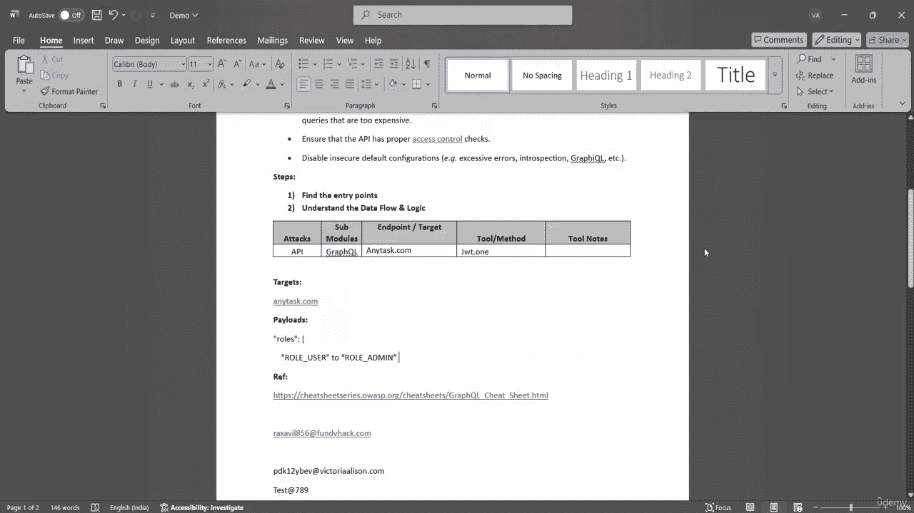

本节课中我们一起学习了如何通过拦截登录响应获取 JWT token，利用 jwt.io 解码其中的负载字段，将 role_user 修改为 role_admin 构造伪造令牌，最终成功进入管理员仪表盘完成账户接管。希望这堂课能帮助你理解 JWT 令牌的工作原理以及其中可能存在的安全隐患。

