# Ethical Hacking：50-Day Hacker Challenge：17：OAuth 配置错误与账号劫持实战 🔐

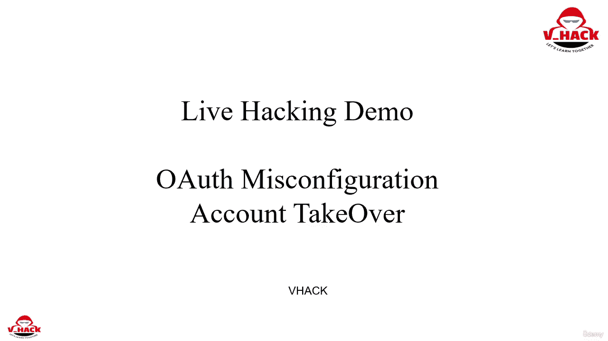

## 课程概述 📚

在本节课中我们将要学习如何利用网站的 OAuth 配置错误来劫持受害者的账号。我们会用最直白的语言把整个攻击过程拆解开来看，让你搞清楚哪里出了问题，以及攻击者是怎么一步步完成账号接管的。这不是什么高深的黑客技术，只是利用了开发人员在配置第三方登录时的疏忽，所以即使你是初学者，也能看懂其中的原理，并且明白日常开发中需要注意哪些坑。

## 准备工作与环境说明 🛠️

在开始演示之前，我们需要先搞清楚实验环境里到底有哪些角色。本节课中我们会模拟两个完全独立的浏览器会话，一个扮演攻击者，另一个扮演受害者。这两个账号在表面上应该互不相干，但因为网站的 OAuth 配置存在缺陷，攻击者最终能够越过边界控制受害者的账号，哪怕他并不知道受害者的密码。

以下是本节演示中涉及的两个测试账号信息：

- 攻击者账号邮箱：researcher2@gmail.com
- 受害者账号邮箱：attacker@gmail.com

这两个邮箱地址是我们演示的核心，后续所有操作都围绕这两个身份展开。请记住，在正常情况下，使用其中一个邮箱登录的浏览器，不应该能够直接操作另一个邮箱对应的账号，否则就说明存在严重的安全漏洞。

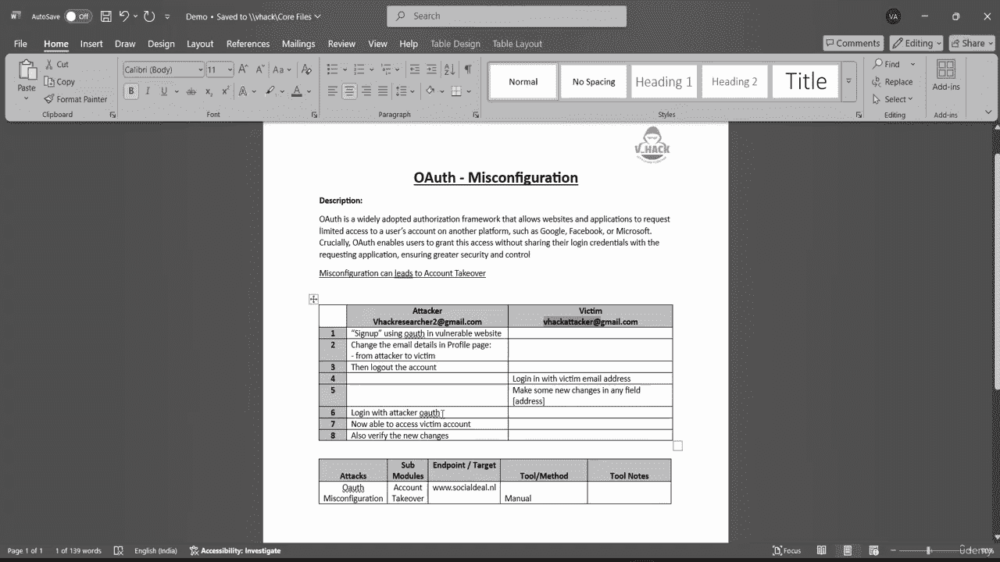

## 漏洞原理与核心概念 🧩

OAuth 是一种常见的第三方授权协议，网站常用它来让用户用 Google、GitHub 等账号登录。当这个协议配置不当时，就会出现严重的安全问题。我们可以用下面的公式来简单表达这个风险：

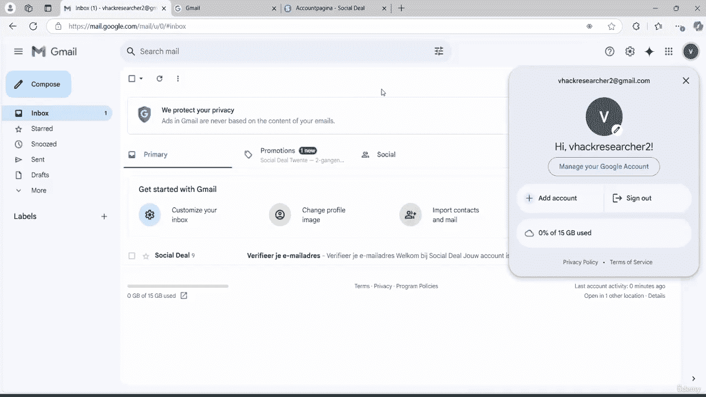

**错误配置下的账号接管条件 = 攻击者可控邮箱 + 受害者账号关联 + 平台缺乏邮箱所有权校验**

换句话说，如果网站在更改账号邮箱时没有严格验证新邮箱的真实所有者，又或者旧会话没有被正确失效，那么攻击者就有机会通过自己的账号去“认领”受害者的账号，从而绕过密码保护直接获得控制权。

## 攻击演示步骤 🖥️

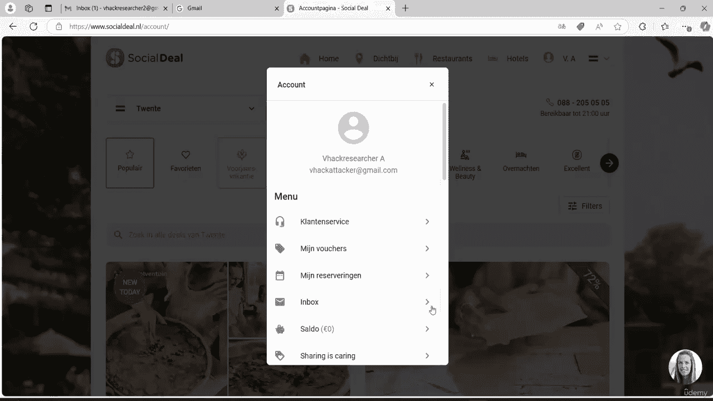

接下来我们进入具体的演示环节。整个过程会分成几个阶段，每一步都会说明攻击者在做什么，以及受害者那边会发生什么变化，让你全程看清漏洞是怎么被利用的。

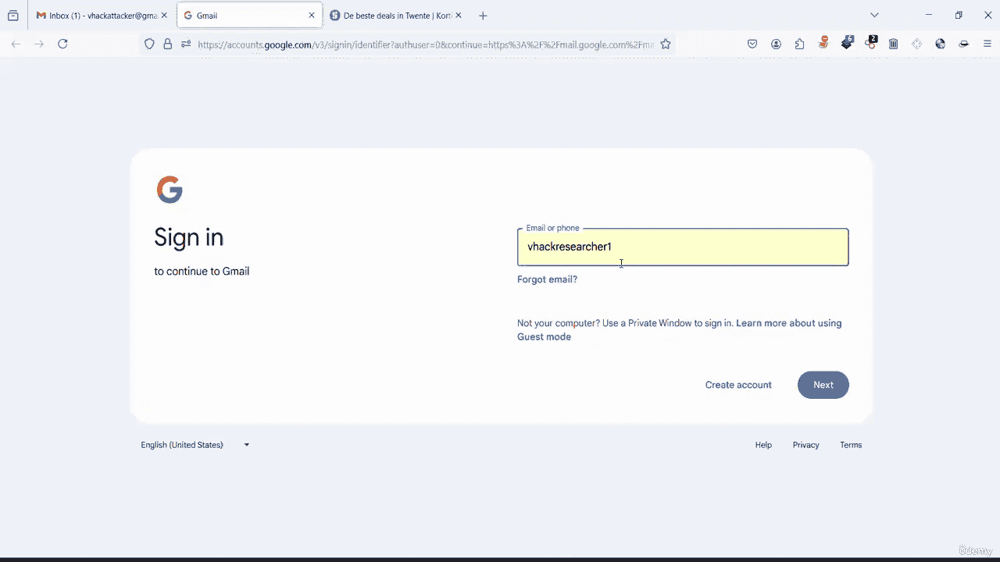

### 第一步：打开两个独立浏览器会话 🌐

以下是我们需要准备的浏览器环境：

- 浏览器 A：登录攻击者账号 researcher2@gmail.com
- 浏览器 B：登录受害者账号 attacker@gmail.com

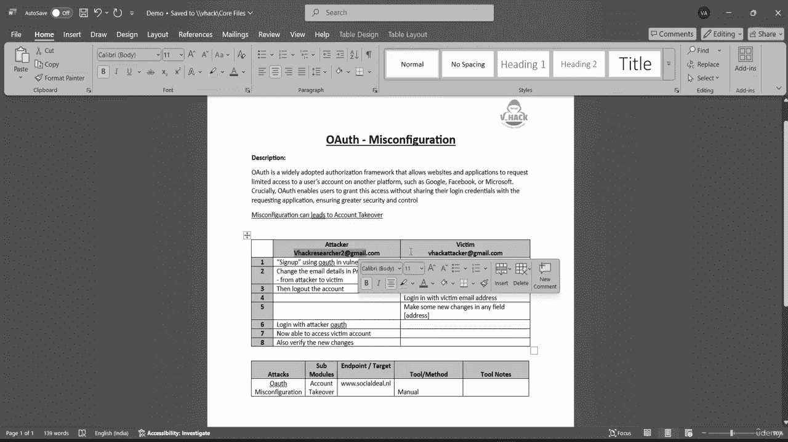

之所以要分开两个浏览器，是为了模拟真实世界中攻击者和受害者分别使用不同设备的情况。在正常的网站设计中，这两个会话应该完全隔离，互相看不见对方的数据，也不可能互相干扰。

### 第二步：在受害者账号中修改关联邮箱 📧

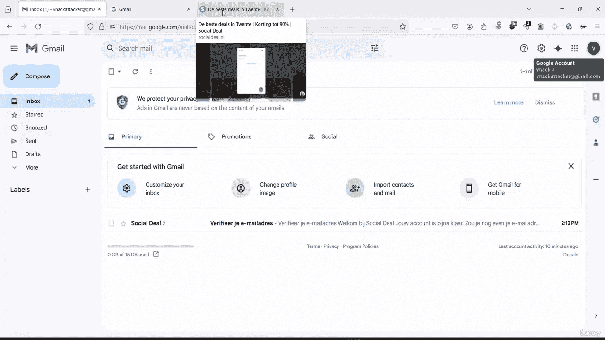

以下是攻击者执行的关键操作：

1. 攻击者使用浏览器 A 登录自己的账号 researcher2@gmail.com。
2. 进入个人资料设置页面。
3. 将账号关联的邮箱地址从 researcher2@gmail.com 修改为 attacker@gmail.com，也就是受害者的邮箱。
4. 提交更改，完成邮箱替换。

这里有一个很关键的点：虽然攻击者改了邮箱，但因为 OAuth 配置错误，原先的攻击者会话并没有被立即剔除，攻击者依然保留着对该账号的某种访问能力，这就为后续的接管埋下了伏笔。

### 第三步：验证两个账号表面上互不相连 🔒

以下是我们需要进行的确认操作：

- 在浏览器 B 中尝试访问受害者账号 attacker@gmail.com 对应的页面。
- 在浏览器 A 中尝试访问 attacker@gmail.com 对应的资源。

如果一切正常，浏览器 A 应该会要求重新输入密码，或者提示没有权限，这说明两个账号在表面上是独立的，攻击者看起来并不能直接登录受害者的账号，也无法轻易拿到受害者的个人信息。

### 第四步：利用配置错误完成账号接管 ⚠️

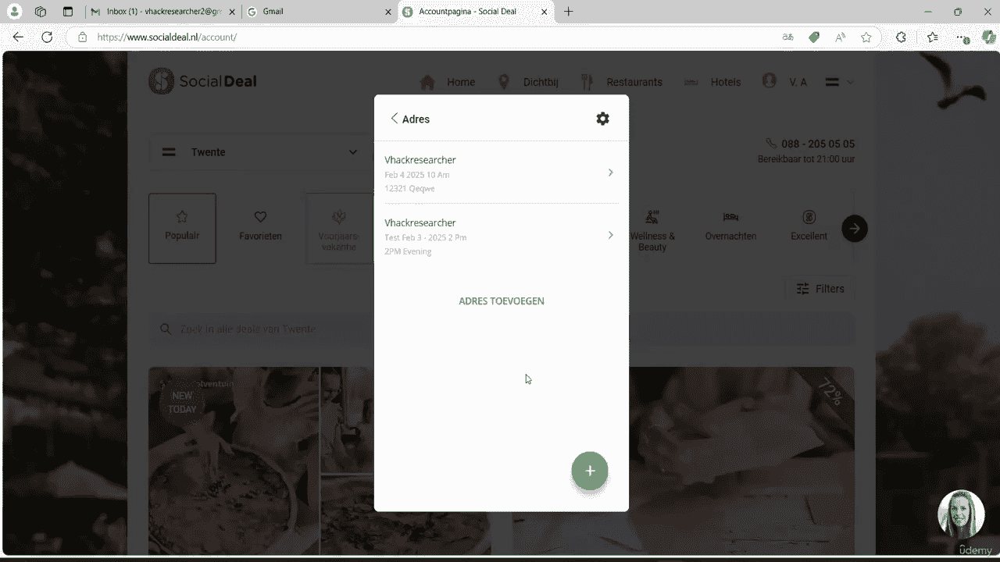

以下是攻击者利用漏洞的具体表现：

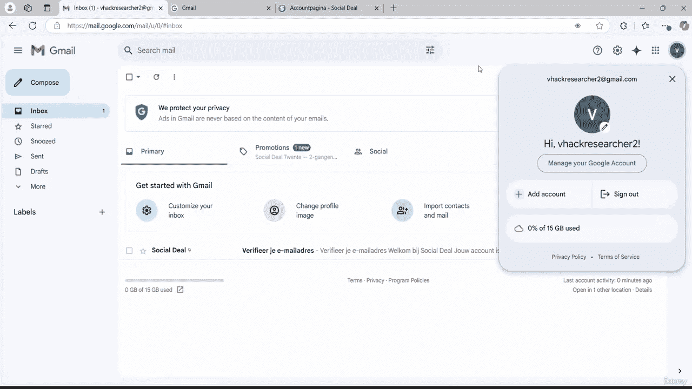

- 攻击者在浏览器 A 中，依然可以访问并修改 attacker@gmail.com 关联的账号信息。
- 攻击者在受害者账号的地址字段中添加了一条新记录，例如设置日期为 2025 年 2 月 4 日，内容为 ABC。
- 切换回浏览器 B，刷新页面，可以看到这条新地址记录已经出现在受害者账号中。

这意味着什么呢？这意味着攻击者并不需要知道受害者的密码，也能够通过之前的会话漏洞，直接在受害者账号里写入数据。受害者账号的合法用户完全 unaware 自己账号里已经多出了陌生人的地址信息，这已经构成了账号被接管的征兆。

### 第五步：在接管后的账号中删除数据 🗑️

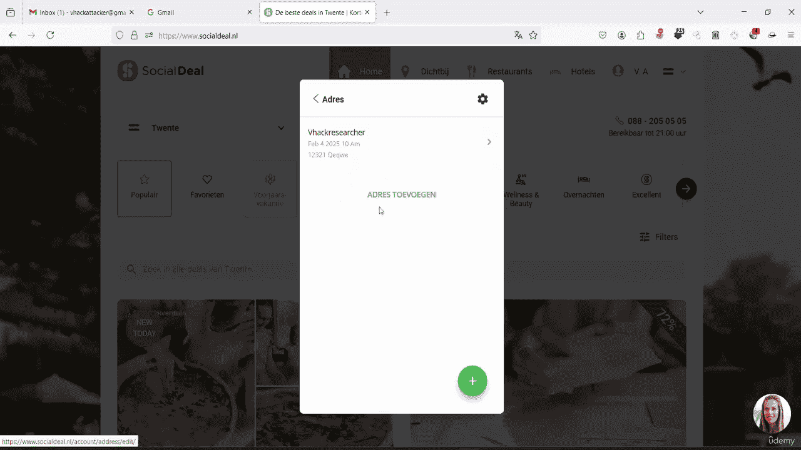

以下是攻击者进一步证明自己拥有完全控制权的操作：

1. 回到浏览器 A，也就是攻击者控制的会话。
2. 尝试删除受害者账号中之前添加的某个地址记录。
3. 刷新浏览器 B 页面，确认该地址记录已经从受害者账号中消失。

能够删除数据说明攻击者不仅能添加信息，还能修改和删除受害者的个人资料，这就已经构成了完全的账号劫持，受害者账号里的任何数据都可能被攻击者随意篡改。

## 漏洞总结与修复建议 🛡️

本节课中我们一起学习了如何通过 OAuth 配置错误实现账号劫持。攻击者只需更改关联邮箱，就能在不需要受害者密码的情况下，完全接管对方的账号，并随意添加、编辑或删除账号中的地址字段等信息。

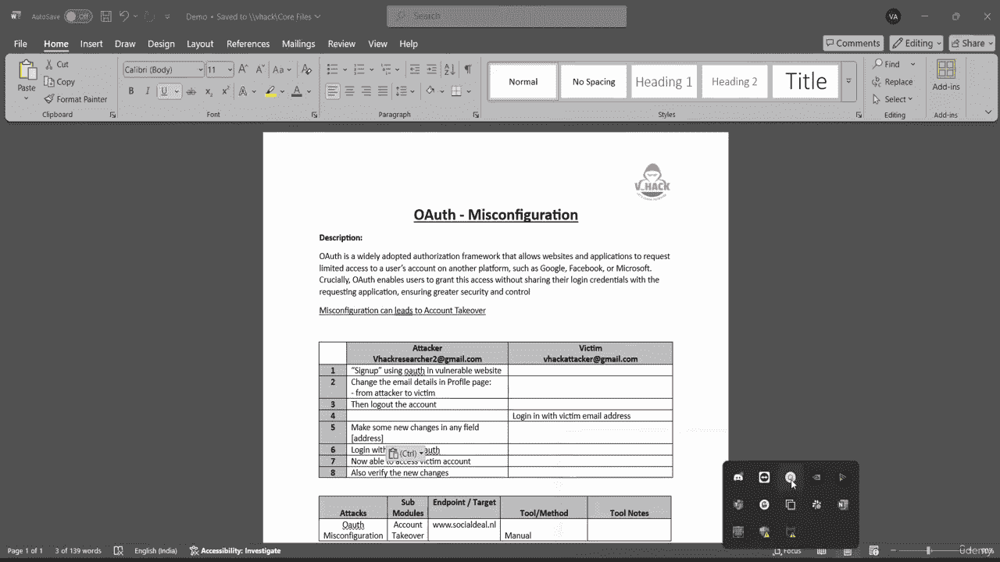

要避免此类问题，开发人员应该在更改账号邮箱时强制进行所有权验证，失效旧的 OAuth 会话，并对账号敏感操作增加二次确认机制。只有做好这些基础防护，才能阻止攻击者利用配置漏洞进行账号接管，保护用户的账号安全。

