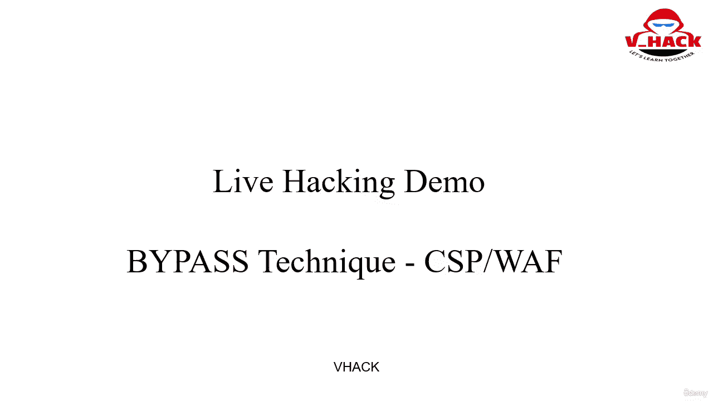
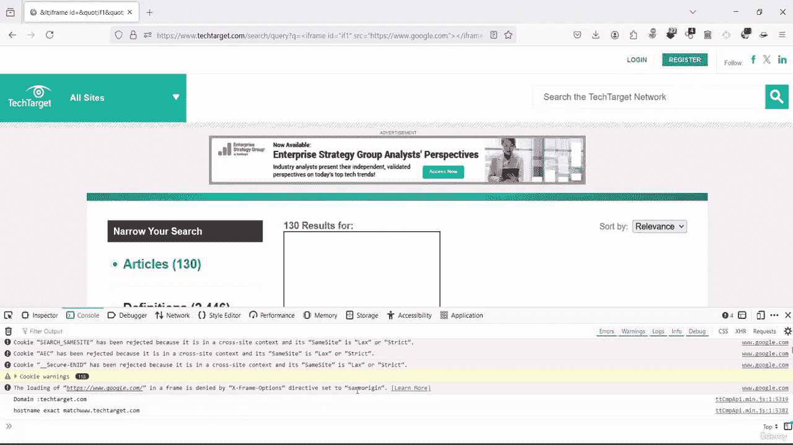
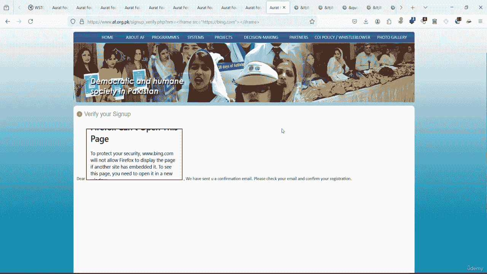
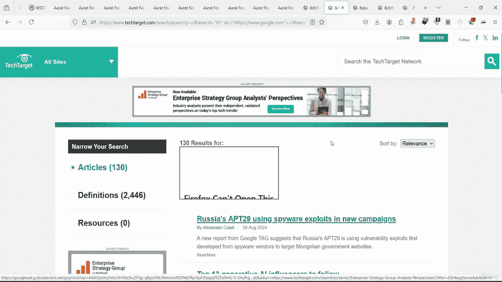
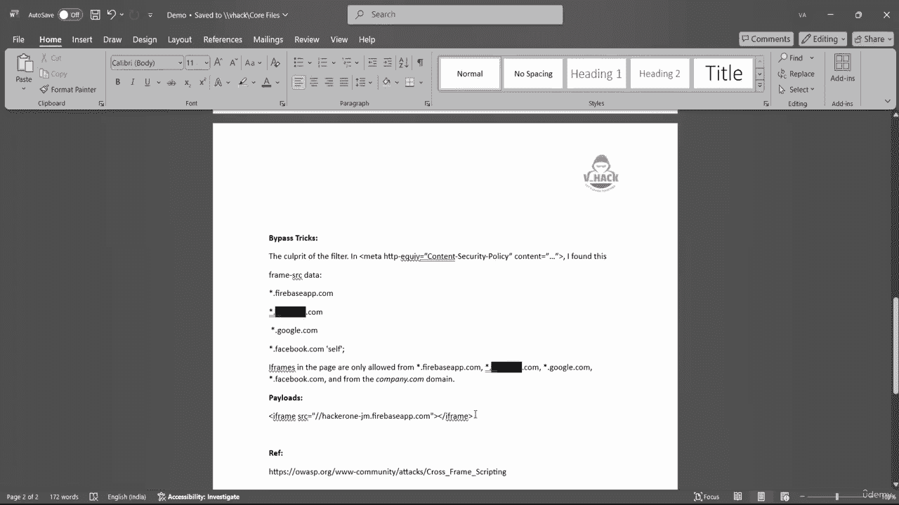
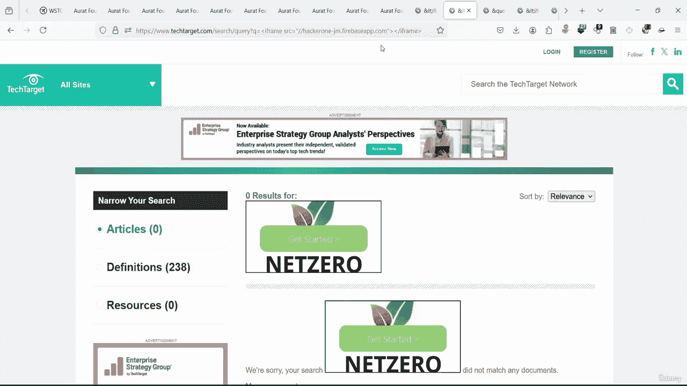
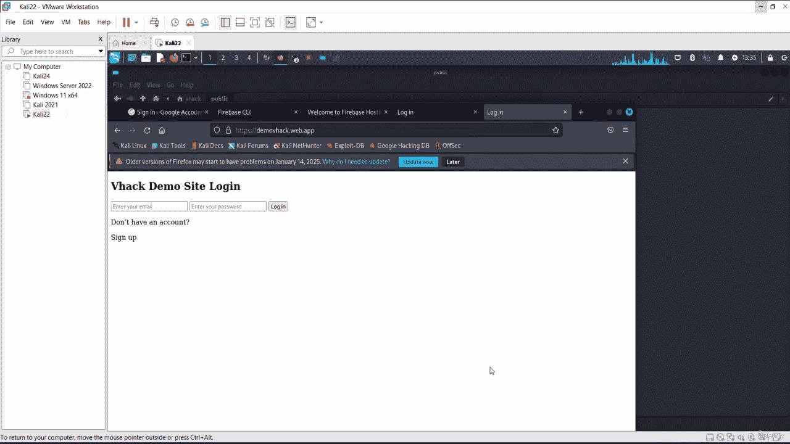
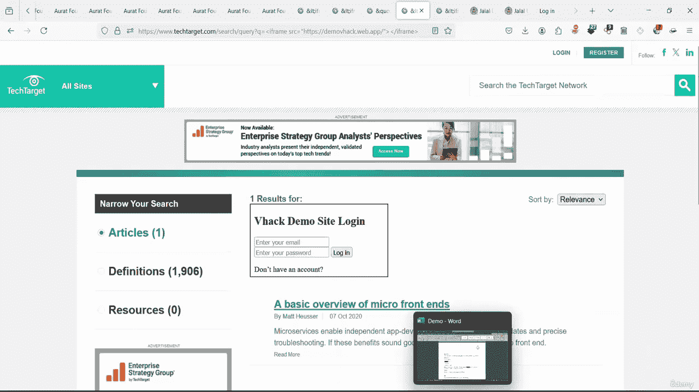
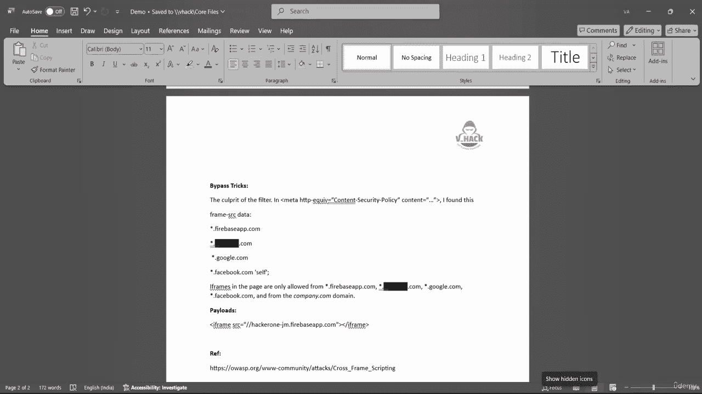

# Ethical Hacking：24：CSP 绕过技术 - Web 应用 - 使用 Firebase [实战目标] 🛡️



在本节课中，我们将学习如何利用 Firebase 绕过 Web 应用中的内容安全策略（CSP）和 X-Frame-Options 防护。首先会介绍 CSP 和 X-Frame-Options 的基本含义，然后说明攻击者如何利用 Firebase 托管恶意页面，接着展示如何通过 iframe 嵌入诱导用户输入账号密码，最后对整个绕过流程进行总结。


## 1. 什么是内容安全策略和框架选项 📋

上一节我们主要介绍了 Web 应用攻击的基础知识，本节中我们来看看内容安全策略和框架选项是如何工作的。

内容安全策略（Content Security Policy，简称 CSP）是浏览器提供的一种安全机制，用来限制页面可以加载哪些资源，以及哪些来源可以被嵌入。你可以把它理解为一道门禁，浏览器会根据这份策略决定允许哪些脚本、图片、iframe 等内容执行或显示，哪些内容直接拦截。X-Frame-Options 则专门控制当前页面是否允许被其他页面通过 iframe 嵌入，主要目的是防止点击劫持攻击。

当目标应用开启了严格的 CSP 或 X-Frame-Options 时，攻击者在外部页面中直接嵌入该应用通常会被浏览器阻止。这时候，攻击者需要寻找绕过这些限制的方法，才能继续后续的渗透测试或攻击演练。

以下是常见的 CSP 和 X-Frame-Options 限制形式：

- Content-Security-Policy: frame-ancestors 'self'
- X-Frame-Options: DENY
- X-Frame-Options: SAMEORIGIN


如果你在响应头中看到上述内容，说明目标站点不允许被不同来源的页面嵌入。这时候，如果你能找到一个受信任的域名来承载自己的页面，就有机会绕过这些限制。


## 2. Firebase 绕过原理 🔥

介绍完 CSP 和 X-Frame-Options 的基本概念后，本节中我们来看看 Firebase 是如何成为绕过手段的。



Firebase 是 Google 提供的应用开发平台，很多合法应用会使用 Firebase 来托管静态资源或构建前端页面。由于 Firebase 的子域名（例如 *.firebaseapp.com 或 *.web.app）通常被浏览器和安全策略视为受信任来源，攻击者可以利用这个特点来绕过目标站点的限制。



核心思路可以用下面的伪代码表示：





```text
如果目标站点禁止外部 iframe 嵌入：
    第一步：在 Firebase 上部署一个钓鱼登录页面
    第二步：将该 Firebase 页面作为 iframe 的 src
    第三步：诱导受害者访问包含该 iframe 的页面
    第四步：收集受害者输入的账号和密码
```

简单来说，就是：既然目标站点不让你直接嵌入，你就自己搭建一个看起来可信的页面，把它托管在 Firebase 上，再把它嵌进去或者直接发送给受害者。受害者看到的是 Firebase 域名，通常会产生信任，从而输入敏感信息。

以下是该绕过技巧的关键步骤：



- 在 Firebase 控制台中创建新项目
- 编写钓鱼登录 HTML 页面
- 使用 Firebase CLI 或控制台将页面部署到云端
- 获取部署后的公网访问地址
- 构造包含该地址的 iframe，或者直接分享链接


## 3. 实操步骤：在 Firebase 上托管钓鱼页面 🚀

讲完原理之后，本节中我们进入实际操作环节。首先，你需要准备一个简单的登录页面，页面上包含用户名和密码输入框，以及一个提交按钮。这个页面模拟真实网站的登录界面，目的是诱导用户输入凭据。

你可以直接在本地编写 HTML 文件，文件内容大致如下：

```html
<!DOCTYPE html>
<html>
<head>
    <title>登录页面</title>
</head>
<body>
    <h2>请登录</h2>
    <form>
        <input type="email" placeholder="邮箱地址">
        <input type="password" placeholder="密码">
        <button type="submit">登录</button>
    </form>
</body>
</html>
```

编写完成后，使用 Firebase 工具将该页面部署到云端。部署成功后，你会得到一个类似 `https://xxx.web.app` 的公网地址。这个地址就是你后续用来绕过 CSP 的承载点。



以下是部署后需要验证的要点：

- 页面能否通过公网地址正常访问
- 登录表单是否能正常显示
- 提交按钮是否能捕获用户输入的内容


## 4. 使用 iframe 嵌入并诱导用户 🎣

完成 Firebase 页面的部署后，本节中我们来看看如何利用 iframe 嵌入来诱导用户。你可以把部署好的页面地址嵌入到目标页面中，也可以直接诱导用户访问这个地址。为了增加可信度，建议让钓鱼页面的颜色、布局与目标网站保持一致，使受害者误以为这是同一个父网站的一部分。

例如，你可以构造如下的嵌入代码：

```html
<iframe src="https://你的-firebase-地址.web.app" width="100%" height="600"></iframe>
```

当受害者访问包含该 iframe 的页面时，浏览器会加载你托管在 Firebase 上的登录页面。由于该页面使用的是 Firebase 受信任域名，浏览器通常不会拦截，从而绕过了目标站点的 X-Frame-Options 或 CSP 限制。

以下是诱导用户的常见方式：

- 发送钓鱼邮件，附带包含 iframe 的页面链接
- 在论坛或社交媒体发布伪装成正常内容的链接
- 使用短链接隐藏真实的 Firebase 地址

一旦用户在钓鱼页面输入账号密码并点击提交，这些凭据就会被你的服务器或后端脚本捕获，攻击即告成功。


## 5. 总结 ✅

在本节课中，我们一起学习了内容安全策略（CSP）和 X-Frame-Options 的基本作用，理解了它们如何阻止恶意 iframe 嵌入。接着，我们探讨了如何利用 Firebase 这个受信任平台来托管钓鱼页面，并通过 iframe 嵌入或直接分享链接的方式绕过防护。最后，我们演示了如何编写简单的登录页面、部署到 Firebase，以及如何诱导用户输入敏感信息。





希望这节课能帮助你掌握 CSP 绕过的核心思路，并在实际测试中灵活运用。


