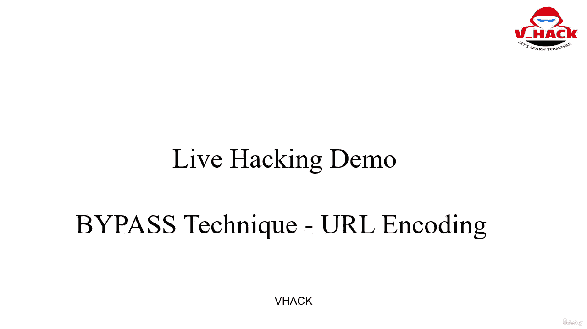
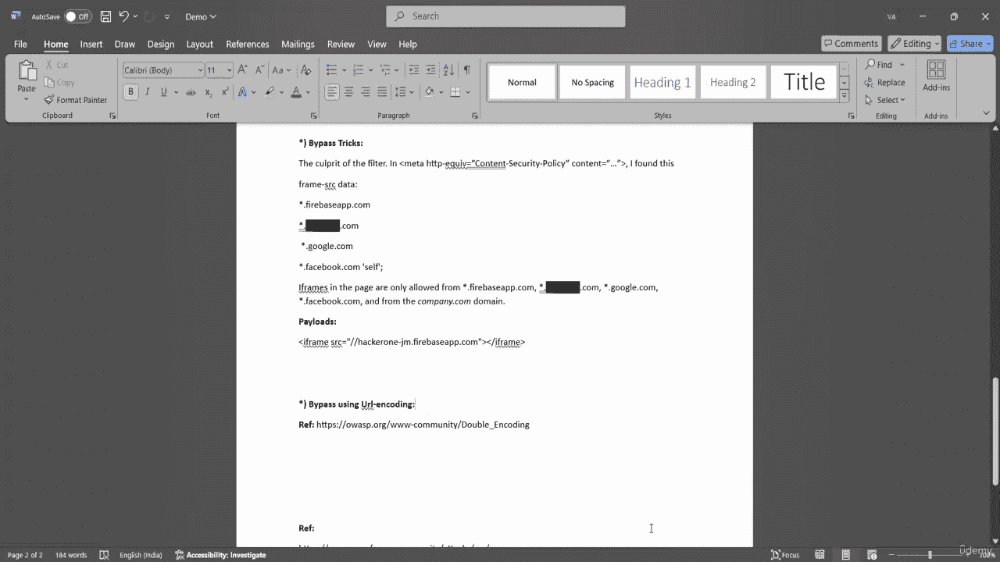
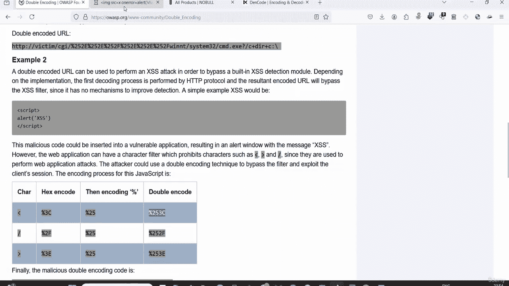
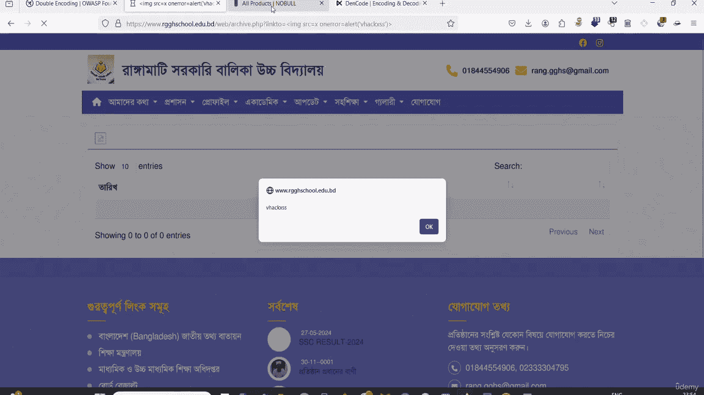
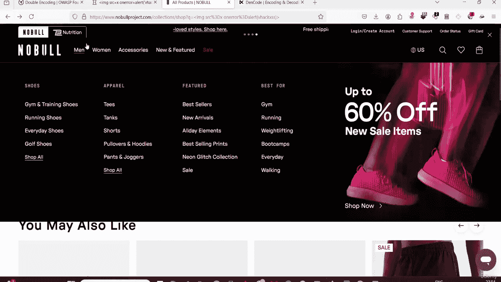
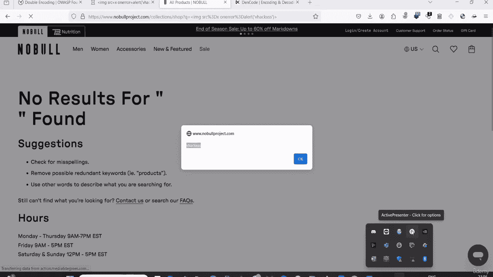

# Ethical Hacking：20：Web应用绕过技术与URL编码实战 🎯



在本节课中，我们将一起学习Web应用攻击中的绕过技术，重点讲解如何利用URL编码绕过安全防护。你将了解攻击者是否通过编码手段让恶意输入绕过应用程序或WAF等设备的检查，并观察一次真实的演示过程。


## 课程概述 📚

本节课属于Web应用攻击模块，具体聚焦于绕过技术。我们会先说明URL编码的基本原理，再说明攻击者如何利用编码进行注入类攻击，最后通过一个实际靶场演示，看看未编码的脚本会被拦截，而经过URL编码后的脚本又是如何被应用接受的。


## 什么是URL编码与双重编码 🔁

在进入具体攻击手法之前，我们先来理解什么是URL编码。URL编码是一种把特殊字符转换为百分号加十六进制数值的表示方式，浏览器和服务器可以还原这些字符。简单来说，就是把不能直接放在URL里的字符，换成百分号开头的编码形式，这样数据就可以在网络中安全传输，而不会因为特殊符号而导致解析错误。

在安全场景中，如果同一个参数被两次以HTML格式编码，就可能出现绕过安全控制的情况，或者让应用产生恶意、非预期的行为。攻击者常利用这一点，把危险字符经过多层编码后再提交，希望服务器在解码过程中逐层还原，最终执行攻击代码，而安全设备在第一层解码时却没有发现危险。



以下是常见编码转换的示例：

- 左括号 `(` 编码后为 `%28`
- 右括号 `)` 编码后为 `%29`
- 斜杠 `/` 编码后为 `%2F`
- 点号 `.` 编码后为 `%2E`

如果再进行一次编码，就会变成双重编码，例如：

- 点号 `.` 双重编码后为 `%252E`


## 常见绕过场景：目录遍历与脚本注入 📂💥

在上一节中我们介绍了URL编码的基本概念，本节中我们来看看攻击者如何把它用于实际的绕过攻击。最典型的场景包括目录遍历和脚本注入，这两种情况在实际的Web渗透测试中非常常见。

对于目录遍历，攻击者会尝试使用 `../` 这样的路径跳转到上级目录，从而访问不应该被外界看到的系统文件。为了绕过过滤，他们会把点号和斜杠进行编码，甚至双重编码。例如：

```
%252e%252e%252f
```

服务器解码后可能还原成 `../`，从而访问到敏感的系统目录。

对于脚本注入，比如XSS，攻击者需要让浏览器在函数外部执行脚本。正常的 `<script>` 标签通常会被输入验证或WAF拦截，但如果把尖括号和括号进行URL编码，安全设备可能无法识别其中的恶意意图，从而让脚本通过并执行。





以下是几种常见的注入类型，它们都可能用到编码绕过：



- 命令注入：在参数中插入系统命令
- iframe注入：嵌入恶意页面
- 标签注入：构造伪造HTML标签
- 越权访问：绕过权限检查访问敏感资源


## 实战演示：无编码与URL编码的对比 🖥️

在介绍完理论之后，本节中我们进入实战演示环节。演示使用了一个简单的靶场网站，该网站接受用户上传的图片，并允许附带一些脚本内容，非常适合用来展示编码绕过的效果。

首先，直接提交一段未经编码的脚本。比如：

```html
<script>alert(1)</script>
```

提交之后，页面没有任何弹窗，也没有返回预期结果。这说明该脚本被应用程序的安全控制，或者前端设备如WAF给拦截了，应用程序没有执行这段用户提交的代码。

接下来，我们尝试对脚本进行URL编码。左括号会被编码为 `%28`，右括号会被编码为 `%29`，尖括号也会被转换成对应的百分号编码。把编码后的完整字符串再次提交给应用。

此时，你会发现用户提供的查询被应用接受了，脚本成功执行。这说明，仅仅通过URL编码，攻击者就能绕过很多Web应用内置的安全机制，或者WAF等防护设备的检查，让恶意代码顺利运行。


## 课程总结 ✅



本节课中，我们一起学习了Web应用绕过技术中的URL编码方法。我们解释了什么是URL编码和双重编码，列举了目录遍历和脚本注入等常见攻击场景，并通过实战演示展示了未编码脚本会被拦截，而经过URL编码后的脚本能够被应用接受。希望这些内容能帮助你理解攻击者如何利用编码绕过安全防护，也提醒你在实际开发中要做好输入验证和输出编码，不要依赖单一的过滤规则。

