# 🛡️ Ethical Hacking：第26节：高级枚举：子域名、存活主机与截图

在本节课中，我们将一起学习高级枚举的完整流程，具体包括子域名收集、存活主机识别以及网页截图获取，目标是从一个主域名出发，逐步暴露更多可攻击的入口点。


上一节我们介绍了漏洞扫描与利用开发的基础知识，本节中我们来看看如何在目标系统上进行更深入的资产发现，为后续的漏洞挖掘打下基础。


## 什么是高级枚举

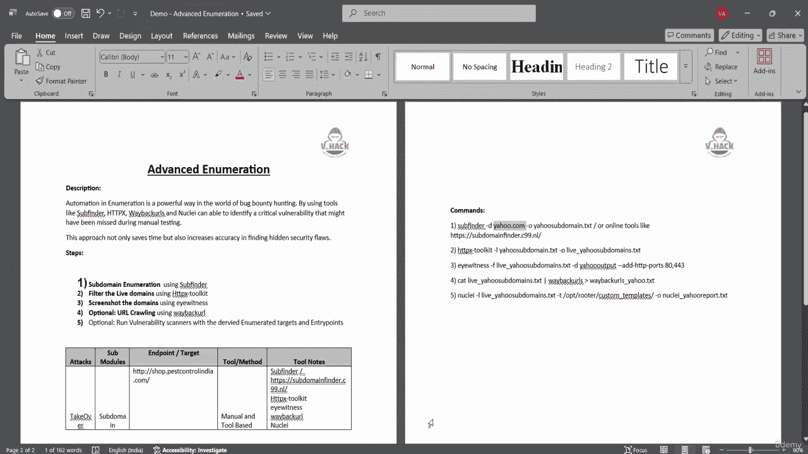

高级枚举是渗透测试中非常重要的一步，简单来说就是通过自动化工具去寻找目标域名下所有可能存在的子域名，进而筛选出真正存活的服务，并记录页面截图。可以把这个过程理解为下面的公式：

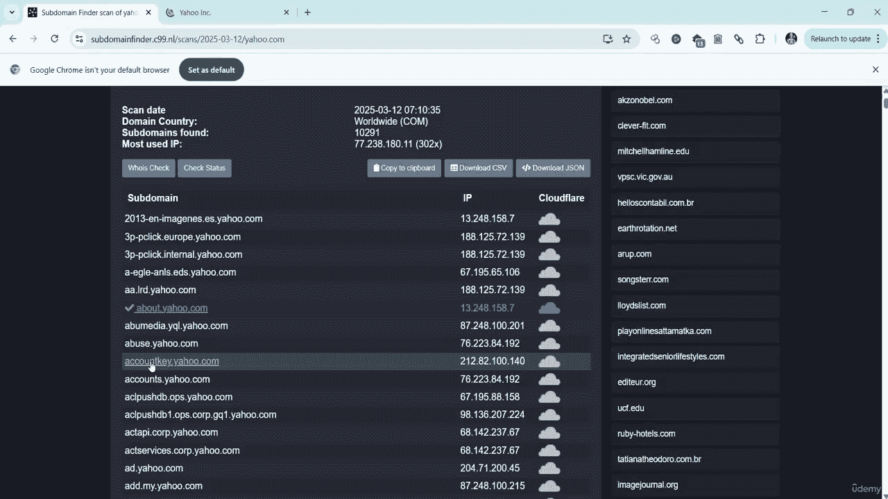


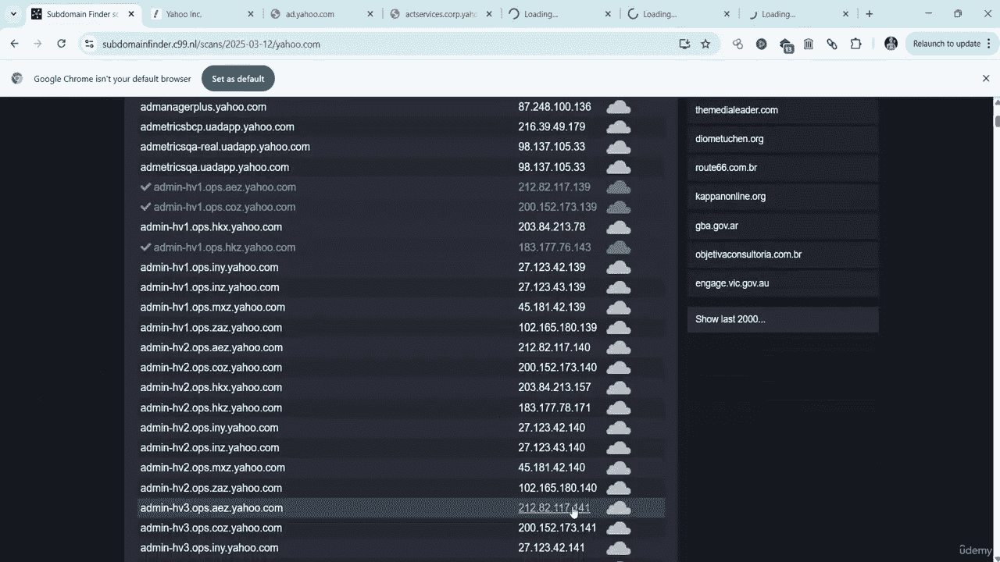

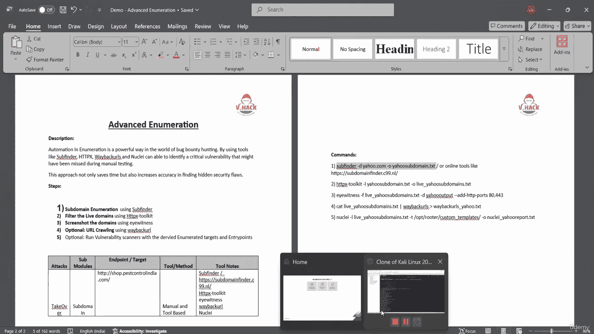

枚举结果 = 子域名列表 ∩ 存活主机 ∩ 可访问页面

这里的每一个部分都缺一不可，只有三者结合，才能拿到真正有价值的攻击面。


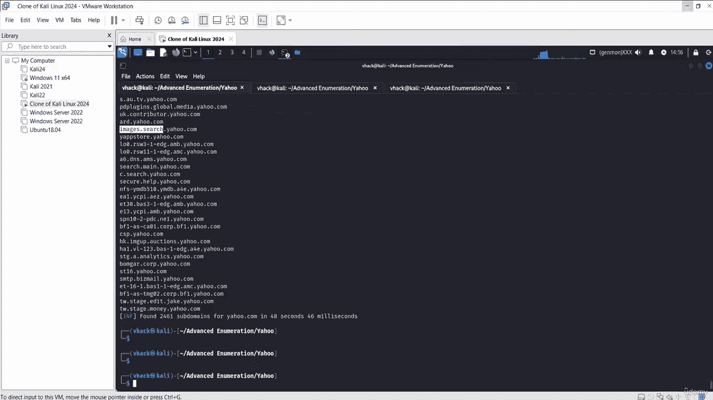

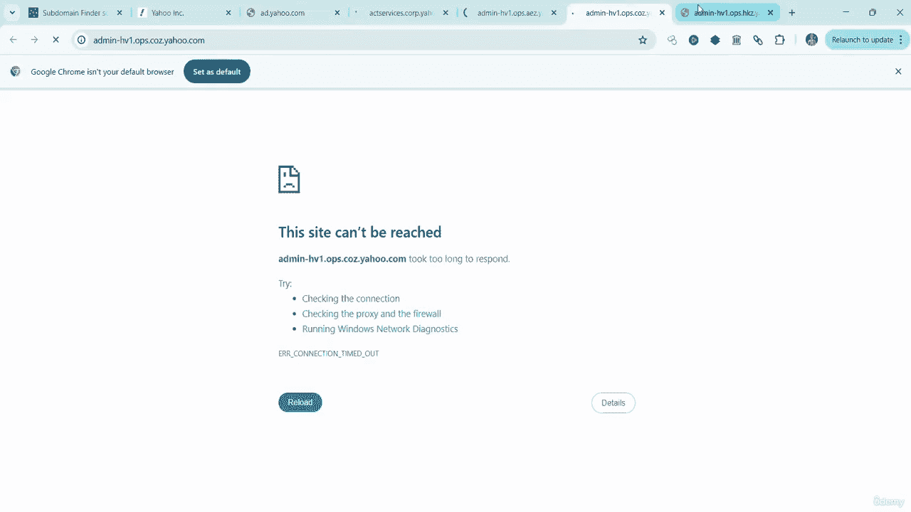

在实际操作中，我们通常会从主域名出发，使用子域名枚举工具批量猜解和收集二级域名、三级域名甚至更深层的域名，把这些域名看作进入目标内部的不同入口。以下是常见的子域名枚举工具列表：

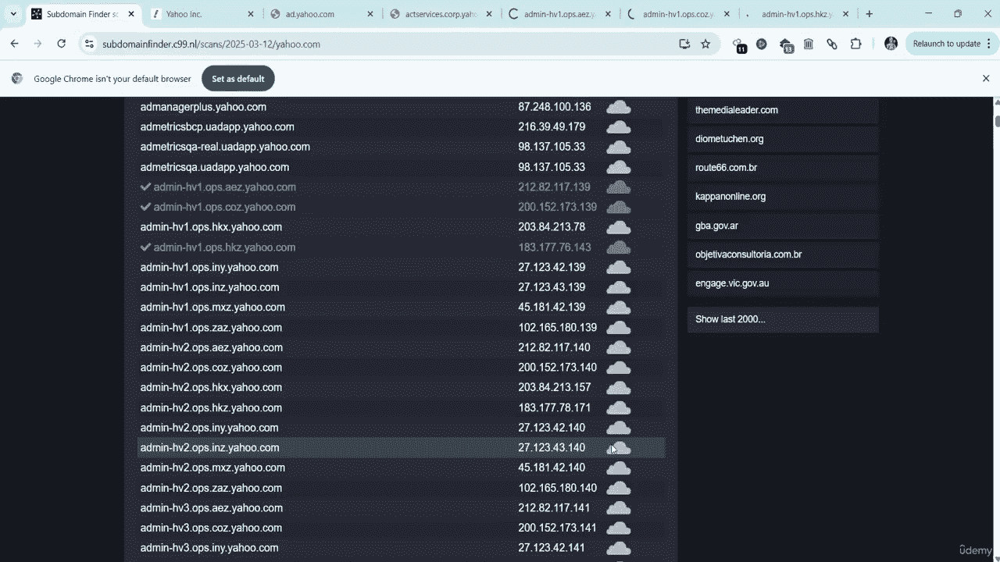

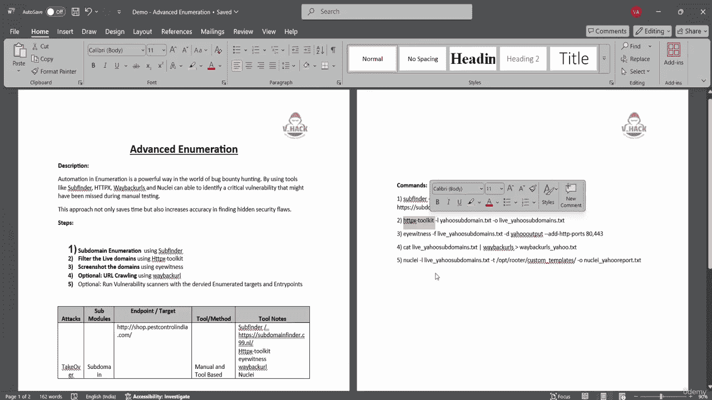

- subfinder：用于从公开数据源快速收集子域名。
- amass：适合进行大规模的子域名映射。
- sublist3r：基于搜索引擎和子域名暴力猜解的经典工具。


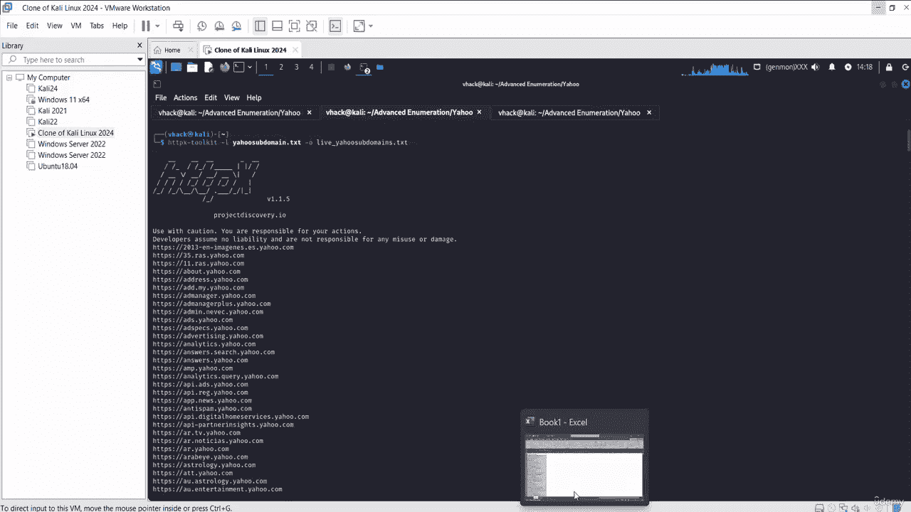

拿到子域名列表之后，我们需要确定哪些子域名真正可达，也就是哪些服务器当前在线并开放了Web服务，这一步通常被称为存活主机检测。以下是常用的存活检测步骤：

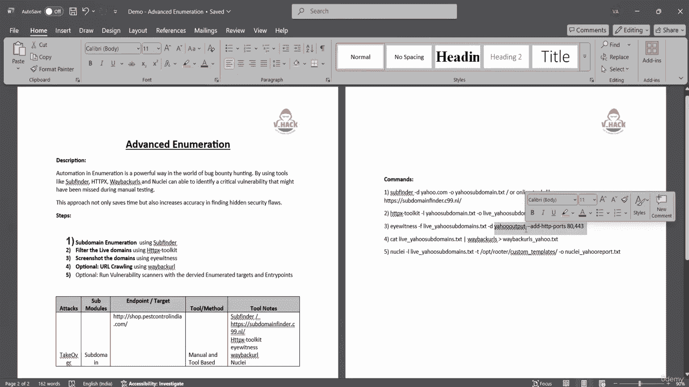

- 使用 httpx 对子域名进行存活探测。
- 过滤出返回 HTTP 200 或其他有效响应的域名。
- 将存活的域名写入文件，作为下一步截图的输入。


接下来我们进入截图阶段，这是高级枚举中非常直观的一步，通过自动化工具对存活的子域名进行截图，我们可以快速浏览成百上千个页面，而不需要逐个手动访问，工具配置示例如下：

```
输出目录 = screenshots
默认端口 = 443, 8443
输入文件 = live_subdomains.txt
```

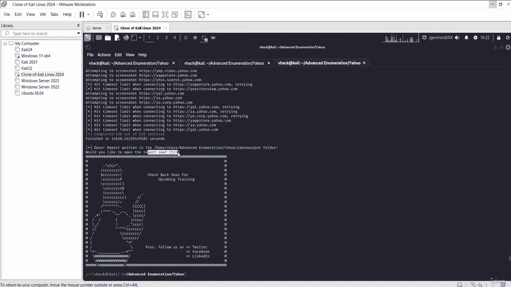

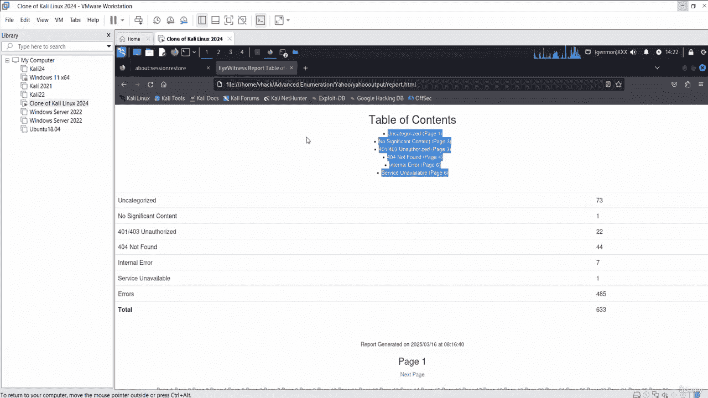

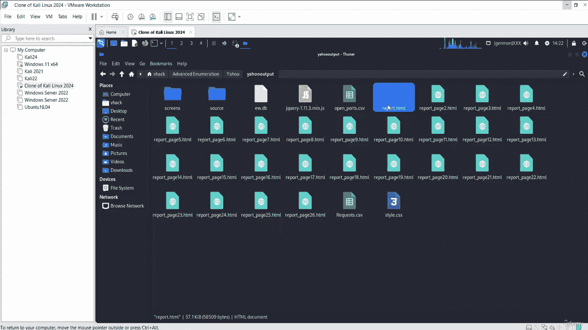

这里需要注意，截图工具会自动尝试访问每个域名，并把页面渲染结果保存为图片文件，生成的图片通常会按照域名命名，方便我们后续定位具体的服务。在运行过程中，你可能会看到类似 completed330 这样的进度数字，这意味着已经处理了几百个目标，剩下的就是等待任务结束，然后查看输出目录中的结果。


当截图任务完成之后，我们需要批量查看这些图片，寻找登录页面、管理后台或者其他敏感界面，以下是审查截图时的重点关注项：

- 登录页：通常是攻击入口，优先检查是否存在弱口令或万能密码。
- 管理后台：如 /admin、/console 等路径，往往权限较高，值得重点测试。
- 异常页面：返回错误页或空白页的域名，可能配置有误或服务已下线。
- 隐藏路径与漏洞编号：在页面中留意不常见的目录或标识，这些往往是深入测试的切入点。


在审查过程中，你可能会发现某些页面出现在多个子域名上，或者某些页面具有相同的界面样式，这说明它们可能使用了相同的中间件或模板，属于高危模式，我们可以将这些信息汇总，形成初步的资产画像。


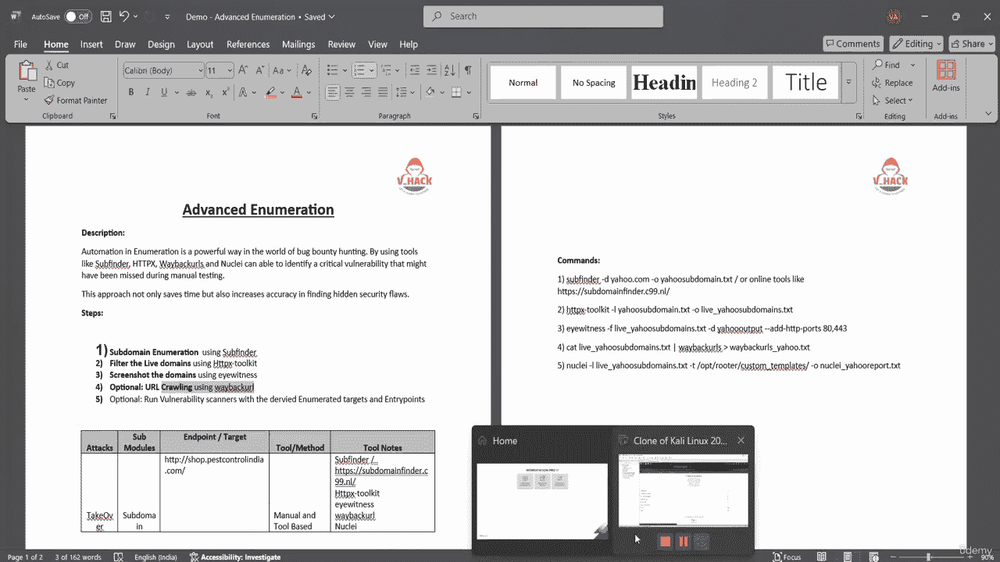

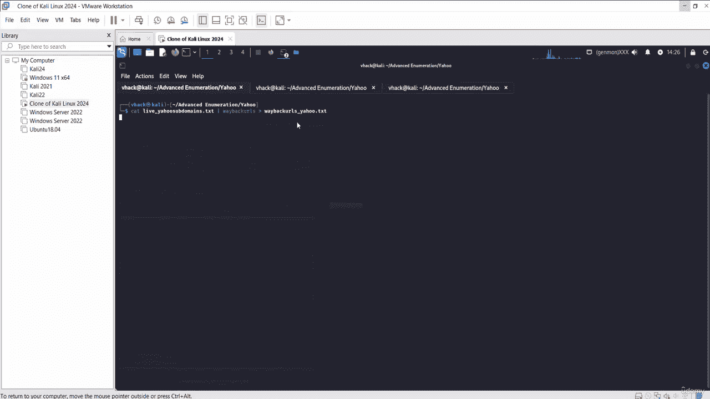

最后，不要忘记将所有发现整理成报告，报告中应包含存活子域名总数、截图文件路径、可疑页面清单以及建议的下一步检测方向，方便团队协作和后续跟进，也方便你向管理层说明当前的安全风险。


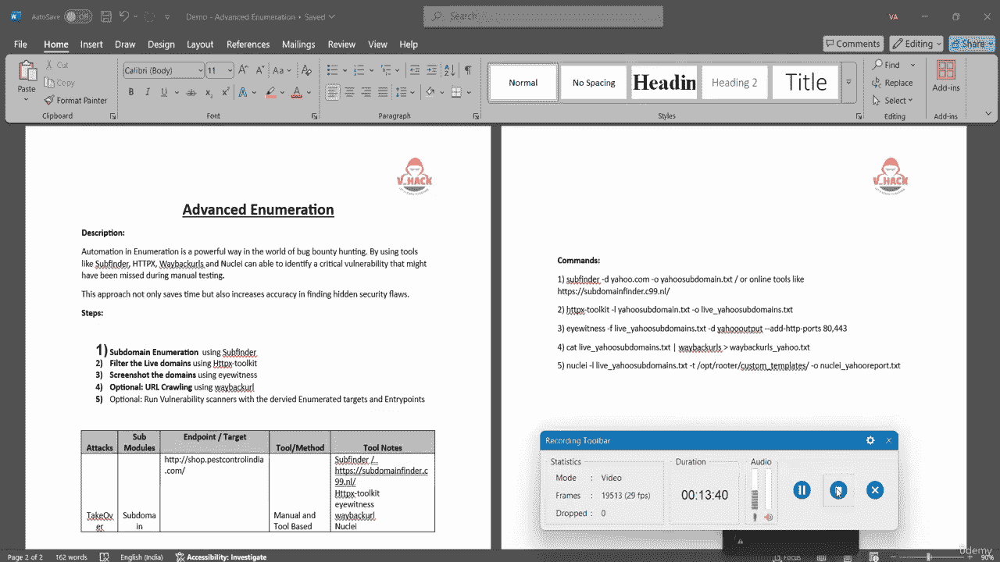

本节课中，我们一起学习了高级枚举的完整流程，包括如何使用工具收集子域名、如何筛选出存活主机、如何自动生成页面截图，以及如何从截图中发现潜在攻击面，希望这些内容能帮助你在实际渗透测试中更高效地定位目标。
