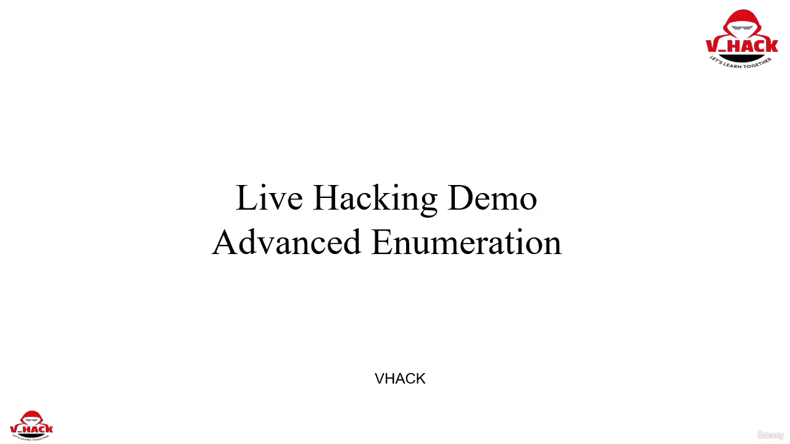
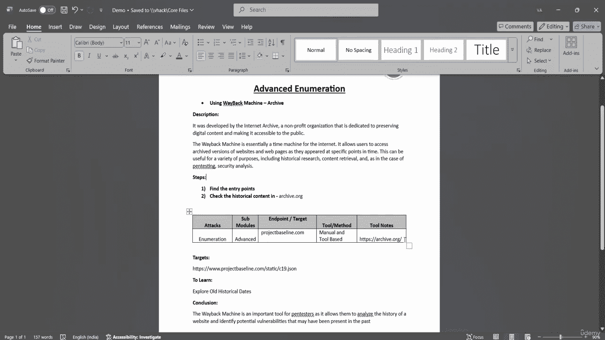
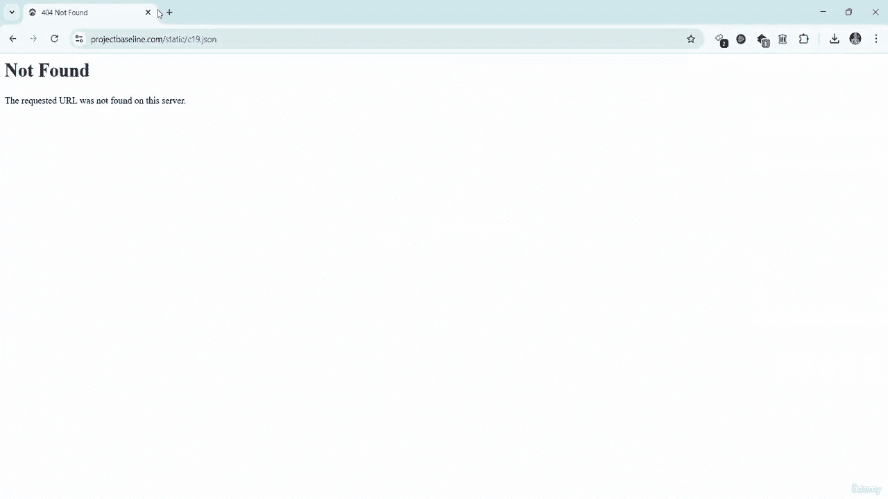
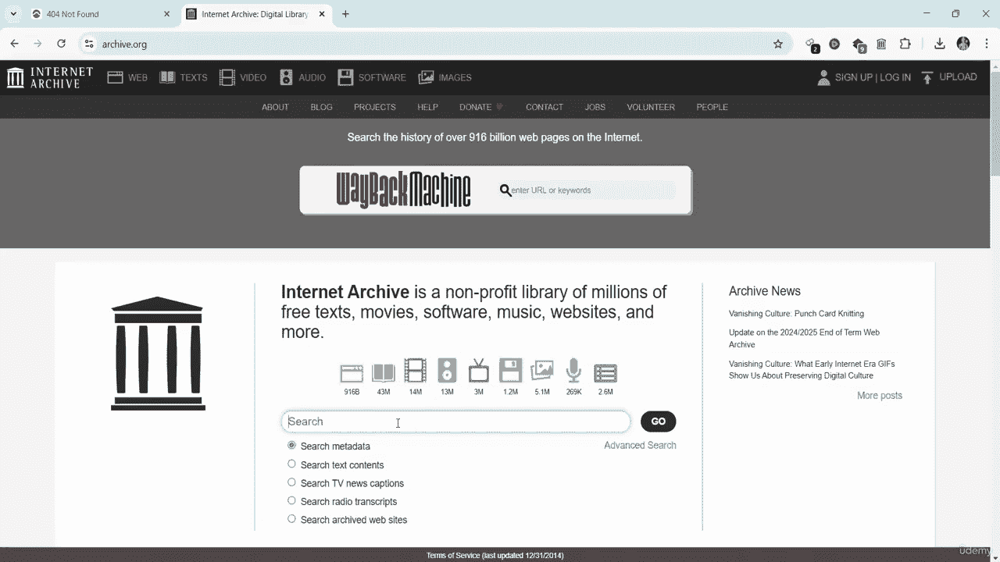
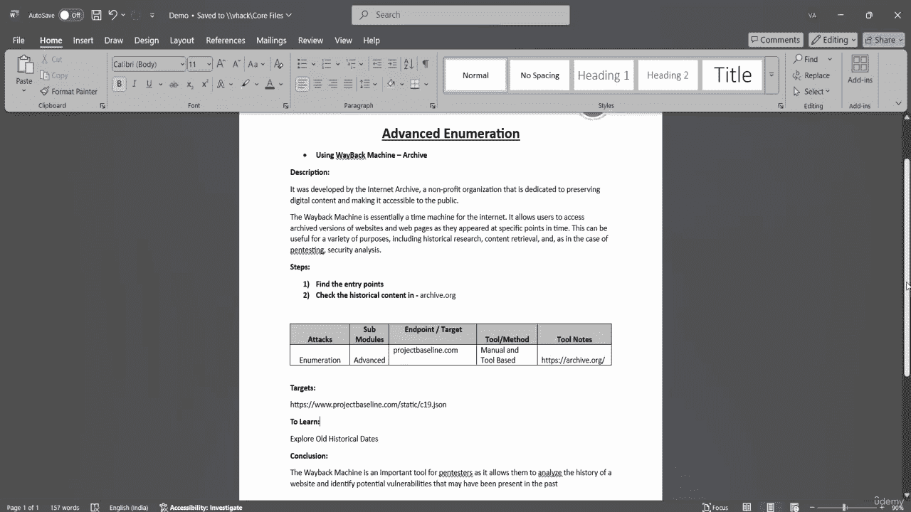
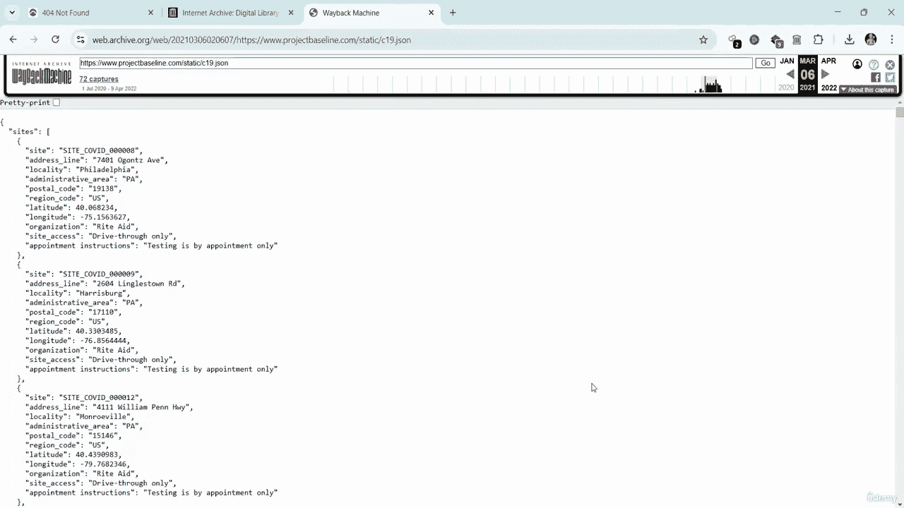
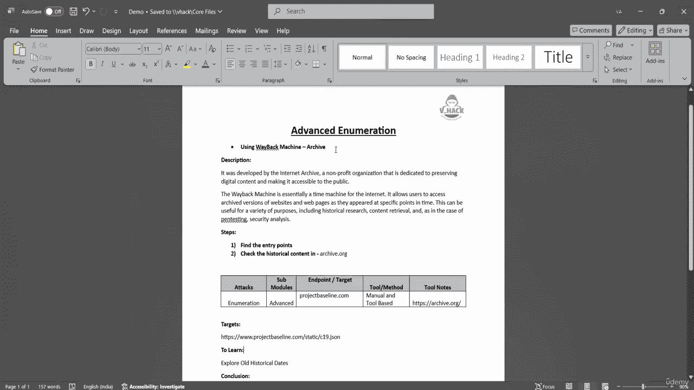

# 道德黑客：第27课：使用Wayback Machine进行高级枚举（实时目标）🕰️


欢迎来到利用环节。在本节课中，我们将学习如何利用互联网档案馆，也就是Wayback Machine，对实时目标进行高级枚举。简单来说，枚举就是从目标网站中挖掘有价值信息的过程，而Wayback Machine则像一台时间机器，可以让你查看网站过去的样子。通过这种方式，我们往往能发现那些已经从当前网站上删除，但依然留存在历史快照里的敏感文件、隐藏目录或者旧版本的页面。无论你是刚开始学习渗透测试的新手，还是想要提升信息收集能力的安全爱好者，这一节内容都会用大白话为你拆解清楚，让你明白如何合法合规地开展这类安全测试，历史快照可以作为参考，例如查看某个特定日期的页面入口。


上一节我们介绍了基本的信息收集方法，比如查看网站的标题、服务器类型和开放端口。本节中我们来看看如何通过历史数据进行更深层的枚举。枚举的核心思路非常直白，就是把目标系统当成一个信息宝库，把可能存在的每一个入口、每一个文件、每一个参数都找出来。在实际渗透测试中，很多看似干净的网站，其实在几个月甚至几年前，曾经暴露过配置文件、数据库备份或者管理后台地址。Wayback Machine正是帮我们找回这些“遗失”线索的最佳工具之一，你可以把它想象成网站的旧账本，虽然现在的页面已经整理干净，但旧快照里可能还记录着早些时候的内部信息。




```text
敏感信息发现 = 历史快照数量 × 目标URL深度 × 文件扩展名筛选
```


简单理解这个公式就是，你查看的历史快照越多，目标URL的层级越深，针对特定文件类型的筛选越精确，就越容易挖出有价值的敏感内容。这就像翻阅一家老店的旧账本，虽然现在的账本已经整理干净，但旧账本里可能还记录着早些时候的进货渠道、供应商电话或者内部价格表。URL和数组里的敏感文件，都是我们重点关注的对象，打开这些目录往往就能看到意想不到的信息。


了解了枚举的基本原理之后，我们需要明白Wayback Machine具体能帮你发现什么。它不是一个漏洞扫描器，也不会自动帮你攻击目标，它只是一个历史网页存档服务。通过它，你可以看到某个网站在过去某一天的具体长相，包括已经下线的页面、修改过的导航栏，甚至是曾经误放在公开目录里的文档。这些高级机构或者普通企业的网站，在早期建设阶段往往会留下很多痕迹，而Wayback Machine就能把这些痕迹重新呈现在你面前。




以下是Wayback Machine可以帮你发现的常见内容：



- 曾经存在但已被删除的登录页面和管理后台入口
- 包含数据库连接字符串的旧配置文件
- 测试环境或者开发环境留下的备份文件
- 隐藏的目录结构和文件上传路径
- 过去曾经公开过的敏感文档，比如员工名单或内部报告


这些信息本身可能没有直接的漏洞，但它们为后续的安全评估提供了重要线索。比如，如果你发现一个旧的登录页面，就可以重点测试这个页面是否存在弱口令或者SQL注入问题；如果你发现一个备份文件，就可以检查里面是否包含源代码或者敏感数据。无论是对方是一家大型机构还是小型网站，历史数据都可能成为攻击者的切入点。


知道了能找到什么之后，接下来我们进入实际操作环节。使用Wayback Machine进行枚举并不复杂，不需要安装任何专门的软件，只需要一台能上网的电脑和一个浏览器就可以完成。整个过程可以分为几个简单的步骤，初学者完全可以跟着做，即便之前没有接触过这类工具也没关系。




以下是使用Wayback Machine进行高级枚举的基本步骤：



第一步，打开浏览器，访问web.archive.org，这是互联网档案馆的官方网站。

第二步，在搜索框中输入你想要测试的目标网站完整URL，记得带上http或者https前缀。

第三步，网站会显示一个时间轴和日历视图，你可以选择某个具体的日期，查看那天该网站的历史快照。

第四步，点击某个快照，浏览器会加载该网站在过去的样子，这时候你可以像正常浏览网页一样，点击链接、查看页面源代码、寻找隐藏的目录。

第五步，重点检查那些看起来不寻常的路径，比如包含admin、config、backup、test、old等关键词的URL，这些地方最有可能藏着敏感信息。

第六步，将发现的敏感路径记录下来，作为后续渗透测试的参考，千万不要随意尝试未经授权的操作。


在这个过程中，你可能会遇到某些快照加载缓慢，或者页面显示不完整的情况，这很正常，因为旧的网页资源可能已经丢失。耐心地翻看多个时间点，往往会有意外的收获，访问这些历史目录时要保持谨慎，不要随意修改任何内容。


在实际操作中，有几点需要特别留意，以免走入误区或者触碰法律红线。安全测试的前提是获得授权，未经许可对他人网站进行扫描和枚举可能违反当地法律法规，即使你只是出于好奇，也不要随意访问他人的敏感目录。




以下是使用Wayback Machine时需要注意的事项：

- 只在获得书面授权的目标系统上进行测试，切勿随意扫描陌生网站。
- 不要对发现的敏感文件进行下载、修改或删除，仅做记录和分析。
- 遵守目标网站的robots.txt规则和服务条款，保持低调和专业。
- 将所有发现的敏感路径和时间点整理成报告，提交给系统所有者进行修复。
- 保护好自己的隐私，使用虚拟机或浏览器隐私模式进行操作，避免暴露真实IP。




合法合规是安全人员最基本的职业素养，只有在授权范围内开展工作，才能真正发挥安全测试的价值，切勿滥用这些技术去侵害他人隐私或系统安全。


希望你享受本次会议。


本节课中我们一起学习了使用Wayback Machine进行高级枚举的方法，了解了如何通过历史快照发现敏感信息，掌握了从访问档案馆到分析敏感路径的完整步骤，并明确了在实际操作中需要注意的法律与道德边界。希望这些内容能帮助你在后续的安全学习中更好地开展信息收集工作。

