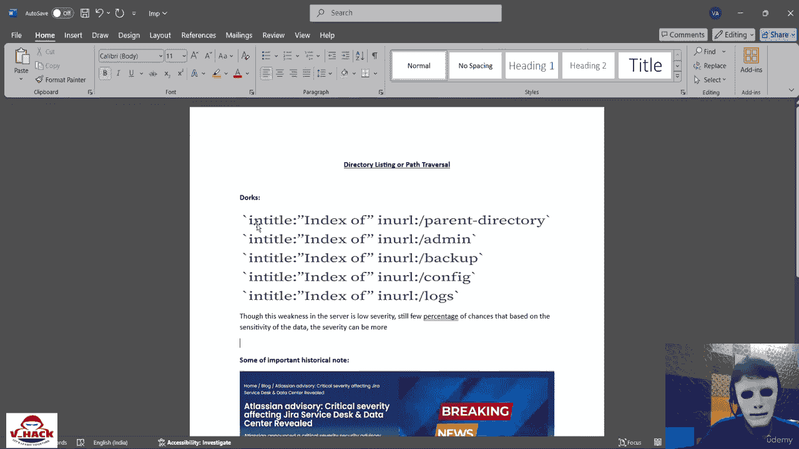
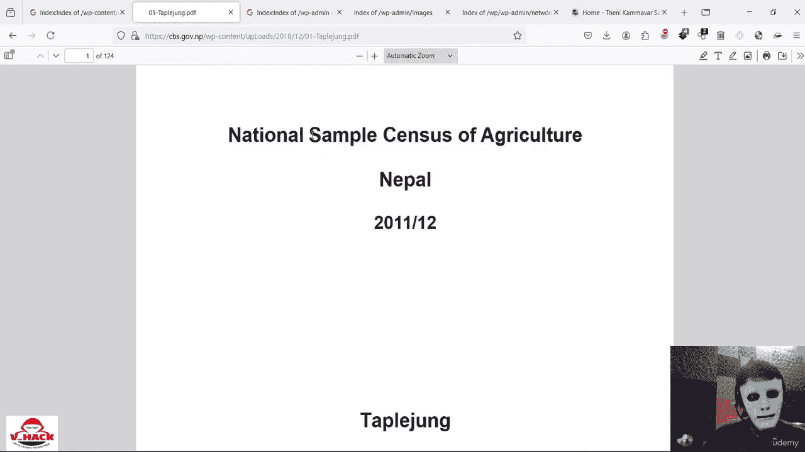
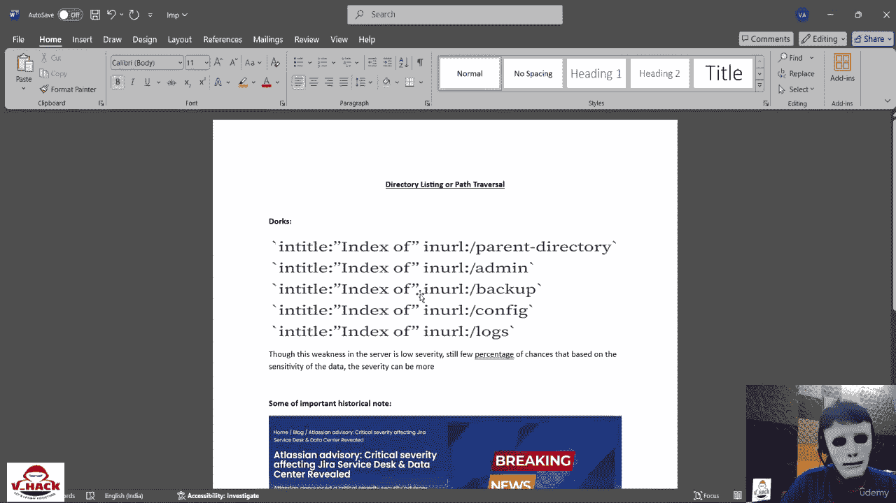
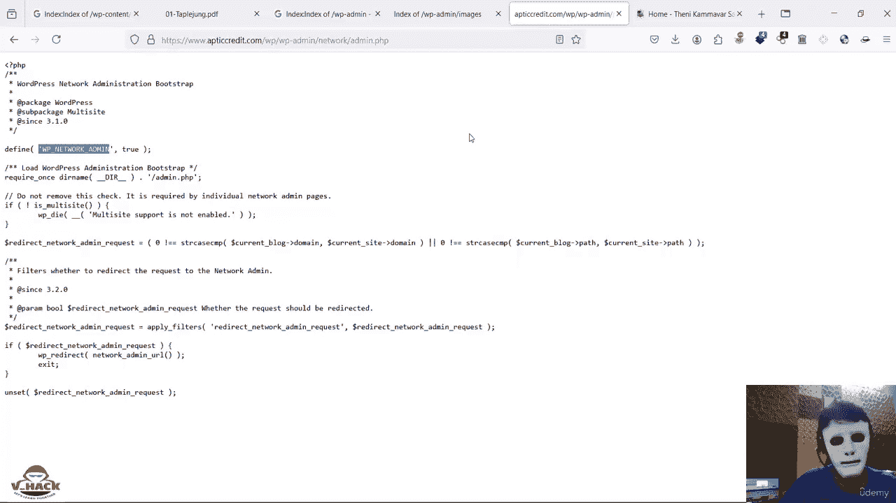
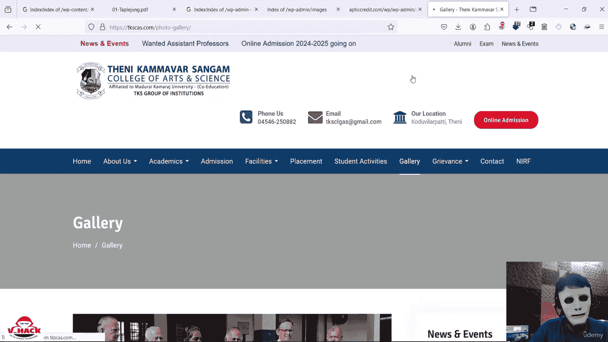
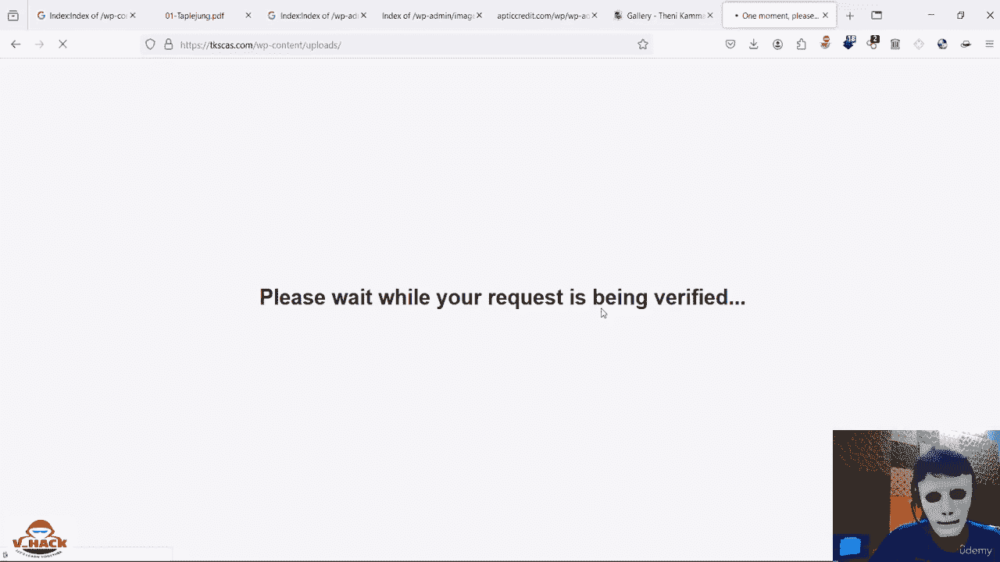
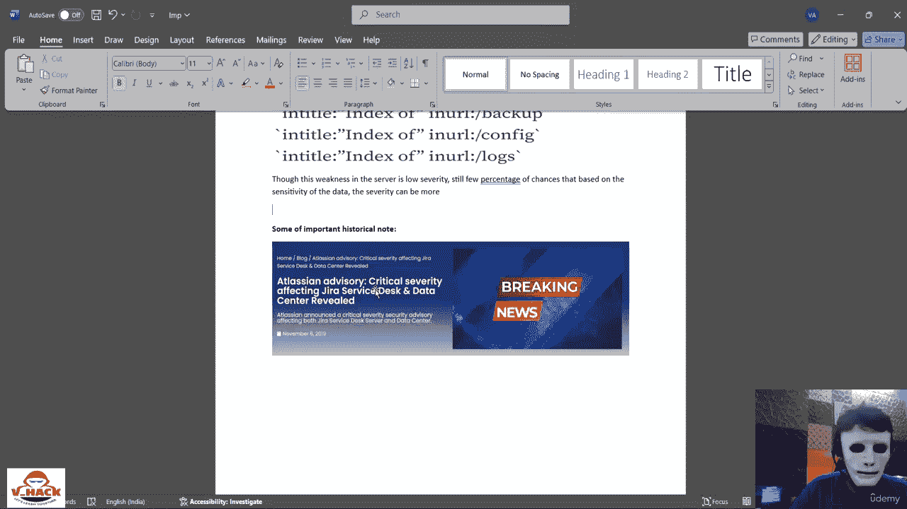
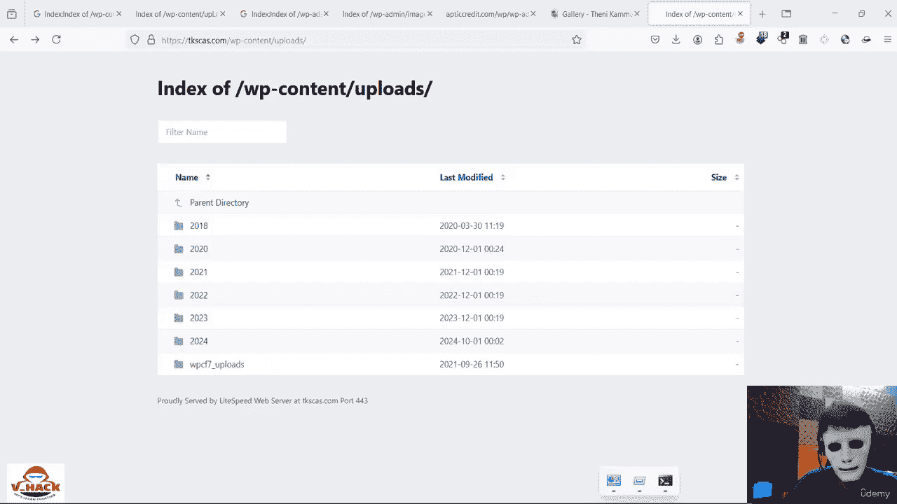

# 🛡️ Ethical Hacking：第 3 节：目录列表（Directory Listing）[实战目标]


在本节课中，我们将一起学习目录列表这个知识点。目录列表是一种非常常见的网站配置问题，简单来说，就是当你访问一个网站文件夹，而这个文件夹里没有 index.html 或 index.php 这样的默认首页文件时，服务器可能会直接把文件夹里的所有文件和子文件夹列在网页上，供任何人浏览。这对网络安全初学者来说是一个非常直观的切入点，因为你不需要复杂的工具，只需用浏览器就能看到服务器里藏着什么。我们会从最基础的定义开始，然后逐步看看怎么用搜索引擎寻找这些目录，重点检查 WordPress 网站中的常见路径，讨论目录列表会带来哪些安全影响，最后还会聊聊如何在渗透测试报告里把发现记录清楚。我们正式开始。


## 一、什么是目录列表


在进入实操之前，我们先搞清楚目录列表到底是什么，以及它是怎么产生的。正常情况下，网站服务器会在网站根目录或者某个子文件夹里放一个默认首页文件，比如 index.html、index.php 或 default.aspx。当用户访问该文件夹时，服务器会自动加载这个首页文件，而不是把文件夹里的所有文件列出来。但如果服务器开启了自动索引功能，而文件夹里又恰好没有默认首页文件，服务器就会退而求其次，直接把当前目录下的文件列表以网页形式展示出来。这就是目录列表漏洞的形成原因。

我们可以用下面这个简单的公式来描述这个过程：

目录列表 = 服务器开启自动索引 + 缺少默认首页文件 → 网页显示文件夹完整内容

当这个条件成立时，攻击者只需在浏览器地址栏输入类似下面的路径，就有可能看到敏感文件：

```
http://目标网站/uploads/
http://目标网站/wp-content/uploads/2024/01/
```



页面打开后，你会看到一个类似文件管理器的界面，里面列出图片、PDF、压缩包甚至备份文件，这就是典型的目录列表现象。


## 二、如何用搜索引擎查找目录列表


了解了目录列表的基本概念之后，接下来我们看看怎么在真实的目标网站中发现它。渗透测试中，直接一个一个文件夹去猜效率很低，这时候搜索引擎就是非常好的助手。通过特定的搜索语法，我们可以快速定位那些错误开启了目录列表功能的网站，而不需要逐个尝试路径。

以下是查找目录列表时常用的搜索思路：



- 使用 site: 语法限定目标域名，只在该网站范围内搜索
- 使用 intitle: "Index of" 查找标题包含“索引”的目录页面，这是很多服务器默认目录列表页面的标题特征
- 结合 inurl: uploads 或 inurl: wp-content 等常见上传路径，缩小搜索范围
- 观察搜索结果预览中是否出现文件图标、文件大小、修改日期等目录列表特有元素



这些技巧组合使用后，通常能在短时间内找到多个存在目录列表的目标路径，为后续的漏洞验证节省大量时间。




## 三、WordPress 中常见的容易出现目录列表的路径




在实际渗透测试中，WordPress 是全球使用最广泛的内容管理系统之一，因此它的目录结构也是我们重点检查的对象。很多 WordPress 网站的管理员可能没关闭服务器的目录列表功能，导致上传目录、插件目录或主题目录直接暴露在互联网上。了解这些常见路径，可以帮助你更快地定位潜在的信息泄露点。

以下是 WordPress 环境下几个比较容易出现目录列表的常见路径：

```
/wp-admin/
/wp-content/
/wp-content/uploads/
/wp-content/uploads/2024/
/wp-includes/
/index.php
```

当你访问这些路径时，如果页面直接显示了文件列表而不是正常的 WordPress 后台登录界面或空白页面，那么就说明该目录开启了目录列表。特别是 /wp-content/uploads/ 这个路径，里面通常存储着网站上传的图片、附件和媒体文件，一旦泄露，可能会让攻击者找到本不应该被公开的备份文件或配置文件。


## 四、目录列表带来的安全影响


找到目录列表之后，我们需要判断这个问题到底严不严重，对渗透测试项目是否有实际价值。目录列表本身不一定直接导致服务器被入侵，但它属于一种信息泄露，可能为攻击者提供有价值的情报。在渗透测试中，信息收集往往是整个攻击链条的第一步，而目录列表正好可以帮助攻击者快速掌握目标的文件结构。



目录列表可能导致以下几种安全影响：

- 泄露网站文件结构，帮助攻击者了解后端架构和文件命名规律
- 暴露备份文件、配置文件、日志文件或源代码片段
- 直接下载敏感文档，例如数据库备份、配置文件或内部测试文件
- 为后续攻击提供路径参考，比如配合文件上传漏洞或包含漏洞进行利用



即使目录里没有明显的高危文件，只要能让攻击者清楚地知道服务器上有哪些文件，就已经增加了被进一步攻击的风险。因此在渗透测试报告中，目录列表通常会被列为低危或中危问题，具体等级取决于泄露内容的敏感程度。


## 五、如何在渗透测试报告中记录目录列表


最后一部分，我们来聊聊如何把发现记录下来，写进专业的渗透测试报告里。渗透测试不仅仅是找到漏洞，还需要让客户或老板理解这个问题的严重性，并知道怎么修复。对于目录列表这种比较简单的信息泄露问题，报告需要包含足够的证据和明确的修复建议。

在报告中，建议包含以下内容：

- 存在目录列表的完整 URL 地址
- 截图或页面源代码截取，作为发现的证据
- 风险等级评定，通常根据泄露内容判定为低危或中危
- 修复建议：关闭 Web 服务器的自动索引功能，或者在每个文件夹中放置 index.html 或 index.php 默认首页文件

把这些要素写清楚之后，报告的可操作性就会大大提高，客户也能更快地完成整改。


## 总结




本节课中，我们一起学习了目录列表的定义、形成原因、搜索引擎查找方法、WordPress 常见路径、安全影响以及报告编写方法。目录列表虽然是一个基础漏洞，但它是渗透测试中信息收集阶段非常实用的切入点。希望通过本节的内容，你能够理解什么是目录列表，知道怎么去查找它，并能在实际测试中把发现写进报告里。下节课我们将继续学习新的主题，再见。
