# 🛡️ 伦理黑客挑战：第29节：HTML 注入、iframe 注入与重定向实战

## 课程概述

在本节课中，我们将一起学习 HTML 注入、iframe 注入以及页面重定向这三种常见的 Web 安全漏洞。这些漏洞通常出现在网站没有正确处理用户输入的地方，攻击者可以通过注入恶意代码来窃取信息、欺骗用户或强制页面跳转。我们将用大白话解释每个概念，并配合简单的代码示例，让初学者也能看懂。无论你是刚开始接触渗透测试，还是想复习基础知识，这节课都适合你。


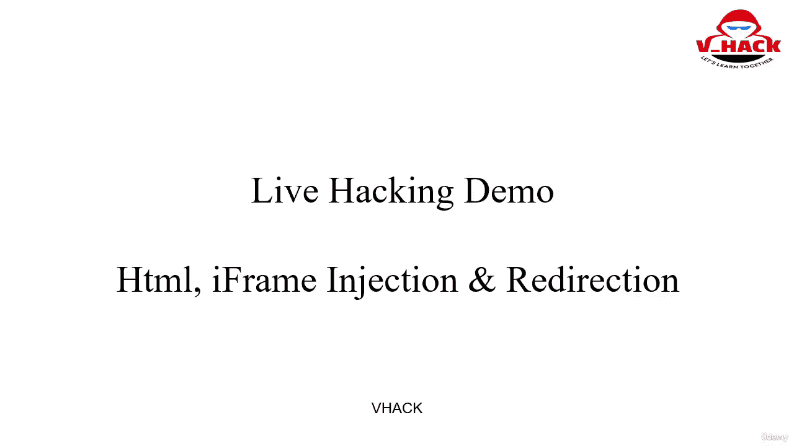

## 一、什么是 HTML 注入

上一节我们介绍了注入攻击的基本思路，本节中我们来看看最常见的 HTML 注入。

HTML 注入是指攻击者在网页的输入框、搜索框或网址参数中提交包含 HTML 标签的内容，而网站又没有对这些内容进行过滤，导致恶意 HTML 代码被直接渲染在页面上。简单来说，就是网站把用户输入当成了网页的一部分来显示，而没有检查里面是否夹带了危险的标签。

以下是 HTML 注入的基本原理：

- 用户在输入框中提交带有 `<script>`、`` 或 `<a>` 等标签的内容。
- 服务器将这些内容原样存储或反射回页面。
- 浏览器将接收到的 HTML 代码解析并执行，从而产生注入效果。

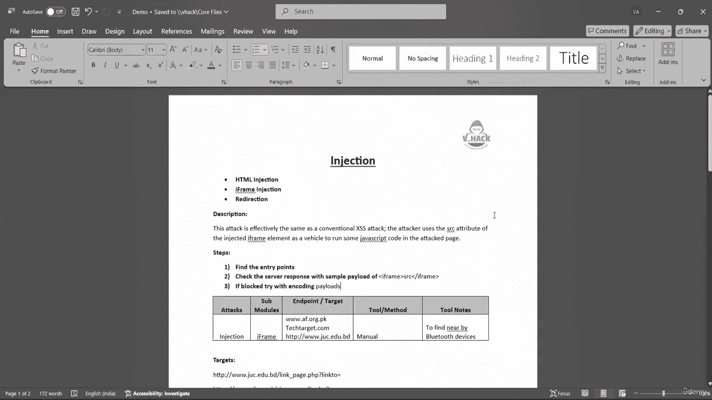

下面是一个简单的注入示例代码：

```html
<input value="<h1 style='color:red'>被注入的标题</h1>">
```

当浏览器渲染这段代码时，页面上会显示红色的标题，这说明攻击者已经成功插入了自定义 HTML。如果输入框里放入的是 `<iframe src="http://攻击者网站"></iframe>`，那么攻击者还可以在受害者页面中嵌入外部页面。


## 二、iframe 注入与页面重定向

在了解了 HTML 注入之后，本节中我们继续学习 iframe 注入和页面重定向。

iframe 注入是 HTML 注入的一种特殊形式，攻击者通过注入 `<iframe>` 标签，将恶意网站嵌入到受害者正在浏览的页面中。页面重定向则是指诱导浏览器自动跳转到另一个网址，通常用于钓鱼或流量劫持，让受害者在不知情的情况下访问攻击者控制的站点。

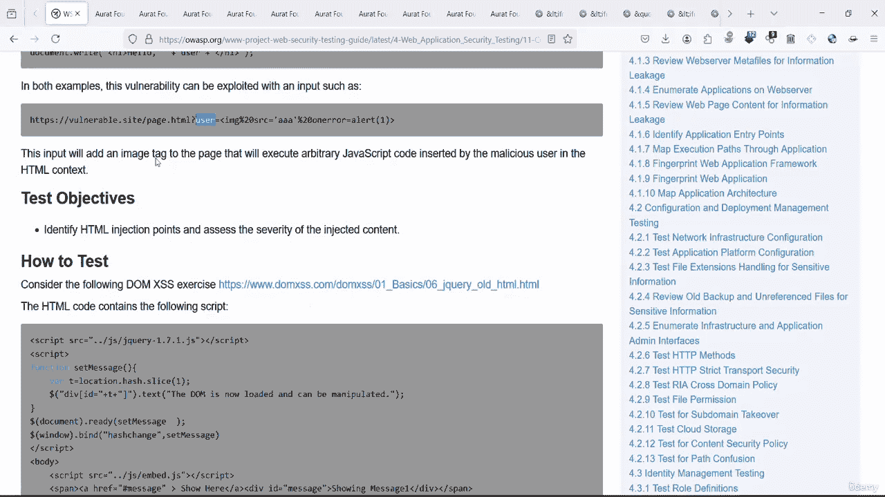

以下是 iframe 注入和重定向的常见形式：

- `<iframe src="javascript:alert('被攻击')"></iframe>`：在页面中嵌入可执行脚本的框架。
- `<meta http-equiv="refresh" content="0;url=http://恶意网站">`：页面加载后立即重定向。
- `<a href="http://恶意网站">点击这里领取奖励</a>`：通过伪装链接诱导用户跳转。

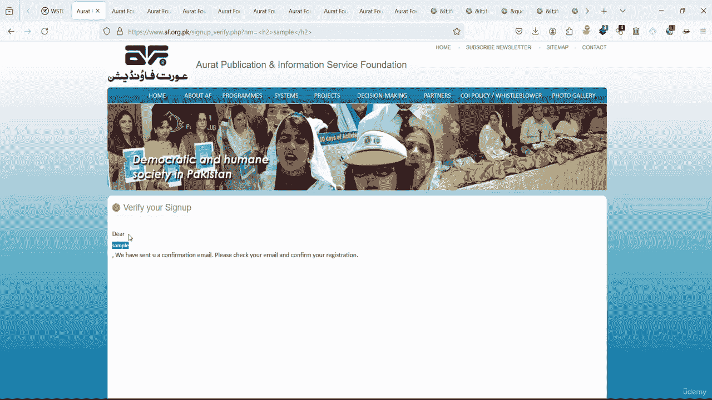

核心概念可以用下面的伪代码来描述：

```
如果 用户输入未经转义直接插入页面：
    浏览器执行 <iframe> 或 <meta 重定向>
    则 攻击成功
```

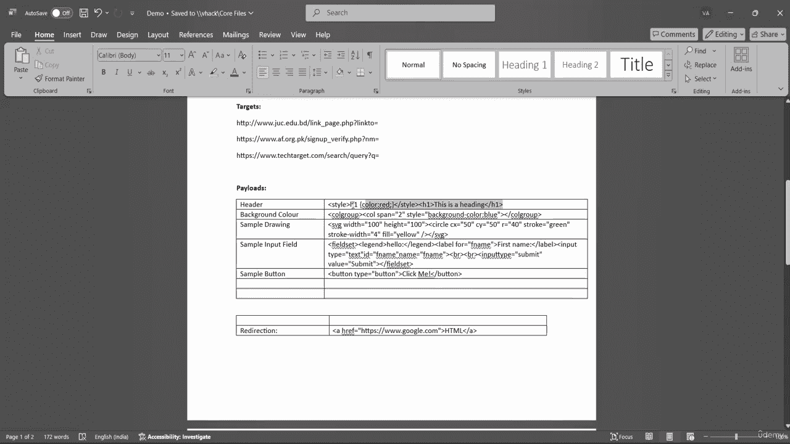

重定向的攻击流程大致如下：

1. 攻击者构造包含重定向代码的链接。
2. 受害者点击链接或访问包含注入代码的页面。
3. 浏览器自动跳转到攻击者控制的网站。
4. 攻击者窃取受害者的会话信息或诱导其输入敏感数据。


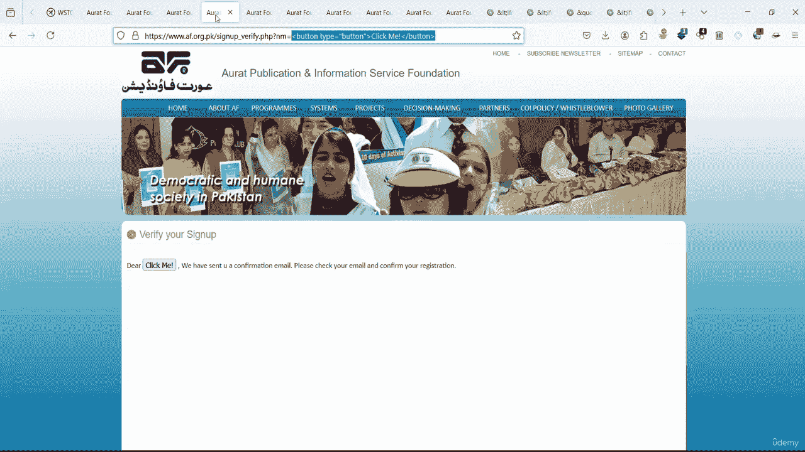

## 三、如何发现注入入口

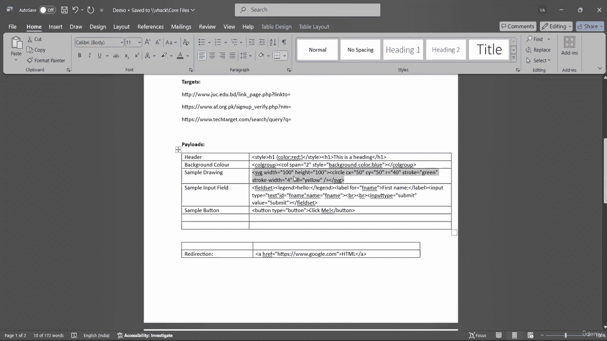

前面我们讲解了注入的原理，本节中我们来看看如何在实际网站中发现这些注入点。

寻找 HTML 注入入口，本质上就是寻找网站中允许用户提交内容并原样显示的地方。常见的入口包括搜索框、评论区、个人简介、用户名显示处以及 URL 参数。

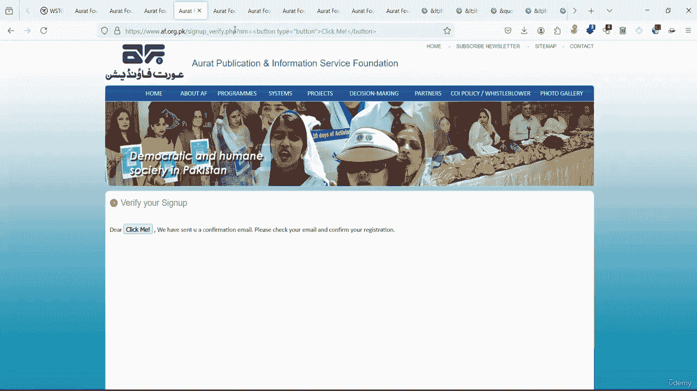

以下是检测注入点的步骤：

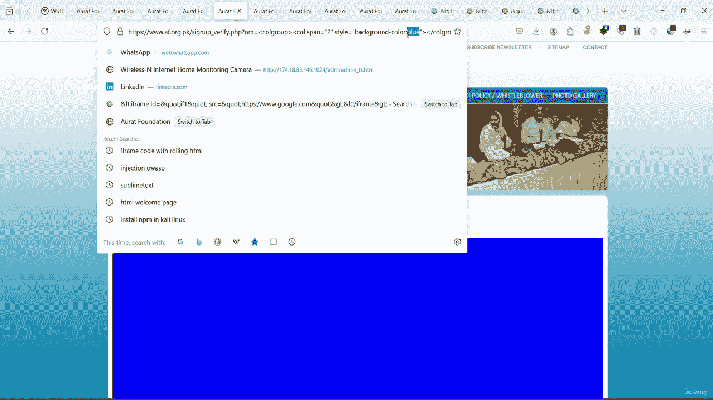

1. 浏览网站，找出所有可以输入文本的地方。
2. 尝试提交简单的测试代码，例如 `<h1>测试</h1>`。
3. 观察页面是否渲染了标题样式，如果标题变大或变色，说明存在 HTML 注入。
4. 进一步尝试提交 `<iframe>` 或重定向代码，确认是否可以嵌入外部页面或跳转。

在参数检测时，攻击者通常会关注 URL 中的参数，例如：

```
http://目标网站/页面?name=用户输入
```

如果把 `name` 参数的值改成 HTML 代码，页面发生了异常显示，那么这个参数就是一个潜在的注入入口。


## 四、防御与安全建议

学习完攻击方法之后，本节中我们来看看如何防止 HTML 注入、iframe 注入和重定向漏洞。

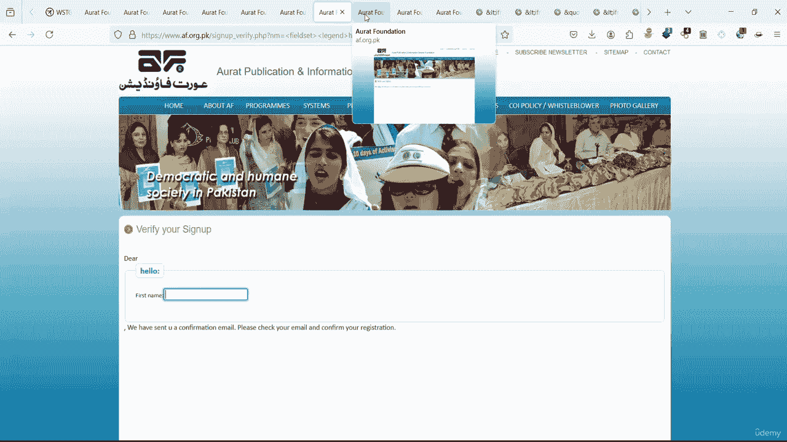

防御注入攻击的核心原则是：永远不要信任用户输入，所有显示在页面上的内容都必须经过处理，不能直接交给浏览器渲染。

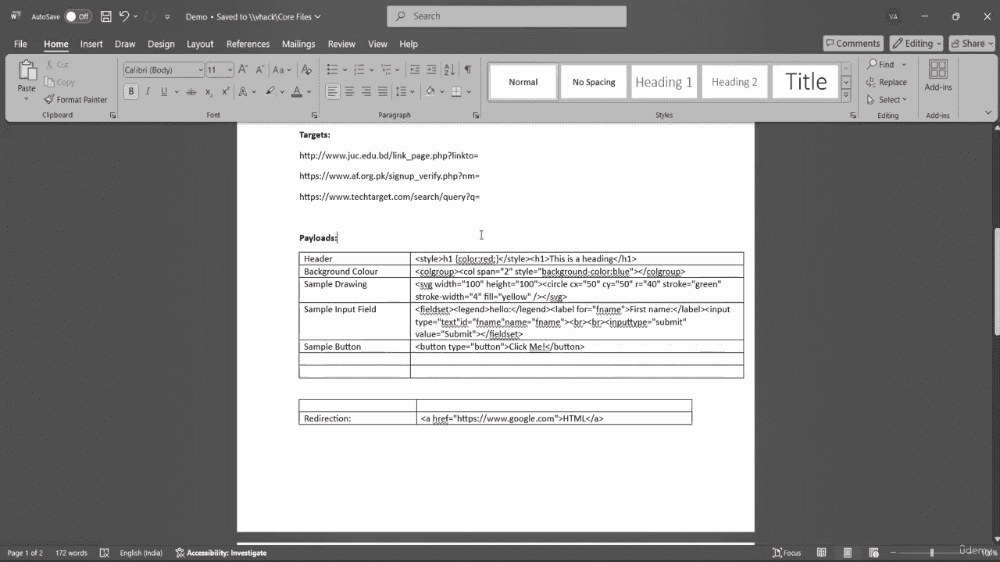

以下是常见的防御措施：

- 对用户输入进行 HTML 实体编码，将 `<` 转换为 `&lt;`，将 `>` 转换为 `&gt;`。
- 使用内容安全策略（Content Security Policy, CSP），限制页面可以加载的资源来源。
- 对重定向链接进行白名单校验，只允许跳转到受信任的域名。
- 在服务器端验证所有参数，不要直接拼接用户输入到 HTML 中。

下面是一个简单的防御代码示例：

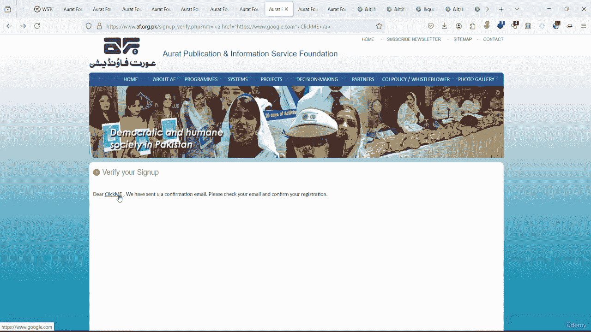

```python
# 错误做法：直接拼接
html = "<div>" + 用户输入 + "</div>"

# 正确做法：转义后输出
html = "<div>" + 转义(用户输入) + "</div>"
```

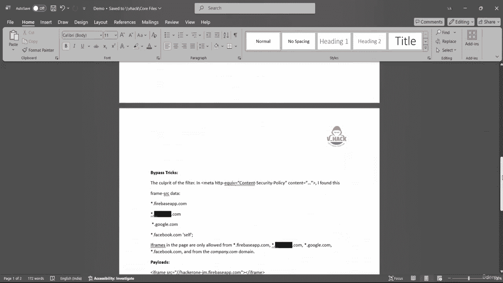

启用 CSP 可以通过 HTTP 响应头来配置，例如：

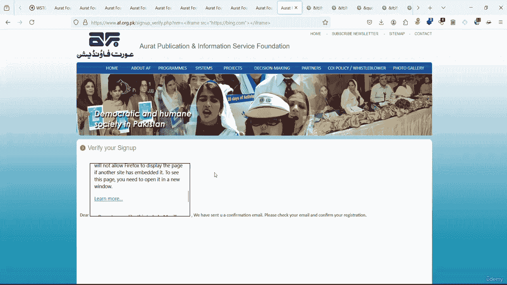

```
Content-Security-Policy: default-src 'self'; frame-ancestors 'none';
```

这段策略表示禁止页面嵌入任何外部 iframe，从而在一定程度上阻止 iframe 注入攻击。


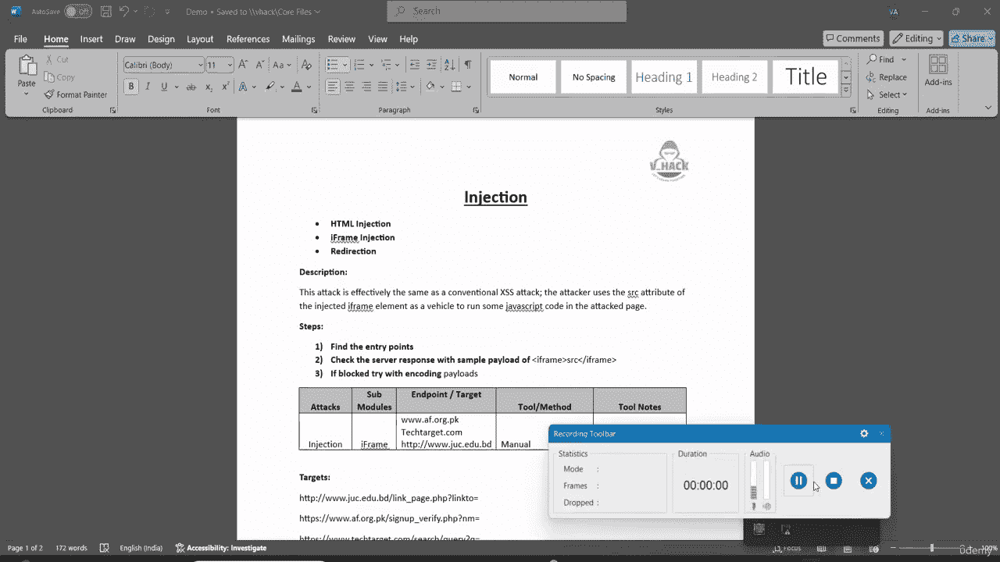

## 课程总结

本节课中我们一起学习了 HTML 注入、iframe 注入和页面重定向这三种攻击方式。我们了解了它们的基本原理、常见注入入口以及如何用代码表示攻击逻辑，同时也学习了输入过滤、HTML 编码和内容安全策略等防御手段。希望这节课能帮助你建立起对 Web 注入漏洞的直观认识，在后续的实战练习中，记得始终在授权范围内进行测试，合法合规地开展安全研究。
