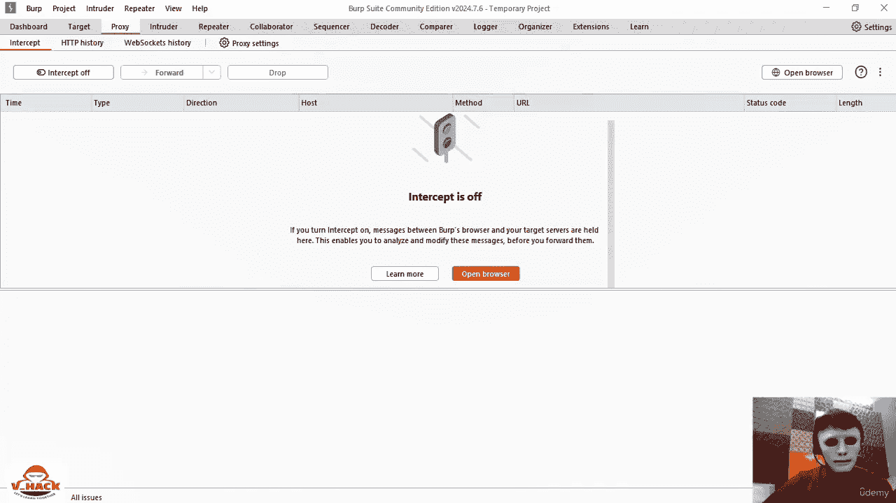
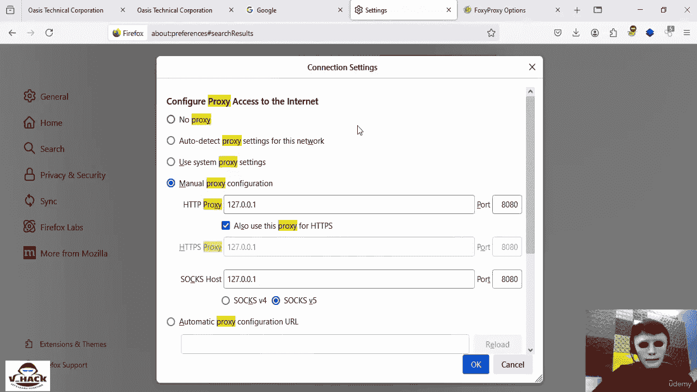
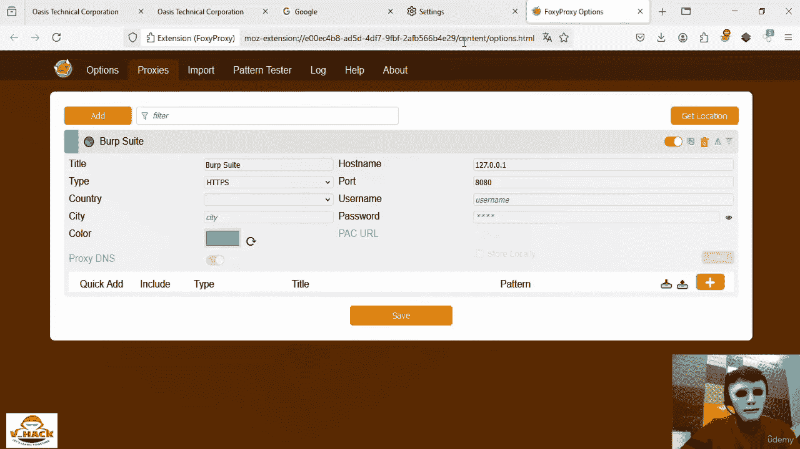
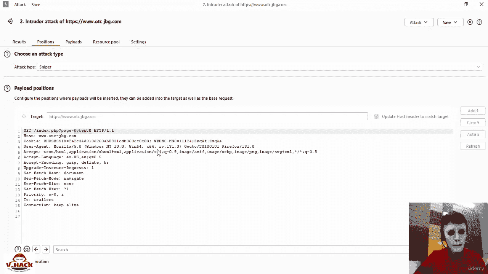

# 🛡️ Udemy 道德黑客：30：LFI 本地文件包含实战

在本节课中，我们将要学习 LFI（本地文件包含）漏洞的实际利用方法。我们会通过一个真实目标演示，从发现注入点开始，一直到读取服务器上的敏感文件。本节课适合初学者，会用大白话把每一个技术细节拆解开来，让你理解攻击者是如何一步步完成渗透测试的。在这里我们先不急着下结论，重点是理解整个过程背后的逻辑。

## 一、LFI 核心概念

LFI 的中文全称是本地文件包含。简单来说，就是 Web 应用程序把用户提供的输入直接拼接到本地文件路径中，然后由服务器读取并返回文件内容。如果开发者没有对输入做严格过滤，攻击者就可以构造特殊路径，读取服务器上不应该被外界看到的文件。

以下是 LFI 的基本原理描述：

```text
用户输入 → 服务端接收 → 拼接成本地路径 → 文件被包含并返回 → 敏感信息泄露
```



常见的易受攻击参数包括 page、file、path、template 等。初学者可能会觉得这里有点绕，但只要记住一点：只要程序会根据用户输入去读取本地文件，就存在潜在风险。

## 二、环境准备与工具设置



上一节我们介绍了 LFI 的核心原理，本节中我们来看看实际演示中需要用到的工具和环境配置。目标服务器通常运行在特定端口上，本示例使用的是 8080 端口。我们需要配置代理工具来拦截和修改浏览器发出的请求。



以下是环境准备的关键步骤：

- 在浏览器中安装代理插件，并将代理端口设置为 8080。
- 启动 Burp Suite，开启拦截功能，确保所有请求都经过代理。
- 在代理设置中手动指定目标 IP 地址，避免流量走错路径。
- 确认单次会话设置已生效，这样每个请求都能被正确捕获。

配置完成后，我们就可以开始观察目标应用程序的请求结构了。

## 三、寻找注入入口点

有了代理环境之后，下一步就是找到注入点。注入点就是应用程序接受用户输入并将其用于文件路径的地方。在这次演示中，我们需要仔细检查每一个请求参数，找出可以控制文件访问的位置。

以下是常见的入口点检查项：

- URL 查询参数中的 file 参数。
- 页面访问时的访问参数。
- 表单提交中的字段值。
- HTTP 请求头中的路径相关字段。

一旦确定了入口点，就可以在参数值中插入测试载荷，观察服务器返回的响应内容是否发生变化。

## 四、构造攻击载荷

上一节我们介绍了如何寻找注入点，本节中我们来看看如何构造具体的攻击载荷。载荷就是我们发送给服务器的特殊字符串，目的是让程序读取我们指定的本地文件。

以下是常用的 LFI 载荷示例：

```text
/etc/passwd
../../etc/passwd
..\\..\\..\\etc\\passwd
```

在参数中替换原始值后，发送请求。如果服务器返回了类似 Linux 密码文件的内容，说明漏洞利用成功。这里的 `/etc/passwd` 文件通常包含系统用户信息，是渗透测试中的经典目标。

## 五、自动化扫描与筛选

手工测试每个参数效率较低，因此我们可以使用自动化工具来加速这个过程。上一节我们介绍了构造载荷的方法，本节中我们来看看如何利用 Burp Suite 的 Intruder 模块进行批量测试。

以下是自动化扫描的操作流程：

1. 将目标请求发送到 Intruder 模块。
2. 选中需要替换的参数位置，设置为 payload 位置。
3. 加载常见的本地文件路径列表作为字典。
4. 启动攻击，观察每个请求的状态码和响应长度。
5. 筛选返回状态码为 200 的请求，重点查看响应内容长度异常的条目。

状态码 200 表示服务器成功处理了请求，如果响应长度与正常页面有显著差异，很可能读取到了敏感文件。

## 六、提取敏感信息

通过自动化扫描，我们通常能定位到几个可疑的响应。上一节我们介绍了如何筛选有效响应，本节中我们来看看如何从中提取有价值的信息。

以下是常见的敏感信息来源：

- `/etc/passwd`：查看系统用户列表，包括管理员账户。
- `/etc/hosts`：查看本地主机名解析记录，发现内部服务地址。
- CPU 信息文件：查看处理器型号，例如 Intel E5-2670。
- 应用程序配置文件：可能包含数据库连接字符串或密钥。

在演示中，攻击者成功读取了 `/etc/passwd`，发现其中包含 admin 用户及其他系统账户信息。同时也读取了 `/etc/hosts`，发现了指向本地 FTP 服务器的 IP 地址，进一步扩大了攻击面。

## 七、容器与路径遍历

有时候目标运行在容器环境中，这会影响文件的实际路径。上一节我们介绍了敏感信息提取，本节中我们来看看容器环境下的特殊情况。

以下是容器环境需要注意的点：

- 容器内部的文件系统与宿主机隔离，但 LFI 仍可读取容器内的文件。
- 路径遍历符号 `../` 可以用于跳出当前目录，访问上层路径。
- 文件访问参数如果未做过滤，攻击者可以拼接多层 `../` 来定位任意文件。

在本次演示中，容器类应用程序的文件访问参数允许路径遍历，攻击者借此成功读取了位于容器内部的敏感配置文件。

## 八、课程总结



本节课中，我们一起学习了 LFI 本地文件包含漏洞的完整利用流程。我们了解了什么是 LFI，如何配置代理工具，如何寻找注入入口点，如何构造 `/etc/passwd` 等经典载荷，如何使用 Intruder 自动化扫描并筛选状态码 200 的响应，最后如何从响应中提取用户信息、主机记录和 CPU 信息。希望通过本节课的讲解，你能够掌握 LFI 漏洞的基本原理与实战技巧，并在未来的渗透测试中灵活运用。

