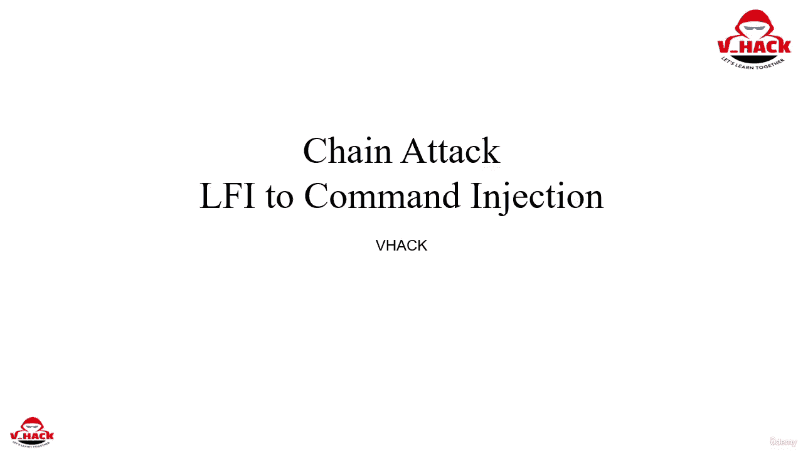
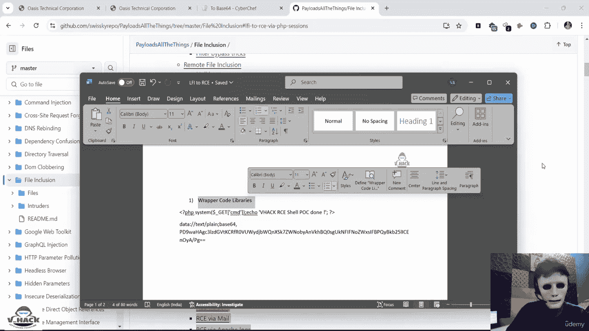
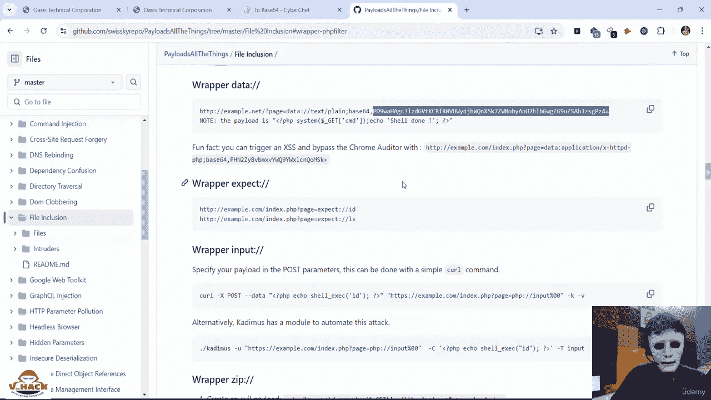
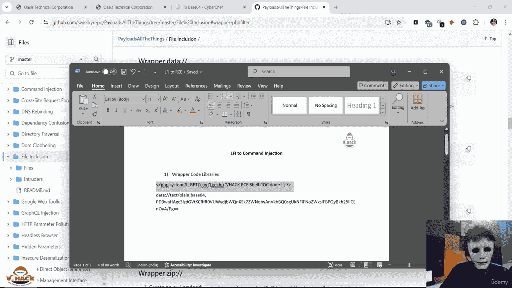
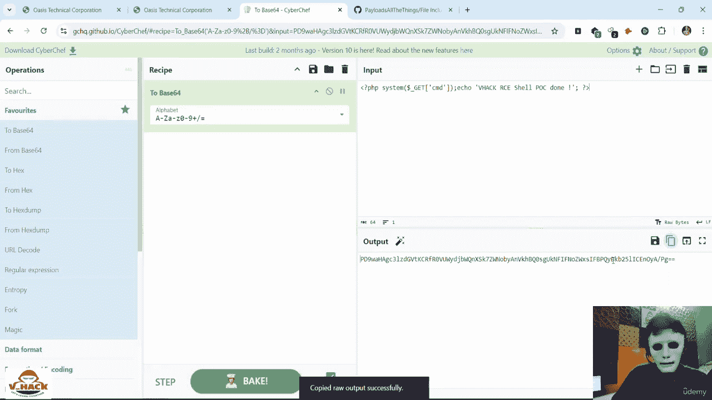
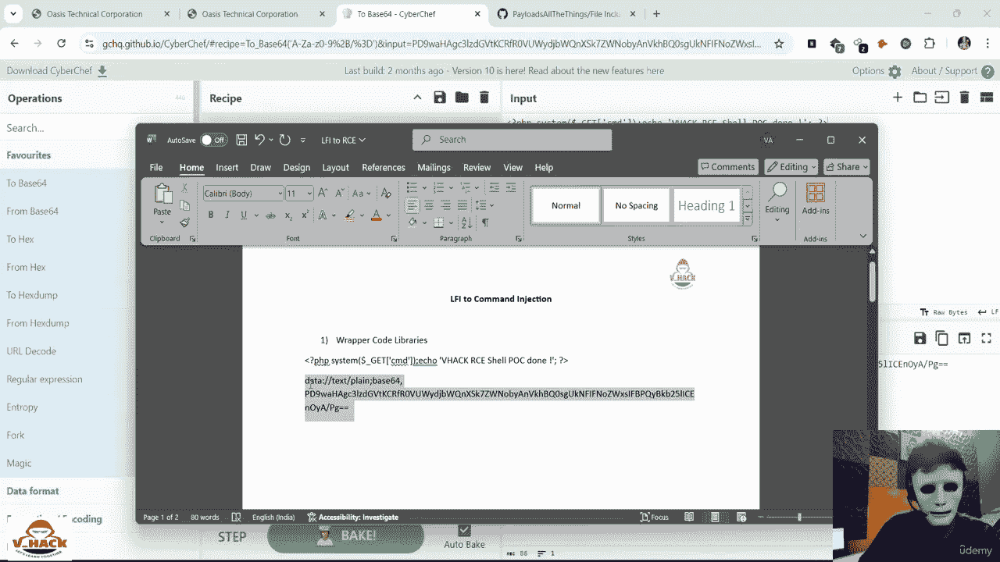
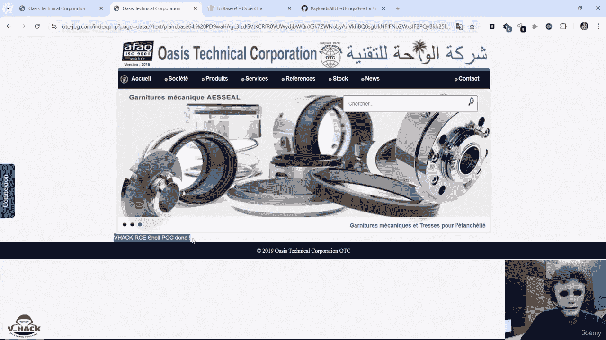
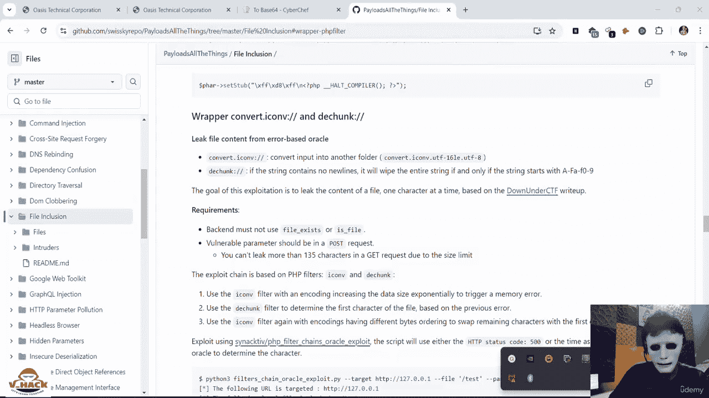

🛡️ 道德黑客：第31课：攻击链攻击——从本地文件包含到命令注入



在本节课中我们将要学习如何把本地文件包含漏洞和命令注入漏洞串联起来，形成一条完整的攻击链。我们会先回顾上一节课学习的本地文件包含基础，然后看看攻击者如何利用 PHP 过滤器和 Base64 编码绕过限制，最后把读取文件的能力转化为执行系统命令的能力。无论你是刚接触 Web 渗透的新手，还是想要加强攻击链构建思路的学习者，这节课都会用大白话把每一个步骤讲清楚。


什么是本地文件包含漏洞

上一节课我们介绍了本地文件包含的基本原理，本节中我们先快速梳理一下它的核心概念。本地文件包含是指 Web 应用程序从用户可控的参数中读取服务器上的本地文件，并将其作为页面内容显示出来。如果开发者没有对输入参数做严格的过滤，攻击者就可以通过构造特殊的文件路径，读取服务器上不应该被外界访问的敏感文件，比如系统配置文件或日志文件。

以下是本地文件包含的典型利用场景：
- 攻击者通过 URL 参数控制文件路径，读取 /etc/passwd 查看系统用户信息。
- 攻击者尝试读取 Web 服务器的配置文件，寻找数据库连接字符串或密钥。
- 攻击者利用日志文件污染，将恶意代码写入日志后再通过包含漏洞执行代码。



本地文件包含漏洞的成因通常可以用下面这个简单公式来理解：
```
用户可控参数 + 文件包含函数 + 缺乏路径过滤 = 本地文件包含漏洞
```
理解了这个公式，你就知道在审计代码时应该重点检查哪些地方。


PHP 过滤器与 Base64 编码

刚才我们说完了本地文件包含的基础，本节中我们来看看如何利用 PHP 的伪协议和 Base64 编码绕过常见的防护措施。PHP 提供了一些内置的流式过滤器，其中最常用的是 php://filter 伪协议。它可以在文件被读取之前，对文件内容进行编码或转换，这样即使页面会对特殊字符做过滤，攻击者也有机会把敏感数据变成看似无害的 Base64 字符串再提取出来。

以下是使用 PHP 过滤器读取文件的常见写法：
```
?page=php://filter/convert.base64-encode/resource=目标文件路径
```
当服务器处理这个请求时，它会把目标文件的内容用 Base64 编码后再输出到页面上。攻击者拿到编码后的字符串，只需要在本地进行 Base64 解码，就能还原出原始文件内容。这种方法在面对某些简单的 WAF 或输入校验时非常有效，因为 Base64 字符串只包含字母、数字和少数符号，不容易触发基于关键词的拦截规则。


从本地文件包含到命令注入的攻击链

在介绍完 PHP 过滤器和 Base64 编码之后，本节中我们进入本节课的核心内容，也就是如何把 LFI 漏洞转化为命令注入漏洞。攻击链的思路是：先利用 LFI 读取服务器上的某个文件，或者通过 LFI 向服务器写入可控内容，再找到一个能够执行系统命令的入口点，最终获得对服务器的控制权。



以下是攻击链的关键步骤：
1. 确认目标页面存在本地文件包含漏洞，并且能够通过 php://filter 读取任意文件。
2. 观察页面是否存在将文件内容原样输出或打印到网页的位置，这通常是命令注入的切入点。
3. 构造包含系统命令的 payload，尝试让服务器把命令执行结果写入可通过 LFI 读取的文件中。
4. 利用 LFI 读取那个被写入命令结果的文件，从而间接执行系统命令并获取输出。



这个过程可以用一个简化的逻辑链条来表示：
```
LFI 读取敏感文件 -> 发现命令执行入口 -> 构造恶意 payload -> 通过 LFI 回显命令结果 = 完成 LFI 到命令注入的链式攻击
```
每一步都需要攻击者仔细观察服务器的响应，不能急于求成，否则很容易被防护设备发现。




实战演示步骤



讲完了理论原理，本节中我们来看看在实际环境中是如何一步步操作的。演示环境是一个专门搭建的靶场，里面模拟了存在 LFI 漏洞的 Web 页面。我们会先用浏览器访问目标页面，观察 URL 中的参数，然后逐步尝试不同的 payload，直到成功执行系统命令。

以下是实战操作的主要步骤：
1. 打开目标网站，找到带有文件包含参数的页面，比如类似 `?page=about.php` 的地址。
2. 将参数值替换为 `php://filter/convert.base64-encode/resource=敏感文件路径`，观察页面是否返回 Base64 编码后的内容。
3. 使用在线工具或本地脚本把返回的 Base64 字符串解码，确认是否成功读取了目标文件。
4. 寻找页面中允许用户输入命令的位置，构造类似 `; whoami` 或 `| cat /etc/passwd` 的命令注入 payload。
5. 把构造好的 payload 放入对应参数，再次发送请求，观察页面是否返回命令执行的结果。
6. 如果直接回显失败，尝试把命令输出写入临时文件，再通过 LFI 读取那个临时文件。



在演示过程中，我们会把每一个 payload 的构造过程写在代码块里，方便你对照着操作：
```
payload 示例：?page=php://filter/convert.base64-encode/resource=/var/www/html/uploads/shell.php
命令注入示例：?cmd=system('id')
```
注意，这里展示的所有操作仅限于授权的测试环境，切勿在未经允许的系统上尝试。


总结



本节课中我们一起学习了如何从本地文件包含漏洞出发，通过 PHP 伪协议和 Base64 编码绕过限制，最终构建出从 LFI 到命令注入的完整攻击链。我们回顾了 LFI 的基本原理，掌握了 `php://filter/convert.base64-encode` 的使用方法，并且了解了如何把读取文件的能力转化为执行系统命令的能力。希望这些内容能帮助你更好地理解 Web 攻击链的构建思路，在今后的学习中把这些知识应用到合法的安全测试中去。
