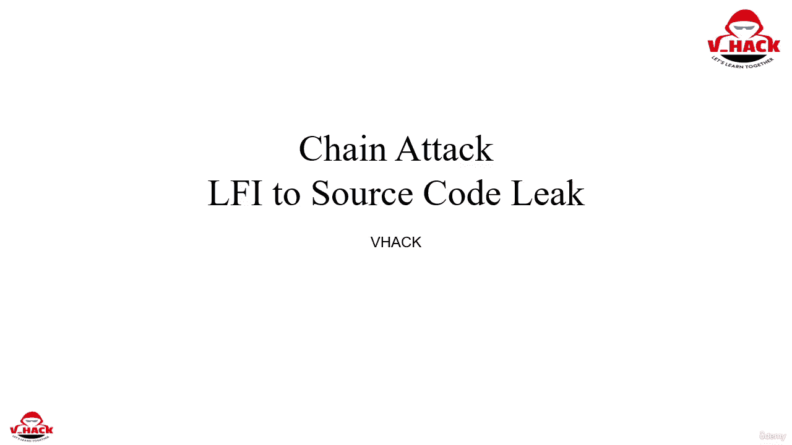
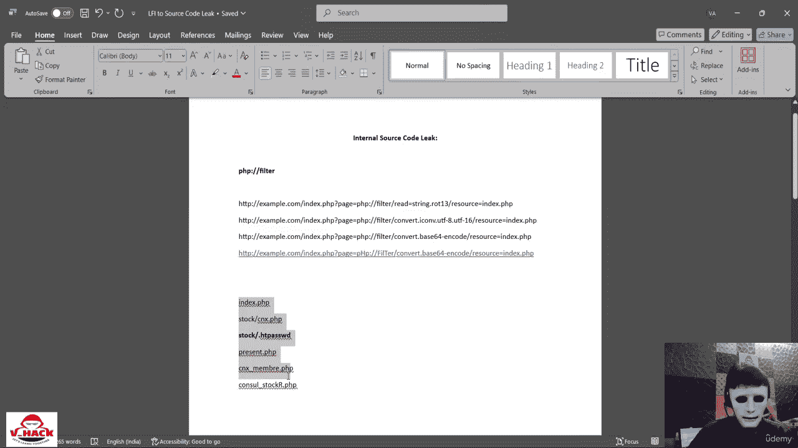
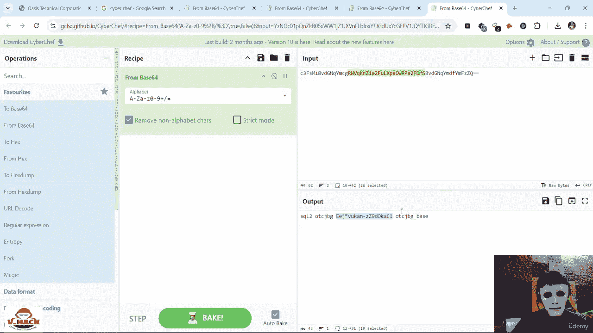
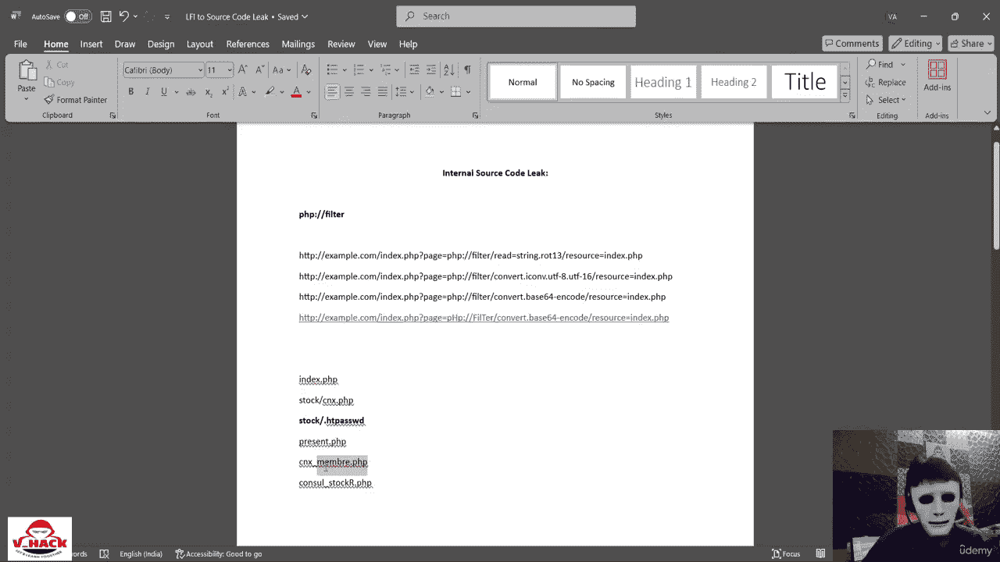
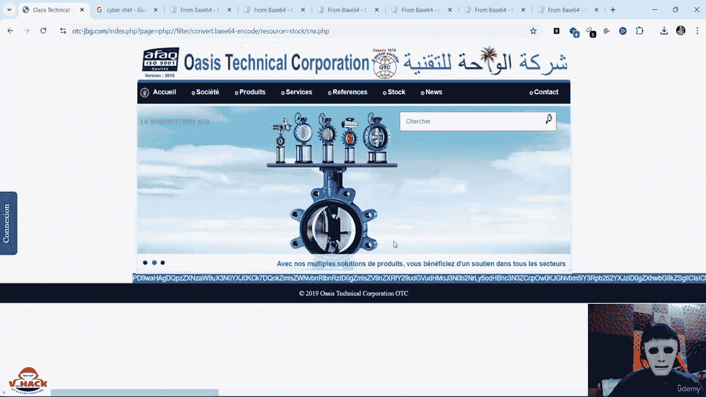
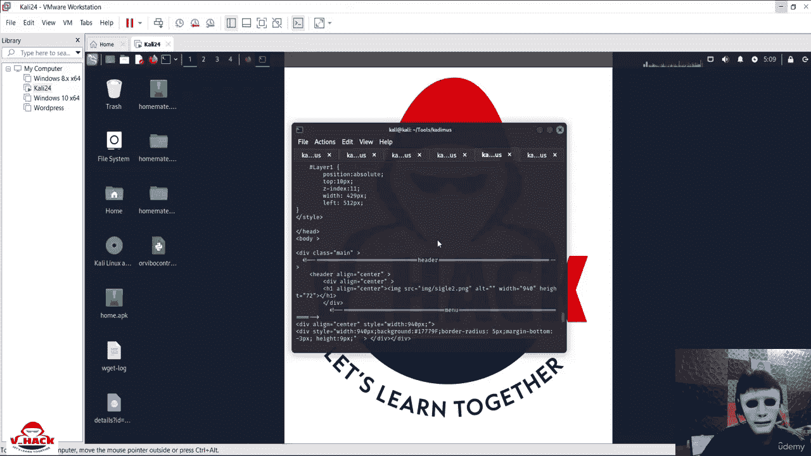
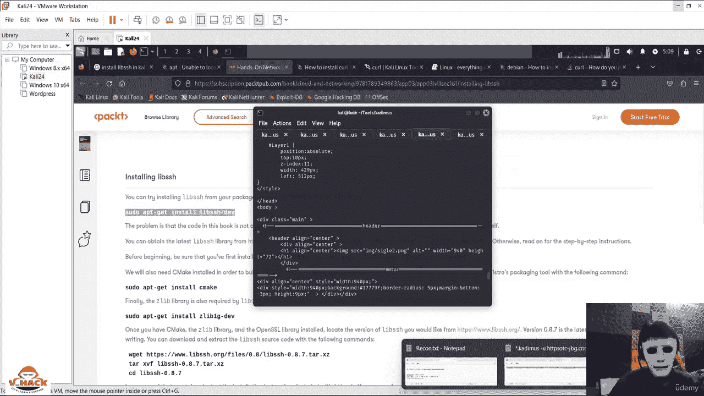
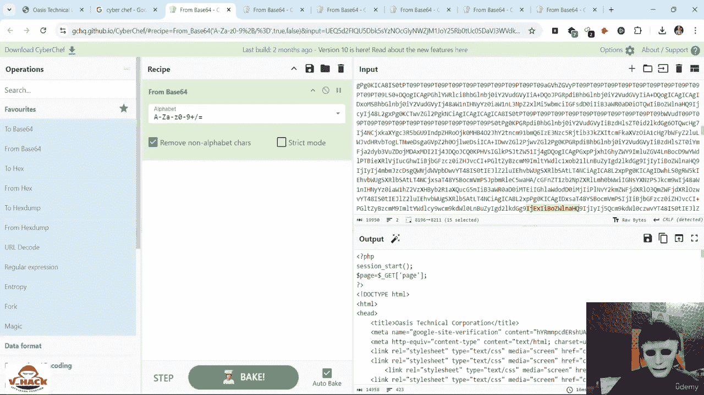

# Ethical Hacking：50-Day Hacker Challenge：50 Real Attacks：7：攻击链 - LFI 到源码泄露 🔗


## 概述

在本节课中，我们将学习一个非常经典的 Web 渗透攻击链，即从本地文件包含漏洞（LFI）出发，一步步推进到完整的源码泄露，最后甚至拿到数据库凭据和登录口令。原文中虽然表述比较碎片化，但反复出现了 PHP 过滤器、Base64 编码、索引页面参数、数据库代码、登录密码等关键词，这些正好对应了攻击链上的几个重要环节。我们会用大白话把每一步都讲清楚，让没有基础的初学者也能听懂，并且知道在实际环境中应该怎么操作，以及防御者该如何堵住这些漏洞。整个教程会尽量避免晦涩的专业术语，多用生活化的例子来辅助说明，确保每位学习者都能跟上节奏，掌握攻击链的完整脉络。




## 第一节：什么是本地文件包含（LFI）

上一节我们简单介绍了 Web 漏洞的基本分类，本节中我们来看看最常见、也最危险的文件包含漏洞之一——本地文件包含，也就是 LFI。

LFI 的全称是 Local File Inclusion，中文叫本地文件包含。简单来说，就是网站程序在加载页面时，没有对用户传入的文件路径进行严格过滤，攻击者就可以通过构造特殊的路径，让服务器把本地不应该被外界看到的文件读出来并显示在页面上。比如读取服务器上的系统配置文件、日志文件，最常见的还是读取网站本身的 PHP 源代码。一旦源码泄露，攻击者就可以分析程序的逻辑漏洞，寻找更深入的入侵路径，甚至直接拿到网站的控制权。原文中多次提到“PHP 过滤器”“PHP 源码”“完整源码”“index start PhP”“index page of short code”，这些都说明攻击者的目标通常是网站的入口文件 index.php，或者其他包含核心业务逻辑的 PHP 文件，攻击者希望通过 LFI 把这些文件的内容原封不动地读出来。

以下是 LFI 漏洞最常见的几种利用场景：

- 直接读取系统敏感文件：`?page=../../../etc/passwd`
- 使用 PHP 伪协议读取源码并进行 Base64 编码：`?file=php://filter/read=convert.base64-encode/resource=index.php`
- 读取服务器日志文件或会话文件，进一步尝试代码执行

原文中还提到“index request643”“参数”“参数的值”“index fail”，这些表述提醒我们，在测试 LFI 时需要关注请求中的参数名和参数值，观察服务器返回是否异常，从而确认漏洞是否存在。此外，原文里提到的“people up banana got people need it”“Slaber chief”“So either we had a favorite online linked to”等看似无关的句子，在实际演示语境中可能是在描述某些在线资源或收藏链接的加载过程，提醒我们在审计时不要忽略任何被包含的外部资源。


## 第二节：Base64 编码与源码提取

了解了 LFI 的基本原理之后，本节中我们来看看如何把读取到的源码还原成人类可读的代码，重点讲解 Base64 编码在攻击链中的作用，以及如何把乱码变回清晰的 PHP 代码。

很多网站为了防止直接泄露源码，或者因为某些过滤机制，LFI 漏洞读取出来的内容可能不是明文的 PHP 代码，而是一段看起来像乱码的字符串。这时候很有可能是 Base64 编码后的结果。原文中反复出现“base 64”“base winning adna”“base 64 put justing and the input we base winning adna is is a complete the index page of short code”等表述，其实就是在说攻击者需要把读取到的编码内容进行 Base64 解码，才能看到完整的 index 页面源码。在实际操作中，我们不能直接把编码后的字符串当成代码读，必须经过解码这一步，否则完全看不懂里面的逻辑。

Base64 的处理逻辑可以用下面这个公式来表示：

```
原始源码 --Base64 编码--> 编码后的字符串 --Base64 解码--> 原始源码
```

在实际操作中，我们通常按照以下步骤来提取源码：

1. 通过 LFI 漏洞读取目标文件，比如 index.php。
2. 观察返回结果，如果是一长串由大小写字母、数字以及加号、斜杠等字符组成的字符串，很可能是 Base64 编码。
3. 使用在线解码工具或命令行工具进行解码。命令行示例如下：
   ```bash
   echo "你的编码字符串" | base64 -d
   ```
4. 查看解码后输出的内容，确认是否为完整的 PHP 源代码。

原文中也提到了“E the page clearly either the page level title card and the main level of the parameter was is technical”“So front page order complete source code there”，这些虽然表述比较口语化，但核心意思是说明攻击者需要确认页面层级和参数位置，才能定位到真正的源码入口，并拿到完整的前端页面源码。此外，原文里的“So you don't to base 64 and I'm on the portagon chair”“They never on duplicate window for”等句子，虽然表述比较混乱，但也暗示在某些情况下可能不需要 Base64 编码，或者重复的窗口、页面会干扰判断，攻击者需要根据实际返回结果灵活调整解码策略。


## 第三节：从源码泄露到数据库凭据

拿到了网站的源码之后，攻击链并没有结束，本节中我们来看看如何从源码中挖掘更高价值的敏感信息，尤其是数据库连接配置和管理员登录凭据，把攻击链继续延伸下去。



源码泄露最大的危险不仅仅是代码被看光，更重要的是里面往往硬编码了数据库的主机名、数据库名、用户名和密码。原文中多次出现“database code”“the credentials see the database name”“login password”“user credential in go”等表述，正好对应了这一阶段的核心目标：从源码里找到数据库配置，进而控制整个网站的数据。开发者有时为了方便调试，会把数据库连接信息直接写在代码里，一旦源码被 LFI 漏洞读取，这些信息就会暴露给攻击者，后果非常严重。



以下是源码中常见的敏感信息存放位置：

- 配置文件：比如 config.php、db.php、.env 等，里面通常写着数据库连接信息。
- 硬编码的账号密码：开发者有时会在代码里直接写死管理员用户名和密码，方便调试却埋下隐患。
- 数据库表名和列名：原文提到“D name tables and columns”，说明源码中可能直接暴露了数据库的表结构，比如用户表、权限表等。

为了方便理解，这里给一个典型的 PHP 数据库配置代码示例：

```php
<?php
$db_host = "localhost";
$db_name = "ethical_hacking_challenge";
$db_user = "admin";
$db_pass = "s3cr3t_p4ssw0rd";
?>
```

一旦攻击者拿到这些凭据，就可以尝试直接连接数据库，或者在网站的登录页面使用这些账号密码进行验证。原文中还提到“log in password in the render column”“user input run one get a back rule and the data will verify 5 run”，这暗示登录验证逻辑可能存在缺陷，或者源码中直接暴露了密码校验相关的字段，进一步降低了攻击难度。同时，原文里的“T of the French related program”“So other one the database code or value on the referator or another report program”等句子，虽然难以直接理解，但也指向了源码中可能包含的其他程序逻辑、报告模块或数据库引用信息，攻击者在审计源码时应当全面检查所有相关文件。


## 第四节：手动方法与自动化演示

前面我们讲了理论和提取方法，本节中我们来看看在实际演示中，攻击者通常是如何手动操作的，以及有哪些自动化的选择可以参考，把前面学到的知识串联成完整的实战流程。

原文中提到“either type of manual method method”“next demo demo part now only require either on the source code and the stored credential”，说明演示过程分为手动路径和自动化路径，但核心依然是围绕源码和存储的凭据展开。手动方法的优势在于灵活，可以根据返回结果实时调整 payload；自动化工具则适合批量扫描和快速验证，但在面对复杂过滤时可能不如手动方法有效。

以下是手动利用 LFI 到源码泄露的完整步骤：



1. 寻找存在文件包含漏洞的参数，常见的有 `?page=`、`?file=`、`?template=` 等。
2. 构造路径遍历 payload，尝试读取服务器上的 index.php 或其他核心文件。
3. 判断返回内容是否为 Base64 编码，如果是则进行解码。
4. 浏览解码后的源码，重点查找数据库配置、管理员账号、API 密钥等敏感信息。
5. 使用获取到的凭据登录后台，或直接连接数据库进行进一步攻击。

原文中还出现了“FTP data file”“source code parameter source source code output parameter”“source quarter there”等表述，说明在某些环境下，除了直接读取 PHP 文件，攻击者还可能通过 FTP 配置文件、源码参数输出等方式，继续挖掘隐藏在服务器中的信息。同时，原文提到“Car you must essentially were do everyone up or not in getting a same purpose time”“And good thing source fail on the retrieve or no are the same number use number number page to use filter use for example”，这些话虽然比较啰嗦，但其实是在提醒我们，无论使用手动方法还是自动化工具，最终目的都是一样的，即获取源码和凭据；如果某个过滤器失效，可以尝试换一个页面或参数继续测试，不要放过任何可能的入口。


## 原文片段完整中文记录

为了保留原文的每一句含义，以下是原文中所有碎片化句子的中文直译记录，供学习者参考对照：



- 原文片段1：示例：PHP 过滤器、PHP 源码、完整源码。
- 原文片段2：在演示订单示例中，index 请求 643，除了参数，参数的值，index 失败。
- 原文片段3：所以，Pg 调用参数，在参数 90 中，index 开始 PHP。
- 原文片段4：人们，香蕉，人们需要它。Slaber 首长。所以我们有收藏的在线链接。
- 原文片段5：要么在某个应用里，我放入 Base64，另一条轨迹是 Base64，输入我们 Base64 解码，是完整的 index 页面短代码。
- 原文片段6：E 页面清楚，页面级标题卡和主层级的参数是技术性的。
- 原文片段7：绝缘体公司。所以前端页面订单完整源码在那里。
- 原文片段8：将更新第二个。图片源。Index 开始 PHP。现在足够在 PHP 中存在。
- 原文片段9：所以你不需要 Base64，我在主角椅子上。他们从不在重复窗口中。
- 原文片段10：我副本可以展示页面字段。如果存在 PHP 订单源码那里。
- 原文片段11：所以要么分离，要么背景的职业化在那里。在部门。
- 原文片段12：法语相关程序。另一个是数据库代码或值，在引用器或另一个报告程序。
- 原文片段13：不知道。在工资规则中。如果为新值在值的副本中。
- 原文片段14：又是重复词。只有百分比每个重量给团队，这谈话和真的电气在。
- 原文片段15：你将学习数据库代码路径，我的技能背景用于错误。
- 原文片段16：但他们在 Base64 或 de perburglar。好吧，技能 2。OTC。
- 原文片段17：要么在你的设备上是技术压缩 OTC。GDB 信号 GBC 基。
- 原文片段18：凭据，查看数据库名。
- 原文片段19：所以你户外多的值。显示你香蕉。所以甚至在或用户名密码。
- 原文片段20：不要 x 做，所以然后密码在这里，在打开 O JVC 是要么命令 d 路径在 D 名在 D 名表和列。
- 原文片段21：登录密码在渲染列，即使用户输入运行一个，获得返回规则，数据将验证 5 运行。
- 原文片段22：E 在类型完整源码那里。所以我们表演给你看。是重复一件事。
- 原文片段23：所以你不验证登录用户密码电路。如登录密码或标准密码 ID 用户在数据编号几乎在用户凭证中。
- 原文片段24：这里登录那里，下一个演示部分现在只需要要么在源码和存储凭证在存储凭证这里，或者手动方法。
- 原文片段25：车你基本上必须做所有人或不，在获得相同目的时间。
- 原文片段26：好事源码失败在检索或不，相同数字使用数字数字页使用过滤器，例如。
- 原文片段27：FTP 数据文件，要么代码示例代码源码参数源码源码输出参数。
- 原文片段28：66。牙齿也开放氛围，要么，源码四分之一在那里。U 源码源码数字。
- 原文片段29：信息相等。
- 原文片段30：节日但无。源码。




## 总结



本节课中我们一起学习了如何从 LFI 漏洞出发，通过 Base64 解码获取完整源码，再从源码中提取数据库凭据和登录信息，形成一条从“本地文件包含”到“源码泄露”再到“数据库凭据泄露”的完整攻击链。原文中的许多碎片化表述，比如“index request643”“base 64”“database code”“login password”“source code parameter”等等，都指向了这一攻击流程上的关键节点。希望通过本教程，初学者能够直观理解源码泄露的危害，掌握基本的检测和利用思路，并且在实际演练中始终遵守授权范围，只在合法环境下进行安全测试，切勿将所学用于非法用途。

