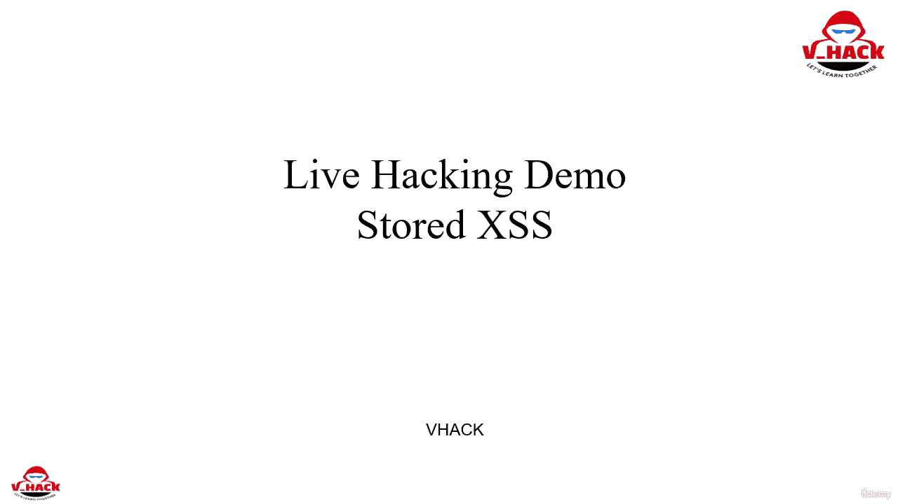
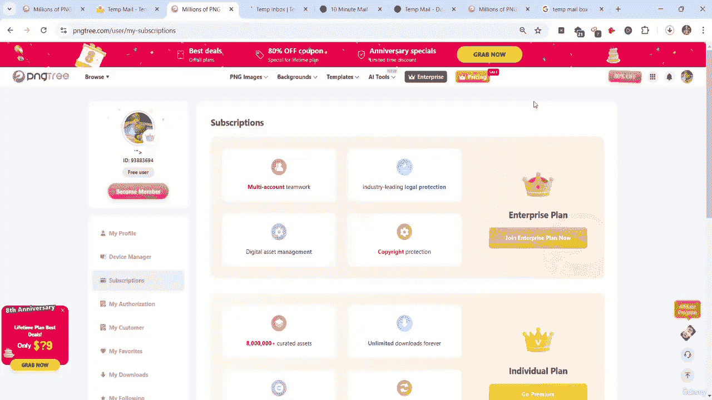

🛡️ Ethical Hacking：08：存储型XSS [实时靶场]



在本节课中，我们将一起学习存储型跨站脚本攻击，也就是Stored XSS的实际利用方法。我们会通过一个真实的靶场演示，完整走一遍从注册账号到在受害者浏览器中弹出JavaScript提示框的全过程。无论你是刚开始接触Web安全，还是想复习XSS基础，这节课都会用大白话把每一步拆解清楚，让你明白攻击者是如何把恶意代码“储存”到服务器里，再让其他人不小心执行的。


在开始实战之前，我们先弄清楚存储型XSS到底是怎么回事。它不同于反射型XSS，反射型XSS通常需要受害者点击一个带有恶意参数的链接，而存储型XSS的核心思路是：攻击者把一段恶意JavaScript代码“存储”到目标网站的服务器里，比如存进用户名、个人简介、评论或留言板中。当其他访问者打开包含这段代码的页面时，浏览器就会把这些代码当成正常网页内容来执行。于是，攻击者的脚本就在受害者的浏览器里运行了，可能窃取Cookie、冒充用户操作，或者做其他有害的事情。


存储型XSS的基本流程可以用下面的伪代码表示：
```
攻击者在输入框提交恶意脚本 → 服务器把脚本保存到数据库 → 受害者请求包含该数据的页面 → 服务器返回带有脚本的HTML → 受害者浏览器执行脚本
```
如果用HTML来表示攻击载荷，可能是这样：
```html
<script>prompt('Stored XSS')</script>
```
或者更隐蔽一点：
```html

```

环境准备好之后，本节中我们来看看在动手之前需要准备什么。我们需要一个可以合法测试的靶场，以及一个常用浏览器。在实际操作中，请务必只在自己有授权的系统上进行，不要随意攻击他人网站。课程中会使用到一个注册页面和一个个人资料展示页面，这两个页面正好构成存储型XSS的经典场景：一个用来输入恶意代码，另一个用来在受害者面前触发代码。

以下是准备工作清单：
- 一台可以访问靶场的电脑
- 一个常用浏览器，比如Chrome或Firefox
- 靶场的注册页面地址
- 靶场的个人资料页面或支付页面地址

完成环境准备之后，本节中我们来看看如何在注册表单中植入XSS负载。打开靶场的注册页面，你会看到用户名、邮箱、密码等输入框。这时候不要使用真实的个人信息，建议使用随机的弱凭据，这样即使测试出问题也不影响你的真实账号。重点在于用户名字段，因为这个字段很可能会在别的页面被显示出来，而没有经过充分的过滤。


在用户名输入框中，我们输入一段简单的JavaScript代码，比如下面这样：
```html
<script>prompt('XSS')</script>
```
提交注册表单。如果系统没有对用户名做严格的过滤，你的这段脚本就会被保存到数据库里，和其他用户资料一起存储起来。有些网站可能不要求邮箱验证，直接就让你注册成功，这也增加了攻击的便利性。

注册完成之后，本节中我们来看看怎样触发它。登录进去之后，前往个人资料页面或者支付页面。这些页面通常会展示你之前注册时填写的用户名。因为脚本已经被存储在服务器里，页面加载时服务器会把你的用户名连同那段脚本一起发送给浏览器。浏览器解析页面的时候，会把脚本当成正常HTML来执行，于是就会弹出一个JavaScript提示框，显示你刚才设置的内容。

这个现象就是存储型XSS被成功触发的标志。只要有其他用户或者管理员访问包含你注册信息的页面，他们的浏览器就会执行同样的脚本，攻击者就可以在不知不觉中完成攻击。

页面出现提示框之后，本节中我们来看看怎样确认攻击到底成功了没有。检查浏览器是否弹出了 `prompt` 对话框，并且对话框里的文字是你刚才注册时输入的内容。如果出现了，就说明服务器把你的脚本原样保存并返回了，浏览器也正确执行了它。此时你可以尝试在浏览器开发者工具里查看页面源代码，找到那段被存储的JavaScript，进一步确认它是如何插入页面的。



本节课中，我们一起学习了存储型XSS的基本原理、注册阶段的恶意代码注入、如何在个人资料或支付页面触发脚本，以及怎样验证攻击效果。希望通过这次实战，你能对跨站脚本攻击有更直观的认识，并在未来的学习中更加关注前端输入过滤和输出编码的重要性。
