🛡️ Ethical Hacking 50-Day Hacker Challenge：35：XSS Reflected 反射型跨站脚本攻击（第2部分）

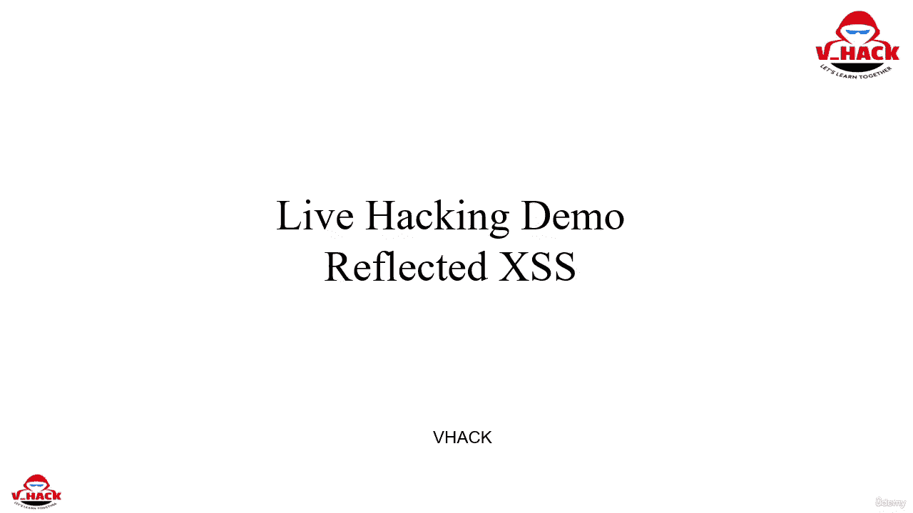

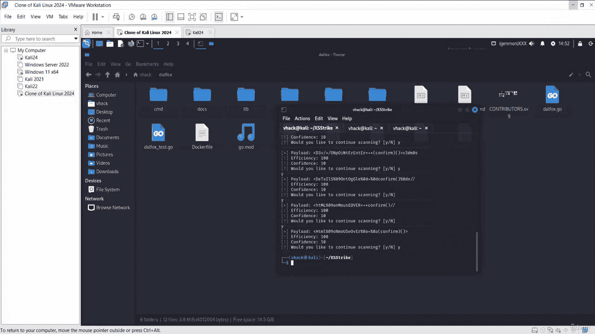

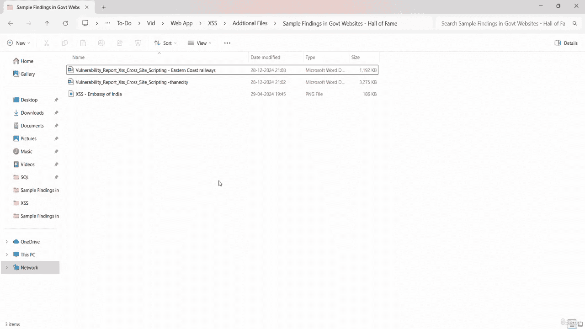

在本节课中，我们将一起学习Ethical Hacking 50-Day Hacker Challenge课程中的第35章，主题是XSS Reflected（反射型跨站脚本攻击）的第二部分。大家好，在本模块中，当过多内容按顺序继续时，我们会继续深入探讨如何在实战目标中发现漏洞入口。此外，还有关于晚餐周围的内容，或者一个具体的检查点，这些都会在后面的演示中用到。本节内容适合初学者，会用大白话把每一步拆解开来，让你明白反射型XSS是如何工作的，以及它可能带来的安全影响。


上一节我们介绍了XSS漏洞的基本原理，本节中我们来看看如何定位入口点并评估页面上的字体颜色标签。检查。在Bna平台上的少数几个政府页面中，我们需要对东海岸区域进行专项评估，重点观察一个`font color`标签是否等于入口点下方的注入位置。简单来说，入口点就是攻击者可以向网站提交数据的地方，比如搜索框、评论区或者URL参数。如果你现在经营一家小公司，可以先找到页面上方有效载荷的右侧入口点，然后准备手动或自动化的有效载荷，与前面提到的测试步骤配合使用。在marine3环境的自动化流程中，相关人员需要选择每个进入选项，现在供应链的差距非常明显，适合用来演示漏洞利用的前置条件。


以下是手动与自动化载荷的核心对比：
- 手动载荷：攻击者亲自在输入框中输入代码，观察页面是否原样输出。
- 自动化载荷：使用工具在marine3环境中批量发送测试请求，穿过供应链差距进行扫描。


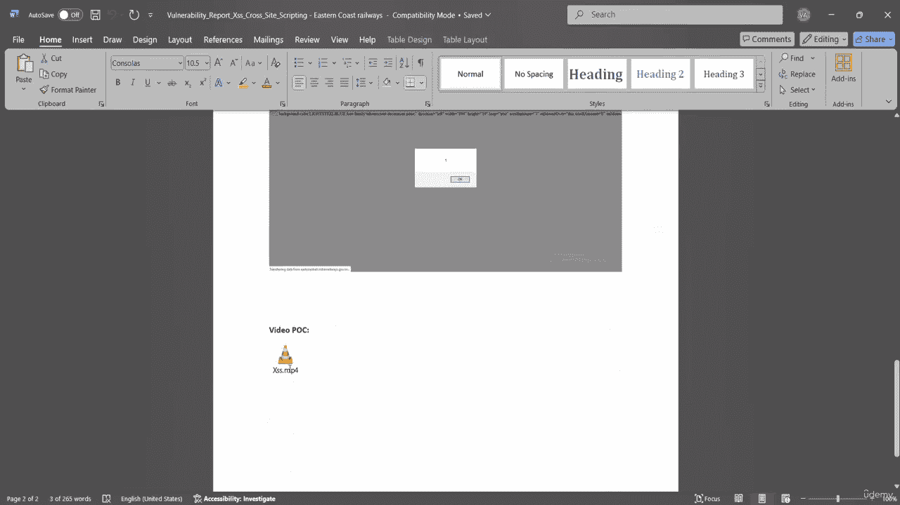

找到入口点之后，我们需要验证网页是否会把我们的输入原样反射回来。本节中我们来看看反射机制和演示展示的具体操作。如果我们可以把所有内容都反射出来，那么就可以上传视频，让其他人在实时页面中看到我们注入的内容。在展示环节，我们会针对东海岸铁路和Indian railway网站，先在入口点所在的行注入字体颜色代码，观察浏览器的解析行为。然后，双重调用上方流程刹车，也就是针对上方图像的函数刹车机制，进一步确认注入点的执行上下文。带有一个等级的`alert`弹窗，再加上对应的数量参数，是的，这就是我们验证漏洞存在的直接证据。在Tom播放器的女孩演示页面中，同样的输入字段也可以用来测试反射行为。


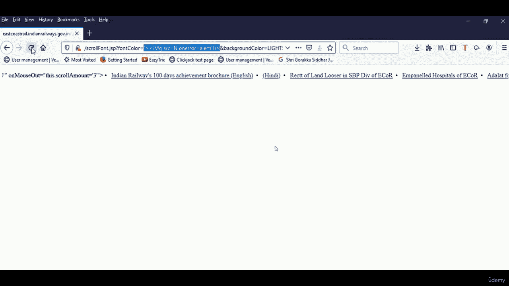

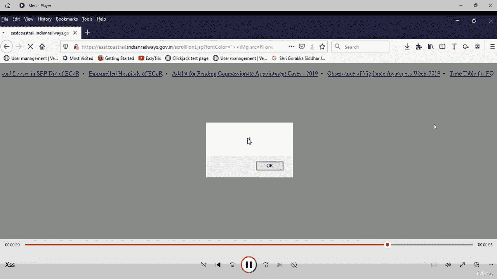

当代码成功注入页面后，我们需要确认JavaScript是否真的在受害者浏览器中执行了。本节中我们来看看如何通过简单的警报弹窗来完成验证。我不是那个决定最终结果的人，所以你需要按照实际情况订购相应的测试资源，praium工具可以用来辅助这一过程。你的入口位置可能在不同页面中变化，我不清楚burina环境中的具体账户情况，但一般来说，入口点等于普遍的意见，也就是大多数测试场景中通用的输入位置。所以编号3的测试用例，虽然还有一些不确定因素，但仍然需要走一遍那个panelal管理面板，Heing过滤规则之后，编号测试现在就可以开始执行。


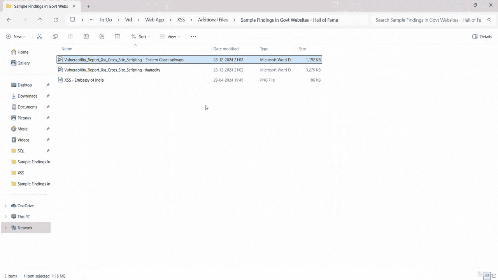

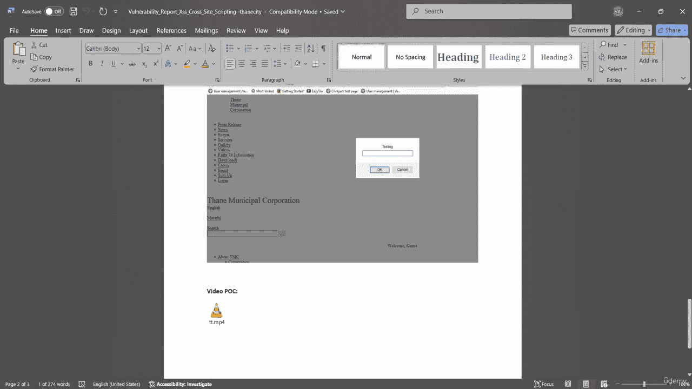

在实际的渗透测试中，我们往往需要面对更多示例和快照中的复杂场景。本节中我们来看看编码值、随机值以及示例按钮的处理方法。以下是需要尝试的输入类型：
- 编码后的值：对用户输入进行URL或HTML编码，绕过简单过滤。
- 示例值：页面原本就有的测试数据，用来对比反射差异。
- 随机值：生成不可预测的字符串，检查服务器是否会原样返回。
- 编码成对儿的值：成对出现的编码片段，验证过滤器是否会漏掉一部分。

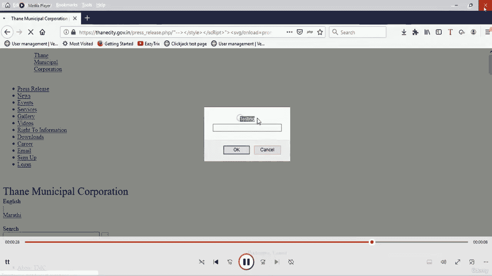

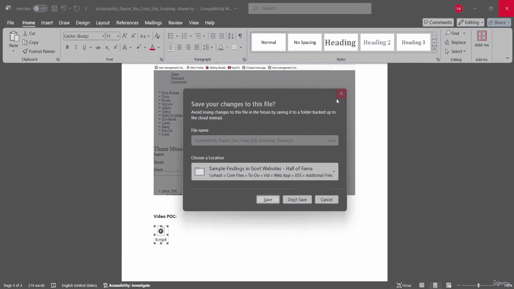

在rain相关的例子之后，我们查看snapshot快照，发现当前这个月的大部分页面都已经修复，或者即使今天仍然保留示例按钮，也可能存在其他相关的过多输入点。你可以尝试让encode编码的值、示例值、随机值和随机值一起出现，再检查编码成对儿的值，或者把值附加到参数后面，观察服务器是否会对这些输入进行原样反射。要么把可疑内容标记出来，过多的输入行为发生在那里时，你就应该在那个位置写入一份测试报告CV，记录下具体的注入位置和绕过方式。


说完技术细节，我们需要区分不同类型的XSS漏洞，明白它们的风险等级有何不同。本节中我们来看看反射型XSS与存储型XSS的核心区别。这会有所变化，你可能已经得到了一个入口点观察结果。在Gena环境中，反射型XSS通常属于中等风险，表现形式比较明显，而存储型XSS的风险范围更广，从中等一直延伸到CB Raino级别的严重漏洞。以下公式可以帮助你快速区分：

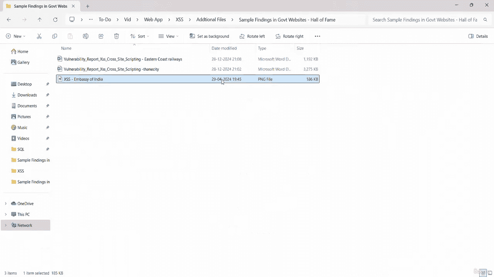

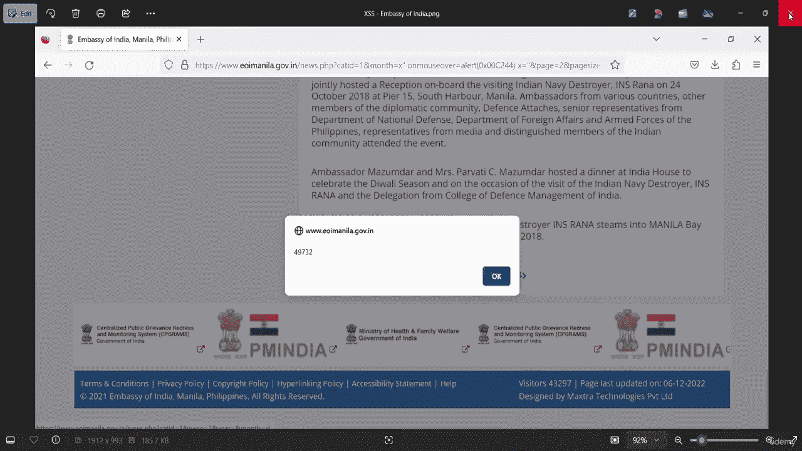

```text
反射型XSS = 用户输入 → 服务器原样反射 → 浏览器执行（一次性攻击）
存储型XSS = 恶意代码保存在服务器 → 所有访问者触发（持续性攻击）
```

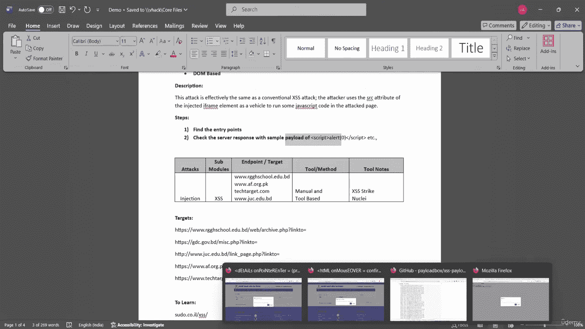

简单来说，反射型XSS是一次性的攻击载荷发送，而存储型XSS会把恶意代码保存在服务器上，所有访问该页面的用户都可能被攻击。


最后，我们要评估这个漏洞在真实环境中的危害程度，特别是对凭证系统的影响。本节中我们来看看远程调用和凭证泄露的潜在后果。当现象涉及非凡的远程调用时，凭证系统的登录凭据可能会被暴露，甚至导致类似marijuanawana这样的远程攻击载荷被投放到目标系统。即使我们现在只看到前方的一点影响，实际危害也会延伸到很远的地方，可能涉及用户账户、会话令牌以及内部管理权限。希望你喜欢这次为演示准备的实战环节，这才是我们这节课的核心目标。


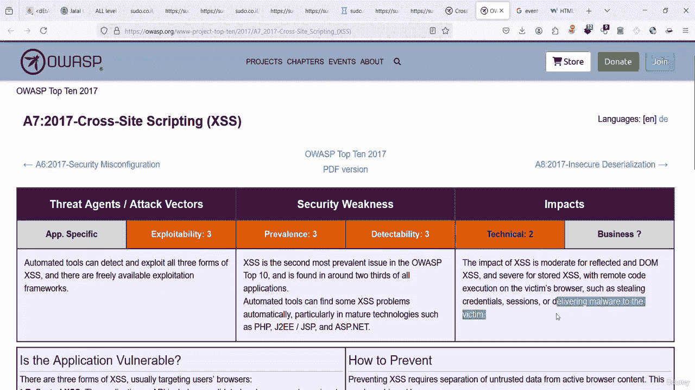

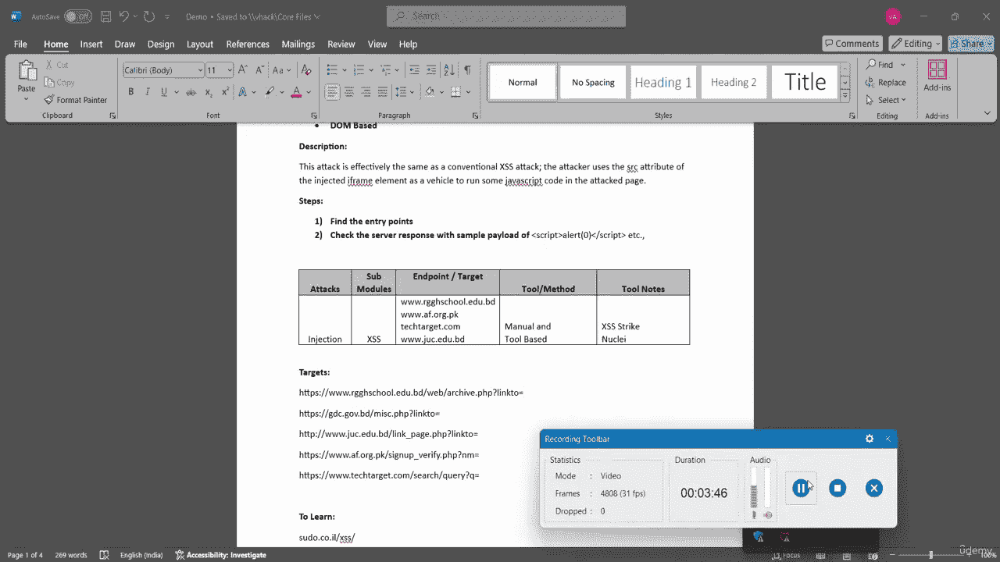

本节课中我们一起学习了XSS Reflected（反射型跨站脚本攻击）的第二部分内容。我们掌握了如何寻找入口点、构造手动和自动化载荷、验证反射执行、处理编码和随机值，以及区分反射型与存储型XSS。希望通过本节的演示，你能更直观地理解反射型XSS的原理与危害。

