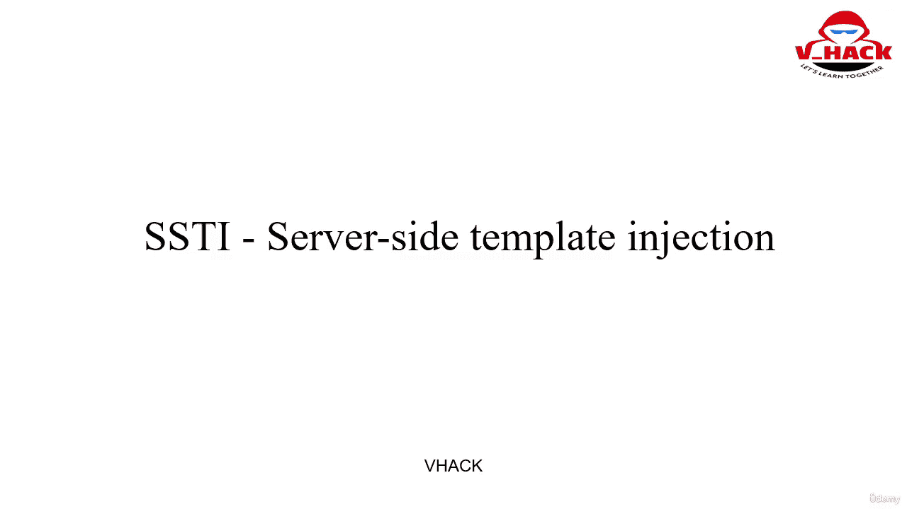
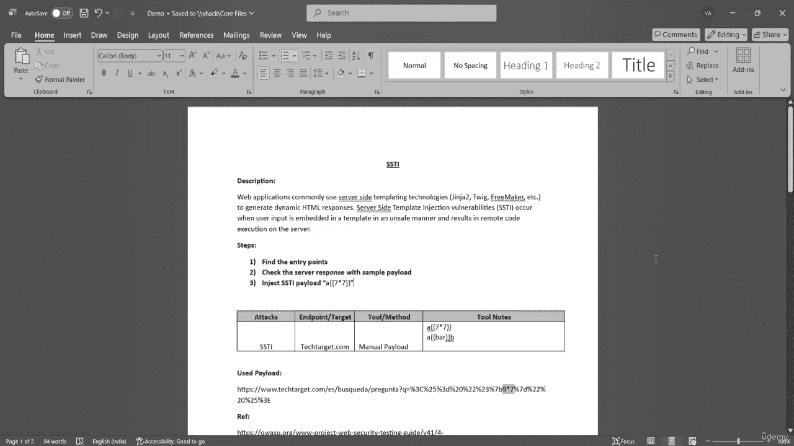
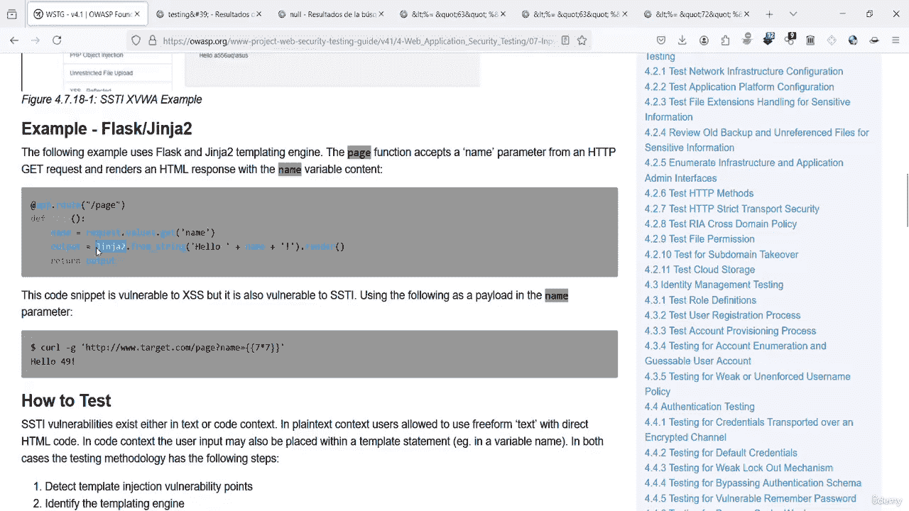
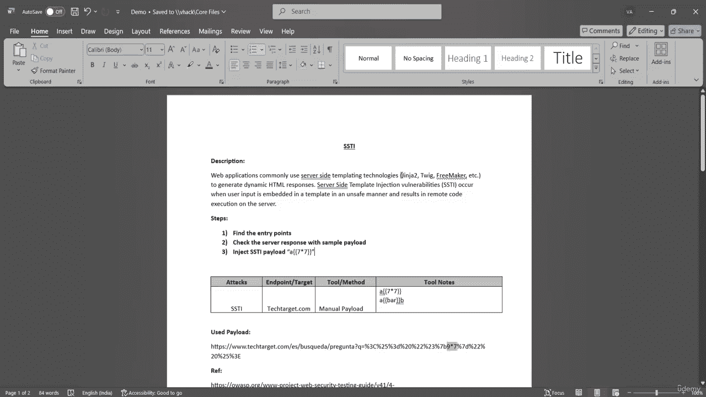
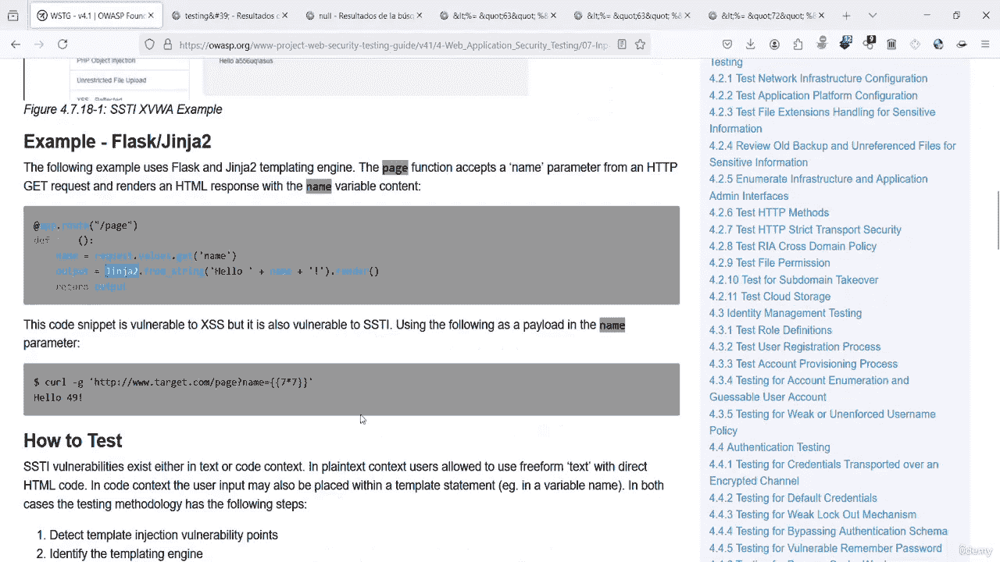
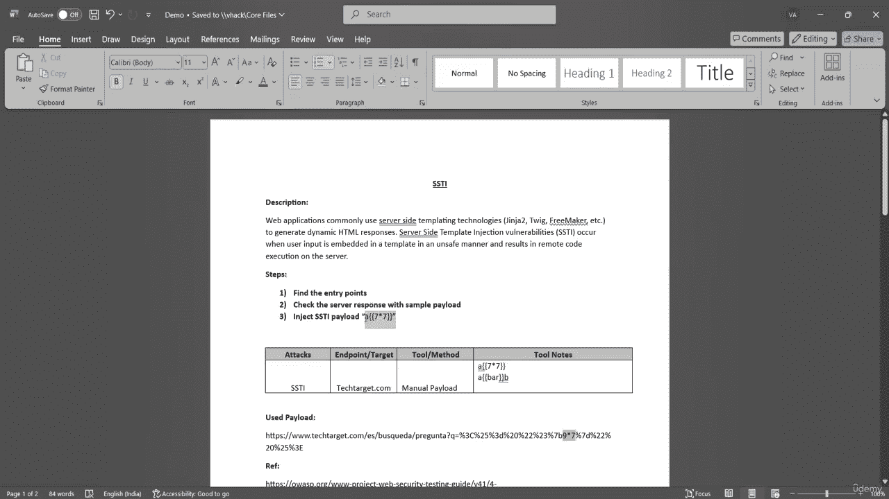
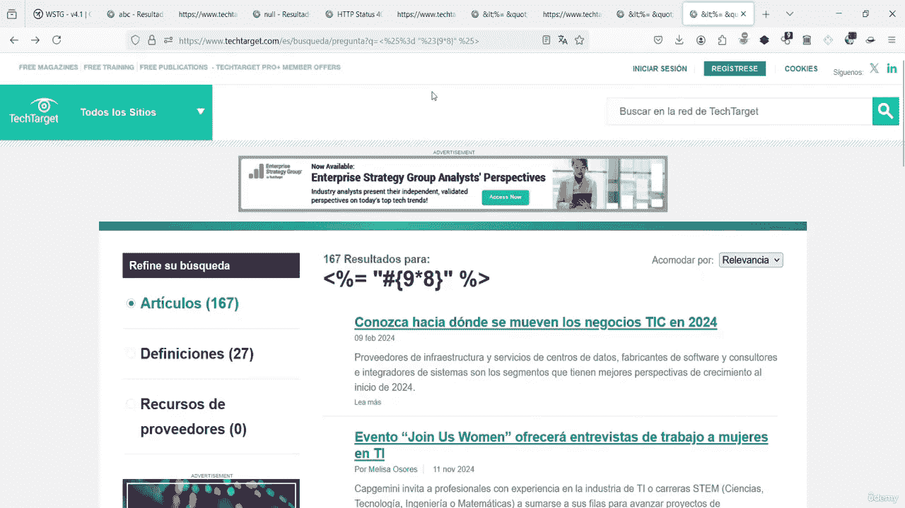
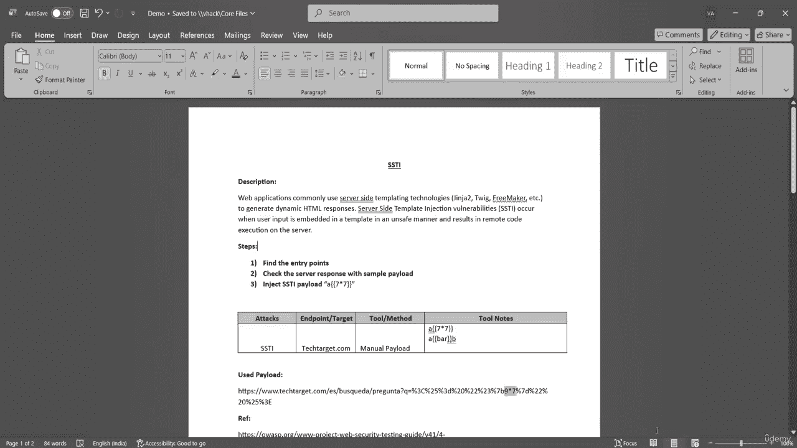

# 🛡️ 伦理黑客：第14章：SSTI 服务端模板注入实战

在本节课中，我们将一起学习服务端模板注入，也就是 SSTI，这是一种在 Web 应用中非常常见的安全漏洞。我们会先了解什么是模板注入，然后看看攻击者如何通过 URL 参数寻找注入点，接着使用简单的数学表达式来验证漏洞是否存在，最后讨论这种漏洞可能导致远程代码执行的风险。整节课我们会用大白话来讲解，适合初学者跟着学习，即使你之前没有接触过相关内容，也能看懂每一个步骤。

## 什么是服务端模板注入

上一节我们介绍了 Web 漏洞的基础概念，本节中我们来看看服务端模板注入是怎么工作的。

很多 Web 应用需要动态生成页面内容，比如显示用户名、商品列表或者欢迎语。为了实现这些功能，开发者通常会使用模板引擎。模板引擎的作用是把模板文件和数据组合在一起，生成最终发送给浏览器的 HTML 页面。

常见的模板引擎技术包括 Jinja2、FreeMarker、Thymeleaf、Mvel、SpEL 以及 Groovy 等。它们在服务器端运行，按照预设的规则渲染页面，把数据填入模板中，生成我们看到的网页。

如果应用程序把用户提交的输入直接放入模板中渲染，而没有做任何过滤或清理，攻击者就可以构造特殊的模板语句。这些语句会在服务器端被执行，这就是服务端模板注入。简单来说，漏洞的核心可以用下面这个公式来表示：

用户输入 + 未过滤的模板渲染 = 服务端模板注入

当攻击者成功注入后，不仅能读取敏感信息，甚至可能在服务器上执行任意命令，这会给网站带来严重的安全威胁。虽然听起来很复杂，但原理其实就是服务器信任了不该信任的用户输入。

## 常见的模板注入语法

以下是几种常见模板引擎的注入测试语法，你可以根据目标网站使用的技术选择对应的 payload。

- Jinja2：`{{7*7}}`
- FreeMarker：`${7*7}`
- Thymeleaf：`${7*7}`
- Mvel：`#{7*7}`
- SpEL：`#{7*7}`

这些语句的意思是告诉模板引擎计算 7 乘以 7，并把结果显示在页面上。如果页面返回了 49，就说明用户的输入被当作模板语句执行了，漏洞存在。这个测试方法非常简单，不需要复杂的工具，只需要在浏览器地址栏里尝试即可。

## 如何寻找注入入口点

在测试之前，我们需要先确定哪里可能存在漏洞。上一节我们介绍了如何观察 URL 参数，本节中我们来看看如何寻找 SSTI 的入口点。

攻击者通常会检查 URL 中的查询参数，比如 `?name=xxx` 或者 `?search=xxx`。如果页面会把参数里的内容直接显示出来，那么这个位置就是潜在的注入点。我们需要花点时间仔细查看每一个参数，不要漏掉任何一个可能的位置。

以下是常见的入口点检查方法：

- 观察 URL 地址栏中的参数名和参数值
- 查看页面反显的内容是否与参数值一致
- 尝试在参数中插入普通文本，看页面是否原样输出

找到可疑的入口点之后，就可以开始注入测试了。这一步是整个攻击过程的基础，做得越仔细，后面的测试就越顺利。

## 如何验证漏洞是否存在

确定了入口点以后，我们需要验证服务器是否真的存在模板注入漏洞。这一步非常关键，不能跳过，否则后面的测试就没有意义了。

通常的做法是发送一个包含数学运算的模板表达式，观察服务器返回的结果。如果服务器把表达式当作代码执行了，页面上就会显示计算结果，而不是原本的表达式文本。

以下是验证步骤：

1. 在参数值中插入 `{{7*7}}` 或者 `${7*7}`。
2. 发送请求，查看服务器返回的页面内容。
3. 如果页面上显示了 `49`，说明模板表达式被执行了，漏洞存在。
4. 如果页面上显示了原本的 `{{7*7}}` 字符串，或者报错，说明可能没有漏洞，或者被防火墙拦截了。

举个例子，当你发送 `?q={{7*7}}` 时，如果页面回显 `49`，就可以判断目标存在 SSTI 漏洞。这时候我们已经证明了用户输入可以直接影响服务器端的模板渲染过程。虽然这只是一个小小的数学计算，但它已经暴露了严重的安全问题。

## 远程代码执行的风险

确认存在 SSTI 漏洞之后，攻击者会进一步尝试执行更危险的操作。上一节我们介绍了如何验证漏洞，本节中我们来看看 SSTI 可能导致的严重后果。

模板注入不仅限于计算数学题，在很多模板引擎中，攻击者可以调用系统函数、读取文件，甚至执行操作系统命令。这被称为远程代码执行，简写为 RCE。一旦攻击者获得了服务器的执行权限，整个网站甚至内部网络都可能面临危险。

下面是一个概念验证的代码示例，仅用于说明原理：

`${T(java.lang.Runtime).getRuntime().exec('whoami')}`

这段表达式的意思是尝试在服务器上执行 whoami 命令，查看当前运行 Web 服务的用户身份。如果成功，攻击者就可以获取服务器的控制权。

需要说明的是，这里展示的只是一个非常简单的概念验证，目的是证明网站存在弱点，而不是用来破坏目标网站。在真实的渗透测试中，我们会在获得授权的前提下进行，并且会妥善记录所有测试过程。安全研究的目的是修复漏洞，而不是制造危害。

## 本节总结

本节课中，我们一起学习了服务端模板注入 SSTI 的基本原理，了解了常见的模板引擎及其测试语法，学会了如何通过 URL 参数寻找注入点，并使用 `{{7*7}}` 这样的表达式验证漏洞是否存在。最后，我们讨论了 SSTI 可能导致远程代码执行的风险，并看到了一个简单的概念验证示例。希望通过本节课，你能对 SSTI 有初步的认识，并在未来的学习中继续深入了解 Web 安全漏洞的检测与防御。
