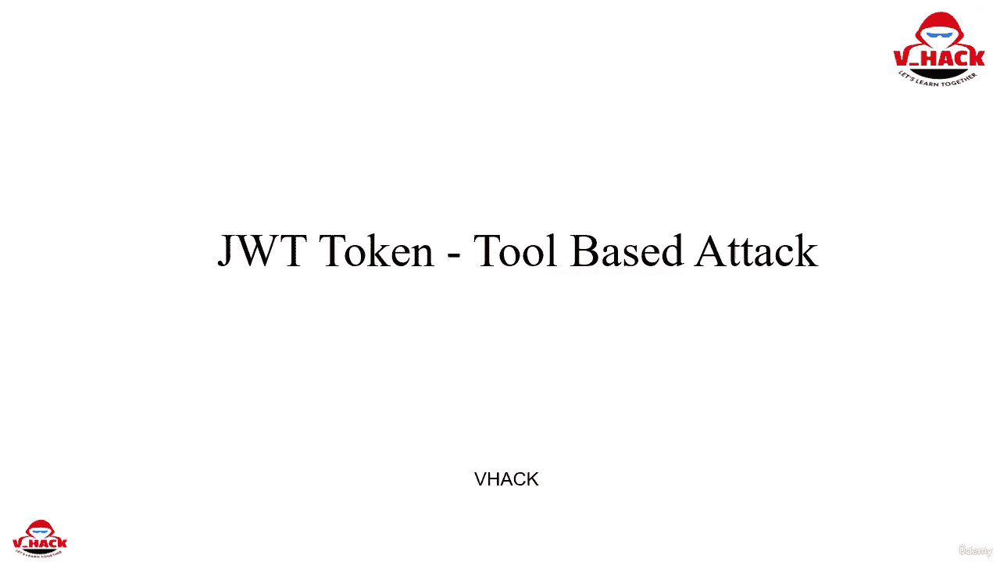
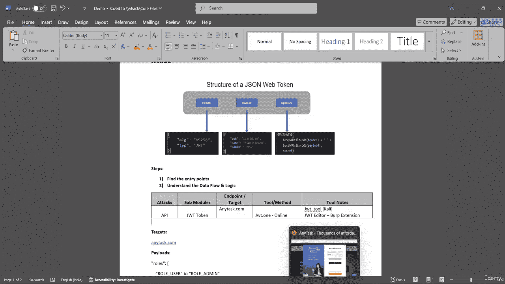
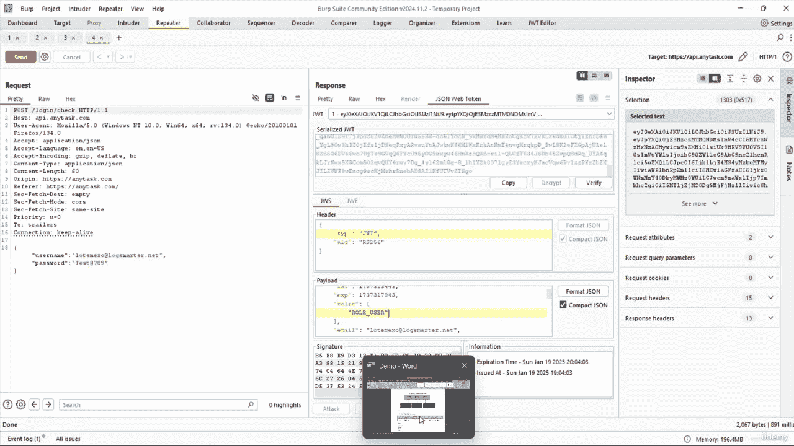
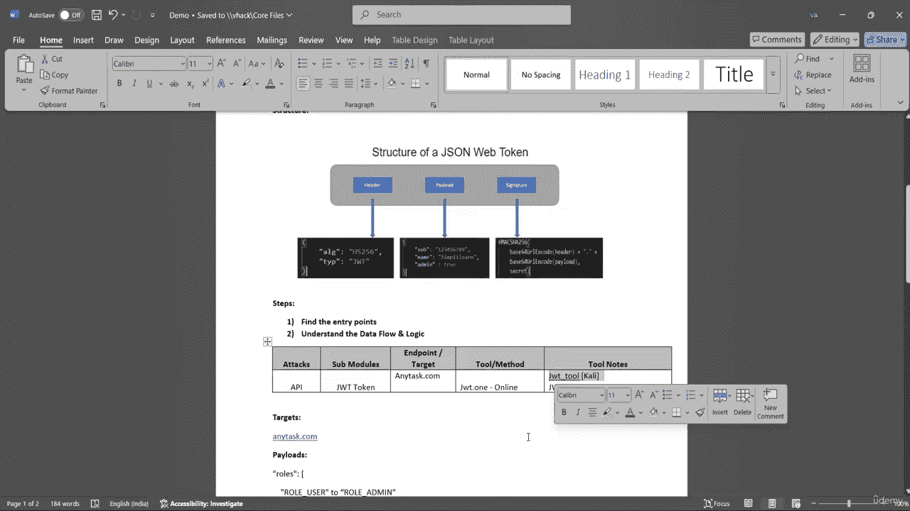
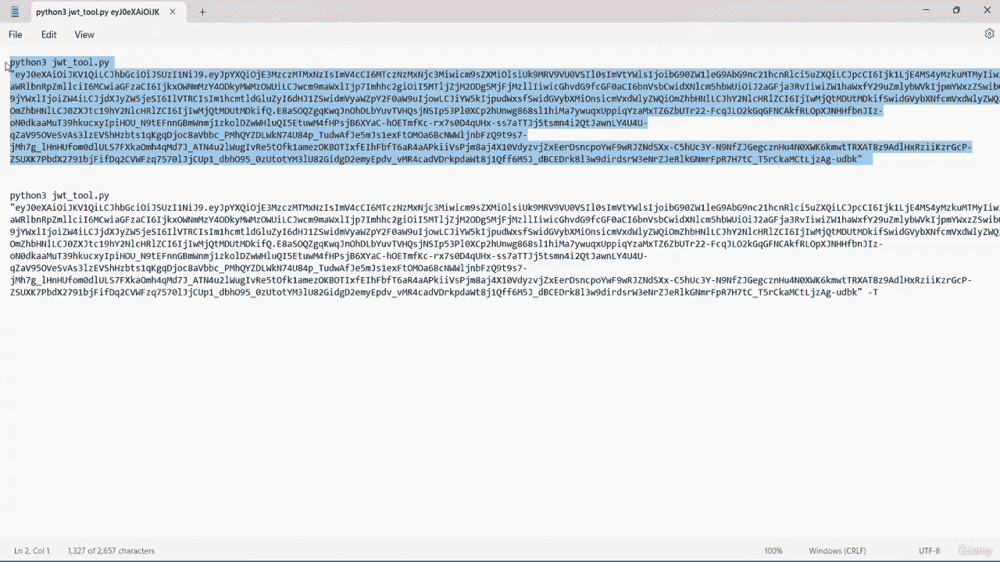
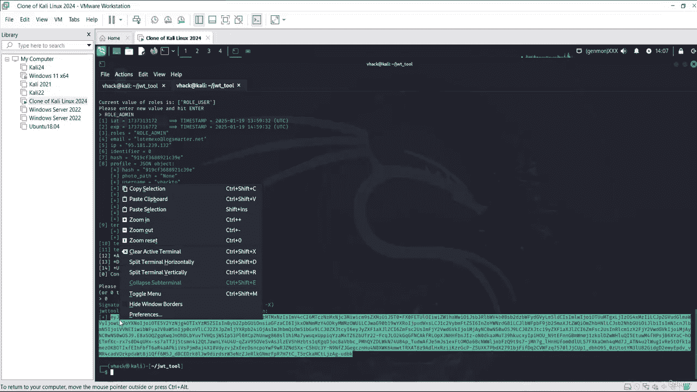
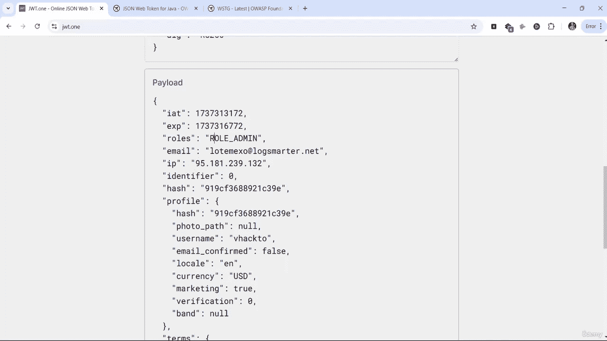
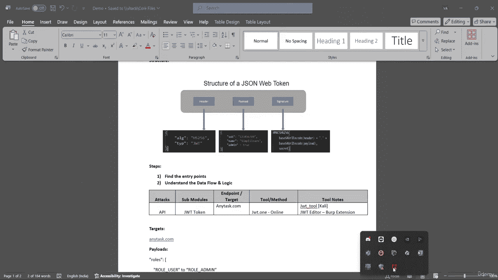

# Ethical Hacking 50-Day Challenge：15：JWT Token 基于工具攻击 🔑

在本节课中，我们将一起学习如何使用自动化工具对 JSON Web Token（JWT）进行基于工具的攻击。我们会先了解 JWT 的基本结构，然后讲解如何通过浏览器扩展和 Python 脚本来篡改令牌内容，最终实现越权访问或权限提升。无论你是刚接触渗透测试的新手，还是想要复习工具使用的学员，这节课都会用最直白的语言带你走一遍完整攻击流程。




## 前置概念：什么是 JWT 📄

上一节我们简单接触过 Web 令牌的概念，本节中我们先来看看 JWT 到底是什么。JWT 是一种在 Web 应用中广泛使用的身份验证和信息传输格式，它把头部、载荷和签名三部分用点号连接在一起。

```text
头部.载荷.签名
```

头部里通常记录签名算法，载荷中存放用户身份、角色等关键信息，签名则用来防止令牌被随意修改。如果攻击者能够修改载荷里的关键字段，并且绕过签名校验，就有可能以管理员身份登录系统。



在本节课的语境下，我们需要关注的核心公式可以简化为：

```python
JWT = base64url(头部) + "." + base64url(载荷) + "." + 签名
载荷 = {"user": "目标用户", "role": "管理员", ...}
```

也就是说，攻击者的目标往往是修改载荷里的 role 或 user 字段，从而获得更高权限。


## 工具准备：安装浏览器扩展 🧩

讲完 JWT 的基本结构之后，我们进入实际操作环节。利用浏览器扩展可以直接在请求中篡改令牌，省去手动解码的麻烦。常用的扩展包括 JWT Editor 等，安装后会在开发者工具面板中出现专门的 JWT 处理区域。

以下是安装和配置步骤：

1. 在浏览器扩展商店搜索 JWT Editor 或类似插件。
2. 点击安装，并将其固定到浏览器工具栏。
3. 打开目标网站，打开开发者工具，找到 JWT 面板。
4. 抓取正在发送的请求，将携带的 JWT 令牌加载到扩展中。

安装完成后，你就可以直接在浏览器里查看令牌内容，而不需要手动解码。


## 使用扩展修改令牌内容 🛠️



有了扩展之后，接下来就是实际修改令牌字段。通常我们会先查看当前令牌里的 role 或 user 字段，然后尝试将其改为更高权限的值，比如把普通用户改成管理员。



以下是常见的修改字段示例：

- role：从 user 改为 admin
- user：从 target_user 改为 administrator
- school：从普通学校改为管理学校

在扩展面板中，你只需要找到对应的键值对，修改右侧的值，然后保存并重新发送请求。如果服务器没有正确验证签名，修改后的令牌就会被接受，你就成功越权了。


## 使用命令行工具生成攻击令牌 🐍

除了浏览器扩展，我们还可以使用 Python 脚本来批量生成或篡改 JWT。上一节我们讲完了扩展的图形化操作，本节中我们来看看命令行工具是如何工作的。

通常需要准备的工具文件名可能类似于：

```bash
jwt_tool.py
JWT_po.py
JWT_pan_P3
```

运行命令的大致形式如下：



```bash
python3 jwt_tool.py <目标令牌> --payload '{"role":"admin"}'
```

或者在某些特定场景下，命令可能长这样：

```bash
python3 JWT_pan_P3 --input token.jwt --output modified.jwt
```

这里的关键在于，你需要告诉工具哪个字段要改，改成什么值。工具会自动处理 base64 编码和签名重算（如果密钥已知或存在签名绕过漏洞）。


## 实际攻击流程示例 🎯

综合扩展和命令行两种方式，完整的攻击流程可以拆解为以下几步：

1. 抓取目标接口返回的 JWT 令牌。
2. 使用扩展查看令牌内部的 role 或 user 字段。
3. 修改字段值，尝试提升权限。
4. 如果扩展无法注入，则使用 Python 脚本重新生成带恶意载荷的令牌。
5. 用新令牌再次访问目标接口，验证是否成功越权。

举个简单的例子，假设原始载荷是：

```json
{"user": "goal_user", "role": "role_0"}
```

我们希望将其改为：



```json
{"user": "admin", "role": "role_admin"}
```

然后用工具生成新令牌，替换掉请求头里的旧令牌，即可尝试以管理员身份访问。


## 注意事项与局限 ⚠️

基于工具的 JWT 攻击并不总是百分之百成功。如果服务器对令牌进行了严格的签名验证，或者使用了不可见的服务端密钥，单纯修改载荷会导致签名不匹配，请求会被拒绝。这时候攻击者需要寻找其他漏洞，比如算法混淆（将 RS256 改为 HS256）或密钥泄露，才能继续。



另外，在实际测试中一定要取得授权，不要在未经允许的系统上进行此类操作。




## 本节总结 📝

本节课中我们一起学习了 JWT 令牌的基础结构，以及如何使用浏览器扩展和 Python 命令行工具进行基于工具的攻击。我们掌握了安装 JWT 相关扩展、在面板中修改 role 和 user 字段、运行 Python 脚本生成伪造令牌的方法，并了解了这种攻击的成功条件与局限。希望通过这节课，你能对 JWT 安全测试有一个直观的认识，并在后续的实践中灵活运用。

