Ethical Hacking：50-Day Hacker Challenge：16 - JWT Token – Account Takeover [Live Target] 🔐


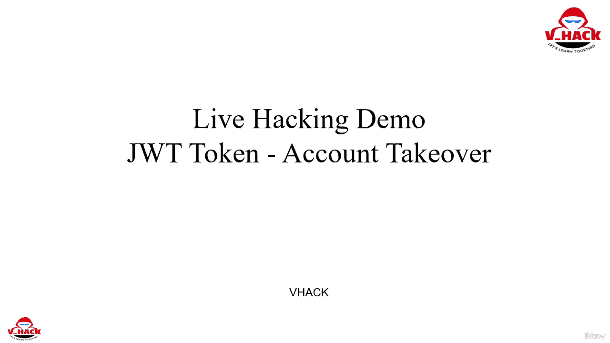

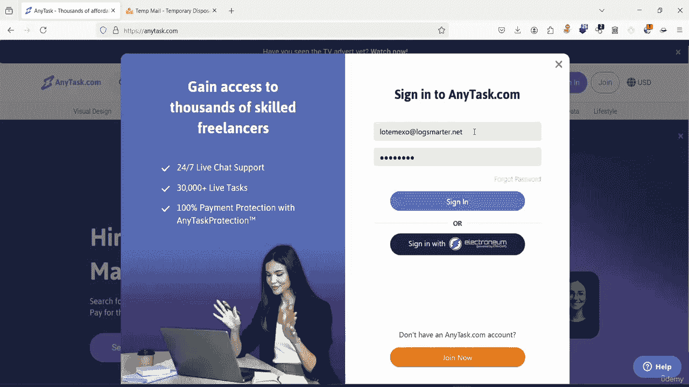

在本节课中，我们将一起学习如何利用 JWT Token 进行账号接管攻击。这是 50 天黑客挑战中的第 16 课，目标是在真实靶场上演示如何通过篡改令牌里的角色字段，获得管理员权限并接管账号。我们会先讲 JWT 是什么，再演示如何抓取请求、修改参数、发送请求，最后总结攻击原理和防御方法。整个过程使用大白话，适合初学者理解。


JWT Token 是什么


JWT 的全称是 JSON Web Token，它是一种在客户端和服务器之间传递声明的方式。你可以把它想象成一张带有签名的身份证，里面记录了用户的身份和权限信息。服务器收到这个令牌后，可以通过验证签名来确认内容没有被篡改。

JWT 的结构通常由三部分组成，中间用点号分隔：

```text
header.payload.signature
```

- header：说明令牌的类型和加密算法。
- payload：存放实际数据，比如用户名、角色、过期时间。
- signature：用密钥对前两部分进行签名，防止伪造。


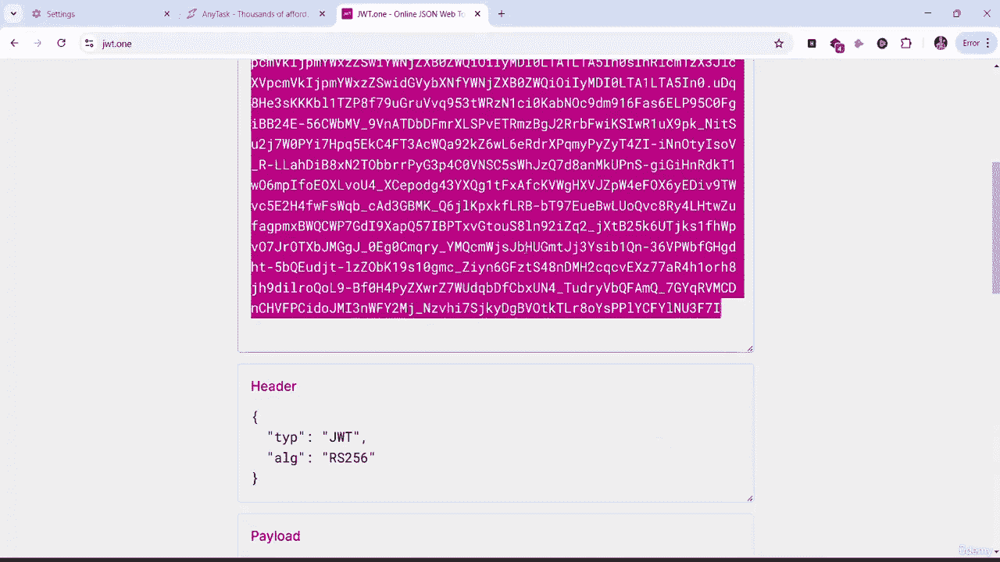

抓取请求并查看角色字段


在开始攻击之前，我们需要先捕获浏览器发送给服务器的请求。以下是抓取请求的具体步骤：

1. 打开浏览器的开发者工具，切换到 Network 面板。
2. 访问目标网站的门户页面，正常登录一个普通用户账号。
3. 找到发送给服务器的请求，点击查看详细内容。
4. 在请求头或请求体中寻找 JWT 令牌，通常会出现在 Authorization 字段里。
5. 复制令牌，使用解码工具查看 payload 部分的内容。


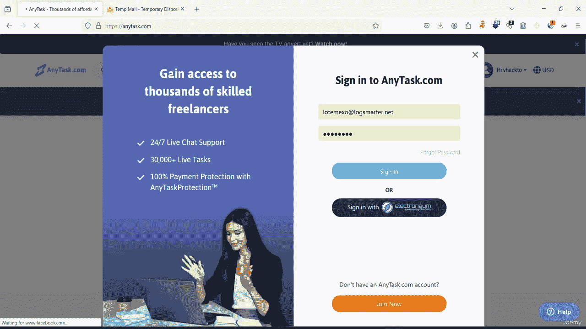

修改 JWT 中的角色参数


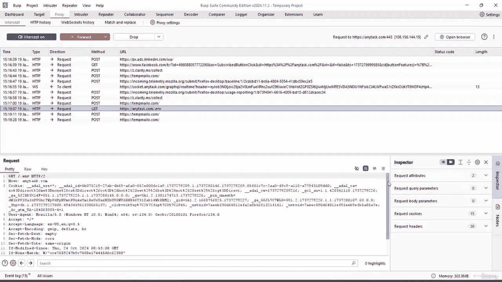

拿到令牌之后，我们需要检查里面是否包含角色字段，比如 role 或 is_admin。如果普通用户的令牌里角色被设置为 user，我们可以尝试把它改成 admin，然后重新签名或者直接发送修改后的令牌，看服务器是否会接受。以下是常见的修改思路：

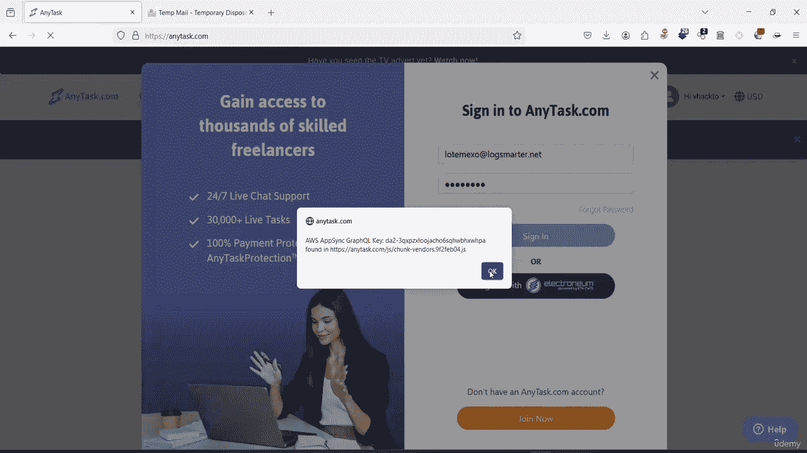

- 解码 JWT，将 payload 中的 role 字段从 user 改为 admin。
- 如果服务器没有严格验证签名，直接把修改后的令牌放回请求头。
- 重新发送请求，观察页面是否跳转到了管理后台，或者是否显示管理员专用功能。


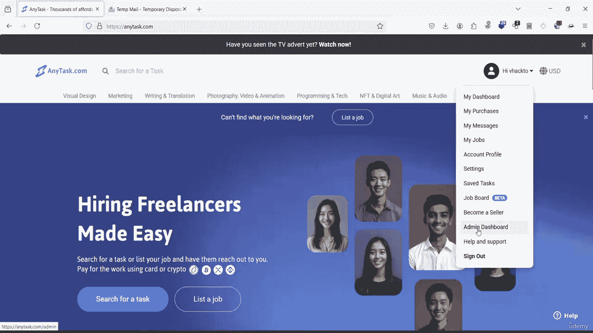

实战演示账号接管


假设目标网站有一个管理门户，地址类似于 example.com/admin。普通用户直接访问这个页面会被拒绝，但是如果我们手里有一个被篡改过的 JWT，服务器可能会把我们当作管理员放行。以下是实战演示的大致流程：

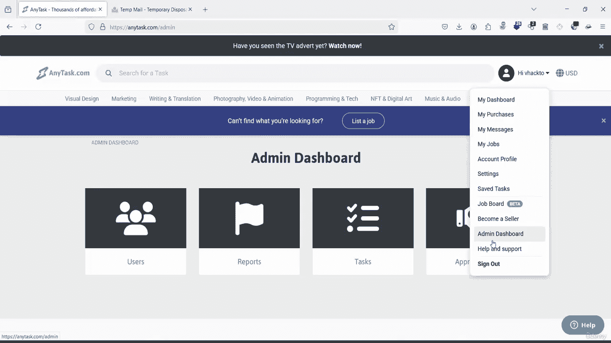

1. 使用 Burp Suite 或浏览器插件拦截登录后的请求。
2. 提取出 Cookie 或 Authorization 头中的 JWT 值。
3. 在线解码 JWT，把 role 字段改成 administrator。
4. 把修改后的 JWT 填回请求，转发给服务器。
5. 如果服务器返回管理页面内容，说明账号接管成功，此时可以查看其他用户的数据或修改系统设置。


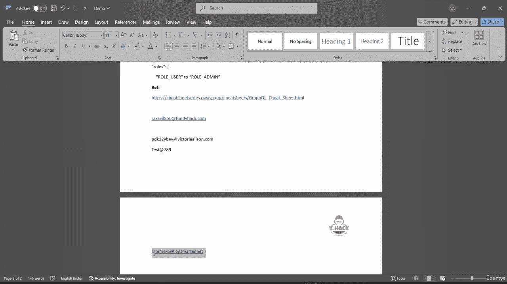

权限提升与防御建议


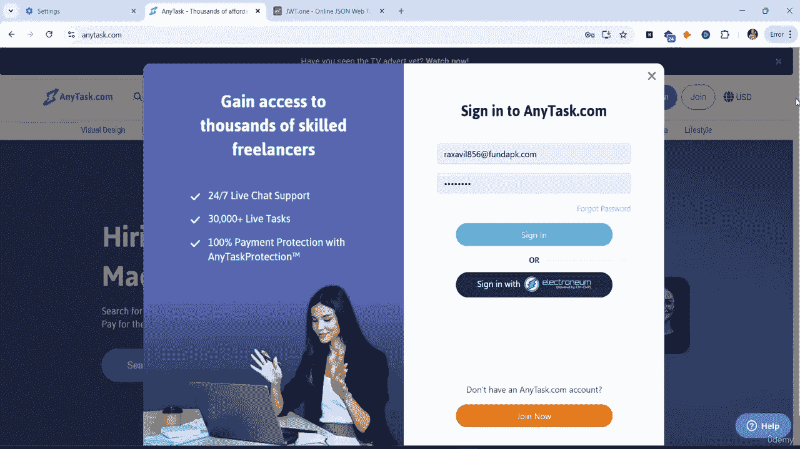

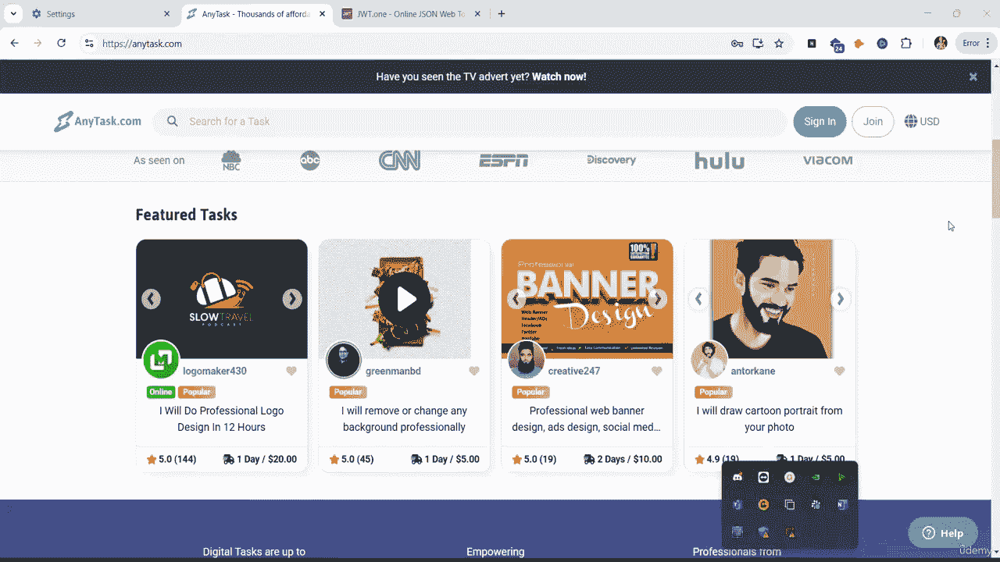

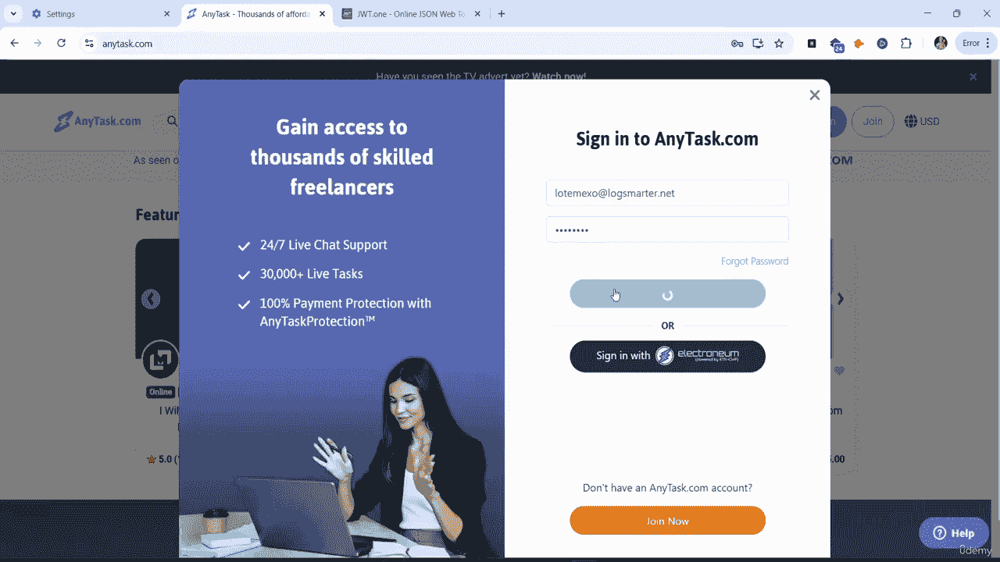

攻击者之所以能通过修改 JWT 实现账号接管，核心原因往往是服务器过度信任客户端传来的令牌内容，没有在服务器端再次校验用户的真实权限。为了防止这类问题，开发者应该在服务器端验证签名，并且不要把敏感权限仅仅保存在 JWT 的 payload 里。每次请求到达服务器时，都要根据令牌里的用户 ID 去数据库查询真实角色，而不是直接相信前端传来的 role 字段。


本节课总结


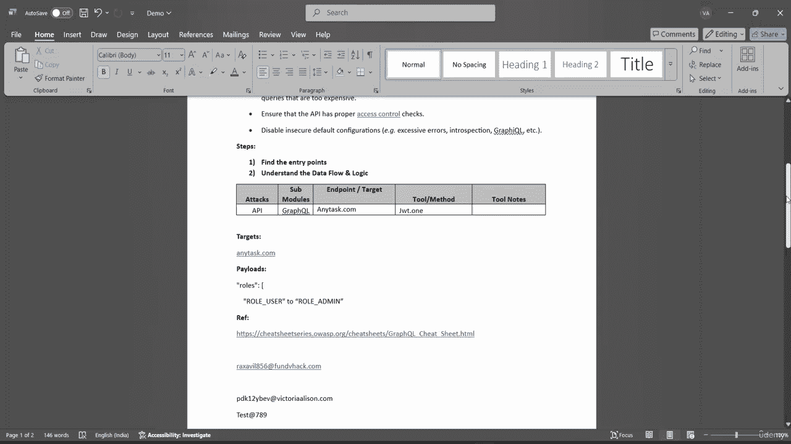

在本节课中，我们一起学习了 JWT Token 的基本结构，掌握了如何抓取请求并查看其中的角色字段，演示了通过修改 JWT 中的 role 参数来实现账号接管的完整过程，并讨论了权限提升的原理和简单的防御方法。希望这些内容能帮助你理解 Web 安全中令牌滥用的风险，并在实际渗透测试中注意相关的安全加固点。
