🛡️ Udemy - Ethical Hacking：50-Day Hacker Challenge：18：Web应用业务逻辑绕过与响应篡改

在本节课中，我们将一起学习Web应用中的业务逻辑绕过技术，重点讲解如何通过篡改服务器响应包来绕过OTP验证码校验，从而实现未授权的账号验证或权限提升。

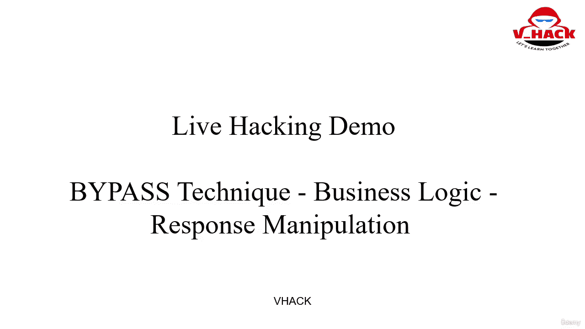

本节课首先回顾暴力破解和二次验证的基本思路，接着介绍临时邮箱在注册测试中的作用，然后演示如何拦截验证码发送请求，最后重点讲解如何修改服务器返回的响应内容，把验证失败改成验证成功，从而绕过业务逻辑限制。

---

### 一、业务逻辑验证的基本原理

在Web应用中，业务逻辑是指网站处理用户请求时遵守的规则和顺序。例如，用户注册后通常需要输入邮箱收到的验证码，服务器才会标记该邮箱为“已验证”。如果开发者只在页面上做了验证提示，而没有在服务器端再次核对，就可能存在被绕过的风险。

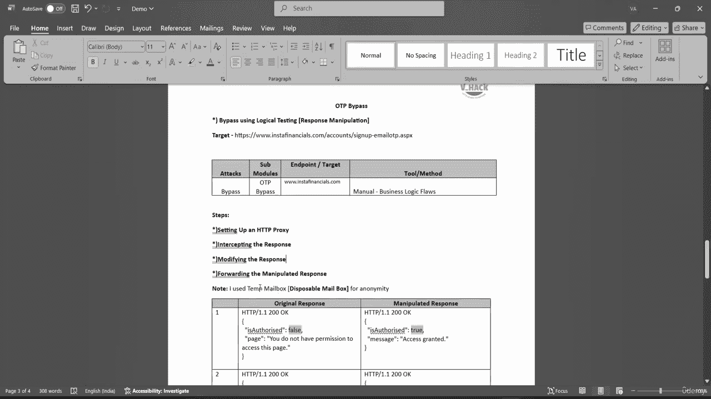

以下是常见的业务逻辑验证流程：

- 用户在注册页面填写邮箱并提交。
- 服务器生成一次性验证码，并通过邮件发送给用户。
- 用户收到验证码后在页面输入并提交。
- 服务器核对验证码是否正确，正确则标记验证通过，错误则拒绝。

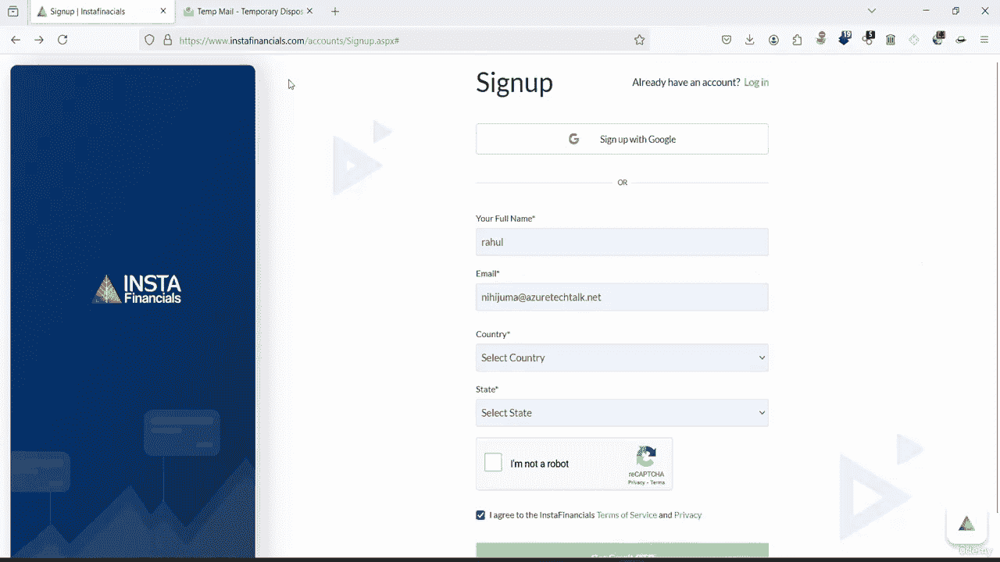

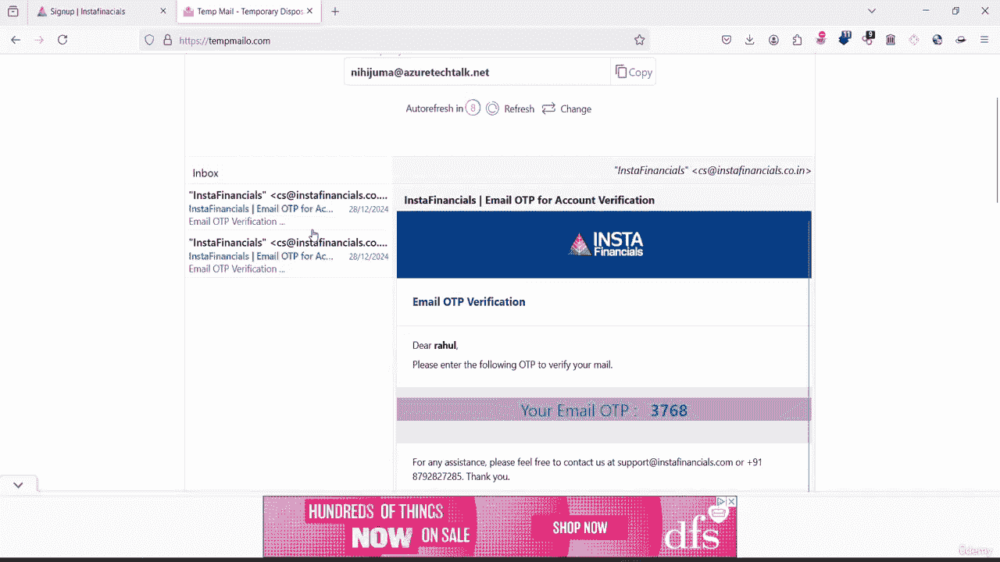

业务逻辑验证的核心可以用下面的公式描述：

```text
验证结果 = 服务器实际校验逻辑(用户输入, 服务器生成的期望值)
```

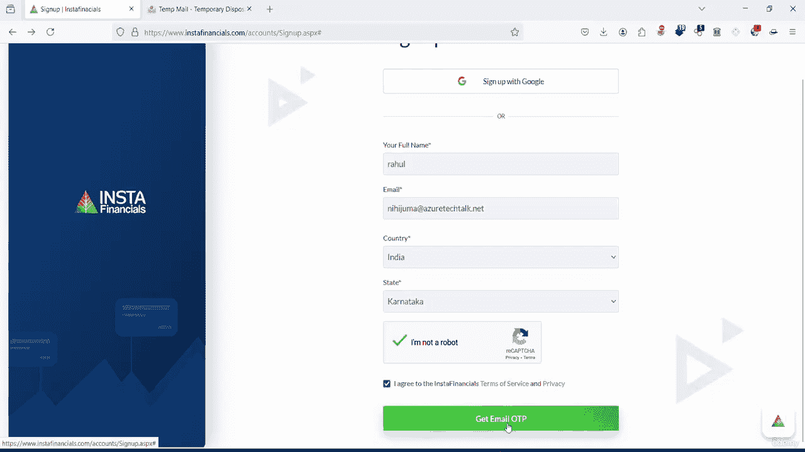

如果客户端只根据服务器返回的“成功/失败”标志来决定是否跳转，那么攻击者就可以修改这个标志，绕过真正的校验。

---

### 二、临时邮箱与验证码获取测试

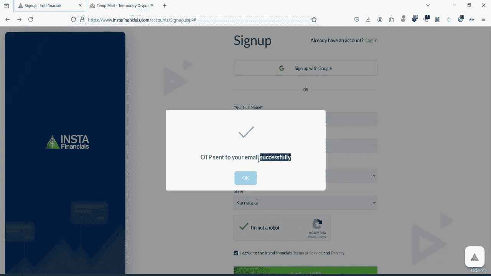

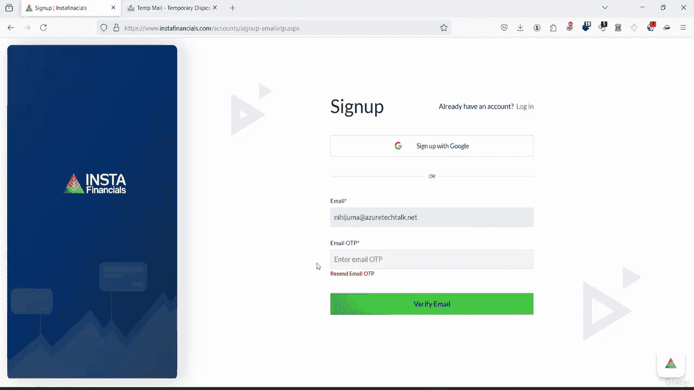

在测试业务逻辑漏洞时，我们经常需要使用临时邮箱来接收验证码，避免使用真实邮箱暴露个人信息。常见的临时邮箱服务可以快速生成一个一次性邮箱地址，用于接收注册确认邮件或验证码，方便测试人员进行多次尝试而不需要注册大量真实账号。

以下是使用临时邮箱进行测试的步骤：

1. 打开临时邮箱网站，复制生成的临时邮箱地址。
2. 在目标网站的注册页面填写该临时邮箱，并提交注册请求。
3. 返回临时邮箱页面，刷新收件箱，查看是否收到验证码邮件。
4. 记录邮件中的验证码数值，准备用于后续验证请求。

需要注意的是，网络流量可能会导致验证码到达时间延迟，通常需要等待十几秒，并且可能需要多次刷新页面才能看到新邮件，所以在测试时要保持耐心，不要过快地认为邮件没有发送成功。

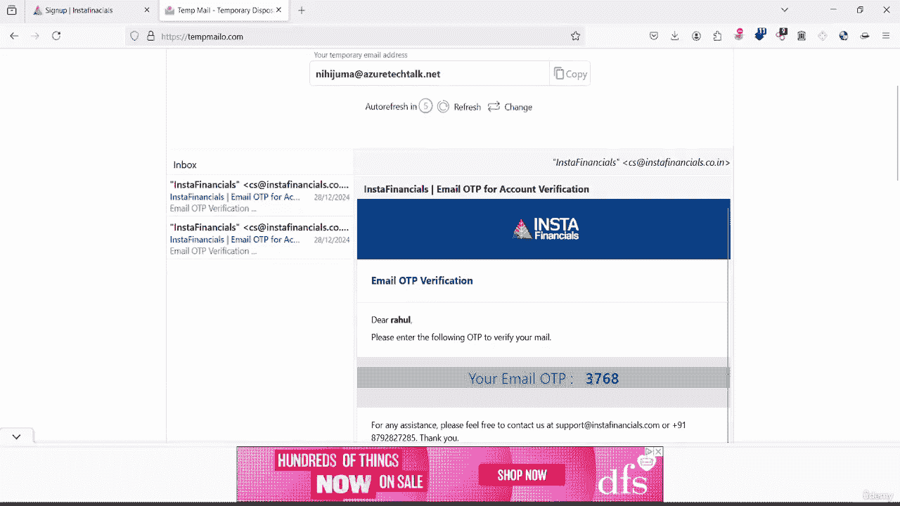

---

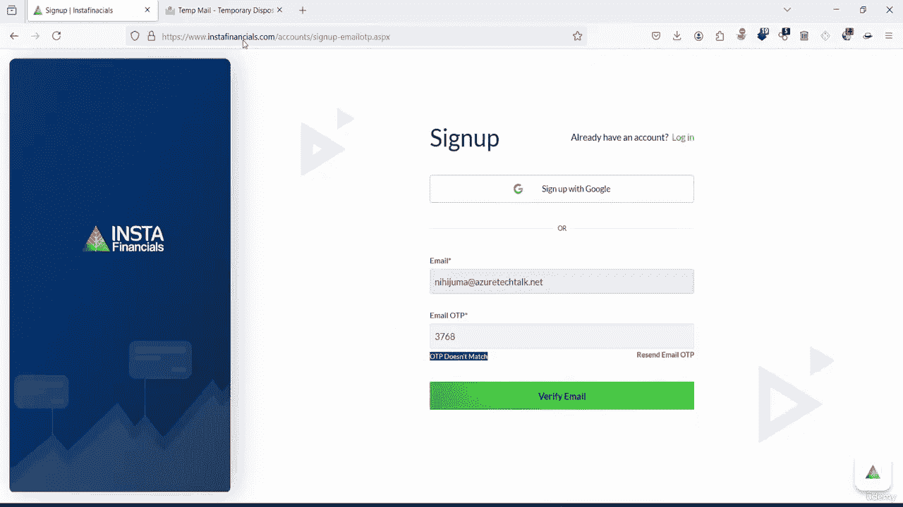

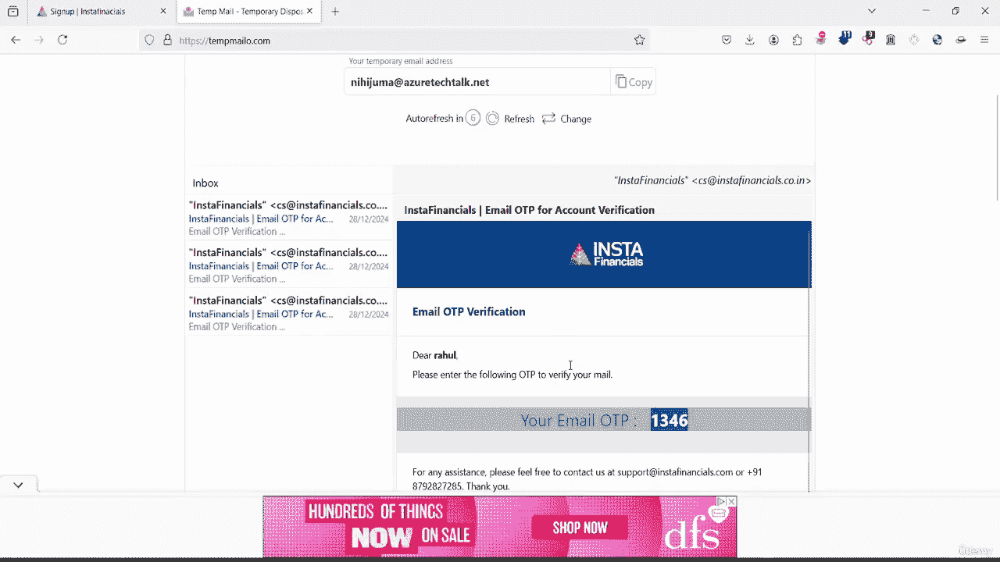

### 三、OTP验证码的拦截与错误测试

当我们拿到验证码后，下一步是尝试提交验证码，观察服务器的反应。这时候可以使用抓包工具拦截请求和响应包，查看服务器到底返回了什么内容，以及客户端是如何处理这些内容的，从而发现是否存在可以被篡改的验证逻辑。

以下是常见的验证码测试场景：

- 输入正确验证码，观察服务器是否返回“验证成功”。
- 输入错误验证码，观察服务器是否返回“验证码不匹配”。
- 不输入验证码直接提交，观察服务器是否会放行或报错。

在实际操作中，攻击者会反复尝试不同的验证码组合，寻找服务器校验逻辑中的薄弱点。例如，有些系统可能只校验验证码的长度，而不校验具体数值，或者在响应包中直接包含了验证结果，导致可以通过修改响应来绕过，而不需要真正知道正确的验证码是多少。

---

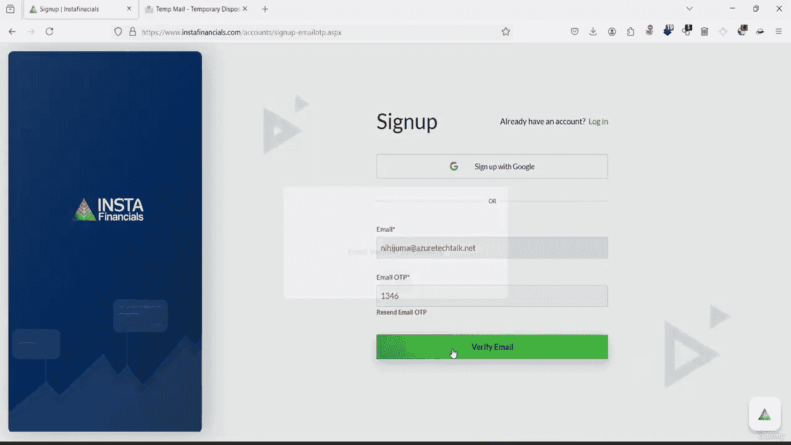

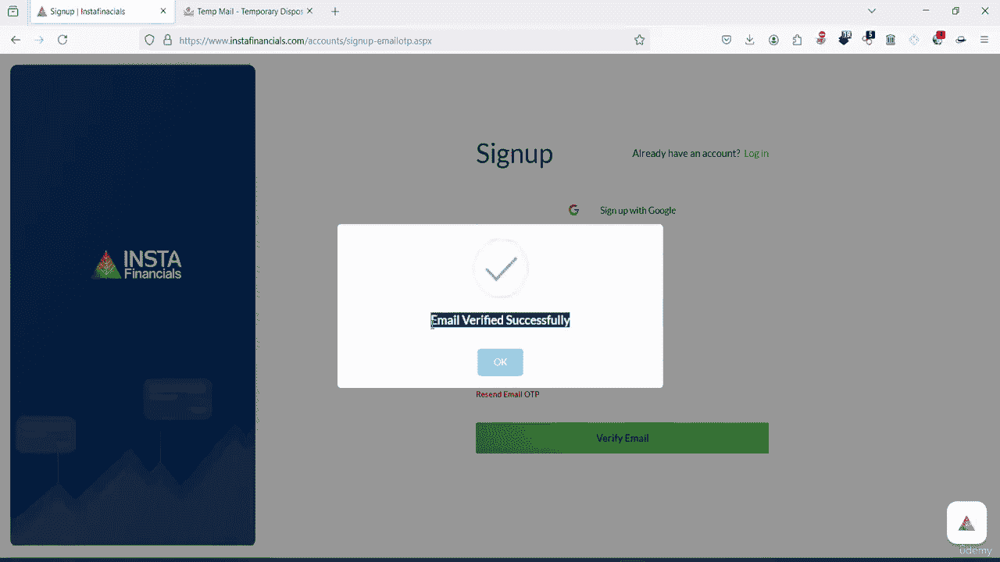

### 四、拦截并修改服务器响应包

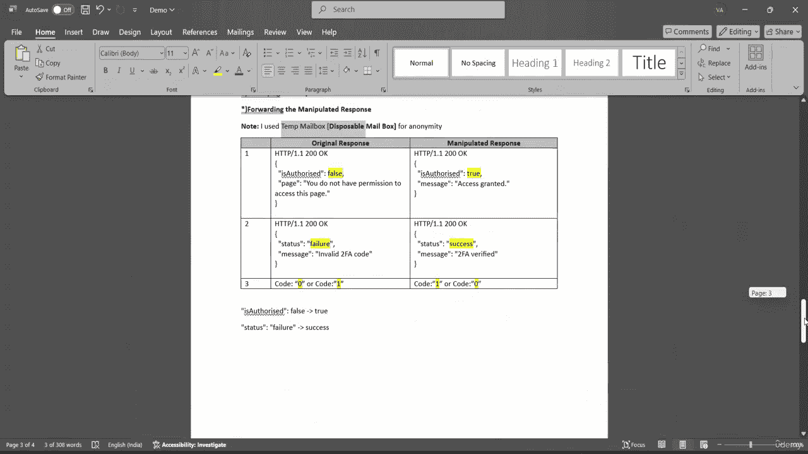

业务逻辑绕过中最关键的一步是拦截服务器返回的响应包，并修改其中的验证状态。通常情况下，当用户提交错误的验证码时，服务器会返回类似“OTP doesn't match”的错误信息，客户端收到后会提示验证失败。如果客户端完全信任这个返回结果，而没有向服务器再次确认，就可以通过篡改响应包来欺骗客户端。


以下是响应包修改的操作要点：

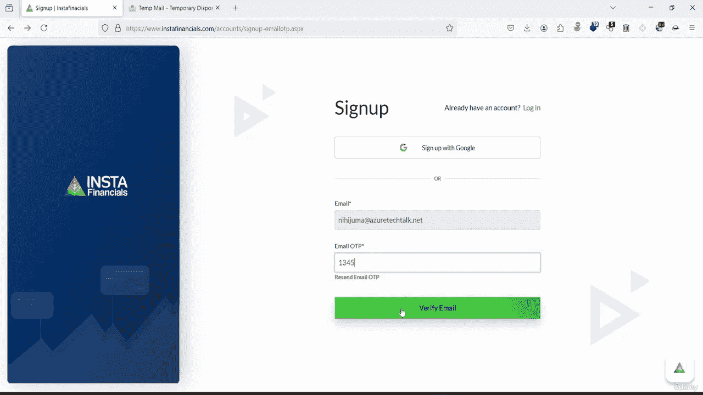

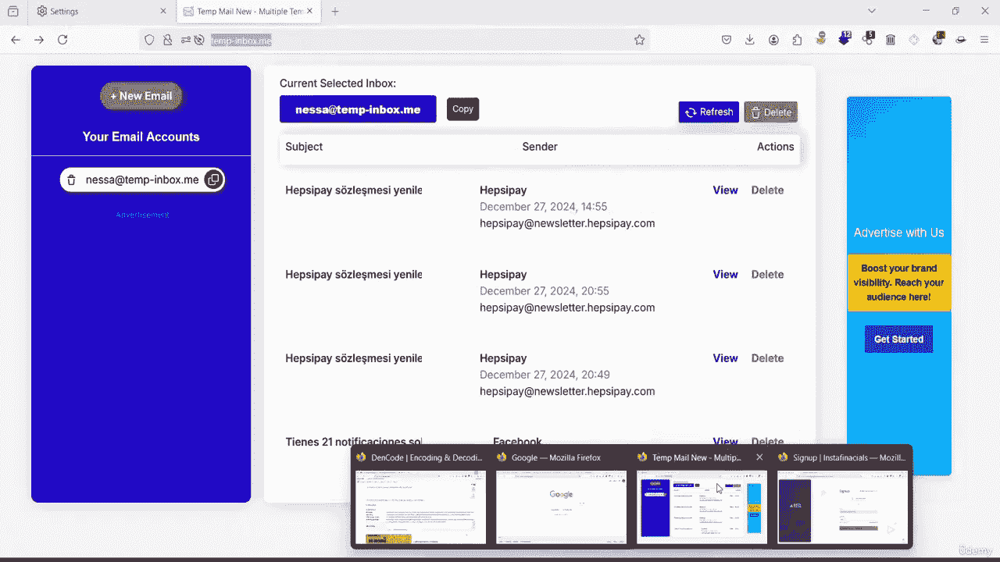

- 使用代理工具开启拦截功能，捕获验证码提交后的响应包。
- 在响应包中找到表示验证状态的字段，例如 `status`、`message` 或 `verified`。
- 将表示失败的内容修改为成功内容，例如把 `OTP doesn't match` 改为 `verified successfully`。
- 放行修改后的响应包，让客户端接收到错误的验证结果。

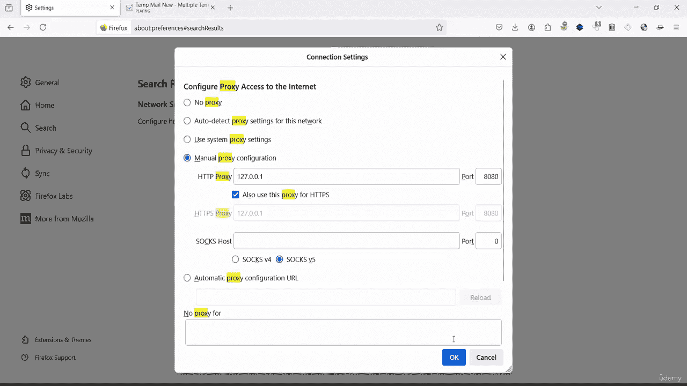

核心操作逻辑可以用下面的代码片段理解：

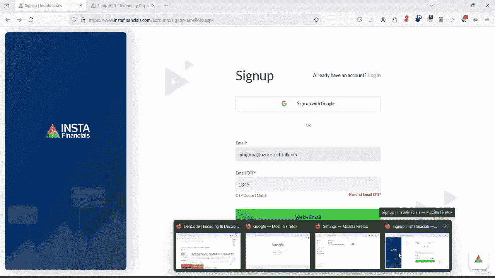

```python
# 伪代码示例：修改服务器响应包
if response.contains("OTP doesn't match"):
    response.body = response.body.replace("OTP doesn't match", "verified successfully")
forward(response)
```

这样一来，客户端就会以为验证码校验已经通过，进而允许用户完成注册或登录，尽管实际上验证码是错误的，服务器并没有真正完成校验。

---

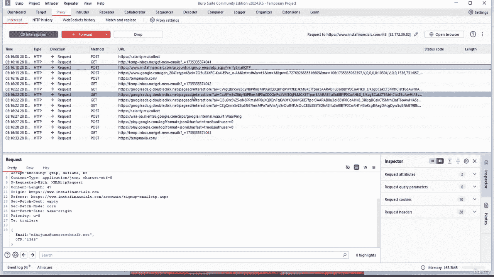

### 五、业务逻辑绕过演示与验证

在实际演示中，我们可以先提交一个错误的验证码，观察服务器返回错误响应。然后拦截该响应包，修改验证状态，再将其发送给浏览器，观察页面是否因此发生变化，从而判断目标系统是否存在业务逻辑漏洞。

以下是演示的关键步骤：

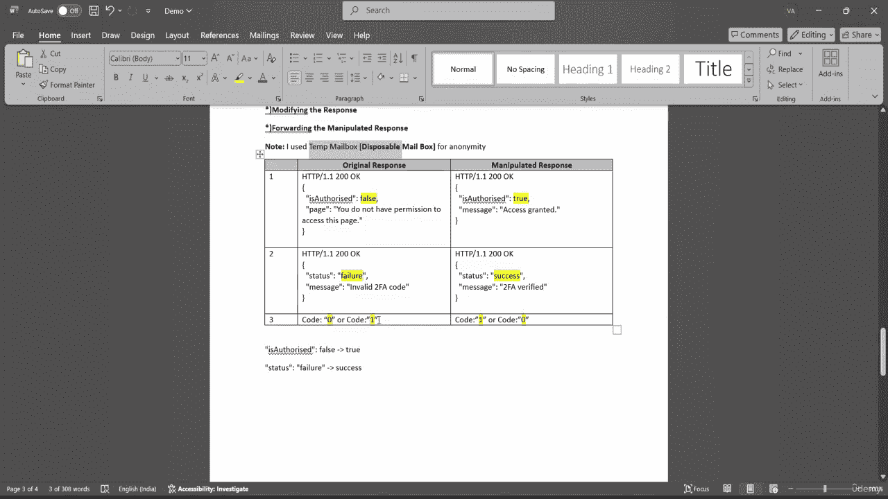

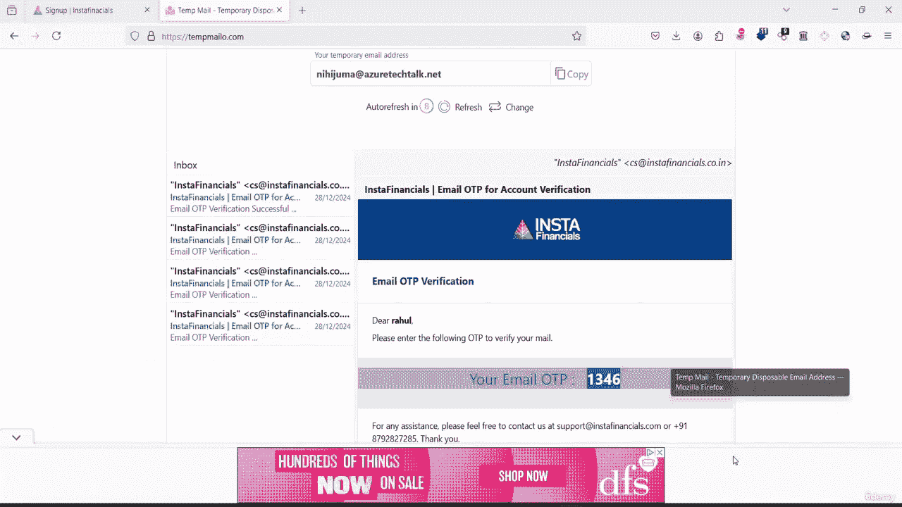

1. 在注册页面提交错误验证码，例如输入 `1346`，而实际验证码是 `3768`。
2. 抓包工具拦截到服务器返回的响应包，其中包含错误提示。
3. 修改响应包中的验证状态字段，将其改为“验证成功”。
4. 放行响应包，观察页面是否跳转到下一步或显示账号已激活。

如果页面成功跳转，说明该Web应用存在业务逻辑漏洞，服务器没有对客户端接收到的验证结果进行二次校验，完全依赖前端展示的状态，这种情况在真实渗透测试中非常常见，也是业务逻辑漏洞的典型表现。

---

### 六、本节总结

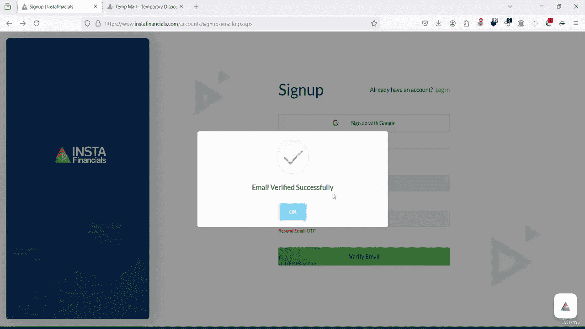

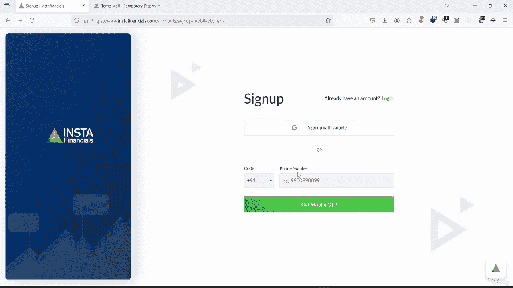

在本节课中，我们一起学习了Web应用业务逻辑绕过与响应篡改的基本方法。我们介绍了业务逻辑验证的原理，讲解了如何使用临时邮箱获取验证码，演示了OTP验证码的拦截与错误测试，并重点展示了如何修改服务器响应包以绕过验证码校验。

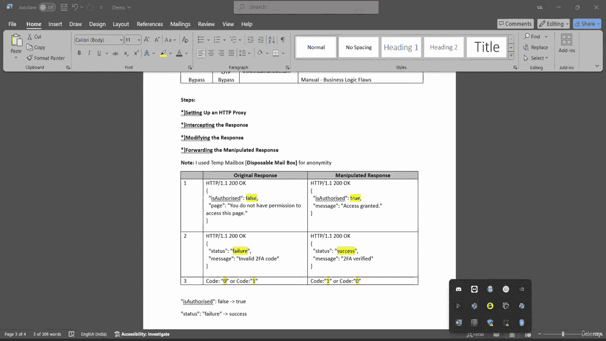

通过本节课的学习，你应该理解：业务逻辑漏洞往往不在于代码是否有缓冲区溢出，而在于开发者错误地信任了客户端接收到的服务器响应。在实际测试中，始终要记住，客户端展示的内容不可信，真正的安全校验必须在服务器端完成，不能依赖前端返回的成功标志来决定用户权限。
