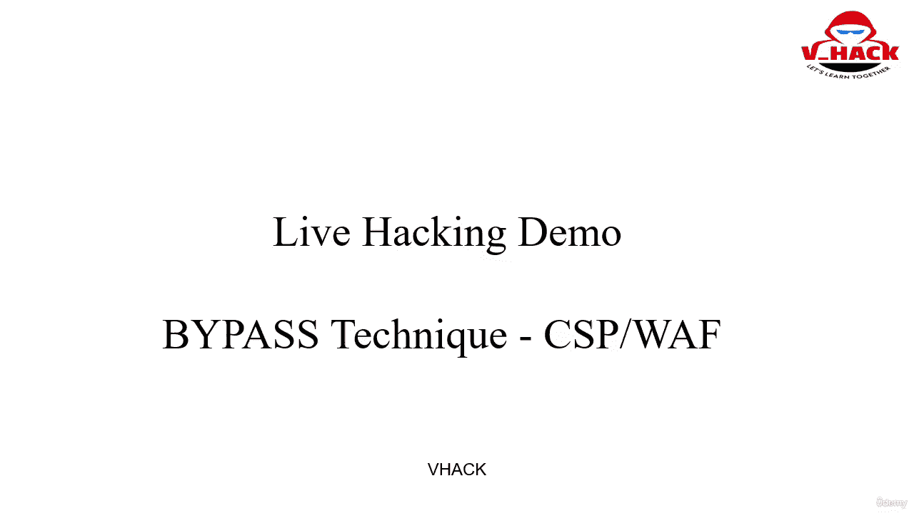
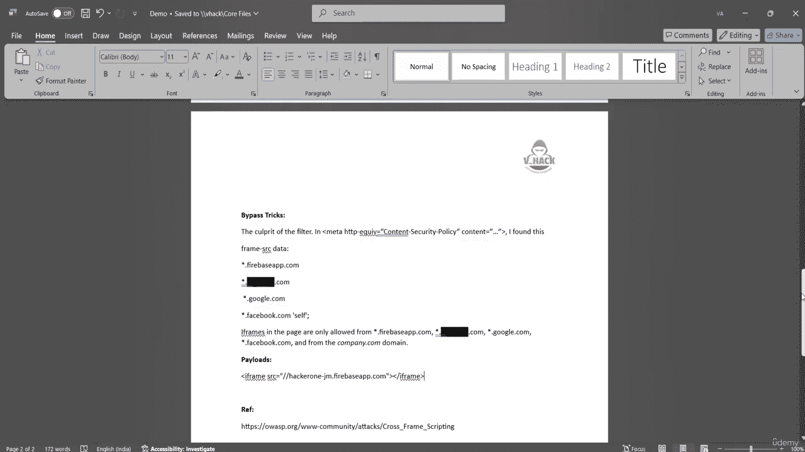
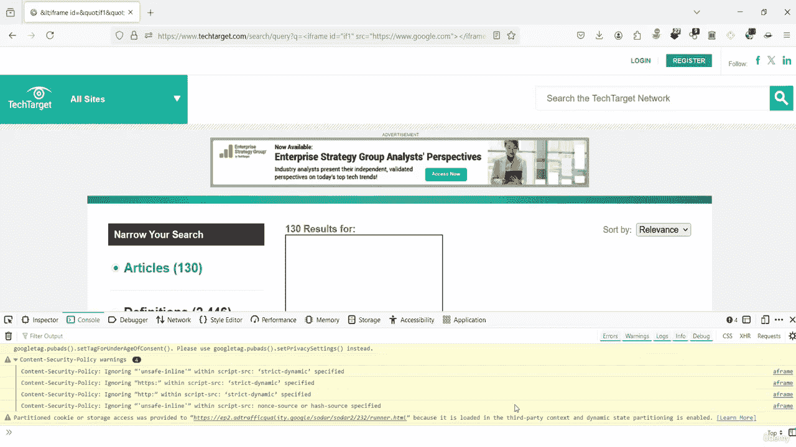
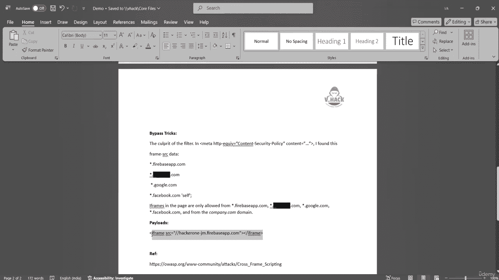
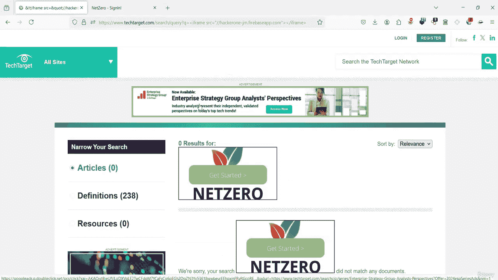
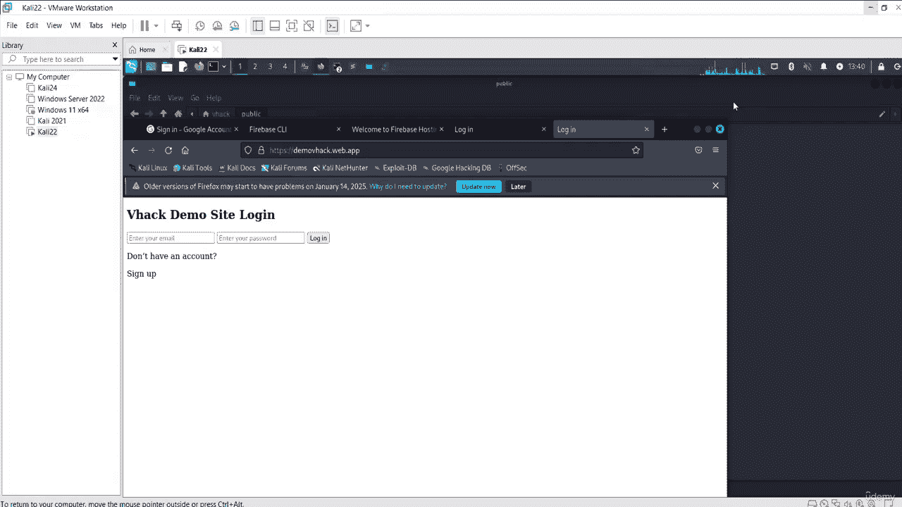
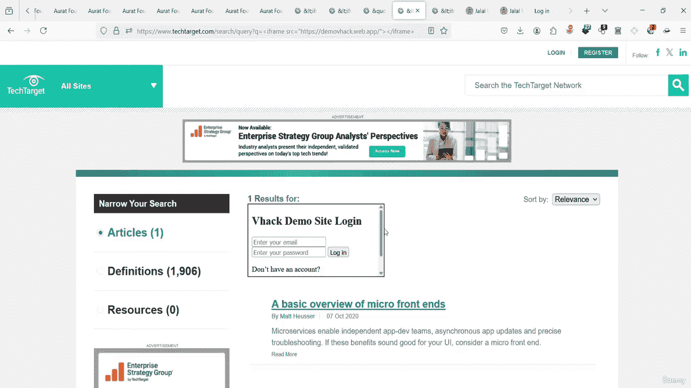
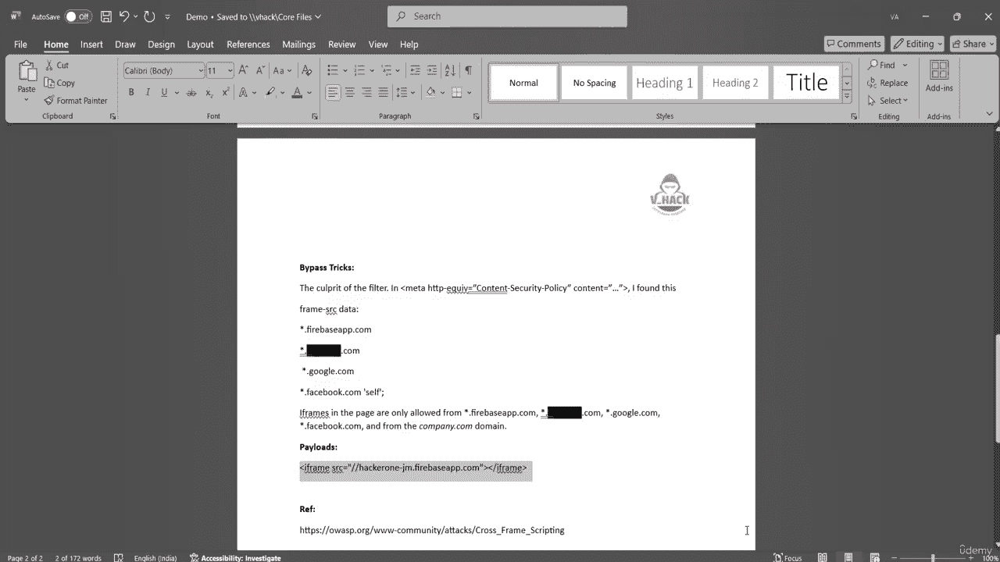
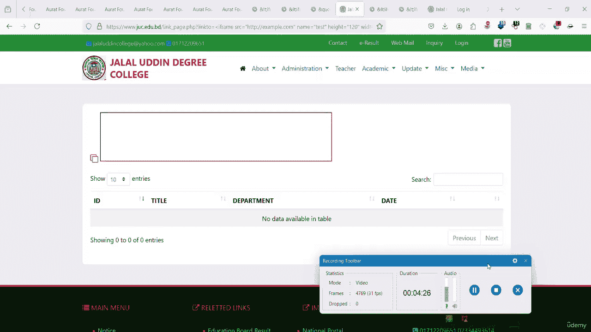

# 🛡️ Ethical Hacking：19：Web应用CSP绕过技术（Firebase）




在本节课中，我们将学习如何利用Firebase来绕过Web应用的内容安全策略，也就是CSP，并掌握一些基础的Web渗透测试思路。这一节的内容专门为初学者准备，我们会用最直白的大白话来讲解每一个概念，不需要你有深厚的编程基础，也能听得懂。主要目标是让你明白攻击者是如何观察目标网站、寻找注入点，以及在什么条件下可以绕过CSP限制。


内容安全策略（CSP）是浏览器用来防止恶意脚本运行的一种安全机制，简单来说就是通过一条响应头告诉浏览器，哪些资源可以加载，哪些脚本可以执行。Firebase是Google提供的后台服务平台，开发者可以直接在网页前端调用它来做用户登录、数据存储和应用托管。当CSP配置不严格时，攻击者就有机会借助Firebase等第三方服务绕过限制，在目标页面中运行未经授权的代码。下面是一个常见的CSP响应头示例：

```http
Content-Security-Policy: default-src 'self'; script-src 'self' https://trusted.cdn.com
```



Firebase应用在前端初始化时通常需要一段配置代码，长这样：



```javascript
firebase.initializeApp({
  apiKey: "AIza...",
  authDomain: "project.firebaseapp.com",
  databaseURL: "https://project.firebaseio.com"
});
```


了解了这些基础概念之后，我们回到具体的演示场景。在patternna Web应用的演示环境中，攻击技术主要围绕注入框架展开，而各种应用安全工具在实际测试中被广泛使用。注入框架的作用是把可疑输入发送到服务器或前端，如果目标网站没有做好过滤，就可能触发安全漏洞。我们接下来会重点看看Firebase应用是在页面中怎样被渲染的。


而Firebase在页面中的具体表现，也是我们需要重点观察的地方。Firebase应用或者Google的相关服务，经常出现在Facebook上的Maria域名页面中，这些页面会直接在前端渲染Firebase应用。举个例子，Na应用里的Firebase初始化过程就可能被攻击者观察到。当页面在浏览器中加载Firebase脚本时，如果CSP没有严格限制脚本来源，外部域就有机会注入代码。




在页面加载Firebase应用时，通常会出现下面几种常见的引入方式：

- 在HTML页面中直接写入Firebase的CDN脚本标签
- 通过JavaScript动态创建script标签，去加载Firebase SDK
- 从某个第三方域名请求Firebase的配置文件


光看页面怎么加载还不够，攻击者更关心的是后台框架是否存在可利用的缺陷。接下来我们看后台框架攻击的示例。攻击者会先尝试找到测试用户和测试数据库，然后检查这些资源是否可以通过前端直接访问。如果测试环境没有做好隔离，或者Firebase的安全规则设置得太宽松，攻击者就能读取或修改本不应该被外界看到的数据。






在测试阶段，通常会重点检查下面这些对象：

- 测试用户的登录凭证和权限范围
- Firebase数据库的读写安全规则
- 前端页面中暴露的API密钥和项目ID






除了当前的测试目标，类似的问题在其他网站上也很常见。除了上述目标之外，还有一些其他网站存在类似的配置问题，Peninsula上的玩家也常常会遇到这类情况。这类网站可能在不同的域名下托管Firebase应用，或者在社交媒体页面中嵌入了未加固的前端代码。


这些额外目标网站通常具备下面几个共同特点：

- 页面中直接渲染Firebase初始化代码
- CSP头部缺失，或者配置过于宽松
- 前端调用了来自未知域名的脚本资源


回顾一下今天讨论的所有目标，我们可以发现很多网站在前端暴露了不应该公开的信息。到目前为止，本次演示的内容就到这里了。剩下的实际攻击演示和深度利用技巧，我们将放在下一次演示中继续讲解。




在本节课中，我们一起学习了如何识别Web应用中基于Firebase的CSP绕过风险，了解了注入框架的基本作用，并梳理了测试用户、数据库以及其他目标网站的常见检查点。希望这些内容能帮助你建立起对Web应用安全测试的初步认识。

