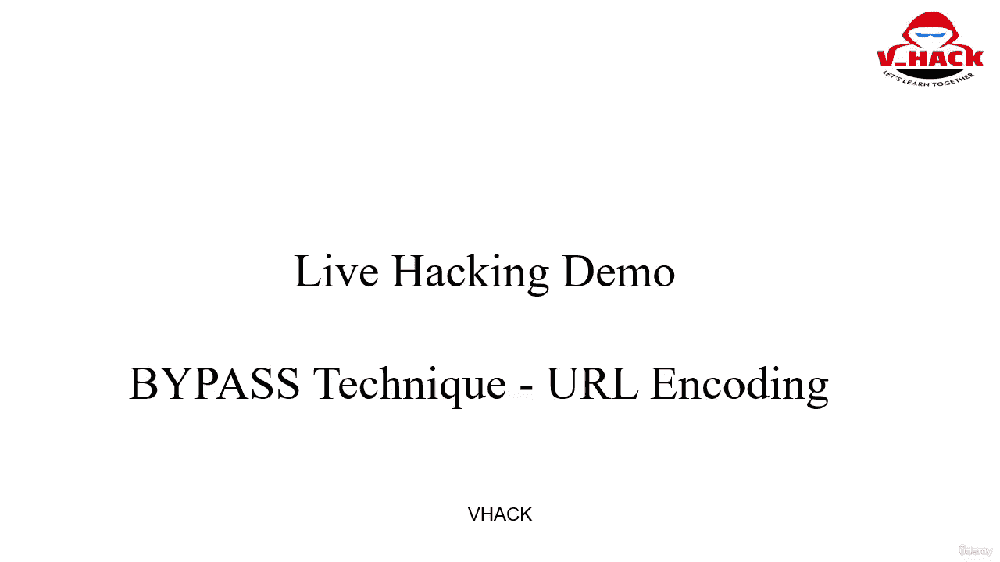
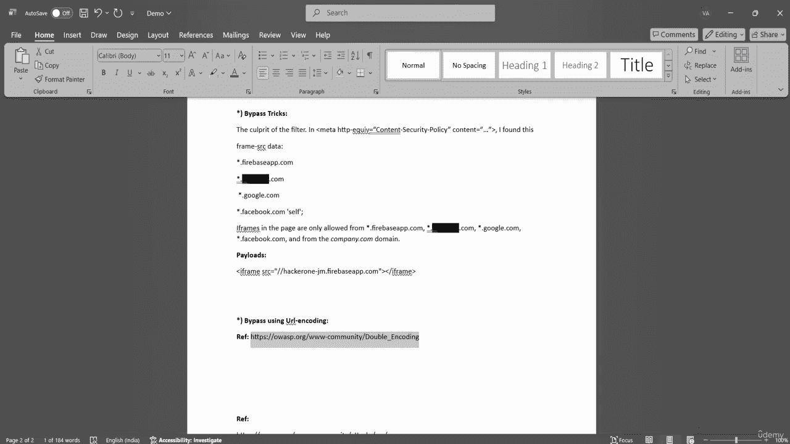
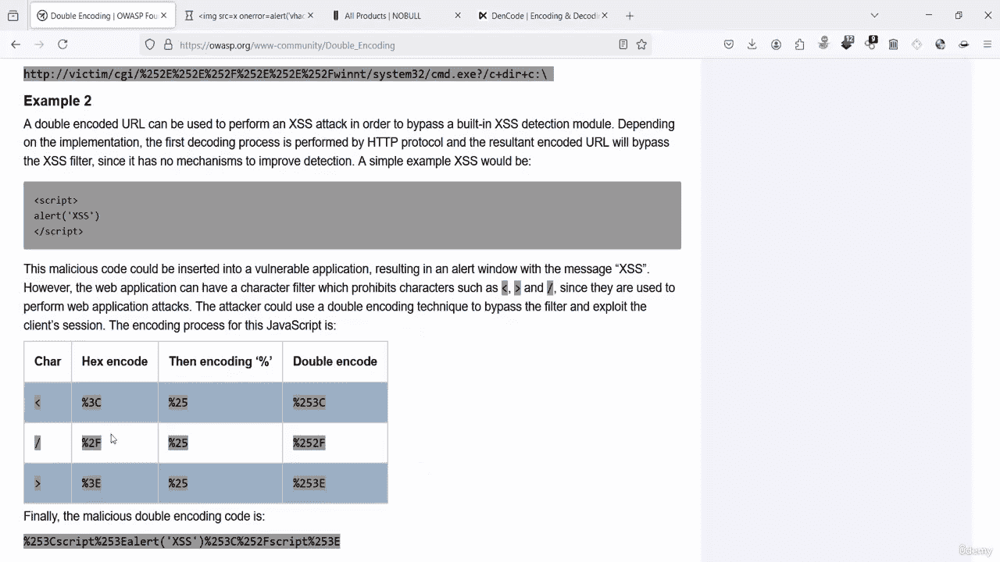
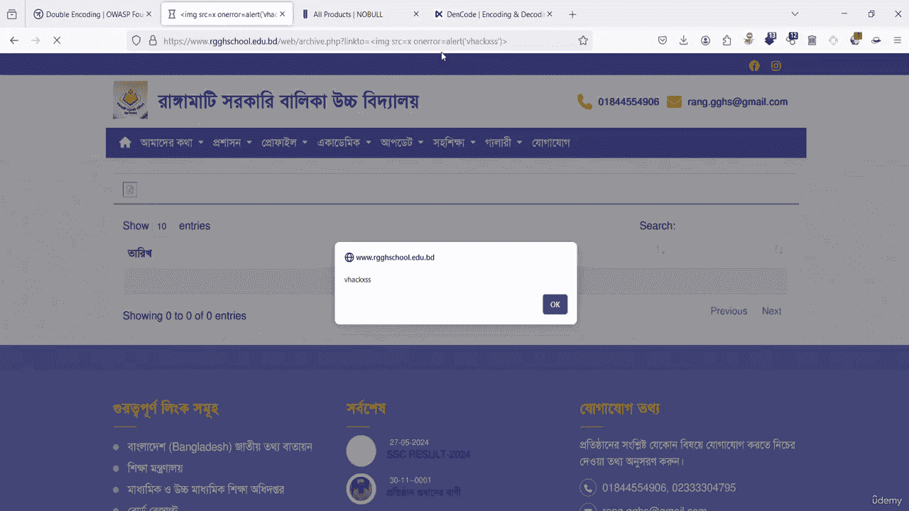
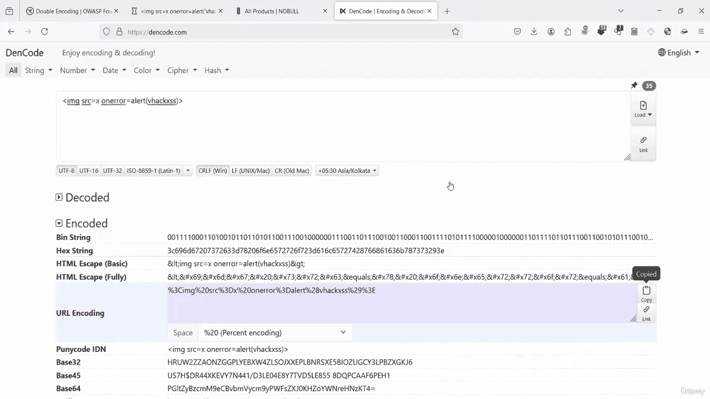
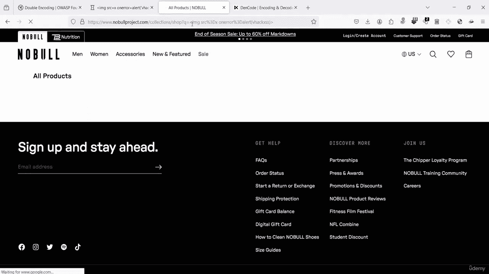
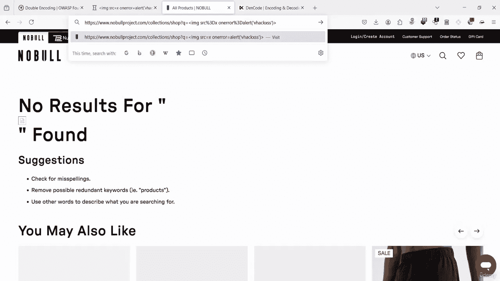
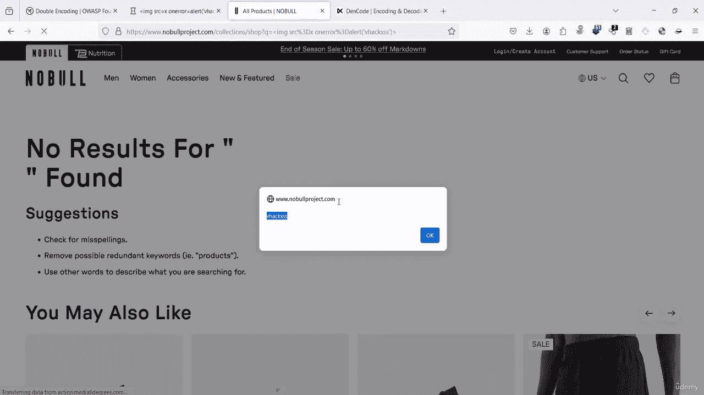

Ethical Hacking：20：Web应用绕过技术——URL编码与双重编码 🛡️



在本节课中我们将要学习Web应用安全中的绕过技术，重点围绕URL编码和双重编码展开。同学们，这部分内容非常实用，因为真实的渗透测试中，经常会遇到防火墙或应用层过滤器拦截攻击 payload。通过本节课，你将理解攻击者如何利用编码手段绕过这些安全控制，并在最后通过一个真实靶场演示完成一次完整的绕过过程。


什么是URL编码

在正式进入演示之前，我们先搞清楚URL编码到底是什么。URL编码是一种把特殊字符转换为百分号加十六进制代码的机制，目的是让字符可以安全地出现在URL地址中。例如，小于号`<`会被编码为`%3C`，空格会被编码为`%20`或`+`。当Web应用接收到包含编码字符的请求时，服务器通常会先进行一次解码，还原成原始字符，然后再处理业务逻辑。

下面是几个常见的URL编码示例：

```
<  ->  %3C
>  ->  %3E
"  ->  %22
'  ->  %27
空格  ->  %20
```

在Web安全攻击中，SQL注入、跨站脚本（XSS）、命令注入等多种注入攻击，都可能因为URL编码而改变 payload 的外观，从而尝试绕过简单的字符串匹配过滤。


各类注入与安全过滤

了解了编码基础后，我们来看看这些编码技巧在实际攻击中是如何发挥作用的。在实际的Web应用层，防火墙或入侵防御系统会实现过滤功能，用于拦截常见的攻击特征。当过滤器只检查原始请求，而不对编码后的内容进行完整还原时，攻击者就有机会绕过防御。

以下是几种常见的注入类型，它们都可能受到编码绕过的影响：

- SQL注入：通过构造数据库查询语句，窃取或修改后台数据。
- XSS跨站脚本：通过在页面中注入恶意脚本，窃取用户Cookie或会话信息。
- 命令注入：通过在输入参数中插入系统命令，在服务器上执行未授权操作。



这些攻击在面对双层安全机制时，防御难度会增加，但攻击者也会通过多次编码来寻找绕过路径。




双重编码的定义与原理



刚才我们提到了各类注入和安全过滤，接下来重点讲解本节课的核心概念——双重编码。双重编码是指对同一个参数值进行两次URL编码。第一次编码后，字符变成了百分号开头的形式；第二次编码会把第一次编码中的百分号`%`本身再次编码，变成`%25`。因此，原本的`<`经过双重编码后，会变成`%253C`。

公式如下：

```
原始字符: <
第一次编码: %3C
第二次编码: %253C
```

当服务器或安全设备只执行一次URL解码时，`%253C`会被还原为`%3C`，而此时如果安全设备已经完成检查并放行，后续应用层可能会再次解码，最终还原成危险的`<`字符，从而触发攻击。这就是双重编码绕过安全控制的核心原理。

在某些场景下，单重编码会被拦截，而双重编码则可能成功绕过，因此在渗透测试中这是一个值得重点尝试的技巧。




实战演示：利用双重编码绕过



理论部分讲完了，我们现在进入实战环节，看看如何在真实靶场中应用这个知识点。假设目标网站地址类似于`denco.com`，我们需要打开浏览器，访问目标页面并找到可注入的参数点。

以下是本次演示的关键步骤：



1. 打开浏览器，输入目标网站的地址，确认页面能够正常加载。
2. 找到GET请求的参数位置，例如参数名为`girl`，我们需要给这个参数赋值。
3. 构造一个XSS测试 payload，例如使用图片标签配合错误处理事件来触发弹窗。
4. 对该 payload 进行URL编码，得到第一层编码结果。
5. 再次对编码结果进行URL编码，得到双重编码后的最终字符串。
6. 将双重编码后的字符串复制到浏览器地址栏的参数值中，发送请求。
7. 观察服务器响应，验证是否成功绕过过滤并触发脚本执行。

代码示例，展示单层与双层编码的对比：

```
单层编码:  %3Cimg%20src=x%20onerror=alert(1)%3E
双层编码:  %253Cimg%2520src%3Dx%2520onerror%3Dalert%281%29%253E
```

在演示过程中，你会发现当我们把双重编码后的值填入参数并提交时，防火墙可能因为只识别了一层编码而放行请求，而后端应用在两次解码后，最终执行了我们构造的攻击代码。




本节小结

今天的演示就到这里。本节课中我们一起学习了Web应用绕过技术中的URL编码与双重编码。我们了解了什么是URL编码，常见的注入类型如何受到编码影响，双重编码的定义与绕过原理，以及如何在真实靶场中通过双重编码绕过安全过滤。希望同学们课后动手实践，在合法授权的环境下复现演示过程，加深对编码绕过技术的理解。

