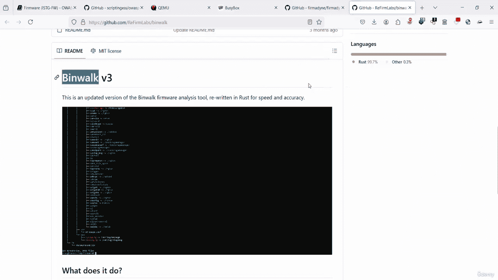
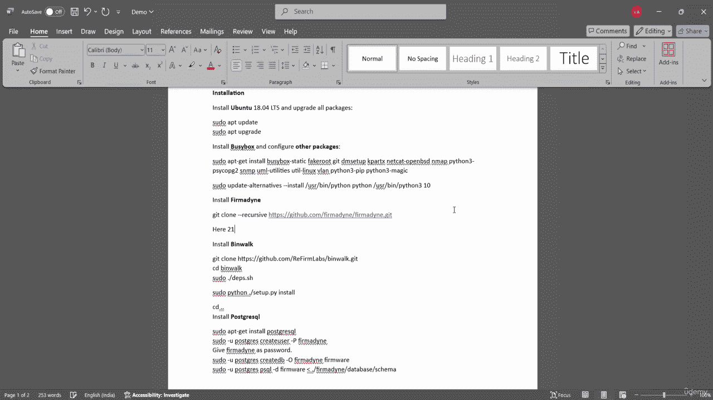
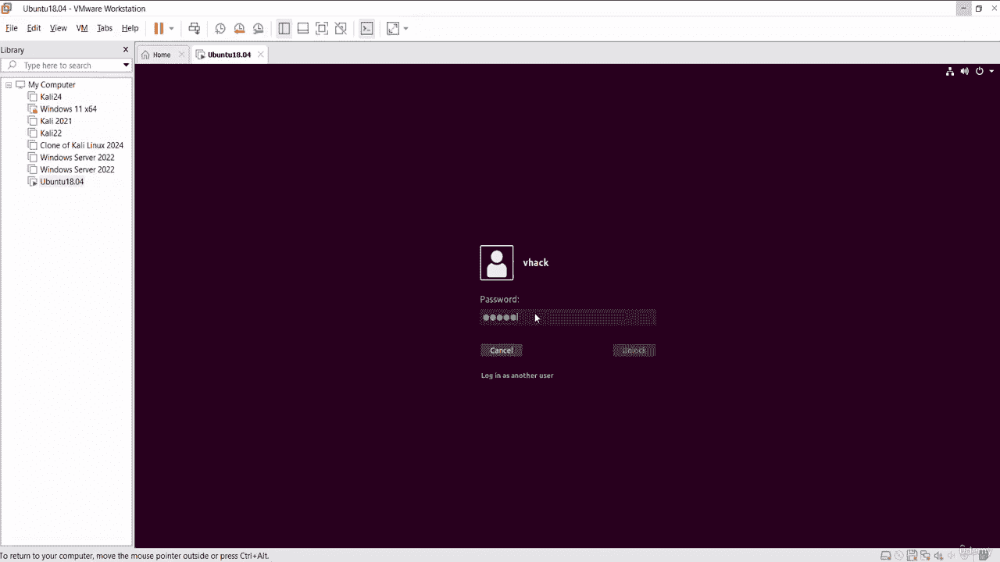
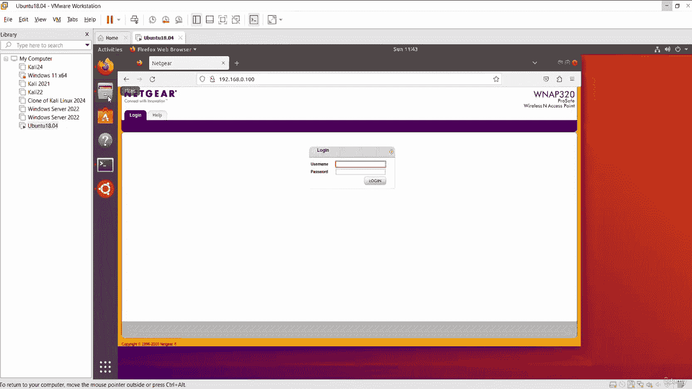
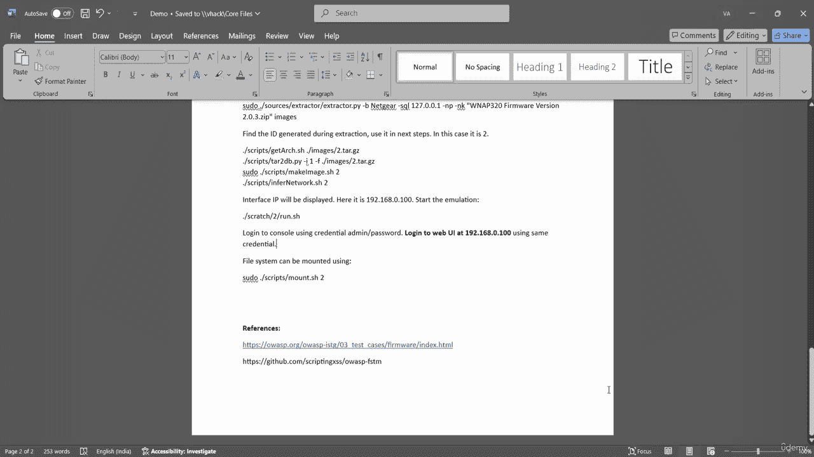
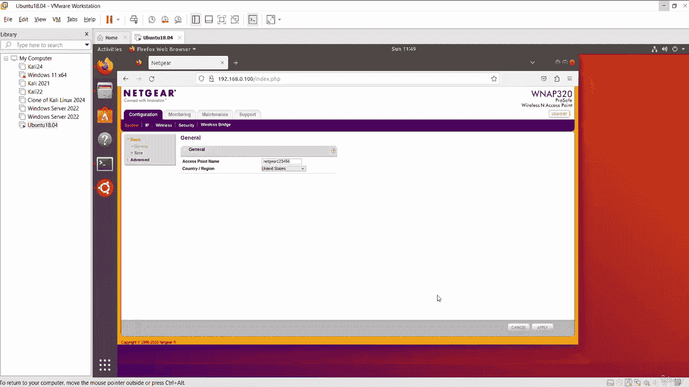
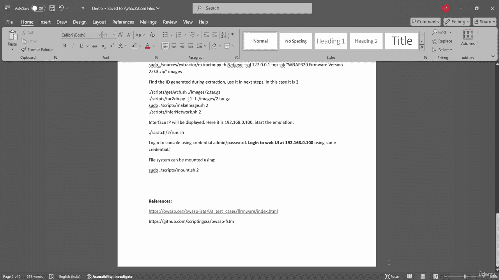

# 道德黑客50天挑战：第46章：固件分析与模拟实践 🛡️

在本节课中，我们将一起学习如何在不需要真实硬件设备的情况下，对物联网设备的固件进行模拟与分析。固件分析是物联网安全测试中非常重要的一环，因为很多安全漏洞都隐藏在设备底层的固件代码里。通过本节课的学习，你将掌握固件仿真的完整流程，了解所需的工具链，并学会如何在虚拟环境中运行真实的路由器固件，从而为后续的漏洞挖掘打下基础。


## 一、固件分析的核心挑战

在开始具体操作之前，我们需要先理解为什么固件分析比较困难，以及业界是如何解决这个问题的。

以下是固件分析中需要面对的几个核心难点：

- 硬件依赖：传统的固件分析通常需要真实的物理设备，比如路由器、摄像头或其他物联网终端，这会增加测试成本。
- 环境搭建复杂：不同厂商的固件架构不一样，直接在真机上调试很不方便。
- 安全标准要求：根据 OWASP 物联网安全测试指南，建议采用固件仿真的方式进行安全测试。

所谓固件仿真，就是用软件模拟硬件环境，让固件在虚拟机里运行，而不是直接刷入真实设备。用公式来表示，这个过程可以理解为：

固件仿真 = 虚拟硬件环境 + 固件镜像 + 模拟器

这样一来，我们就不需要准备昂贵的硬件设备，也能在电脑上完成对固件的安全分析。


## 二、必要工具与环境准备



为了让固件能够在电脑上顺利运行，我们需要安装一组专门的工具。上一节我们介绍了固件仿真的基本概念，本节中我们来看看具体需要哪些软件支持。

以下是本教程中使用的核心工具清单：

- Ubuntu 18.04：作为操作系统，因为某些旧版本的固件分析库只支持 Python 2，使用这个稳定版本可以避免兼容性问题。
- Firmadyne：用于固件自动化仿真的开源框架，版本建议选择 18.42 左右，不要使用最新版本。
- Binwalk：用于从固件文件中提取和读取内部文件的工具。
- QEMU：一个免费开源的仿真器，支持多种硬件架构，例如 x86、PowerPC、ARM 等。
- PostgreSQL：Firmadyne 所需的数据库，用于存储仿真过程中的元数据。
- VirtualBox：虚拟机软件，用于运行 Ubuntu 环境。

安装这些工具的大致步骤如下：

1. 先对软件源进行更新和升级，确保系统包是最新的。
2. 安装 VirtualBox 以及相关的依赖库。
3. 安装 Firmadyne，建议使用 18.42 版本，不要追求最新版。
4. 创建数据库用户名和密码，库名称可以设置为 FDme。
5. 安装 QEMU 仿真器。





完成以上步骤之后，你的环境就基本准备就绪，可以进入固件提取阶段了。




## 三、固件提取与镜像准备

环境搭建好之后，下一步就是获取要分析的固件文件，并从中提取出可用的镜像。上一节我们安装好了所有需要的工具，本节中我们来看看如何处理固件文件。

以下是固件提取的具体操作流程：

- 下载固件：从厂商官网或互联网上下载目标设备的固件文件，比如 TP-Link 或 Netgear 路由器的固件。
- 使用 Binwalk 提取：运行 Binwalk 工具对固件进行解包，忽略部分失败的组件，提取出内部的文件系统镜像。
- 运行安装脚本：进入 Binwalk 的 Python 安装文件，安装其他所需的依赖项。
- 确认安装结果：使用 Binwalk 的命令行选项，检查工具是否正确安装并可以正常调用。

提取完成后，你会得到一个或多个镜像文件。如果你是第一次操作，镜像编号通常从 1 开始；如果之前已经处理过其他固件，编号会递增，比如本示例中的镜像编号是 2。镜像文件就是固件在虚拟环境中运行的基础，接下来我们需要配置网络才能启动它。


## 四、网络配置与模拟启动



有了镜像文件之后，我们需要让模拟器联网，这样才能访问设备的管理界面。上一节我们完成了固件镜像的提取，本节中我们来看看如何设置网络并启动模拟。

以下是网络配置和启动的关键步骤：

- 查找镜像 ID：在 Firmadyne 中找到对应的镜像编号，确认要启动的是哪一个固件镜像。
- 设置网络接口：确保在网络接口配置中填入正确的 ID，让模拟器能够正常获取 IP 地址。
- 挂载镜像文件：将提取好的固件镜像挂载到模拟器中。
- 启动仿真脚本：运行 Bash 启动脚本，启动 QEMU 模拟器。

启动完成后，模拟器会分配一个 IP 地址，在本示例中使用的是 192.168.0.100。这个 IP 地址就是我们后续访问虚拟路由器管理界面的入口。


## 五、网页接口访问与验证

模拟器启动后，我们就可以通过浏览器访问固件的网页管理界面，确认仿真是否成功。上一节我们设置好了网络并启动了模拟器，本节中我们来看看如何登录并验证环境。

以下是访问网页接口的方法：

1. 打开浏览器，输入模拟器分配的 IP 地址，例如 http://192.168.0.100。
2. 在登录页面输入默认凭据：

```text
用户名：admin
密码：password
```

3. 登录成功后，你会看到设备的管理界面，包含接入点配置和其他网络选项。

这意味着固件已经成功运行在模拟器中，整个网络接口已经准备就绪。你可以随意操作界面上的功能，甚至可以配合抓包代理工具，拦截并分析设备发出的每一个网络请求。这就是固件仿真分析的完整流程，不需要任何真实硬件设备，就能在电脑上完成对固件的安全测试。




## 六、下一步预告与总结

本节课的演示暂时结束。在接下来的演示中，我们还将学习如何修改固件文件，然后再次上传到模拟器中，这实际上就是创建后门的过程。



在本节课中，我们一起学习了固件分析的核心挑战，了解了 OWASP 建议的固件仿真方案，掌握了 Firmadyne、Binwalk、QEMU 等工具的安装方法，完成了固件镜像的提取与网络配置，并成功通过网页界面登录到模拟后的路由器固件。希望这些内容能帮助你建立起对物联网固件安全测试的直观认识，为后续的实战练习做好准备。
