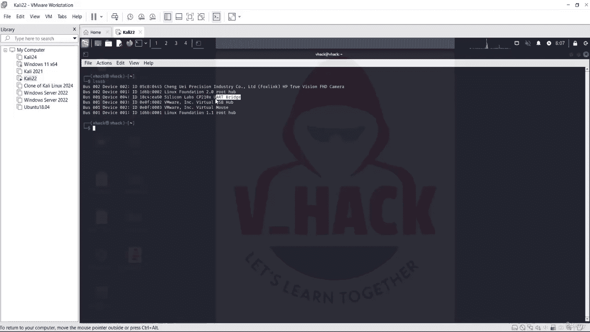
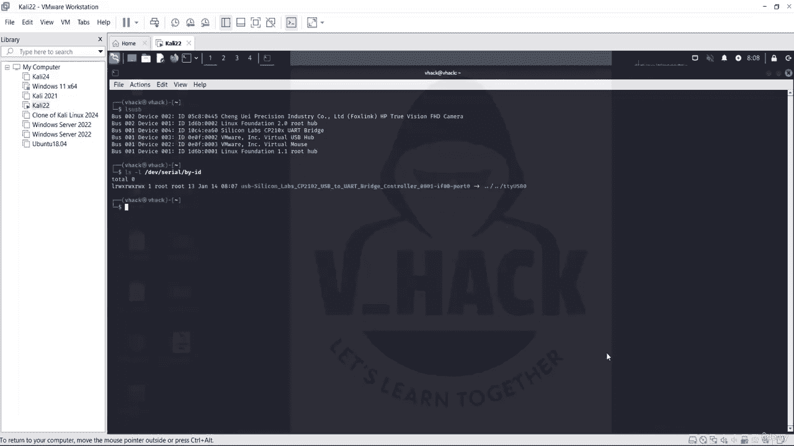
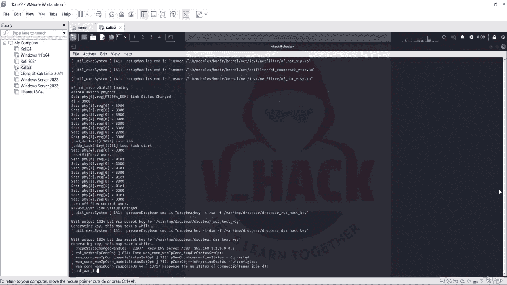
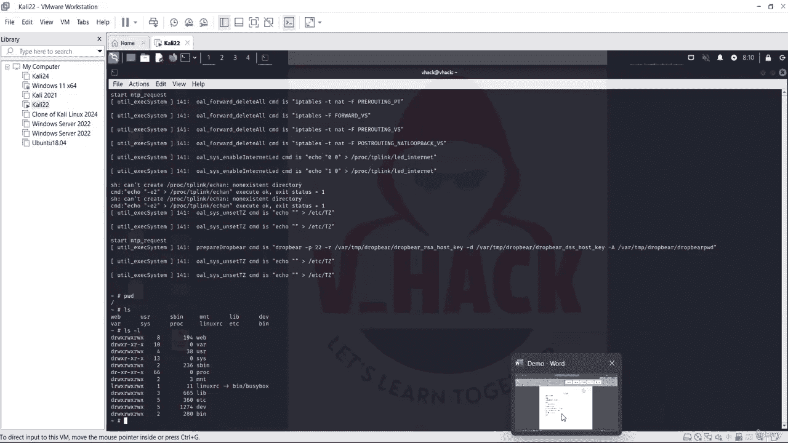

🔧 IoT渗透测试与硬件攻击：47：UART硬件接入与路由器攻击实战


在本节课中，我们将学习如何通过UART硬件接口连接路由器等嵌入式设备，并尝试获取设备的底层控制权限。本节内容属于IoT渗透测试中的硬件攻击模块，我们将延续之前关于UART基础原理的讨论，把理论知识应用到真实的路由器设备上，完成从物理连接到命令行交互的全过程。

上一节我们介绍了UART的基本工作原理和引脚定义，本节中我们来看看如何把电脑和路由器的硬件连接起来。

首先需要准备一根USB转串口转接线，常见的型号包括CP102桥接转换器。把转接线的一端插入笔记本电脑的USB接口，另一端连接到路由器主板上的UART引脚。连接完成后，操作系统应该能够识别出这个外部串口设备。

以下是验证设备是否被识别的步骤：


- 打开终端，检查系统是否挂载了USB串口设备；
- 查看设备节点名称，通常会出现类似ttyUSB0这样的标识符；
- 确认设备驱动已经加载，否则需要重新插拔硬件或安装对应驱动程序。

确认电脑已经识别到路由器的串口设备之后，我们需要选择合适的软件工具来建立通信。

在Linux系统中，screen是一个常用的终端复用工具，也可以用来连接串口设备。使用screen之前，我们必须知道设备的波特率，也就是数据传输的速度。波特率的常见取值包括9600、115200等，具体数值需要和路由器硬件保持一致，否则会出现乱码。



核心参数可以用下面的公式或代码表示：


```bash
波特率 = 115200 bps
串口设备 = /dev/ttyUSB0
```



使用screen连接的命令格式如下：

```bash
screen /dev/ttyUSB0 115200
```


这条命令的意思是，打开/dev/ttyUSB0这个串口设备，并以115200的波特率进行通信。

串口通信软件配置好之后，我们可以给路由器通电，并观察设备启动过程中输出的信息。

操作步骤是先关闭路由器电源，然后再重新打开。此时screen终端中会出现大量启动日志。大多数嵌入式设备在启动时都会通过串口输出人类可读的文本信息，这对我们来说非常方便。

你会看到引导加载程序（Boot Loader）的启动信息，接着是Linux内核尝试加载操作系统的过程。这些日志以纯文本形式显示，我们可以直接阅读，了解设备正在执行什么操作，比如加载驱动、挂载文件系统、启动网络服务等等。



当路由器启动完成并且我们成功进入命令行界面后，需要执行几个基础命令来确认连接稳定，并查看当前用户的权限范围。

在终端中输入以下命令，可以查看当前所在的目录和目录下的文件列表：


- pwd：显示当前工作目录；
- ls：列出当前目录下的所有文件和文件夹；
- ls -l：显示详细的文件权限信息。

执行后，你可能会看到/etc、/bin、web用户目录等典型的Linux系统文件夹。有些文件是绿色显示的，代表可执行文件或目录。查看权限列表时，你会发现某些配置文件只有只读权限，而其他文件可能拥有读写权限。通过这些命令，我们可以确认已经成功进入了路由器的UART Shell环境，并拥有与设备交互的基础能力。

完成硬件连接、软件配置和启动日志观察之后，最后一步是正式拿到设备的控制台权限。



当我们可以在终端中自由输入命令并得到回显时，就意味着UART攻击已经成功。此时我们获得了一个交互式Shell，可以进一步查看系统配置、提取固件信息或尝试提升权限。这对于后续的IoT设备安全测试来说，是一个非常关键的切入点。


本节课中我们一起学习了如何识别USB转串口设备、配置波特率参数、使用screen工具连接路由器、观察引导加载程序与内核启动日志，以及通过pwd和ls等基础命令验证UART Shell权限。掌握这些步骤，你就可以开始对真实的嵌入式设备进行硬件层面的安全测试了。
