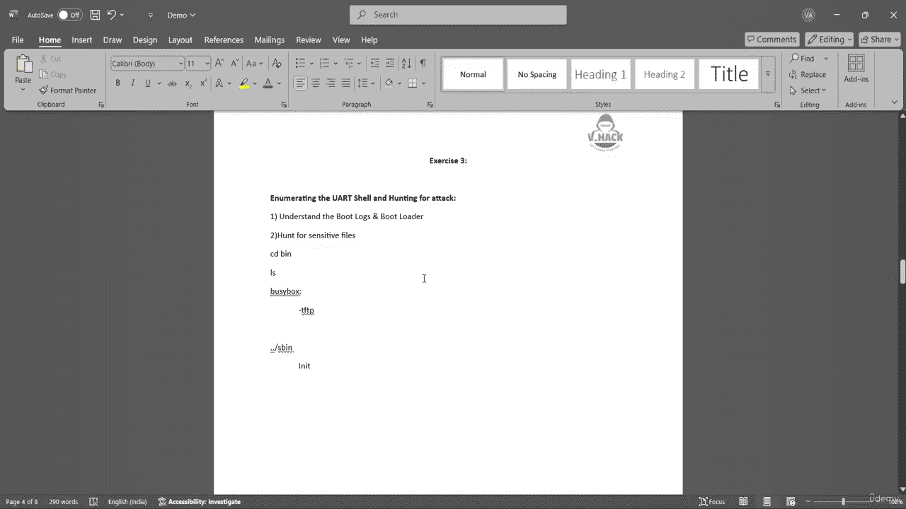
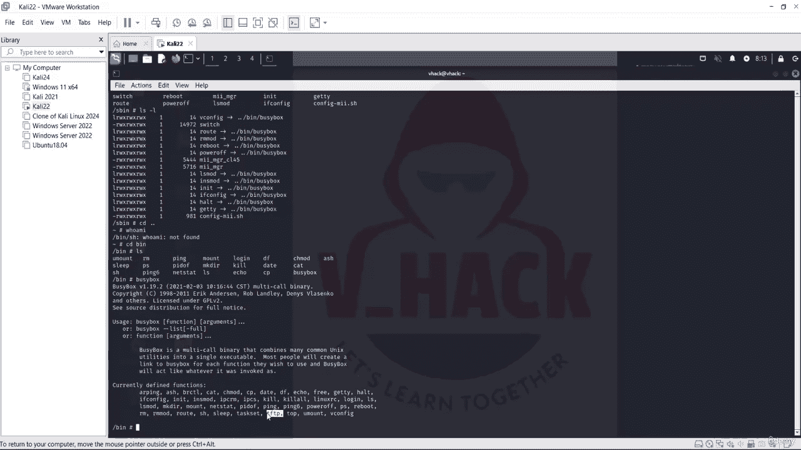
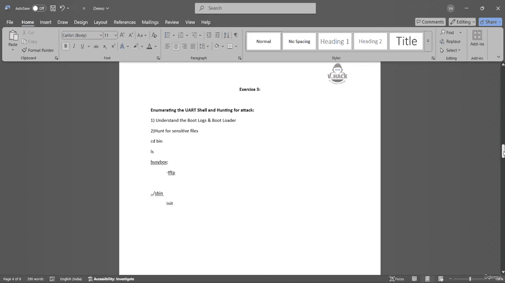

# Udemy - Ethical Hacking：50-Day Hacker Challenge：50 Real Attacks：48：3 - 硬件黑客 - UART - 枚举[实时目标 - 路由器] 🛠️


## 课程概述

在本节课中我们将要学习如何在实时路由器目标上进行UART硬件黑客攻击，具体来说就是枚举U shell并寻找敏感文件。我们会延续上一节的内容，查看设备中已经存在哪些文件，理解为什么很多常用命令被禁用，并找出可以用于文件传输的可用通道，比如TFTP协议。通过这一节的学习，你将掌握如何从嵌入式设备中提取有价值的信息，为后续的渗透测试打下基础。


## 一、回到练习现场并定位目标文件



上一节我们介绍了如何通过UART接口连接到路由器，本节中我们来看看接下来要做什么。讲师切换回之前的演示环境，准备进行第三个练习。这个练习的核心目标是枚举U shell，也就是在设备的shell环境中查找敏感文件，为后续的攻击步骤收集情报。

在演示开始后，讲师作为之前内容的延续，发现设备中存在一些名为pin的文件。这类文件通常包含设备的配置信息、认证凭据或者其他敏感数据，是我们进行后续利用时的重要线索。


## 二、认识BusyBox与受限命令环境

接着我们进入pin目录，这里展示了一个关键概念——BusyBox。

BusyBox是一个集成了大量Unix工具的命令行实用软件，广泛应用于嵌入式设备中。你可以把它理解为一个“精简版的Linux工具箱”，把很多常用命令打包在一个可执行文件里，以节省存储空间。在代码层面可以这样表示：

```text
BusyBox = 多个Unix工具合并为单一可执行文件
```

然而在这个演示中，你会发现大部分命令（比如`cat`、`connect`等）都没有被启用。这是因为嵌入式设备的存储空间非常有限，厂商为了减少固件体积，通常会把不常用的命令剔除掉。虽然这会让我们暂时无法直接使用某些工具，但这并不影响后续的学习，因为接下来的练习中我们会学习如何在笔记本电脑和设备之间传输文件，从而绕过这些限制。


## 三、定位敏感文件夹并准备导出

讲师退出pin目录后，发现有一个名为Sa的文件夹（或者存储卡分区）已经存在。这个文件夹与前面的pin具有相同的基本性质，是设备中已知的一个目录，我们可以在接下来的练习中重点关注它。

以下是我们要关注的关键文件和目录列表：
- pin文件：可能存储设备认证或配置相关的敏感信息
- Sa文件夹：已知的目录，包含可供进一步分析的内容
- BusyBox环境：当前可用的命令行工具集，大部分命令受限

在即将到来的练习中，我们会尝试把这个文件夹从设备导出到笔记本电脑，以便在更强大的环境中进行深入的文件搜寻和敏感信息挖掘。


## 四、文件传输的关键通道：TFTP

讲师回到bin目录下查看BusyBox的具体配置，这里揭示了本节演示的一个重要转折点。虽然大部分常用命令被禁用，但我们发现一个关键功能已经启用，那就是TFTP（简单文件传输协议）。

TFTP是一个极简的文件传输协议，不需要复杂的认证过程，非常适合在受限的嵌入式设备与外部计算机之间交换文件。你可以把它想象成设备和电脑之间的一条简易传输通道：

```text
笔记本电脑 <--> TFTP协议 <--> 路由器设备
```

在这个演示中，TFTP成为了我们在笔记本和路由器之间移动文件的“王牌”通道，也是后续练习中导出敏感文件的核心手段。


## 五、演示总结与下一步展望



到这里，本次演示接近尾声。我们通过枚举U shell，在路由器设备上发现了一些敏感文件，这些文件可以帮助我们进入下一阶段的攻击。虽然目前大部分命令不可用，但TFTP协议的启用为我们提供了文件传输的可行路径，后续练习中我们会详细演示如何利用这个通道完成数据导出。



本节课中我们一起学习了如何在实时路由器目标上进行UART枚举，定位了pin文件和Sa文件夹等敏感目标，理解了BusyBox受限环境下的命令限制，并找到了TFTP作为文件传输的关键通道。希望这节课对你有所帮助，我们在下一节继续深入探讨。

