🔧 道德黑客：50天黑客挑战：06：硬件黑客与 SPI 固件提取

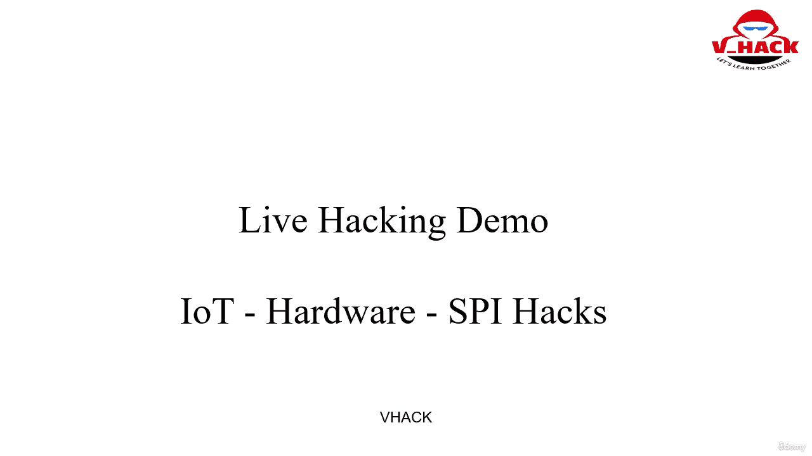

## 课程概述

在本节课中，我们将一起学习如何从路由器的只读存储器中提取固件。这属于物联网硬件黑客的范畴，具体涉及串行外设接口，也就是 SPI 技术。我们将使用一款名为 CH341A 的硬件编程器，配合相应的转接板和测试夹子，以及名为 flashrom 的软件工具，把路由器 ROM 里的固件完整读取出来，保存为一个二进制文件。这样我们就可以对固件进行进一步分析，寻找潜在的安全问题。

## 核心概念简述

在开始实际操作之前，先简单了解一下本节涉及的核心概念。串行外设接口是一种常用的短距离通信总线，通常由四条信号线组成，分别是主输出从输入、主输入从输出、时钟线和片选线。固件提取的基本过程可以用下面的伪代码来描述：

```text
固件 = flashrom.read(设备接口, 只读存储器地址)
保存(固件, 输出文件名)
```

理解了这个基本流程之后，我们再进入具体的准备工作。

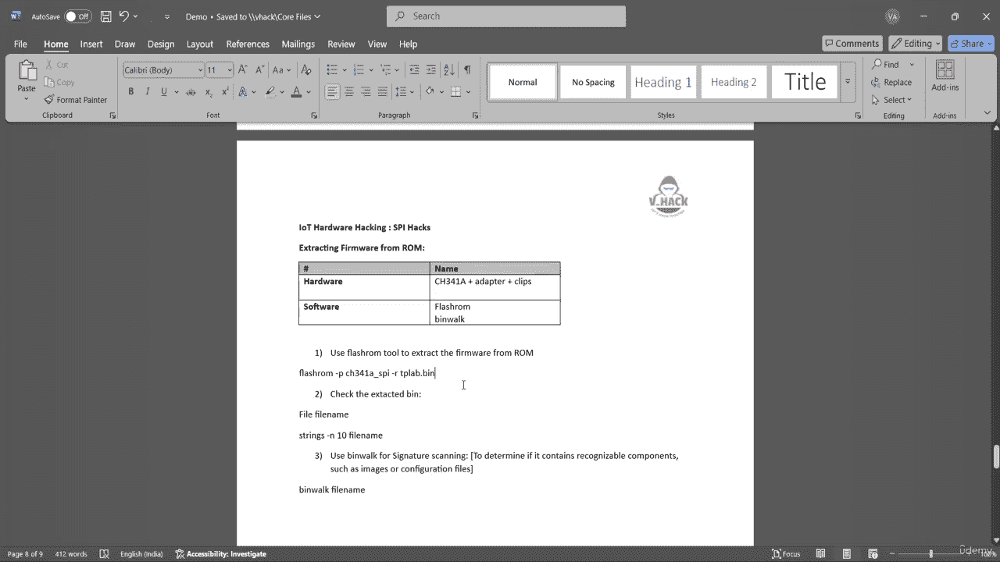

## 准备硬件和软件

上一节我们介绍了只读存储器的不同类型，本节中我们来看看实际操作中需要准备哪些工具。

每种只读存储器都需要不同的硬件组件和软件组件才能完成读取工作。针对本节演示中使用的 PP-Link 路由器，我们需要准备以下设备和程序，缺一不可。

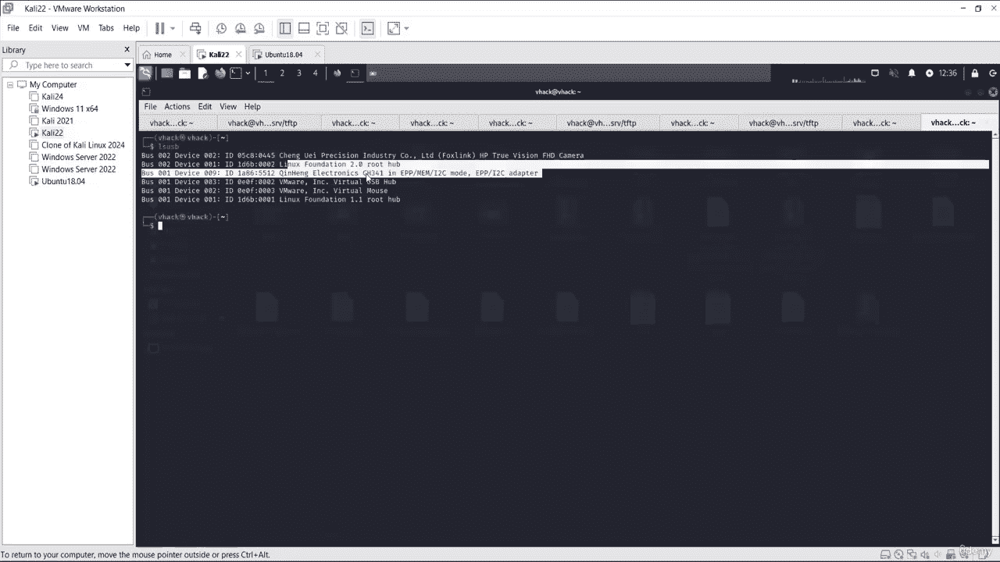

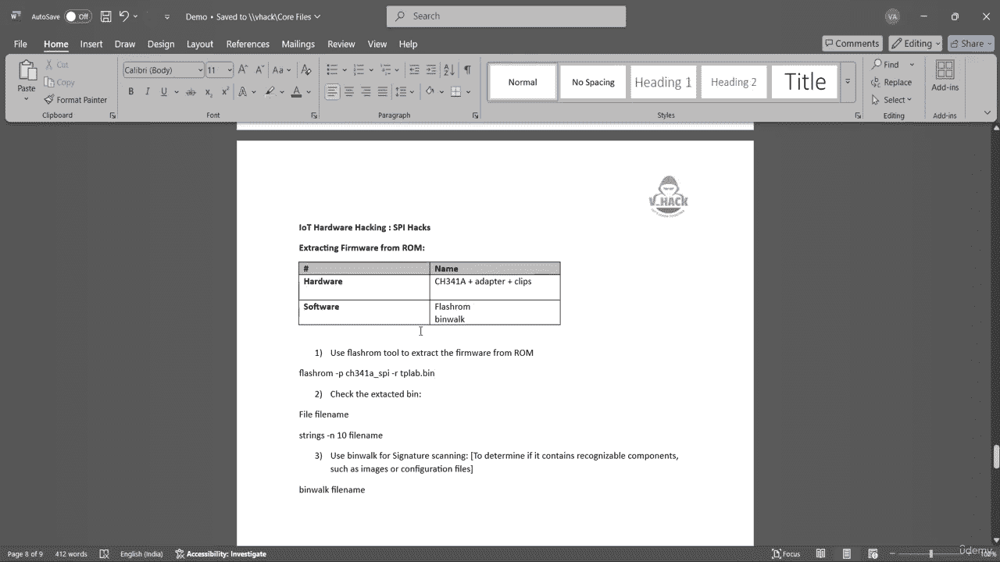

以下是本节所需的主要清单：

- CH341A 硬件编程器
- 对应的转接适配器
- 对应的测试夹子，这是一个八脚夹子
- flashrom 软件工具，用于读取和写入闪存

请确保这些设备已经就位，软件也已经安装在你的电脑上，然后我们再进入下一步。

## 连接硬件设备

有了工具清单之后，我们需要确认电脑能否正确识别连接的硬件。

第一件事是确保设备已经连接好，并且系统能够看到这个硬件设备。在本次演示中，我们使用的硬件设备就是 CH341A 编程器。你可以在系统设备管理器或者相关工具中看到它，设备标识通常显示为 C H 3 4 1，也就是 CH341A 硬件设备。

确认设备正常识别之后，我们需要继续检查软件环境是否就绪。

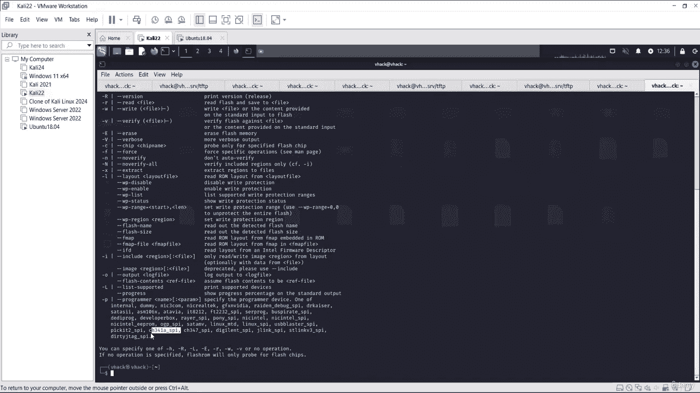

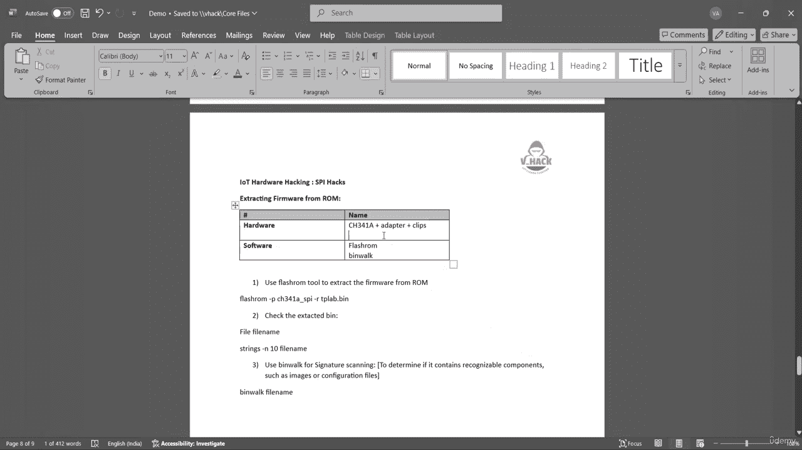

## 检查 flashrom 软件

硬件连接没问题之后，第二件事就是确认 flashrom 工具是否已经安装。

在本节演示中，我们已经确认 flashrom 已经安装完成。接下来我们需要了解这个程序的使用方法。运行该程序非常简单，只需要输入程序名称 flashrom，然后加上相应的参数即可。

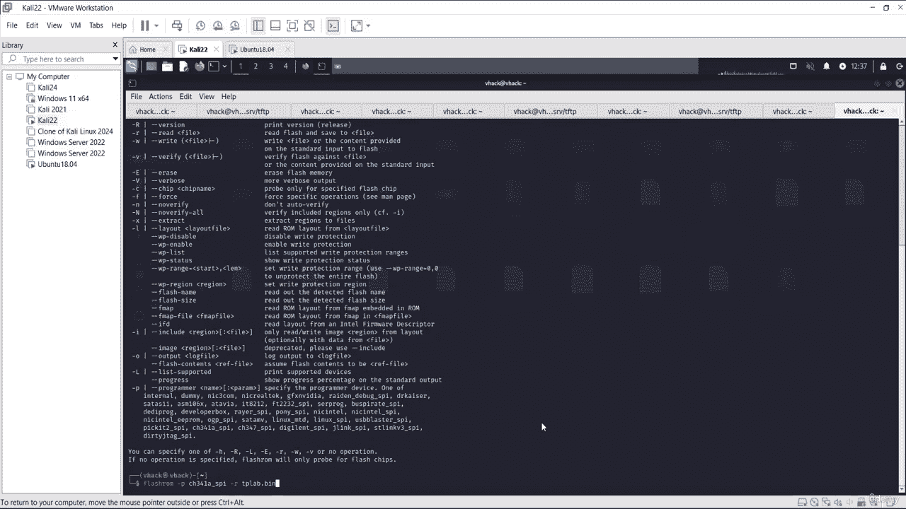

以下是使用 flashrom 时需要了解的几个关键参数：

- 程序名称：flashrom
- 参数 -E：用于指定使用的设备类型
- 参数 -R：表示我们计划执行读取操作
- 输出文件名：用于保存提取后的固件，例如 TP_link.bin

掌握这些参数之后，我们就可以组装成完整的命令来执行固件提取了。


## 执行固件提取命令

检查完软件环境后，我们来实际运行命令把固件从 ROM 中读取出来。

完整的命令大致如下：

```bash
flashrom -p ch341a_spi -r TP_link.bin
```

这条命令的意思是，使用 flashrom 工具，通过 ch341a_spi 接口，把只读存储器里的固件读取并保存为 TP_link.bin 文件。

在执行这条命令之前，有一点非常重要，请务必牢记。一旦你提取了只读存储器里的内容，切记不要尝试在设备通电的情况下进行此操作。必须确保设备已经关闭电源，所有设置和连接都已经正确建立，然后再开始提取固件。操作过程中不要移动或干扰硬件连接，否则可能导致读取失败甚至损坏设备。

如果你的搭建准确无误，这个命令就会允许我们从只读存储器中提取固件。

## 验证提取结果

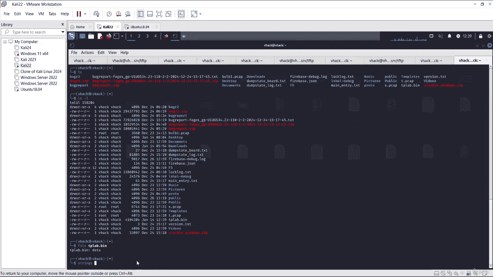

命令执行之后，我们需要等待几分钟，直到读取过程完成。固件文件通常比较轻量，所以过程不会花费太长时间。

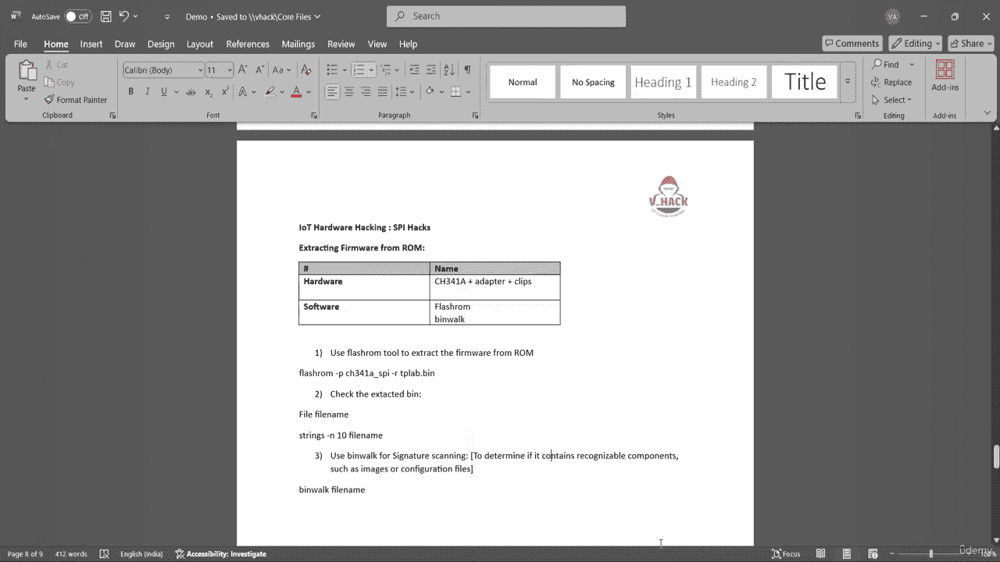

过程结束后，我们来验证一下文件是否生成，以及文件大小是否正常。你可以使用列表文件命令来查看生成的文件。

以下是验证步骤：

1. 使用列表命令查看当前目录下的文件，确认能看到 TP_link.bin
2. 查看文件大小，确认大约在 4 到 5 兆字节左右
3. 确认文件类型为二进制数据文件

如果文件存在且大小合理，说明我们成功地从只读存储器中抓取或提取了固件。

## 分析提取的固件文件

验证文件大小之后，我们可以对这个固件文件做初步的了解。

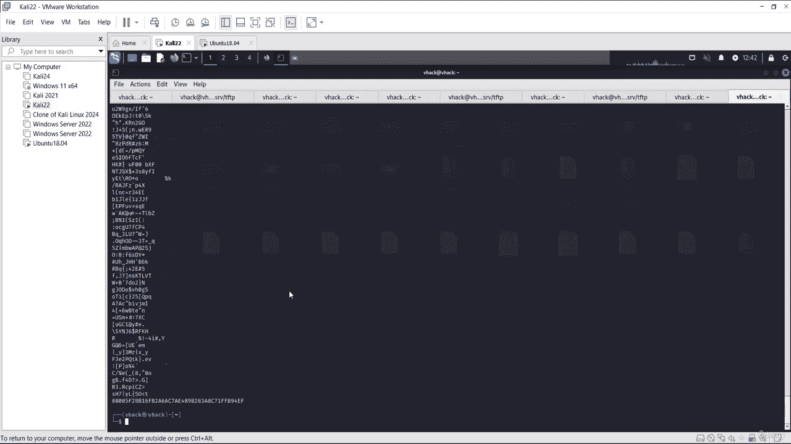

提取出来的文件是二进制数据，大部分内容可能不可读。这很正常，不用担心。你可以使用字符串提取工具，比如 strings，来查看文件中是否包含一些可读文本。

以下是我们在固件中可能发现的一些信息示例：

- 波特率设置，例如 115200
- 关联的 IP 地址，例如 0.2.x.x
- 以太网地址
- 其他相关配置参数

这些信息在之前的利用过程中可能用到过。如果你看到大量不可读内容，那可能是因为数据被压缩或者加密了。我们会在后续的练习中学习如何处理这些问题，但本节练习的重点就是完成固件提取。

## 课程总结

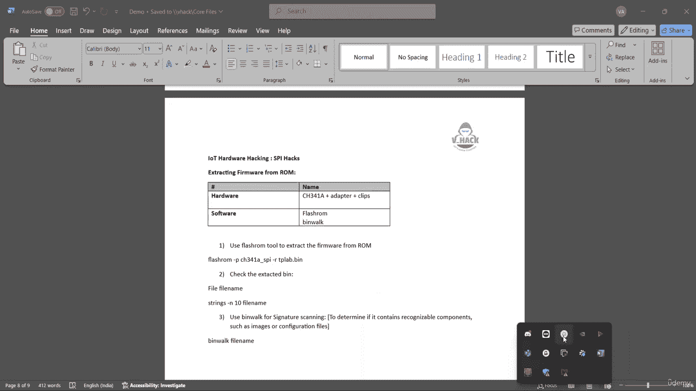

本节课中，我们一起学习了如何使用 CH341A 适配器、测试夹子以及 flashrom 软件，从路由器的 ROM 中提取固件。我们准备好了硬件和软件，确认了设备连接，检查了 flashrom 安装状态，执行了读取命令，验证了输出文件的大小，并初步查看了固件中的可读字符串。希望你喜欢这次演示，并且已经掌握了从只读存储器中提取固件的基本方法。本节内容到此结束。
