Ethical Hacking：07：SPI 硬件黑客之从摄像机 ROM 提取固件 🔧

在本节课中我们将要学习如何通过 SPI 接口从 IP 摄像机的 ROM 芯片中提取固件。这是硬件黑客领域的一个经典实操，老师会延续上一节课 TP-Link 路由器固件提取的思路，不过这次目标换成了一台 Tail Link 品牌的 IP 摄像机。整个过程虽然和之前很像，但因为设备不同，需要在命令里多加一个芯片型号参数，否则读取工具认不出芯片。咱们会一步步把硬件连好，用软件把里面的固件 dump 出来，最后验证一下文件是不是完整，看看里面有没有什么有价值的信息，比如私钥之类的东西。

上一节我们介绍了从路由器中提取固件的基本思路，本节中我们来看看针对 IP 摄像机需要准备哪些硬件和工具。

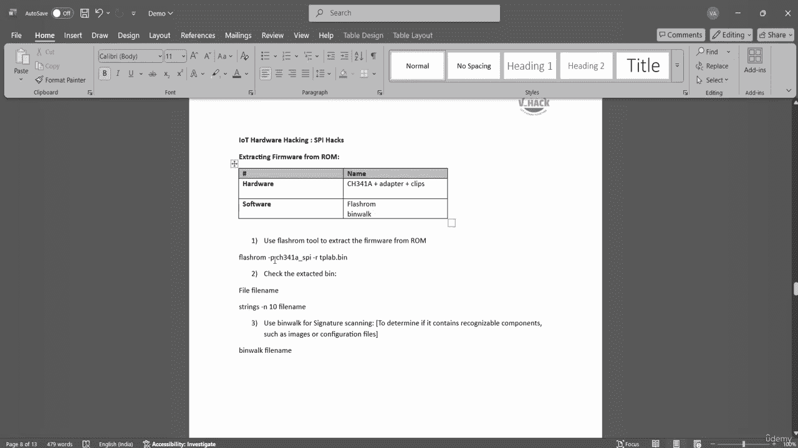

这里需要用到几样东西，不用紧张，都是常见的廉价设备。第一个是 CH341A 转接器，它负责把电脑的 USB 信号转成 SPI 协议，好让电脑能和芯片对话。第二个是夹子，通常叫作测试夹或者探针夹，用来物理上咬住芯片的引脚，不需要焊接就能接上去。第三个是 flashrom 软件，这是开源的烧录和读取工具，命令行操作，很轻量。第四个是操作系统环境，老师演示里用的是 Windows 系统，配合相应的驱动程序就可以。

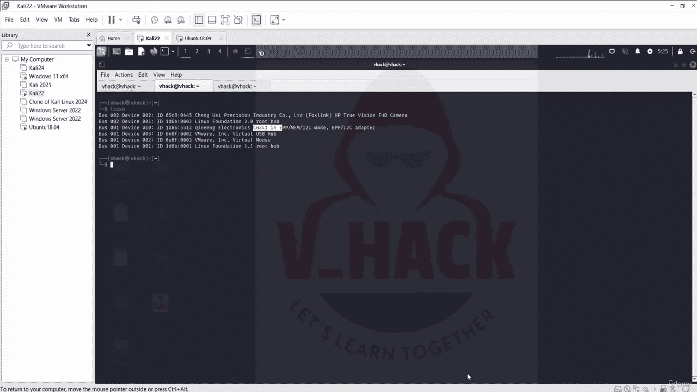

以下是本节实验需要的核心硬件清单：
- CH341A USB 转 SPI 转接器
- 八脚测试夹（SOIC 封装适用）
- flashrom 读写工具
- 目标设备：Tail Link IP 摄像机主板上的 SPI Flash 芯片

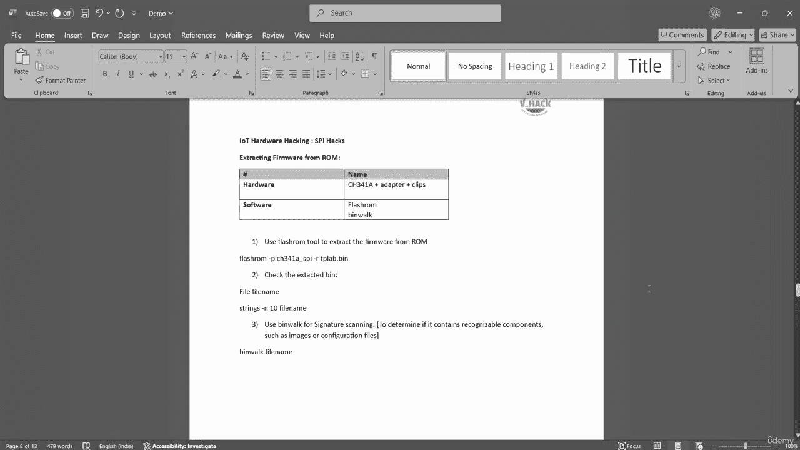

硬件连接关系可以简化为：
`电脑 USB → CH341A 转接器 → 测试夹 → SPI Flash 芯片（ROM）`

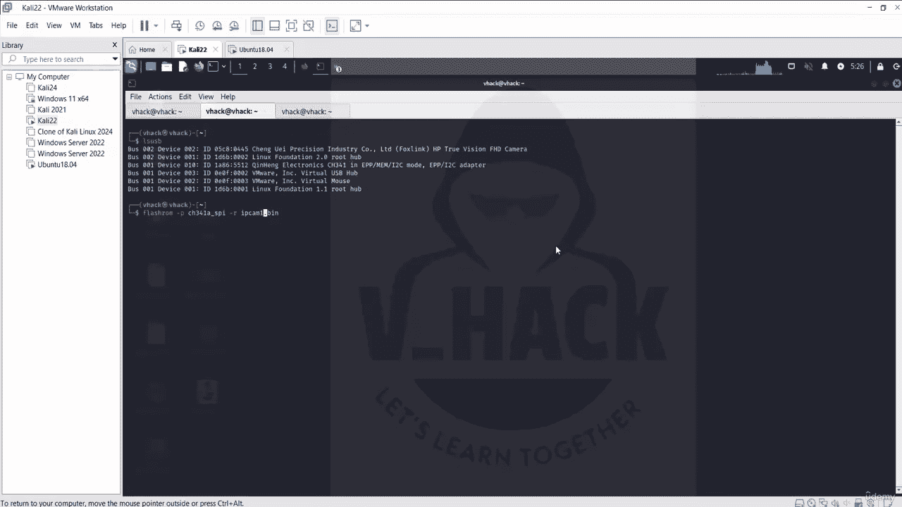

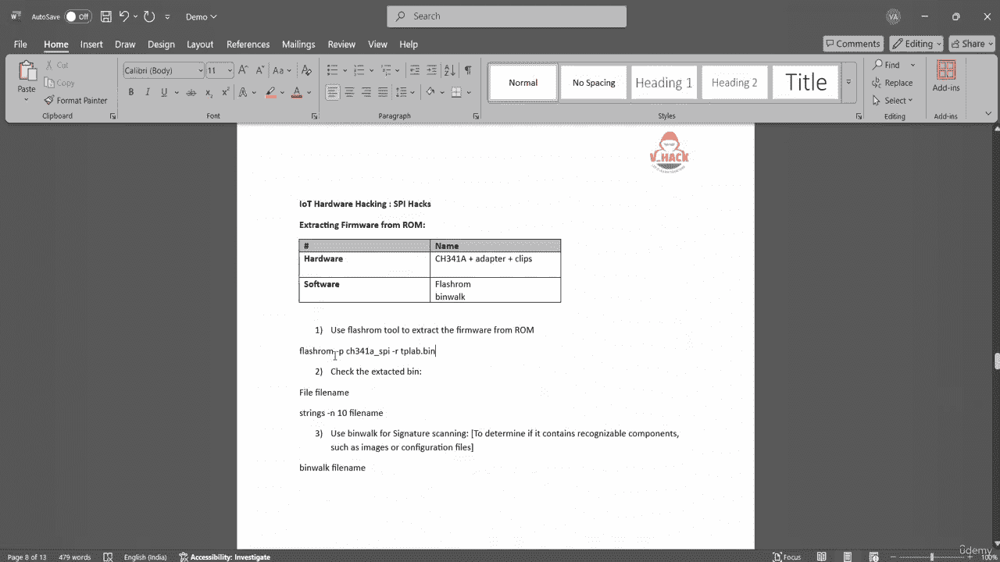

硬件工具都备齐之后，本节中我们来看看如何把它们连起来，并让电脑识别出摄像机里的闪存芯片。

连接的时候要小心，千万别把引脚弄歪了，否则可能烧坏芯片。把测试夹夹在摄像机主板上的 SPI Flash 芯片上，另一头插到 CH341A 转接器，然后把转接器插进电脑 USB 口。连好之后，打开电脑的设备管理器，应该能看到一个叫 CH341 的设备，这说明电脑和转接器之间的通路是通的。如果设备管理器里没有出现，那可能是驱动没装好，或者接触不良，需要重新检查连接。

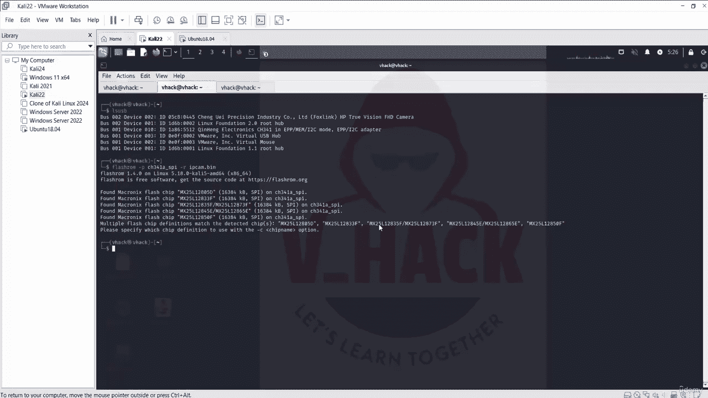

确认连接正常后，可以按照以下步骤进行设备识别：
1. 打开设备管理器，查看端口（COM 和 LPT）下是否出现 CH341 设备。
2. 确认转接器上的电源状态正常。
3. 确保测试夹已经稳固地咬住芯片的所有引脚。

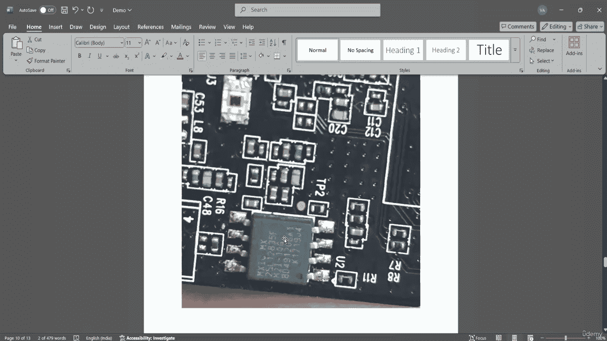

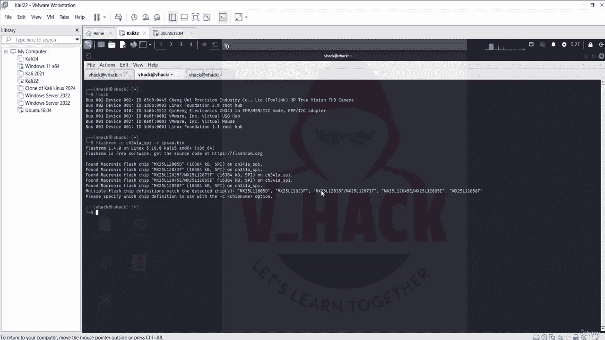

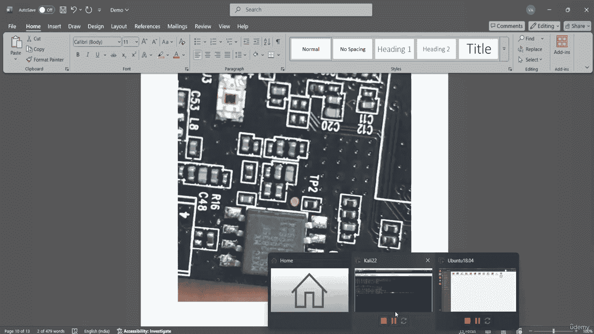

连接和识别都没问题以后，本节中我们来看看怎么用 flashrom 把 ROM 里的固件读出来，保存成一个二进制文件。

这次和路由器那个例子不太一样，路由器直接运行读取命令通常就行，但摄像机这边软件会提示检测到好几种可能的芯片型号，让你手动指定到底用哪一个。如果不指定，程序不知道该怎么和芯片说话，读取就会失败。所以我们需要先确认芯片的具体型号，老师演示里识别出来的是 MX25L12835F，这是一种常见的 16MB SPI Flash 芯片。拿到型号之后，就可以在命令里加上芯片参数，告诉 flashrom 用正确的时序去读取。

固件提取的核心命令如下，请仔细对照每个参数的含义：

```bash
flashrom -p ch341a -c MX25L12835F -r IPcam.bin
```

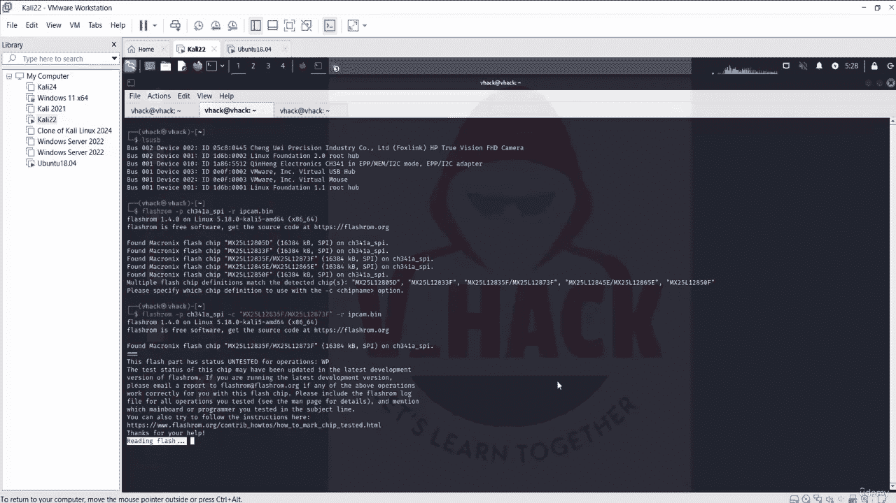

命令拆解：
- `-p ch341a`：指定使用 CH341A 编程器作为接口。
- `-c MX25L12835F`：强制指定芯片型号，因为软件无法自动唯一确定。
- `-r IPcam.bin`：表示读取操作，把内容保存到名为 IPcam.bin 的文件里。

执行命令后，程序会开始读取。因为 IP 摄像机的固件比较大，大约有 16 兆字节，所以读取过程会比路由器慢一些，可能需要等待几分钟，屏幕上会出现 reading 的提示，说明正在实时把数据从芯片里拷出来。等进度条走完，如果没有报错，说明提取成功了。

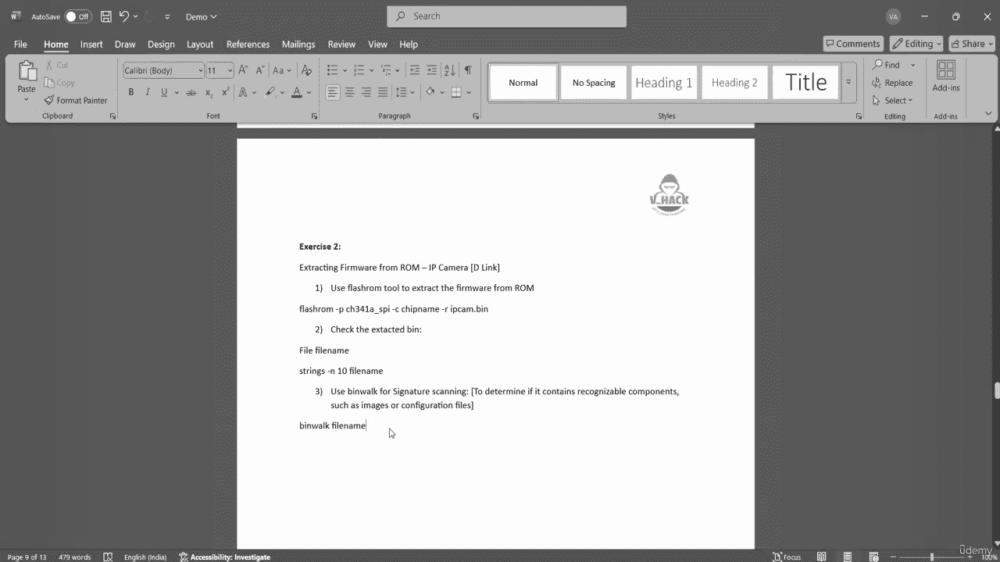

文件读出来之后，本节中我们来看看怎么验证这个固件文件是不是完整，里面有没有我们想要的信息。

拿到 IPcam.bin 之后，不能直接认为万事大吉，得检查一下文件类型和内容，确保没有读错、没有损坏。可以用 file 命令看看系统怎么识别这个文件，再用 strings 命令把里面可读的文本字符串都打印出来，看看有没有一些敏感信息。另外，还可以用 Binwalk 做签名扫描，看看固件里面包含了哪些文件系统、内核镜像或者加密密钥之类的结构。

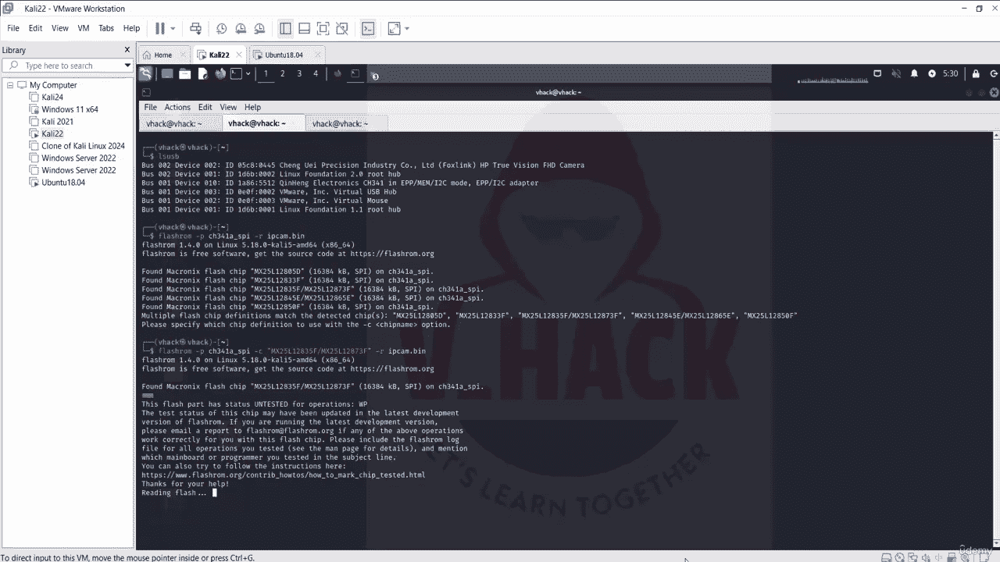

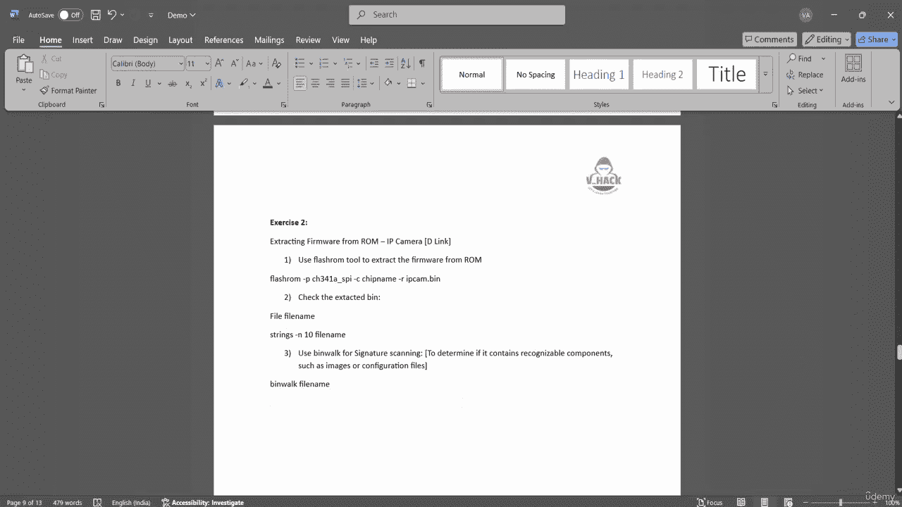

验证固件文件可以使用以下几种常用方法：
- `file IPcam.bin`：检查文件的基本类型和魔数。
- `strings IPcam.bin`：提取文件中可读的 ASCII 字符串，常用于寻找密钥、路径或配置信息。
- `binwalk IPcam.bin`：扫描固件签名，识别嵌入的文件系统和已知格式。

老师在演示里用 strings 命令之后，竟然在固件里看到了一些 RSA 私钥相关的内容，这说明固件里可能存有设备的证书或身份验证密钥，对安全研究来说是非常有价值的发现。另外，文件大小大约是 16MB，可以用简单的公式来表示：

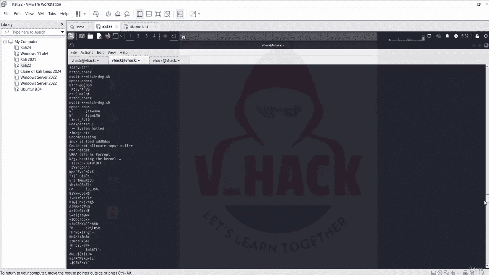

`文件大小 ≈ 16 × 1024 × 1024 字节`

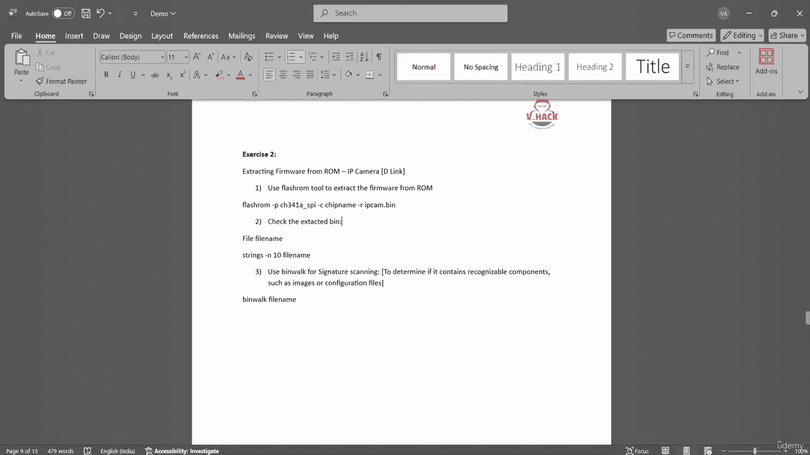

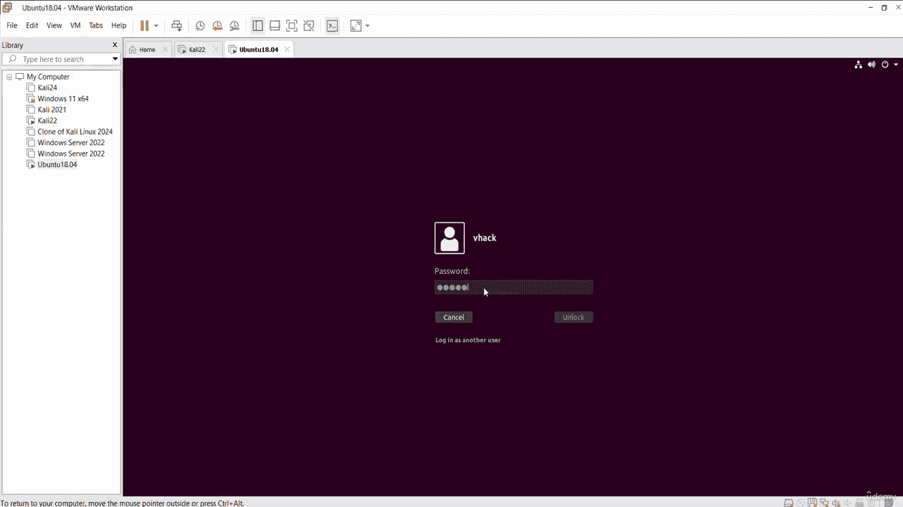

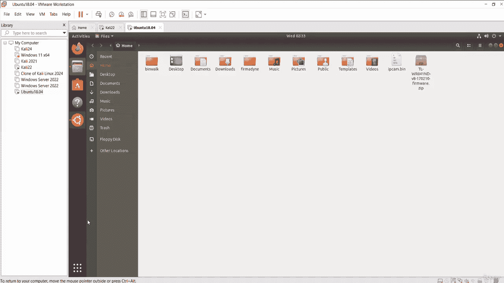

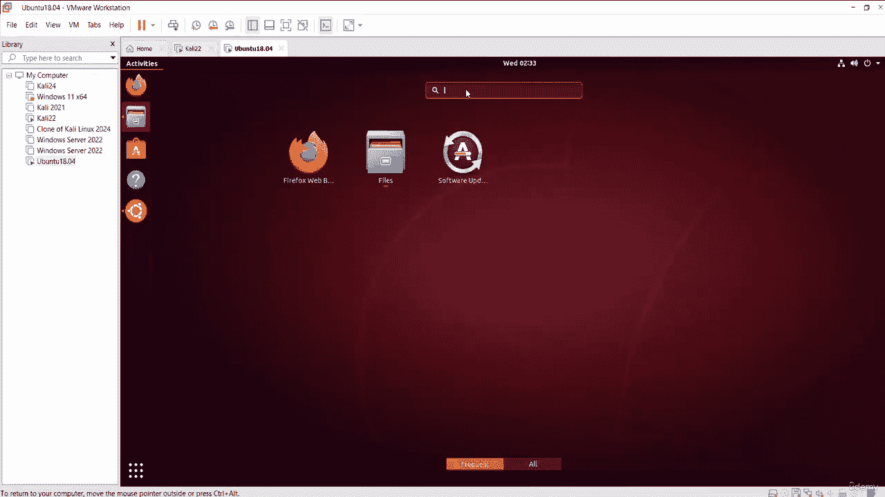

固件提取和验证都完成了以后，本节中我们来看看在做 SPI 硬件黑客时，有哪些关键的安全注意事项千万不能忽视。

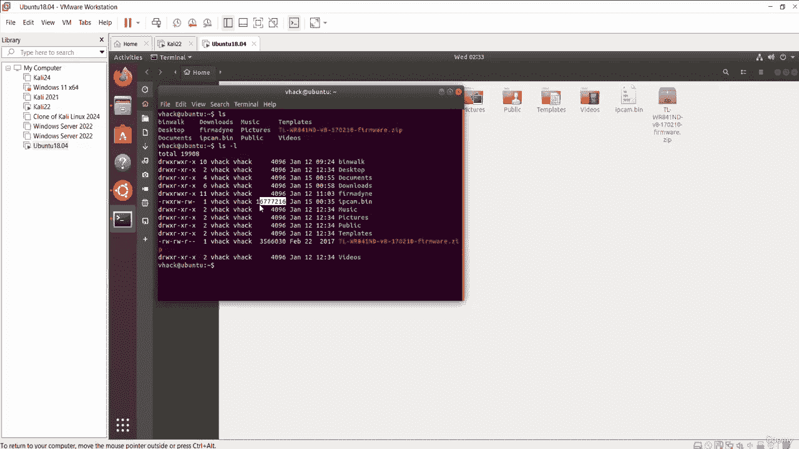

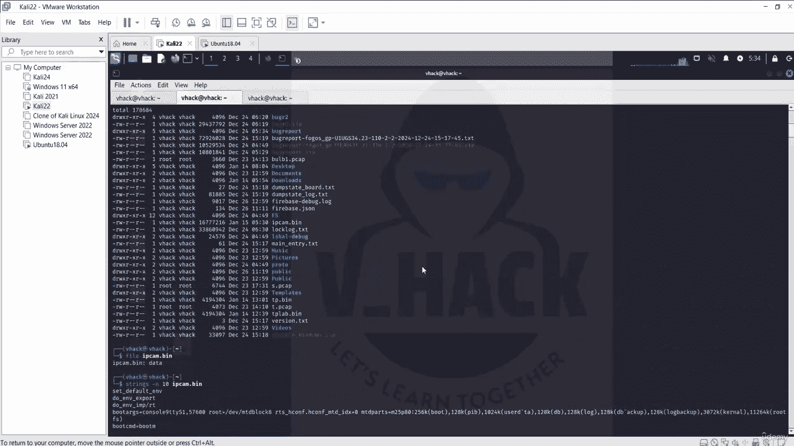

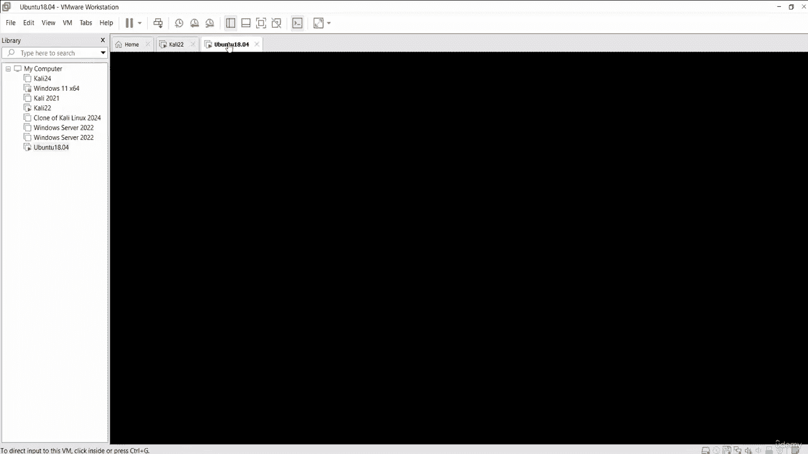

这里有一条非常重要的规则，所有做 SPI 相关操作的人都要牢记，那就是在连接编程器、读取芯片的过程中，目标设备绝对不能通电。也就是说，摄像机的电源要拔掉，不能插电源适配器，也不能开机。如果设备通电状态下强行接测试夹，电平冲突很容易把 SPI Flash 芯片或者主板烧掉，甚至损坏 CH341A 转接器。所以操作顺序应该是先断电、再接夹子、连电脑、运行软件，读完之后再拆夹子，最后才通电测试。

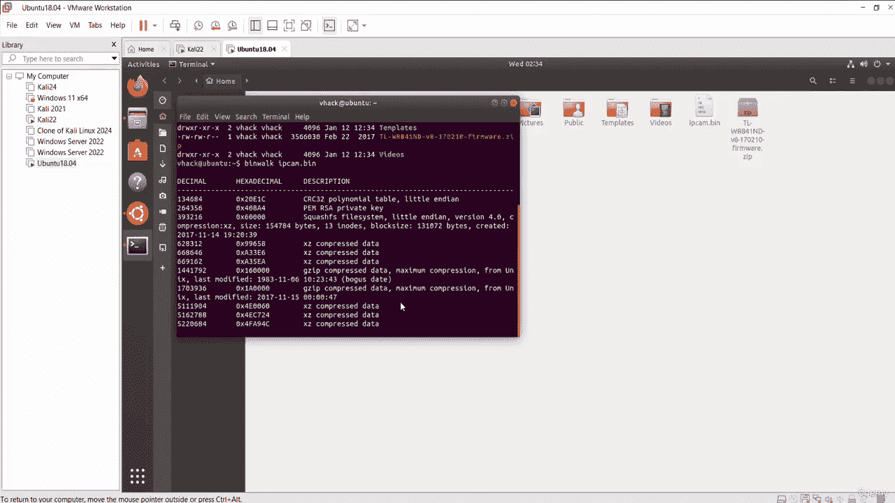

SPI 硬件操作的核心禁忌包括以下几点：
- 禁止在设备通电时连接或断开测试夹。
- 禁止在未确认芯片型号的情况下盲目使用 `-c` 参数以外的选项。
- 禁止在接触不良的情况下强制运行读取命令。

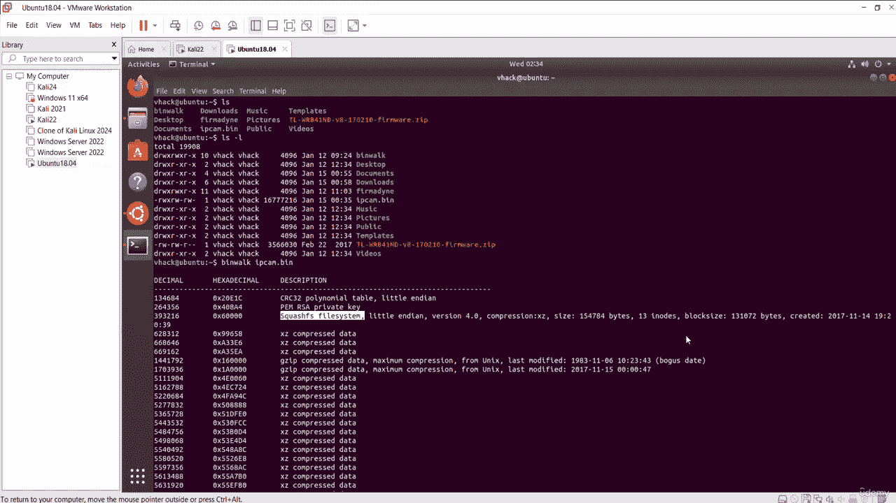

到这里，整个从 IP 摄像机 ROM 提取固件的演示就结束了，本节中我们来回顾一下都学到了哪些关键步骤。

首先，准备好 CH341A 转接器、测试夹和 flashrom 软件；其次，把夹子稳稳地夹在 SPI Flash 芯片上，确认电脑设备管理器里能看到 CH341 设备；然后，运行带有芯片型号参数的 flashrom 命令，把固件读取到 IPcam.bin 文件里；最后，用 file、strings 和 Binwalk 验证文件，甚至能从中发现 RSA 私钥等敏感信息。整个流程和之前路由器的例子非常相似，只是多了一个指定芯片型号的步骤，因为摄像机的芯片足迹软件无法自动唯一匹配。

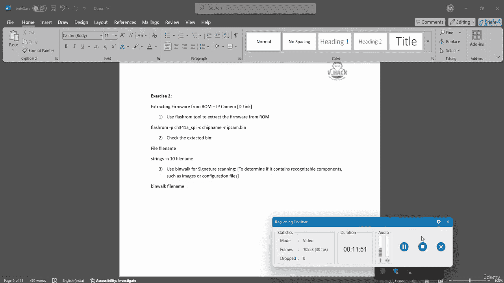

在本节课中我们一起学习了如何使用 CH341A 和 flashrom 从 IP 摄像机的 SPI Flash ROM 中提取固件，掌握了指定芯片型号参数 `-c` 的必要性，学会了用 file、strings 和 Binwalk 验证提取出的固件文件，并且记住了 SPI 操作过程中必须保持设备断电这一关键安全规则。希望这节课对你有帮助，下节课见。
