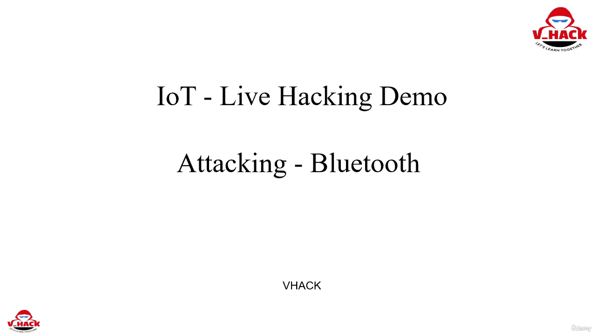
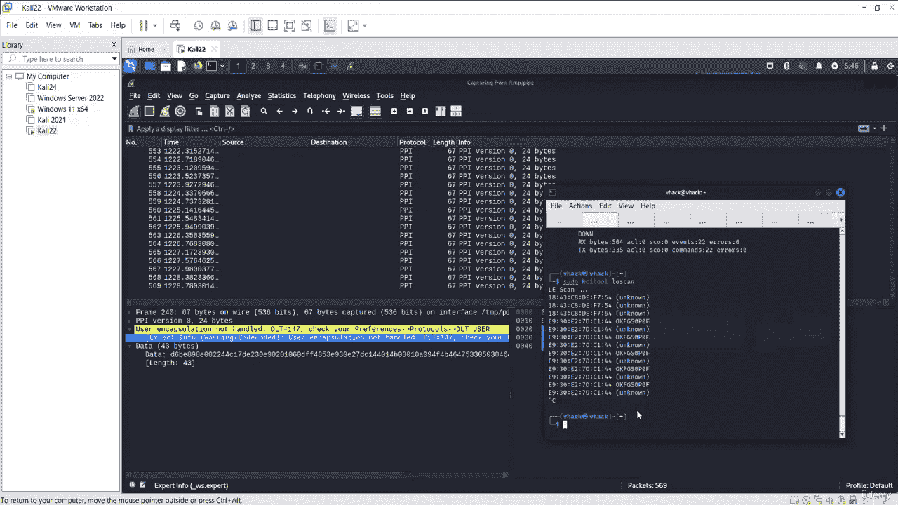
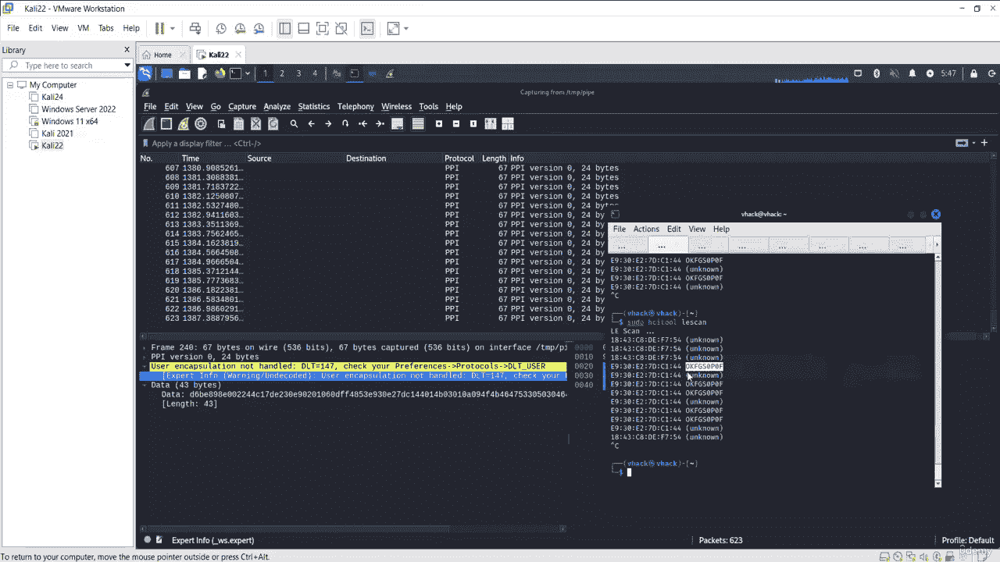
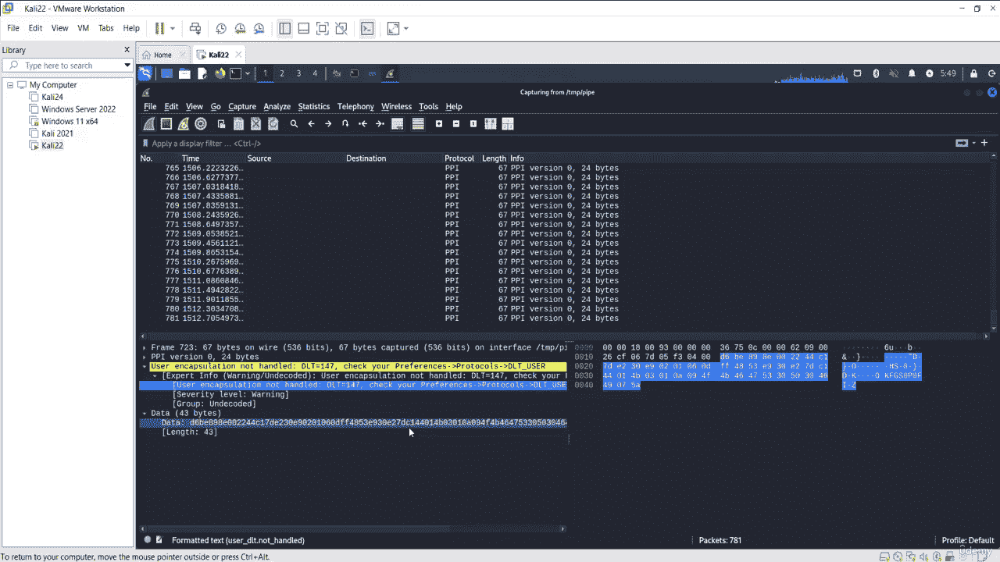
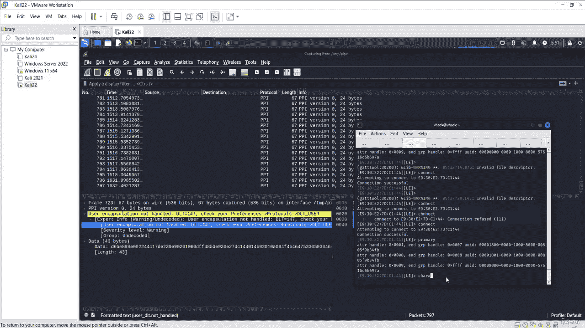

# Udemy - Ethical Hacking：50-Day Hacker Challenge：8：攻击蓝牙（实战目标 - 智能锁 - 指纹）🔓

## 课程概述

在本节课中，我们将继续学习物联网黑客攻击与蓝牙攻击的内容。本节的核心演示将聚焦于第二种攻击方式，即使用名为 Ubertooth 的硬件工具来攻击蓝牙设备。我们将以一款带有指纹解锁功能的智能锁作为实战目标，演示如何发现附近蓝牙设备、获取其 MAC 地址、抓取无线流量，以及如何通过分析句柄和特征值来构造畸形指令。学完本节后，你将掌握使用 Ubertooth 进行蓝牙安全测试的完整思路。


## 蓝牙攻击的基本流程

上一节我们介绍了蓝牙攻击的整体框架，本节中我们来看看具体的攻击步骤。整个过程可以概括为：先发现附近的蓝牙设备，再获取目标的 MAC 地址，接着针对该 MAC 地址进行流量嗅听，最后根据句柄与特征值的逻辑构造攻击载荷。

以下是蓝牙攻击的主要步骤：

- 使用扫描工具发现附近可用的蓝牙设备。
- 记录目标设备的 MAC 地址，注意蓝牙通信中使用的是 MAC 地址而非 IP 地址。
- 针对该 MAC 地址开启嗅听，抓取设备与手机应用之间交换的数据。
- 将抓取的数据导出为数据包文件，或者通过管道实时发送到 Wireshark 进行分析。
- 根据抓取到的句柄和特征值，理解设备功能对应的逻辑，例如智能灯的开关与颜色变化，或智能锁的开锁与上锁。
- 在掌握逻辑后，无需依赖官方应用，即可使用攻击工具直接构造并发送畸形指令。

以上步骤构成了本节演示的完整攻击链条，我们将逐一展开说明。


## 扫描并定位目标设备

在正式攻击之前，我们需要先在 Kali Linux 环境中准备好所有工具，确保环境已就绪。第一步是使用 HCI 工具寻找存活的蓝牙设备。

扫描过程会列出附近的低功耗蓝牙设备，示例如下：

```bash
hcitool lescan
```

扫描完成后，你会看到类似下面的输出：


```
发现设备 A
发现设备 B
发现目标设备 he930
```




在本次演示中，我们锁定的目标是一款带有指纹识别功能的智能锁，其描述信息为 "ok fg"，设备名称显示为 "okayL"。一旦确认目标设备，第二步就可以开始了。


## 抓取蓝牙流量（使用 Ubertooth 和 Wireshark）

有了目标设备的 MAC 地址之后，接下来的任务是针对该地址开启钩子，并将抓取的流量与 Wireshark 配对，以便实时观察数据交换过程。



在后台，我们可以看到目标设备对应的接口已经开始产生实时图形。需要执行的命令如下：

```bash
sudo ubertooth-btle -t <目标 MAC 地址>
```


这里的核心思路是创建一个管道。管道创建完成后，打开 Wireshark 的捕获界面，不要选择以太网或无线网卡，而要选择管道接口，从而启用连接。设置就绪后，即可开始捕获实时流量。

以下是抓取流量时需要关注的要点：

- 使用 Ubertooth 指定之前扫描得到的 MAC 地址。
- 创建管道并将其指向 Wireshark。
- 在 Wireshark 中选择管道接口而非普通网卡。
- 观察背景中实时更新的流量图形和数值变化。
- 统计捕获到的数据包数量，示例中已捕获七百多个数据包。
- 这些数据包包含与用户相关的信息，反映了蓝牙设备与应用之间的交互内容。

通过这种方式，我们能够成功嗅听目标设备的流量，并为后续分析句柄与特征值奠定基础。


## 分析句柄与特征值

在掌握了工具逻辑和不同句柄的基本概念之后，我们需要进一步查看每个句柄关联的特征值，从而理解蓝牙设备与应用之间交换的数据含义。

在蓝牙低功耗协议中，句柄与特征值的关系可以简化为：

```text
句柄 (Handle) -> 特征值 (Characteristic) -> 属性值 (Value)
```

例如，对于智能灯设备，不同的功能对应不同的特征和句柄：

- 打开灯泡对应一个句柄和特征值。
- 关闭灯泡对应另一个句柄和特征值。
- 改变灯光颜色对应第三个句柄和特征值。




对于智能锁设备，逻辑类似：

- 开锁对应一个特征值和句柄。
- 上锁对应另一个特征值和句柄。

每个特征都需要通过不同的句柄才能访问。一旦掌握了这些底层逻辑，就可以不依赖官方蓝牙应用，直接使用 CAD 工具模拟指令来控制设备。


## 使用 gatttool 构造畸形指令

在对工具逻辑和不同句柄有了大致理解之后，我们可以使用 gatttool 来构造畸形指令，进一步测试目标设备的安全性。

gatttool 的使用步骤如下：

```bash
sudo gatttool -i hci1 -b <目标 MAC 地址> -I
```

这里 `-i` 指定蓝牙适配器接口，例如 hci0 或 hci1。你可以使用 `hcitool con` 命令查找其他可用的 HCI 接口。本次演示中使用的是外置蓝牙适配器，对应的接口为 hci1，同时也涉及 Ubertooth 设备。

连接建立后，进入一个指向目标 MAC 地址的交互式 Shell。此时可以执行基础初始化命令，其中 `primary` 命令用于列出不同的句柄。示例中可以看到初始连接的三个句柄如下：

```
0x001
0x008
0x009
```

每个句柄关联不同的特征属性，示例中的特征值包括：



```
0x000a
0x02
0x01
```

这些特征值分别连接到不同的句柄。连接成功后，你可以执行 `primary` 命令查看不同句柄，进一步理解每个句柄与特征值之间的对应关系。这些数值正是蓝牙设备与应用之间交换的数据指示器。


## 课程总结


本节课中，我们一起学习了如何使用 Ubertooth 硬件工具攻击蓝牙设备，以带有指纹功能的智能锁作为实战目标。我们介绍了从扫描附近蓝牙设备、获取 MAC 地址，到针对 MAC 地址嗅听流量并通过 Wireshark 实时分析的完整流程。同时，我们也学习了如何分析句柄与特征值，理解智能灯和智能锁等设备的功能逻辑，最后使用 gatttool 构造畸形指令进行安全测试。希望这些内容能帮助你掌握蓝牙安全测试的基础方法。

