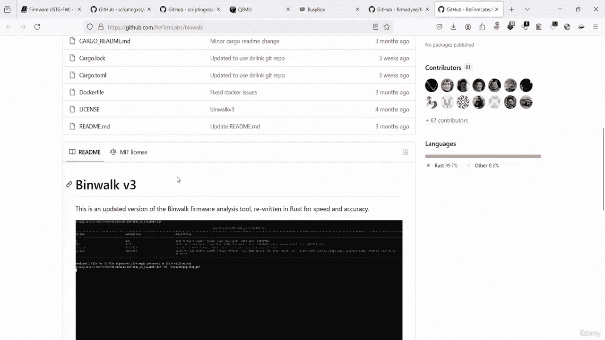
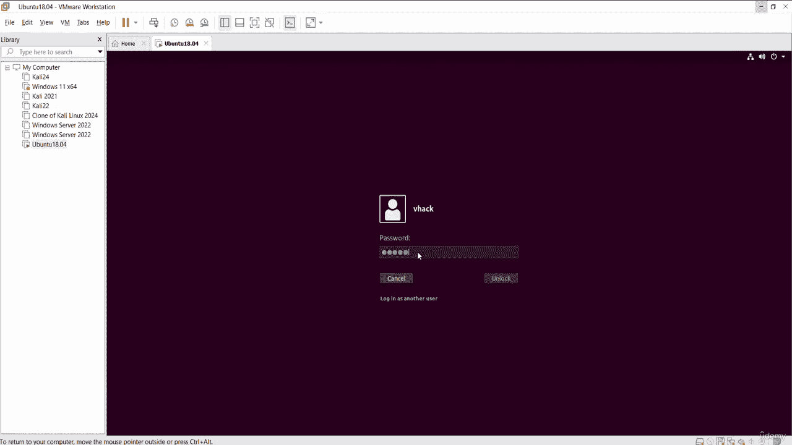

# 🛡️ Ethical Hacking 50-Day Hacker Challenge：第54节：固件分析与仿真

在本节课中，我们将一起学习固件分析的基础知识，重点了解如何在不使用实际硬件设备的情况下，通过仿真技术来分析物联网设备的固件。固件分析是物联网安全测试中非常重要的一部分，因为很多攻击都发生在设备底层软件之中。本节内容适合初学者，我们会用大白话把每一个概念讲清楚，确保你能跟上思路。

在了解了固件分析的总体目标之后，我们先来看看固件分析具体指的是什么。

固件分析简单来说，就是研究嵌入式设备里面运行的软件。这些软件通常被烧录在设备的存储芯片里，控制着设备的基本功能。当我们做安全测试时，不一定非要拿到实体硬件，也可以通过仿真环境来观察固件的行为。这种方法可以帮我们发现固件中的异常控制逻辑，而不需要准备多台设备。

固件分析的核心可以用下面的公式来表示：

固件分析 = 静态代码审计 + 动态运行仿真

这里的静态审计是指不运行固件直接查看代码，动态仿真则是指在模拟环境里让固件运行起来，观察它的真实表现。

有了基本概念以后，下一步就是准备好分析所需的工具环境。



在开始分析之前，我们需要先搭建好仿真环境。最常用的工具是 QEMU，它可以模拟不同的处理器架构，让我们在普通电脑上运行嵌入式固件。除了 QEMU，我们还需要安装 Python 以及一些依赖库，这些工具会在后续步骤中用到。


以下是安装所需的主要组件：




- QEMU 模拟器安装包
- Python 运行环境
- 相关依赖库和升级工具

安装完成后，我们需要创建用户并设置密码。这是为了在模拟系统中拥有合适的权限，方便后续操作。通常使用默认设置即可，记得启用调试模式，这样可以看到更多运行信息。

核心仿真命令示例如下：

```bash
qemu-system-arm -M versatilepb -kernel firmware.bin -append "root=/dev/sda"
```

环境搭建完成后，我们还需要考虑设备在网络中是如何工作的。

在仿真固件时，网络组件也被视为一种需要模拟的硬件。设备在真实环境中会连接网络，接收和发送数据包，因此我们的仿真环境也要能够模拟网络接口、IP 地址以及时间线等要素。

固件仿真涉及的网络与硬件要素包括：

- 虚拟网络接口
- IP 地址配置
- 数据包捕获与监控
- 控制器随机化设置

当这些要素准备好之后，我们就可以启动仿真进程，并开始监控网络流量。在运行过程中，系统会生成日志文件，记录设备的行为。我们可以查看这些日志，分析固件是否存在可疑的通信或访问行为。

网络和硬件要素都准备好以后，就可以进入固件仿真的具体操作了。

固件仿真并不是一步就能完成的，通常需要按照固定的路径一步步进行。整个流程大概包含六个主要步骤，从提取固件镜像，到配置密码，再到启动模拟器，每一步都有明确的操作顺序。

以下是固件仿真的通用步骤顺序：

1. 提取固件镜像文件
2. 配置安装路径和选项
3. 设置用户名和密码
4. 启用调试选项
5. 启动 QEMU 模拟器
6. 监控网络并查看日志

完成这些步骤之后，固件就已经在模拟环境中运行了。接下来的模块中，我们会继续介绍其他分析步骤，并深入探讨具体的攻击场景。本节的演示到这里就结束了。


在本节课中，我们一起学习了固件分析的基本概念，了解了如何使用 QEMU 进行固件仿真，掌握了安装环境、配置网络硬件以及执行仿真步骤的方法。希望这些内容能帮助你建立起对物联网固件安全测试的初步认识。

