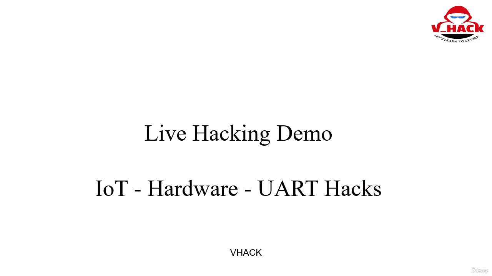
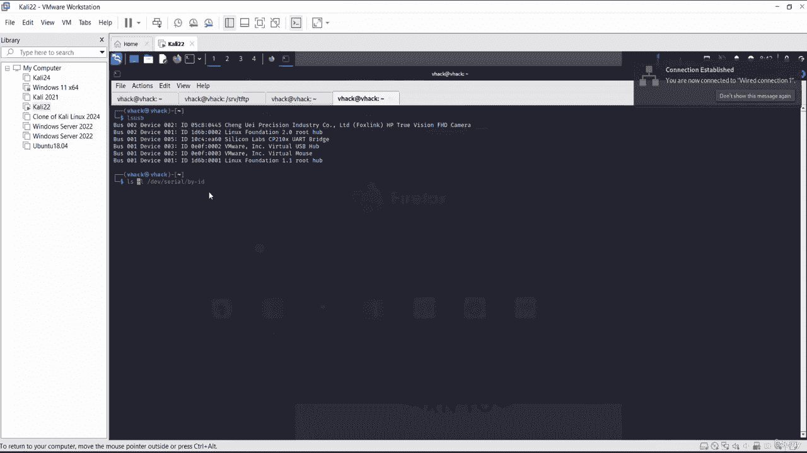
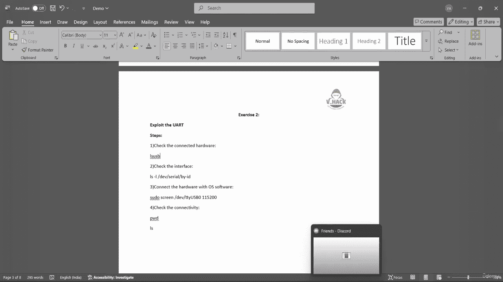
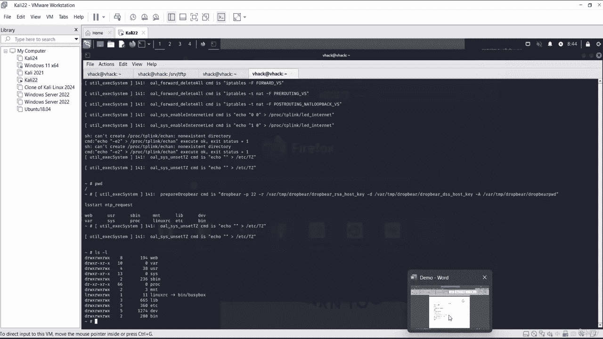
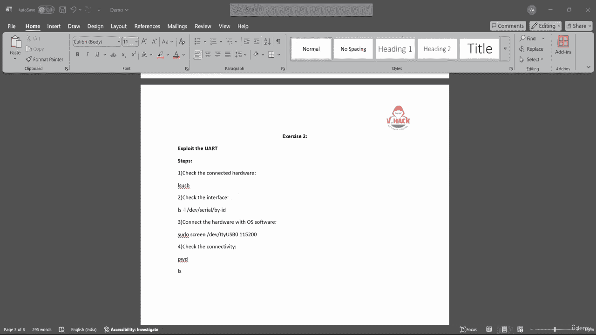
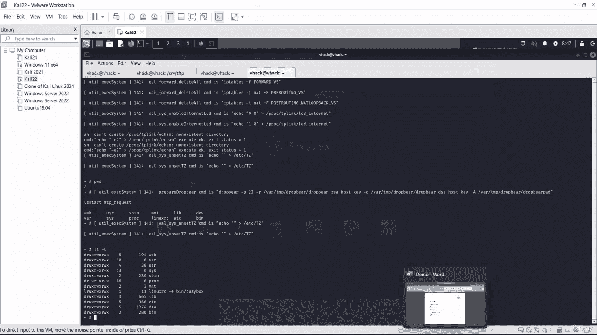
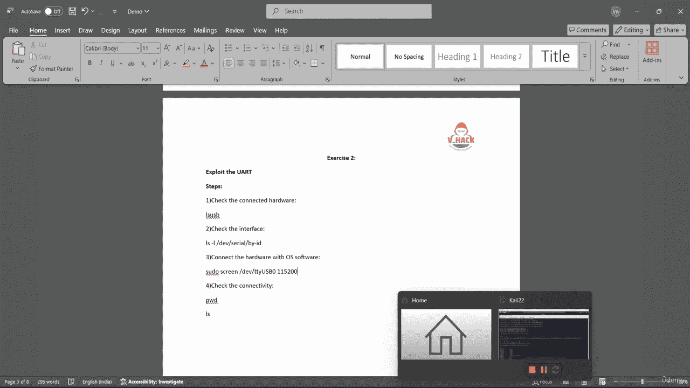
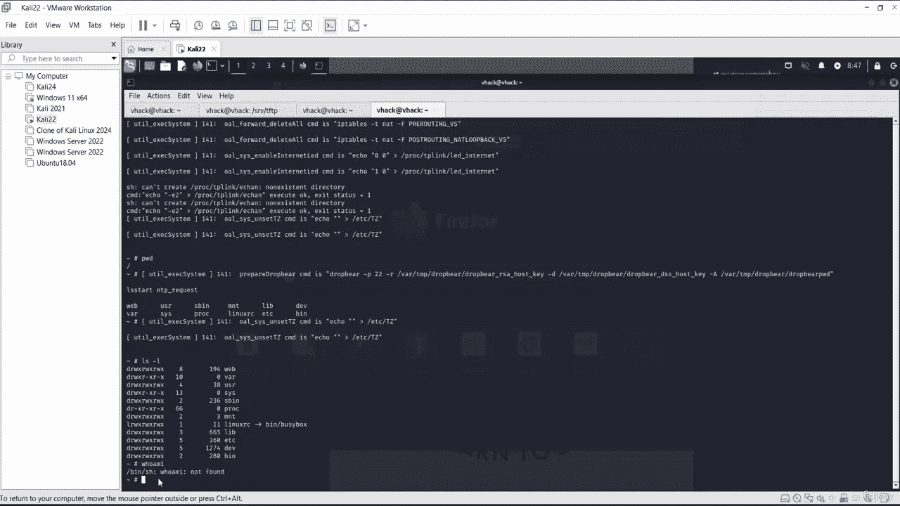
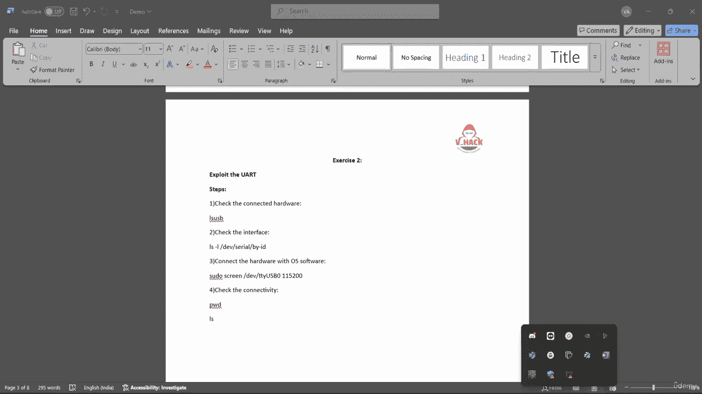

# Ethical Hacking：02：硬件入侵之 UART 连接与攻击 🔧



在本节课中，我们将学习如何通过硬件层面的 UART 接口，连接到真实的路由器设备并对其进行控制。我们会先准备虚拟机环境，再把 USB 转串口转换器接上设备，接着在终端里配置正确的波特率，最后设置文件权限，为后续的攻击练习打下基础。无论你之前是否接触过硬件安全，这节课都会用大白话把每一个操作步骤讲清楚，让你明白底层通信是怎么发生的，以及为什么这些步骤缺一不可。


本节课的第一部分是准备虚拟机和网络桥接。我们需要在主机上运行虚拟机，让虚拟机能够直接访问物理网络，这样才能稳定地连接后面的硬件设备。原文中提到的 Bridge 就是网桥模式，它能让虚拟机像一台独立的电脑一样出现在局域网里，而不是隐藏在主机后面，这样后续的硬件通信才不会出现网络隔离问题。

以下是虚拟机网络配置的关键要点：

- 主机设备：运行虚拟机软件的物理计算机
- 虚拟机：模拟出的独立计算环境，用于执行安全测试
- 网桥模式：`network_mode = Bridge`
- 连接目的：让虚拟机直接与物理路由器通信



完成虚拟机设置后，我们就要把注意力转移到硬件连接本身了。


接下来是 UART 物理连接与终端软件配置。UART 是一种常见的串行通信接口，很多路由器主板上都留有 UART 引脚，攻击者可以通过 USB 转串口转换器把电脑连到这些引脚上，从而直接与设备的控制台交互。原文所说的“控制转换器 USB”以及“US0”，指的就是系统里识别出来的串口设备，通常会被分配一个类似 `/dev/ttyUSB0` 的设备文件。



在终端里连接串口设备时，需要指定正确的波特率，否则只会看到乱码。原文中提到的波特率数字是 11520，实际操作中通常对应标准的 115200，这决定了数据发送和接收的速度，必须和路由器端保持一致。

以下是终端连接命令的核心参数：

```bash
device_path=/dev/ttyUSB0
baud_rate=115200
sudo screen /dev/ttyUSB0 115200
```

当你执行上面的命令后，电脑就可以通过串口直接控制路由器的底层系统了。这时候不要着急，确认终端里能正常输出设备日志，再进行下一步操作。


连接建立并能正常通信后，下一步是处理设备上的文件权限。原文里提到了“rock 组件”和“完全读权限”，意思是有些关键文件默认只能读不能写，如果我们需要修改或提取这些文件，就必须先调整权限。文件权限通常用数字表示，比如 0 表示特定的受限状态，而具体的路径则决定了我们要操作哪个文件，这个路径将帮助我们在接下来的练习中顺利完成操作。

以下是权限设置相关的重要概念：

- 只读权限：`file_permission = 0`（表示无法写入）
- 目标路径：`/etc/shadow` 或其他系统关键文件路径
- 权限修改命令：`chmod 000 /path/to/file`
- 用途：为后续的文件提取或修改练习做准备



设置好权限后，我们就可以进入最核心的实战环节了。




最后一部分是整个练习的操作步骤回顾。原文中提到的“T”很可能是指某个终端设备或调试接口，而 ID 是 0 或 1，说明系统里可能存在多个串口设备，我们需要确认当前使用的是哪一个。按照之前的设置，先连接硬件，再打开终端，指定正确的设备 ID 和波特率，最后检查权限，就能完成一次完整的 UART 连接与控制流程。

以下是实战练习的简化流程：





1. 启动虚拟机并设置网桥模式：`network_mode = Bridge`
2. 插入 USB 转串口转换器，确认设备路径：`/dev/ttyUSB0`
3. 在终端连接串口：`screen /dev/ttyUSB0 115200`
4. 检查并设置目标文件权限：`chmod 000 /path/to/target`
5. 确认终端设备 ID：`device_id ∈ {0, 1}`

按照这个顺序操作，你就能够稳定地连接到路由器的 UART 接口，并为后续的硬件攻击练习做好准备。






本节课中，我们一起学习了如何准备虚拟机环境、如何通过 USB 转串口转换器连接路由器的 UART 接口、如何在终端里配置正确的波特率，以及如何设置关键文件的权限。希望这些内容能帮你理解硬件入侵的最基本流程，在实际操作中多动手，逐步熟悉每一个细节。
