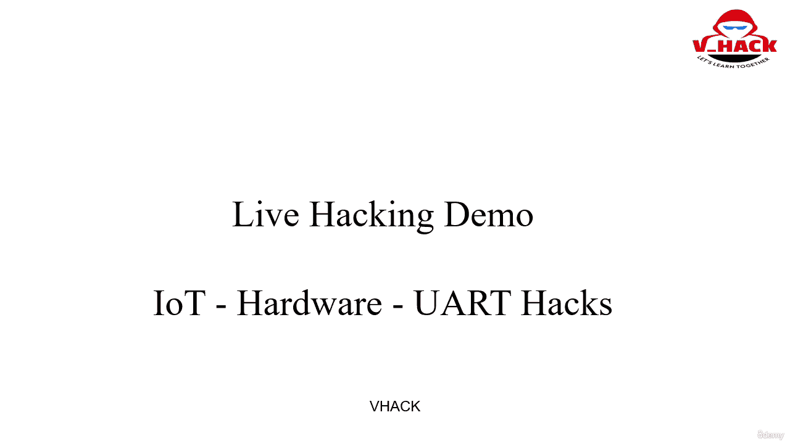
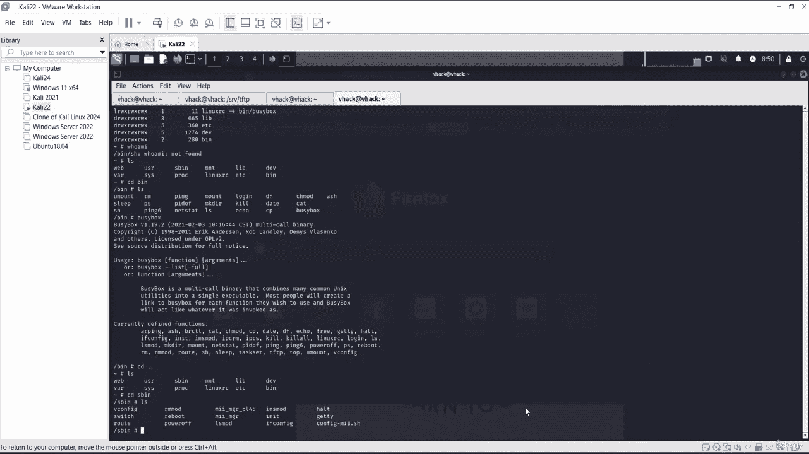

Ethical Hacking：3：硬件黑客 – UART 枚举 [实战目标 - 路由器] 🔌

在本节课中，我们将一起学习硬件黑客的基础知识，重点围绕 UART 接口展开，并以真实路由器作为攻击目标，演示如何对设备进行枚举与信息收集。无论你是完全没有硬件基础的新手，还是已经了解一些网络安全概念的学习者，这节课都会用最直白的方式把难点拆开讲清楚，确保每个人都能跟上节奏，顺利完成实验任务。

---



### 硬件黑客与 UART 的基本概念 🛠️

上一节我们主要聊的是软件层面的漏洞利用，本节中我们来看看硬件层面是如何被攻击的。在硬件黑客的世界里，UART 是最常见的调试接口之一，攻击者可以通过它直接与设备底层进行通信，绕过很多操作系统层面的保护机制。

UART 的核心连接关系可以用下面这个简单的代码块来描述：

```
UART 通信 = 发送引脚 (TX) + 接收引脚 (RX) + 地线 (GND)
```

这三根线缺一不可，只有把它们正确接到路由器主板的测试点上，我们才能拿到设备的控制台输出，进一步枚举系统信息。如果你是第一次接触硬件，不用担心，只要记住 TX 接 RX、RX 接 TX、GND 接 GND 这个基本原则，就不会接错。

---


### 练习三的连接要求与敏感字段 📌

在介绍完 UART 基础之后，我们具体来看练习三需要做什么。以下是该练习的主要要求和注意事项：

- 你需要把练习三涉及的第二个引脚和上方引脚正确连接，确保两者处于等电位状态。
- 参数一中包含一些敏感字段，这些字段在后续枚举过程中非常关键，不能随意修改或忽略。
- 连接完成后，确认引脚定义无误，再进行后续的通信测试。

这里的“敏感字段”指的是设备启动过程中输出的关键配置信息，比如内存地址、启动参数或管理员凭据片段，拿到这些信息后，后续的攻击面会大大扩大。

---

### 平凡文件传输协议与 BusyBox 底层分析 📂

刚才我们说完了硬件连接部分，本节中我们来看看枚举过程中会涉及的协议与底层组件。有趣的是，这里还会涉及到平凡文件传输协议，也就是常说的 TFTP，它常被嵌入式设备用来传输固件或配置文件。

在实际操作中，你需要了解以下几点：

- 不需要立即处理后续生成的文件，先保持原样，避免破坏现场。
- 你要对 BusyBox 有高层级的理解，因为很多路由器的底层 Shell 环境正是基于 BusyBox 构建的。
- 平凡字段传输的内容通常出现在单元的底部区域，建议重点关注这部分输出日志。

BusyBox 就像是嵌入式设备里的“瑞士军刀”，把很多常用 Linux 命令压缩进一个小可执行文件里，理解它的行为能帮你更快地在路由器 shell 中执行枚举命令。

---

### 从练习三过渡到练习四 ⏭️

上面的内容就是练习三的核心流程，完成引脚连接、识别敏感字段、分析 TFTP 与 BusyBox 输出之后，你就已经掌握了 UART 枚举的基本套路。接下来我们要进入练习四，把刚才学到的知识应用到更复杂的场景中，继续深入路由器的硬件攻击面。



---


### 本节总结 📝

本节课中我们一起学习了硬件黑客中 UART 接口的基础概念，掌握了 TX、RX、GND 三根线的连接逻辑，完成了练习三中关于引脚连接与敏感字段识别的要求，并且初步了解了平凡文件传输协议和 BusyBox 在路由器底层中的作用。希望这些内容能帮你建立起硬件层面的安全认知，为后续的攻击实验打下坚实基础。
