Ethical Hacking：06：SPI 闪存固件提取实战（路由器） 🛠️


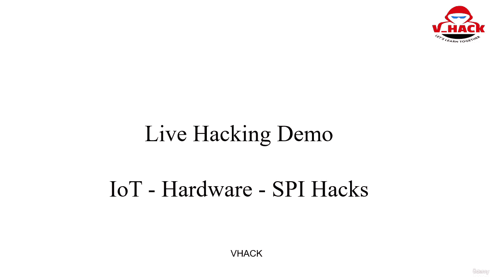

在本节课中，我们将学习如何通过硬件接口读取路由器上的 SPI Flash 芯片，并把里面的固件完整地提取出来。这属于硬件黑客入门实战，我们会一步步讲解从物理连接到固件分析的完整流程，适合完全没有硬件基础的初学者跟着操作。


## 第一节：课程概述 📋


我们先来聊聊这一节的大致内容。上一节我们介绍了硬件黑客的基础知识，本节中我们将进入更具体的实操环节，目标是从一台真实的路由器设备中提取固件。固件简单来说，就是运行在路由器上的操作系统和配置程序，它存储在一个叫 SPI Flash 的芯片里。

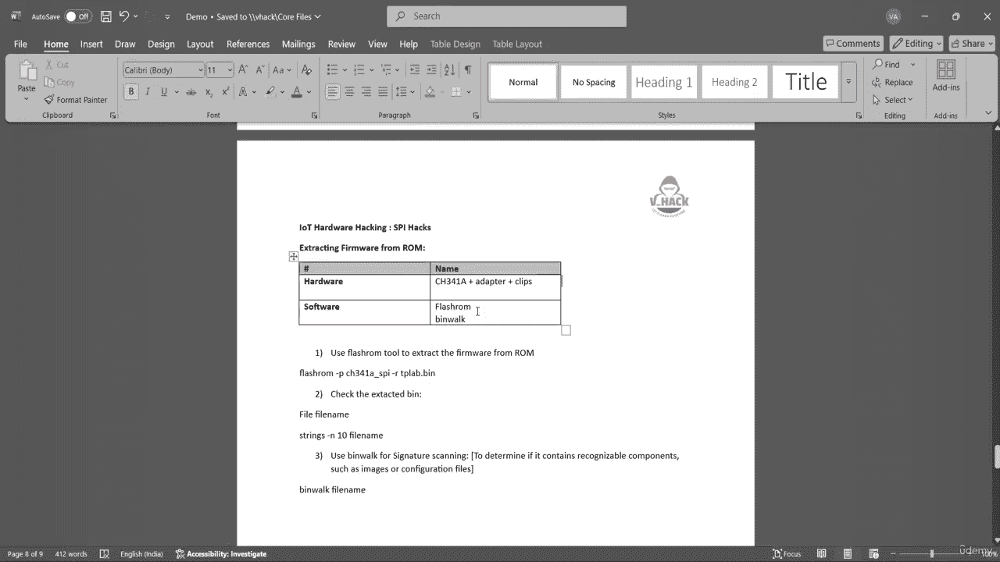

SPI 是一种常见的串行通信接口，全称 Serial Peripheral Interface，很多嵌入式设备都用它来连接闪存芯片。我们可以把它理解为电路板上的一个数据通道，通过这个通道，外部设备可以读取或者写入芯片里的内容。

核心概念可以用下面的公式来表示：

```text
固件 = 操作系统 + 驱动程序 + 配置文件 + 引导程序
```

或者用代码形式描述设备与芯片的关系：

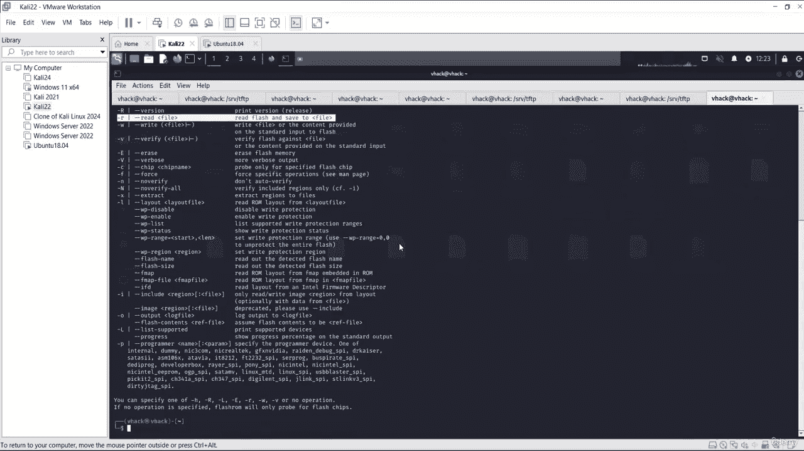

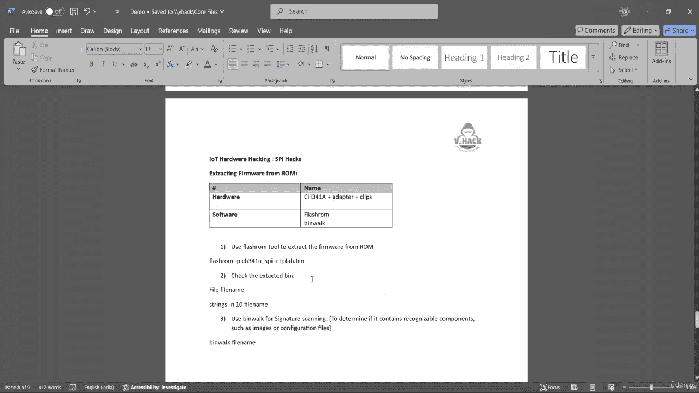

```c
struct spi_device {
    char *chip_name;
    uint32_t flash_size;
    uint8_t *firmware_data;
};
```

本节课我们会使用 CH341A 编程器作为读写工具，通过它连接到路由器主板上的 SPI Flash 芯片，把芯片里的数据完整读取出来，保存成一个二进制文件，也就是俗称的 bin 文件。之后我们会对这个 bin 文件进行分析，提取出里面有用的信息，比如字符串、IP 地址、文件系统等等。


## 第二节：准备硬件与工具 🔧


在动手之前，我们需要准备好必要的硬件设备和软件工具。以下是需要准备的物品清单：

- CH341A 编程器，用于与 SPI Flash 芯片通信
- 测试夹子或杜邦线，用于物理连接
- 一台目标路由器，主板上带有 SPI Flash 芯片
- 电脑一台，安装好固件读取软件和分析工具
- 软件方面，常用的有编程器上位机软件，以及固件分析工具，例如 binwalk

CH341A 是一款非常便宜且常用的 USB 转串口/编程器芯片，很多初学者都会买来玩硬件。它的作用很简单，就是把电脑的 USB 信号转换成 SPI Flash 芯片能听懂的信号，让我们可以通过电脑直接读写闪存里的数据。

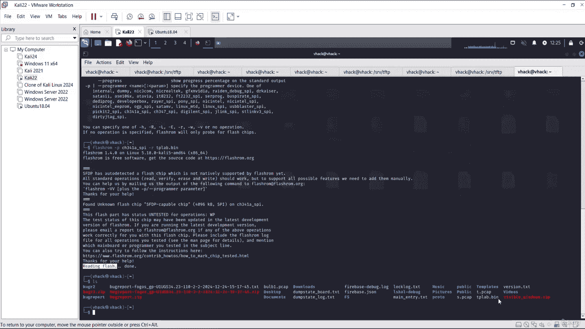

在软件层面，我们需要一个能够识别 CH341A 的编程器软件，用来发出读取闪存的指令。读取完成后，会得到一个原始的二进制镜像文件，后缀通常是 .bin。这个文件就是路由器固件的完整备份，里面包含了所有的系统程序和设置。


## 第三节：连接 SPI Flash 芯片 🔌


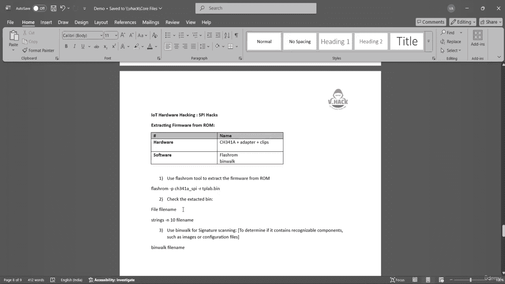

有了工具之后，接下来就是最关键的硬件连接步骤。我们需要把编程器连接到路由器主板上的 SPI Flash 芯片上，通常涉及以下几个引脚：

- VCC，给芯片供电
- GND，接地
- CS，片选信号
- MOSI，主输出从输入
- MISO，主输入从输出
- CLK，时钟信号

连接的时候要特别小心，不能接错引脚，否则可能会烧坏芯片或者主板。建议先找好芯片的数据手册，确认每个引脚的定义，再用测试夹子或杜邦线逐一对应连接好。连接完成后，用电脑通过 USB 把 CH341A 编程器接上，打开编程器软件，检查能否正常识别到芯片。

如果软件能成功识别芯片型号，说明硬件连接没有问题，接下来就可以开始读取闪存里的内容了。这一步看起来简单，但实际上是整个流程的基础，连接不好会导致读取出错或者读出来的数据是乱码。


## 第四节：读取 ROM 并保存固件 💾


连接确认无误后，我们就可以开始读取 SPI Flash 芯片里的固件数据了。在编程器软件中，选择对应的芯片型号，然后点击读取按钮，软件会把芯片里的所有数据逐字节读出来，并保存到电脑硬盘上。

读取过程可能需要一段时间，具体取决于闪存的容量大小，容量越大，读取时间越长。读取完成后，软件通常会提示读取完成，同时会在指定目录生成一个 bin 文件。比如我们可能会得到一个名为 tp_link.bin 的文件，这就是路由器固件的完整镜像。

核心操作可以用伪代码描述如下：

```python
firmware_data = spi_reader.read_flash(start_address=0x0, size=flash_capacity)
save_to_file(firmware_data, "router_firmware.bin")
```

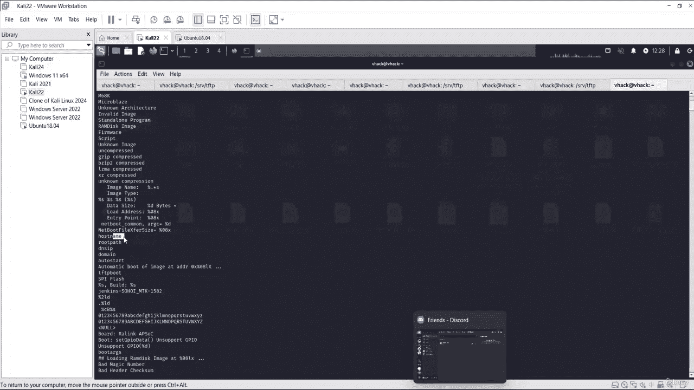

拿到 bin 文件之后，不要急着直接分析，先确认文件大小是否和芯片容量一致，如果文件太小或者为零字节，说明读取失败，需要重新检查连接。读取成功后，这个 bin 文件就是我们后续所有分析工作的基础，里面包含了路由器启动所需的全部程序和数据。


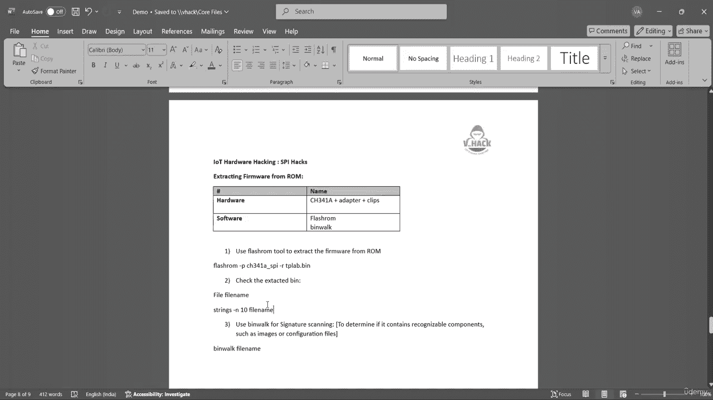

## 第五节：使用签名扫描分析固件 🔍


有了固件镜像文件之后，我们就可以开始分析里面藏了什么内容了。固件文件本身是二进制数据，肉眼很难看懂，所以我们需要用固件分析工具来帮助我们提取有用信息。以下是常见的分析步骤：

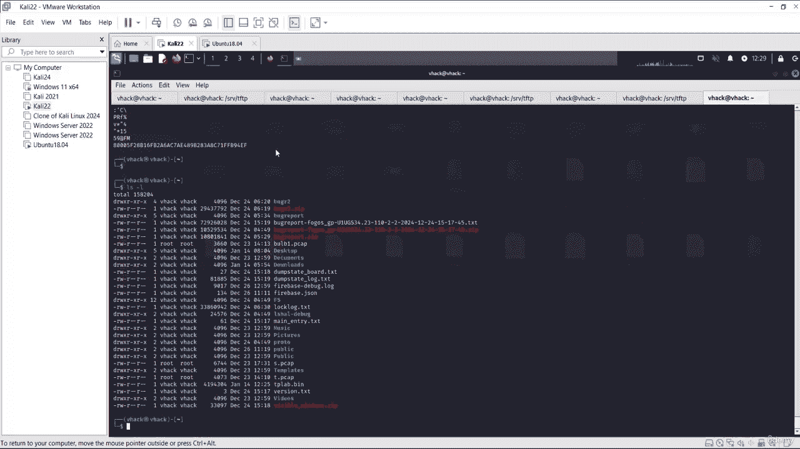

- 用字符串搜索工具在 bin 文件中查找可读文本
- 搜索常见的网络配置，比如 192.168.0.x 这样的 IP 地址
- 使用签名扫描识别已知的文件系统格式，比如 SquashFS
- 查找内核镜像、启动加载程序和 busybox 等组件

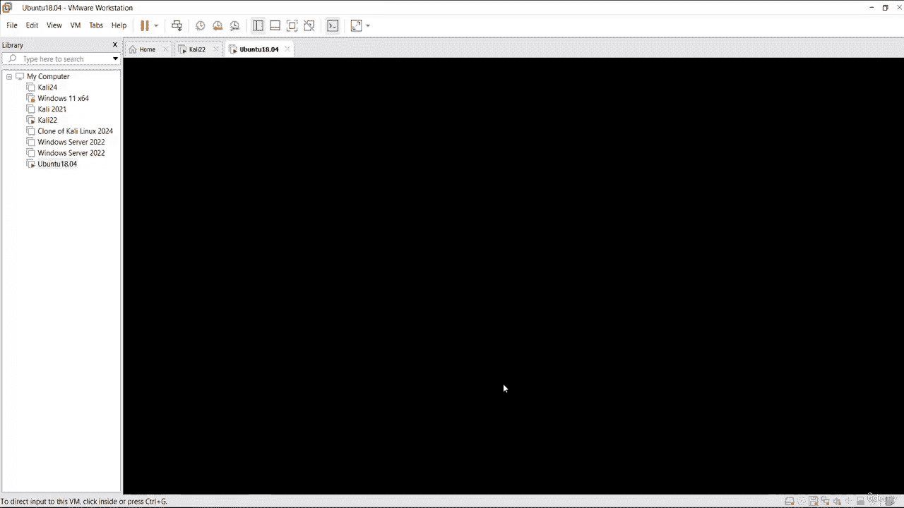

签名扫描的原理其实很简单，就是在二进制文件里搜索特定的字节序列，这些序列就像签名一样，能告诉我们这里可能是一个压缩包、一个文件系统或者一个可执行程序。比如 binwalk 就是一款常用的固件分析工具，它可以自动扫描 bin 文件，列出里面所有可能的文件和分区。

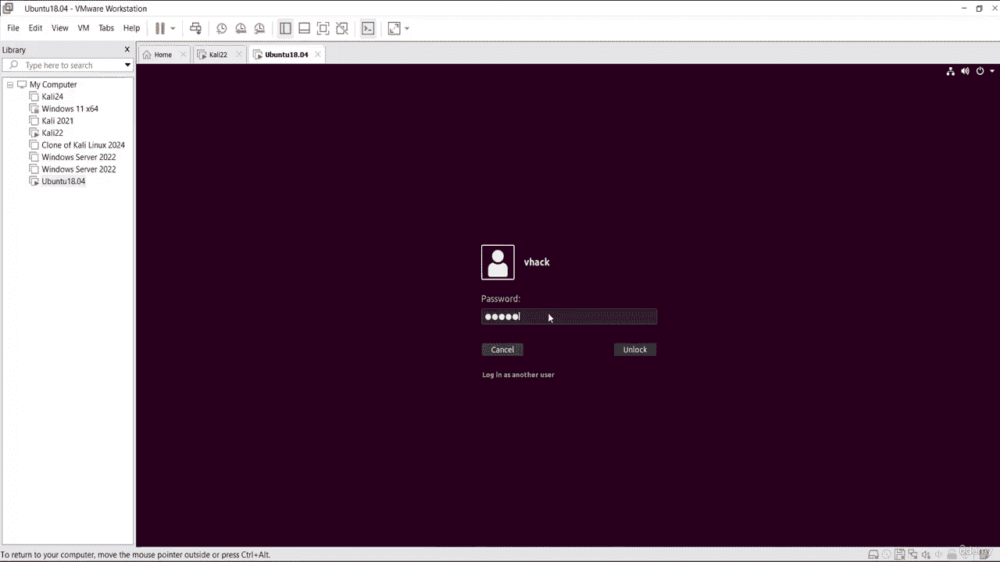

分析过程中，我们可能会发现固件里的某些部分被加密了，或者被压缩了，这时候直接查看可能是乱码，不能立刻读懂。但这没关系，我们可以先记录下这些位置，稍后尝试解密或解压。很多时候，固件里的关键信息，比如管理员密码、后台地址、硬件版本号，都会以明文形式存在，搜索一下就能找到。


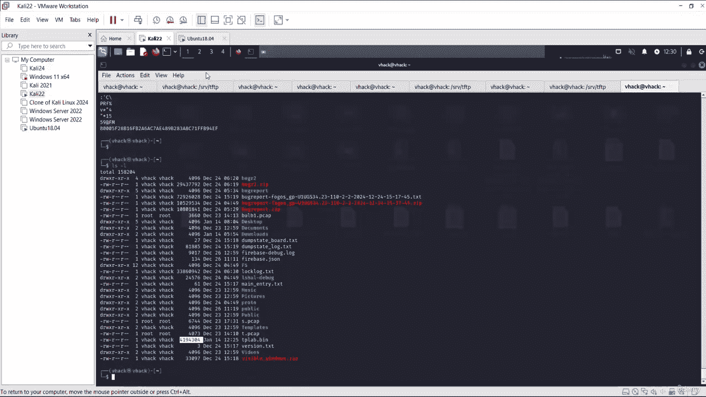

## 第六节：提取文件系统与关键信息 📂


签名扫描完毕之后，我们就可以把固件里的文件系统提取出来，进一步查看里面的文件和脚本。常见的嵌入式文件系统包括 SquashFS、JFFS2 等，提取之后可以得到一个类似 Linux 根目录的文件结构。

提取后的内容通常包括：

- 内核镜像文件，负责系统启动和硬件驱动
- 根文件系统，包含各种系统程序和配置脚本
- BusyBox 工具集，提供常用的 Linux 命令
- Web 管理界面文件，路由器的后台设置页面就在这里

在提取过程中，我们需要指定正确的起始地址和文件系统类型，如果参数设置不对，提取出来的文件可能是损坏的。提取成功之后，我们就可以在这些文件里寻找感兴趣的信息，比如默认密码、远程访问端口、固件更新机制等等。

这一步是整个固件分析的核心，因为二进制镜像里虽然数据很多，但只有把文件系统提取出来，才能方便地用文本编辑器或者搜索工具去查找具体内容。提取完成后，固件里的秘密基本上就都被我们揭开了。


## 第七节：本节总结 ✅


本节课中，我们一起学习了如何通过硬件接口从路由器的 SPI Flash 芯片中提取固件。我们先介绍了 SPI 接口和固件的基本概念，然后准备了 CH341A 编程器等硬件工具，接着学习了如何正确连接芯片引脚，并使用编程器软件把闪存数据读取并保存为 bin 文件。最后，我们使用签名扫描和固件分析工具，对 bin 文件进行解析，提取出文件系统和关键信息。

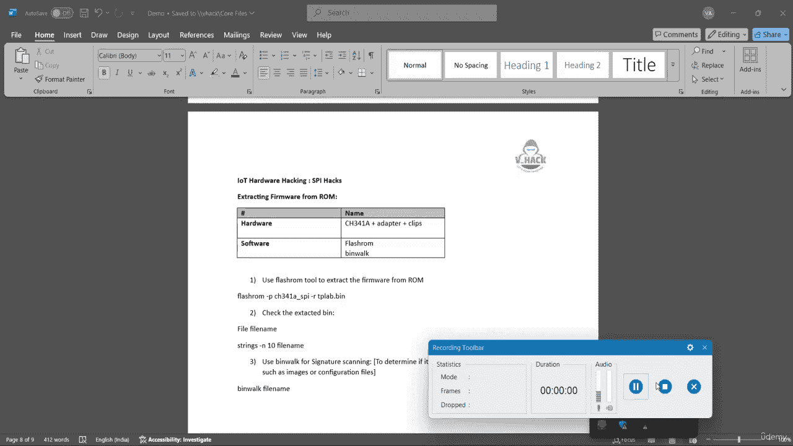

通过这一节的实践，你应该已经掌握了硬件固件提取的基本流程，知道了从物理连接到数据读取，再到固件分析的完整步骤。这些技能是进行更深层次嵌入式设备安全研究的基础，希望你能动手尝试一下，在实际设备上验证这些知识。
