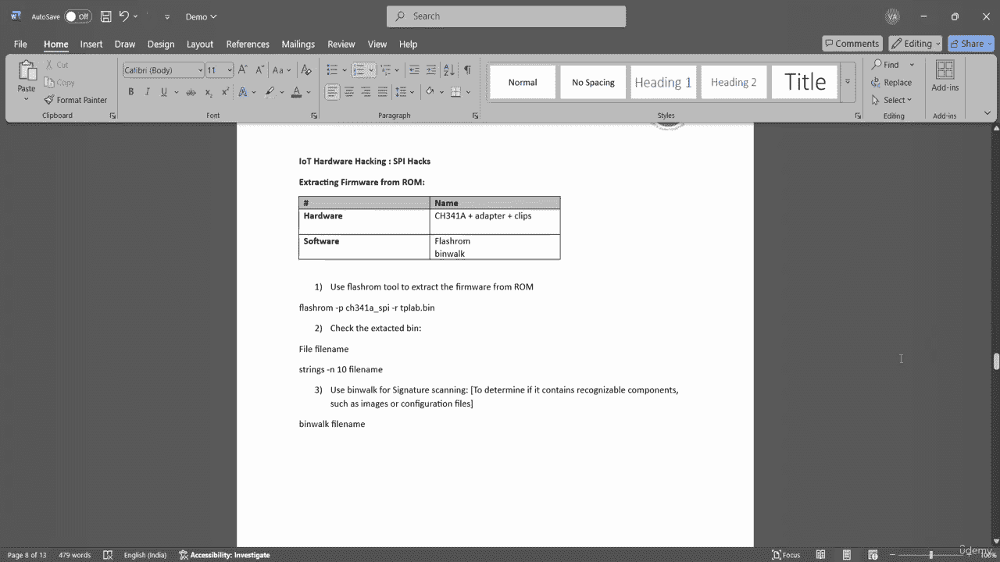

# 🔧 道德黑客：50天黑客挑战：50次真实攻击：07：硬件黑客 - SPI - 从 ROM 中提取固件 [IP摄像机实战目标]


在本节课中，我们将学习如何通过 SPI 接口从 IP 摄像机的 ROM 芯片中提取固件。本节内容属于硬件黑客部分，主要面向零基础初学者。我们会先搭建硬件连接，再读取闪存内容，最后对固件文件进行基础分析。整个过程不需要复杂的编程基础，只需按照步骤操作即可完成固件提取和简单的安全检查。


## 准备硬件连接环境

上一节我们介绍了软件层面的渗透测试基础，本节中我们来看看硬件层面的攻击入口。提取固件的第一步是建立正确的硬件连接，确保读取器能够和 ROM 芯片正常通信。

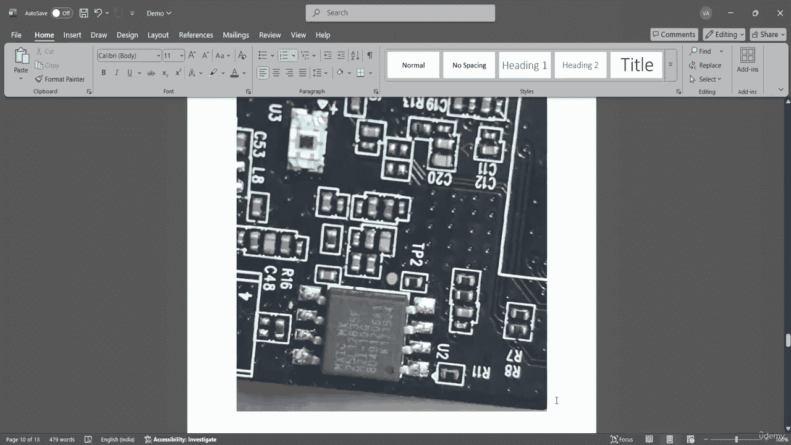

以下是硬件连接所需的核心步骤：

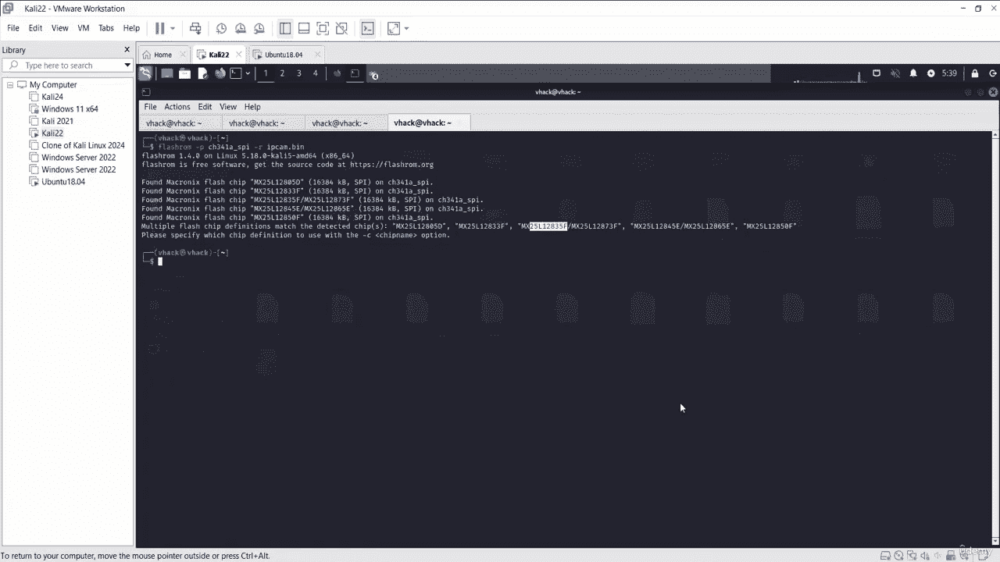

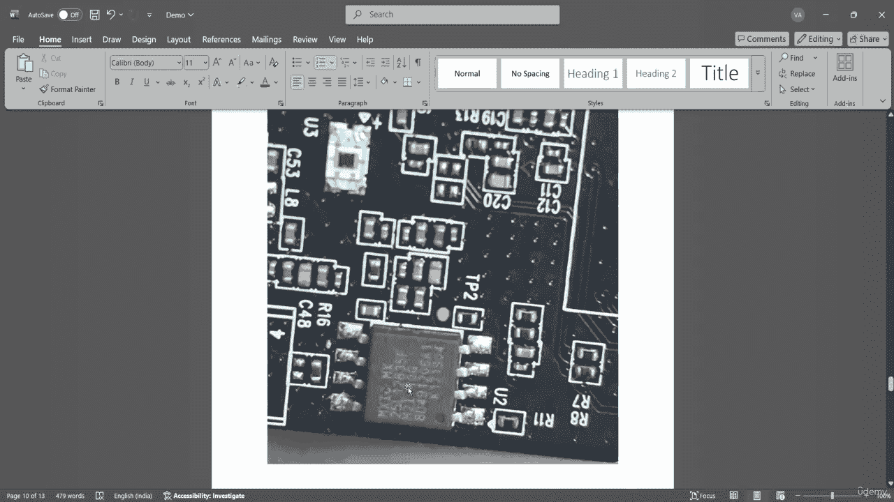

- 确认目标设备为 IP 摄像机，并找到主板上的闪存芯片位置。
- 使用夹子或导线将读取器与芯片引脚对应连接，引脚顺序需参考芯片手册。
- 检查连接是否牢固，避免在读取过程中出现接触不良。

硬件连接建立后，我们需要在软件端完成初始化配置，这样读取器才能识别芯片型号并准备好数据传输通道。


## 读取闪存中的固件数据

硬件就绪之后，下一步是将闪存里的二进制数据读取到计算机中。读取时间取决于固件文件的大小，通常需要等待一段时间才能完成。

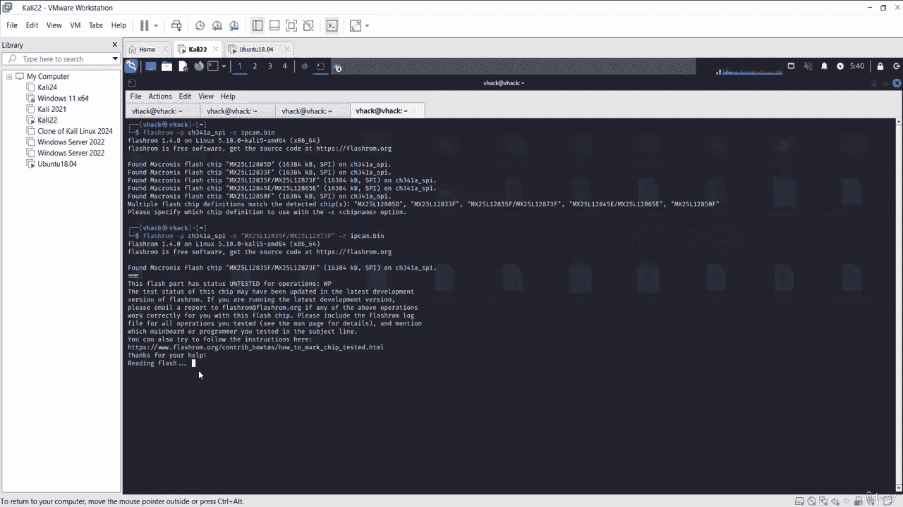

以下是读取闪存的主要操作：

- 启动读取软件，选择对应的 SPI 接口和芯片型号。
- 执行读取命令，将 ROM 芯片内容保存为二进制文件。
- 等待进度条完成，确认读取过程未出现错误。

读取完成后，你会得到一个包含完整固件的二进制文件，该文件包含了设备的引导代码、内核镜像和配置信息，可用于后续的安全分析。


## 分析固件文件与基础命令

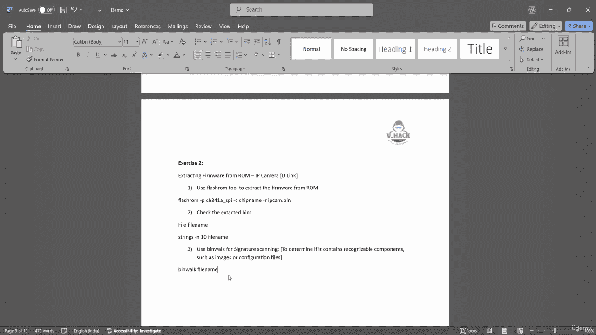

拿到固件文件之后，我们需要验证文件的有效性并提取其中的关键信息。这一步可以帮助我们了解固件的结构，并发现潜在的安全问题。

以下是常用的分析步骤和命令：

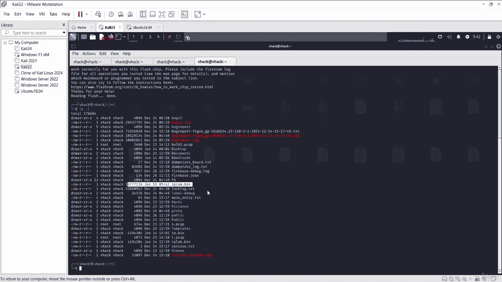

- 使用 `file` 命令查看固件文件类型，确认是否为有效的二进制镜像。
- 使用 `strings` 命令提取文件中的可读字符串，查找证书、密钥或配置信息。
- 进行签名扫描，定位固件中的组件、镜像和配置区域。
- 检查 RSA 证书信息，验证固件的签名来源是否可信。

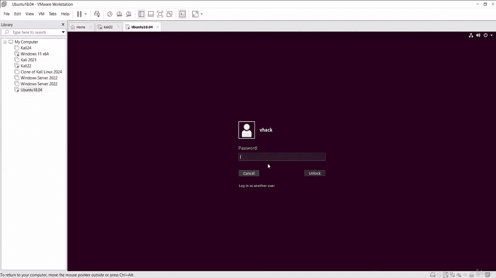

在分析过程中，系统会执行完整性检查，确保读取的文件没有损坏。如果检查通过，说明固件提取成功，可以进入更深层的漏洞挖掘阶段。


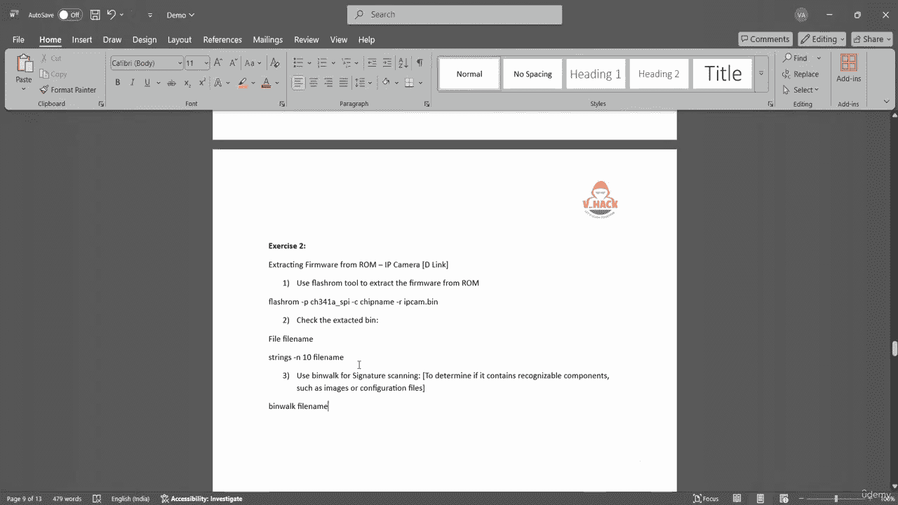

## 配置串口通信与波特率

固件提取完成后，很多时候还需要通过串口连接与设备进行交互，获取内核日志和引导信息。正确的波特率设置是建立通信的前提。

以下是串口连接的关键参数：

- 波特率：57600 bps，部分设备也可能使用 115200 bps。
- 数据位：8 位。
- 停止位：1 位。
- 校验位：无校验。

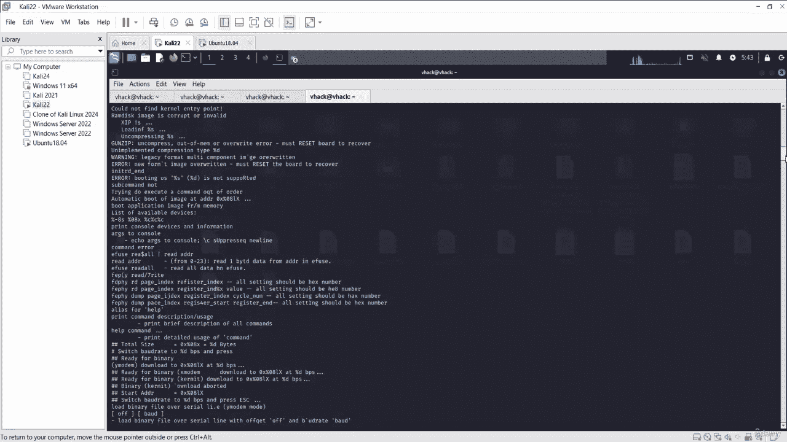

波特率配置示例如下：

```
波特率 = 57600 bps
```

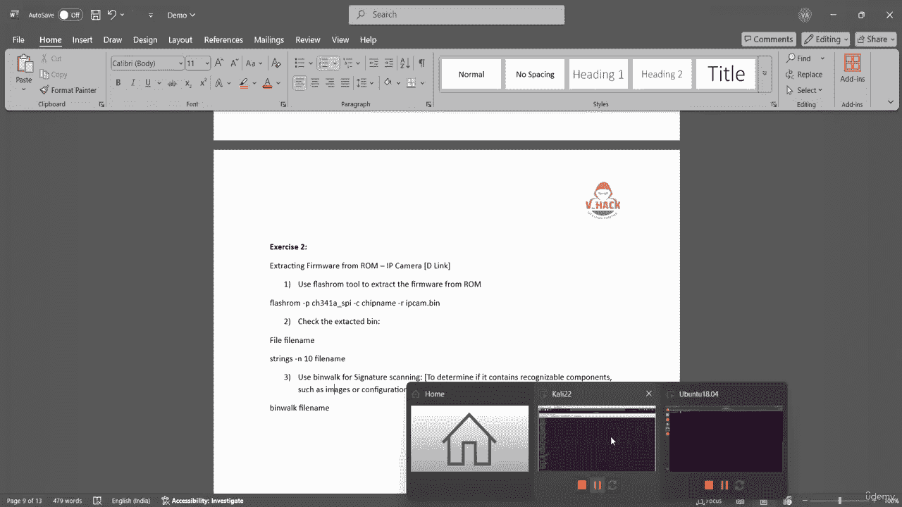

当波特率设置正确后，串口助手就能正常显示设备输出的日志信息，包括内核启动过程和系统运行状态。


## 整理提取结果与模式确认

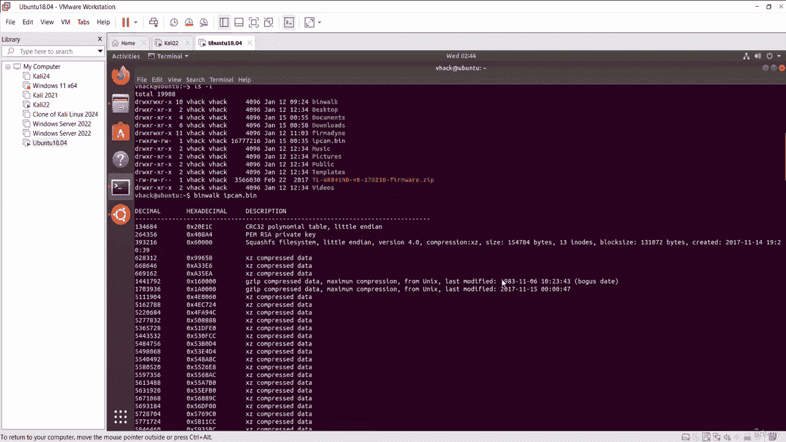

所有数据读取和分析完成后，我们需要对提取结果进行汇总，确认固件中的关键偏移量和字节序模式。这一步有助于后续进行逆向工程或漏洞利用。

以下是需要确认的关键信息：

- 固件文件中的偏移模式，例如 16、77、216 等字节位置。
- 系统的字节序模式，确认是小端序还是大端序。
- 提取出的组件列表，包括镜像文件和配置模块。
- 最终的完整性验证结果，确认读取数据无误。

当所有信息确认无误后，本次固件提取任务就算完成，你可以基于提取的固件进行进一步的安全研究。


## 本节课总结

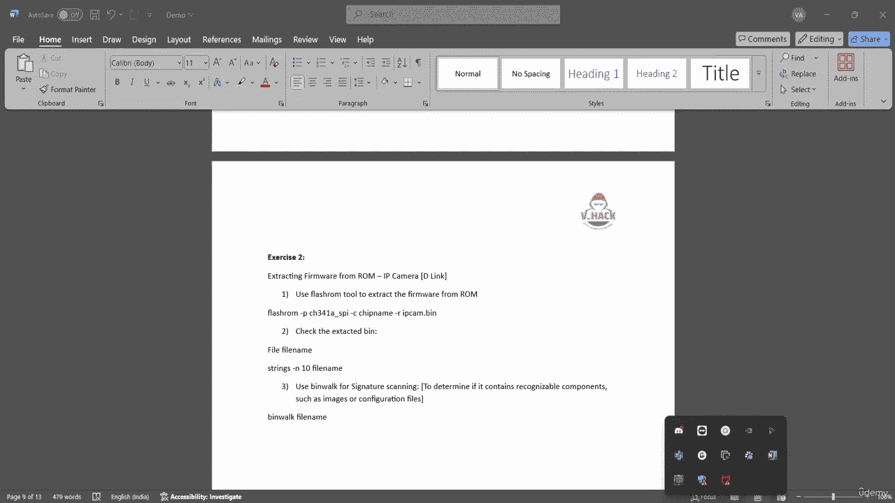

本节课中我们一起学习了如何通过 SPI 接口从 IP 摄像机的 ROM 芯片中提取固件。我们搭建了硬件连接，读取了闪存中的二进制数据，使用 `file` 和 `strings` 等命令分析了固件内容，并配置了 57600 波特率的串口通信。最后，我们对提取结果进行了完整性检查和模式确认。掌握这些基础操作后，你就可以开始尝试更复杂的硬件安全测试了。

