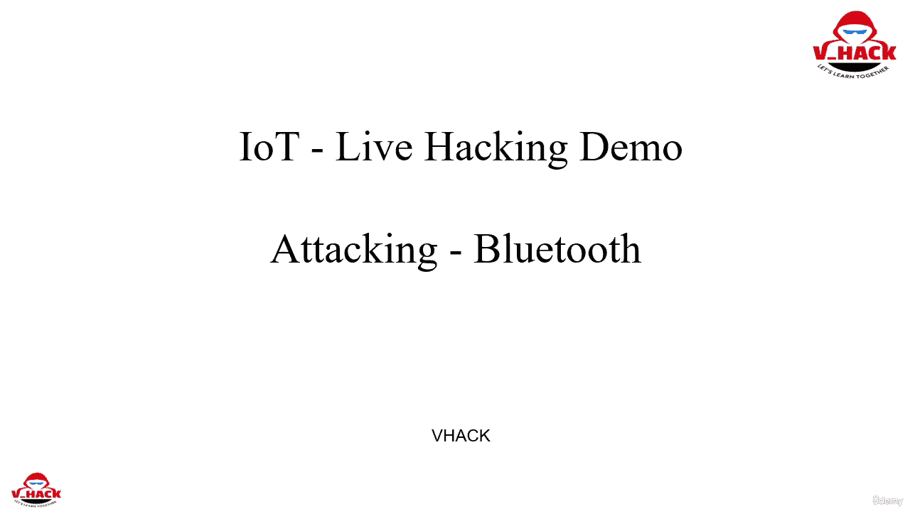
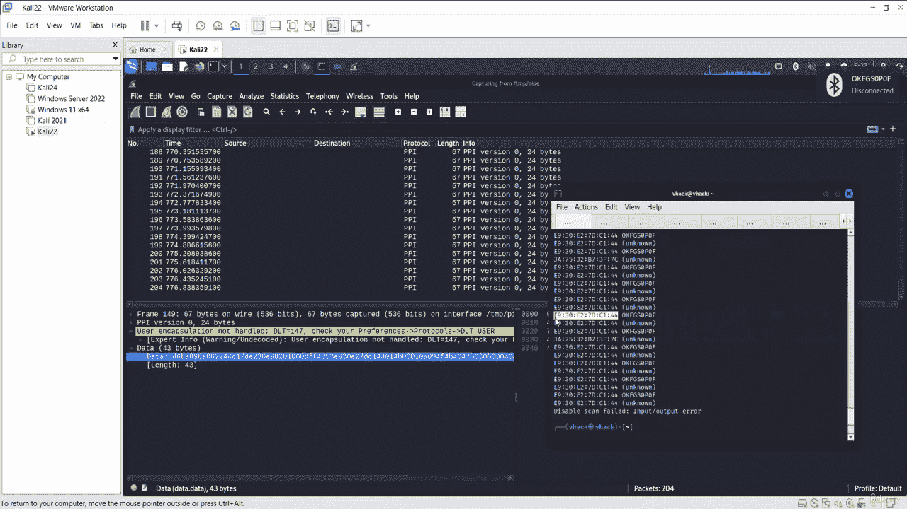
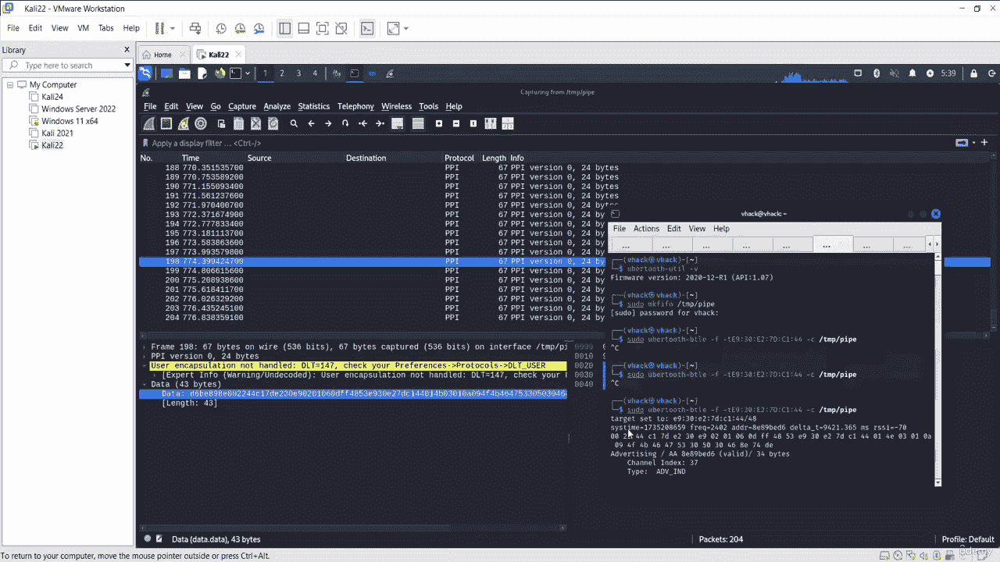
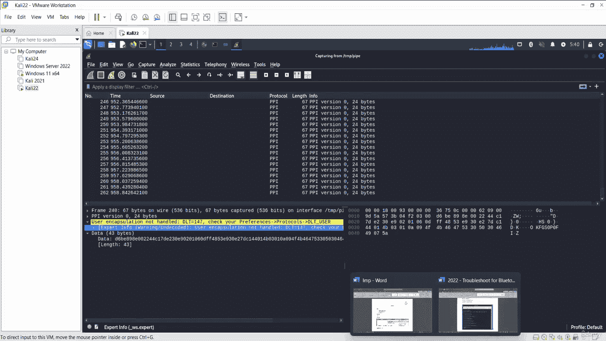
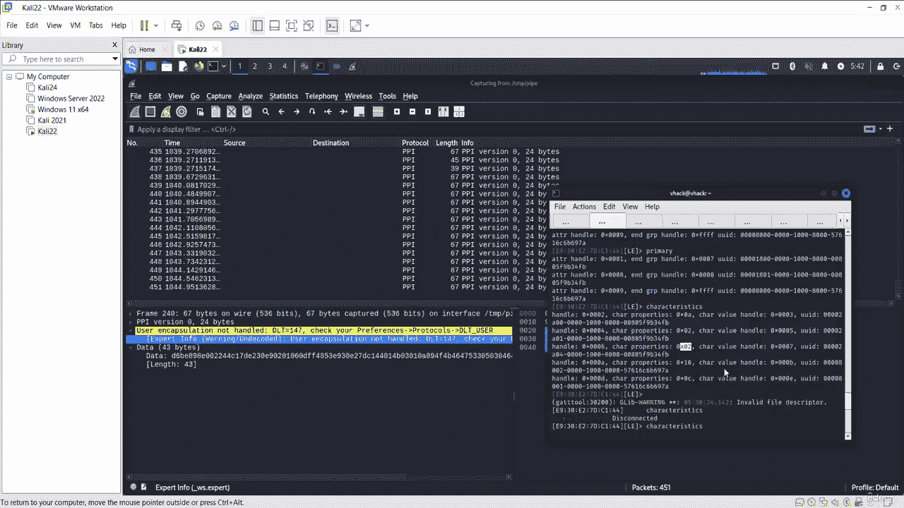
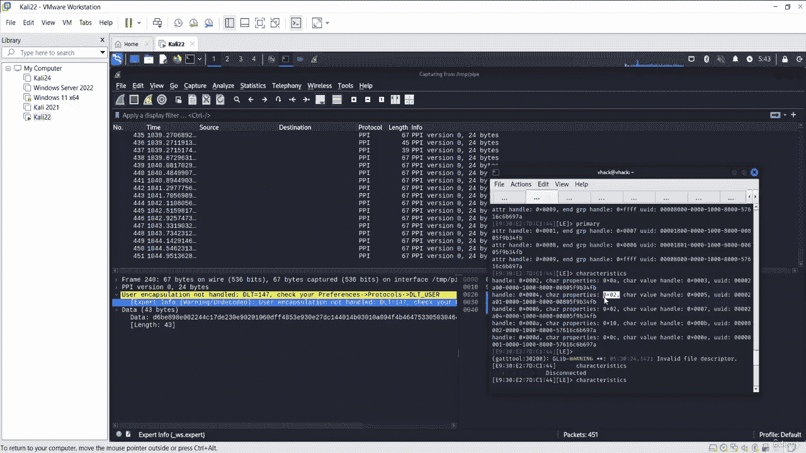
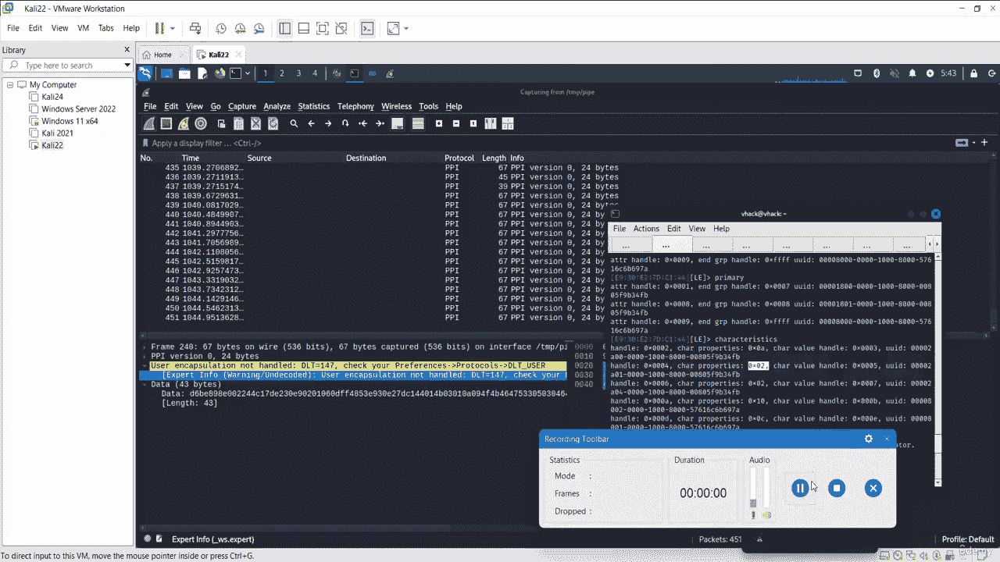

# Ethical Hacking：50-Day Hacker Challenge：8：蓝牙攻击实战（智能锁指纹目标）🔓

在本节课中我们将要学习如何针对蓝牙设备进行攻击，以实时目标智能锁指纹为例。我们会一起了解两种常见的攻击思路，一种是借助 Parkpo 这类软件工具，另一种是借助专门的硬件设备去嗅探蓝牙流量。无论你是刚接触物联网安全的新手，还是想要复习无线攻击基础的学习者，这节课都会用大白话把扫描、抓包、连接和特征值分析的完整流程讲清楚，让你明白攻击者是如何一步步拿到目标设备信息的。所有演示都建立在合法授权的前提下，切勿用于非法用途。

## 第一节：工具选择与环境准备

上一节我们介绍了模块一的整体框架，本节中我们来看看蓝牙攻击的准备工作。

在开始动手之前，我们得先决定用什么武器。课程里明确给出了两个可选方案，你可以根据自己的实际情况来选。

以下是两种常见的攻击方式：

- 方案一：使用 Parkpo 软件工具。这是一种运行在电脑上的蓝牙分析程序，适合不想额外购买硬件的初学者。
- 方案二：使用专门的蓝牙硬件设备。这种设备可以直接在无线电波层面嗅探流量，适合想要深入底层原理的学习者。

不管选哪个，核心目的只有一个，就是在合法授权的前提下，把周围蓝牙设备的通信流量“听”下来，为后面的分析做准备。硬件设备通常更适合处理低能耗蓝牙信号，而软件工具则更容易上手，两种方式都能帮我们拿到设备的 MAC 地址和通信特征。环境准备好之后，我们就可以进入扫描阶段了。

## 第二节：扫描附近蓝牙设备

工具准备好了之后，本节中我们来看看如何发现目标设备。

蓝牙攻击的第一步，永远是扫描。你得先知道对方在哪里，才能下手。

以下是扫描时需要关注的关键信息：

- 设备名称：比如智能锁的品牌标识，方便你在一堆设备里认出目标。
- MAC 地址：每个蓝牙设备都有唯一的物理地址，格式通常如 `XX:XX:XX:XX:XX:XX`，这是后续连接的必备凭证。
- 信号强度：越近的设备信号越强，像看地图一样帮你判断目标距离。
- 低能耗模式：大多数智能锁使用 BLE（Bluetooth Low Energy），扫描时要关注低能耗设备列表，相关表达式可表示为 `BLE_scan() → nearby_devices`。

扫描完成后，目标设备会按照一定的顺序排序，你只需要把智能锁的完整 MAC 地址记下来，就可以进入下一阶段了。这一步看起来简单，但实际上决定了后续能不能顺利连上目标。拿到地址以后，我们就可以开始捕获流量了。

## 第三节：流量捕获与特征值分析

拿到 MAC 地址以后，本节中我们来看看如何捕获和理解蓝牙流量。

有了目标地址，我们就可以开始“偷听”它和手机 App 之间的对话了。

以下是捕获流程的重点步骤：

- 开启抓包：在工具界面选择相应的标签页，启动流量捕获功能，开始记录空中传输的数据包，可用 `sniff(interface) → captured_packets` 表示。
- 观察特征值变化：当你在手机 App 上操作智能锁，比如开锁或更改指纹设置时，蓝牙特征值会发生变化，界面上的信号也会随之刷新。
- 记录数据包格式：每一个传输的数据包都可能包含关键信息，例如数值 `233234` 这样的标识，代表当前的指令或状态。
- 理解配对过程：蓝牙设备在连接前通常需要配对，捕获配对阶段的流量有助于我们理解安全机制的弱点，特征值可简写为 `Characteristic = {handle: 0x0000, value: ...}`。

抓到的流量就像是一段段对话记录，我们需要从中找出哪些特征值是控制开锁的，哪些只是心跳包。通过对比正常操作和异常操作的流量，你就能逐渐摸清目标设备的“指纹”规律。分析完这些之后，就可以尝试主动连上设备了。

## 第四节：尝试连接与属性交互

分析完流量之后，本节中我们来看看如何主动连上设备并进行交互。

光看流量还不够，真正的攻击往往需要直接和目标设备握手。

以下是连接与交互的常见操作：

- 发起连接请求：使用目标 MAC 地址向蓝牙设备发起连接，如果成功，设备会返回确认响应，逻辑可表示为 `connect(target_MAC) → success | failure`。
- 查看属性句柄：连接成功后，你可以看到一系列属性句柄，例如 `00000`、`010`、`00` 等，这些句柄代表设备内部不同的功能模块。
- 尝试发送畸形数据：有时候发送格式不正确的数据包，可以观察设备的异常反应，从而发现潜在漏洞。
- 多次重试：如果第一次连接失败，不要灰心，蓝牙连接经常受信号干扰，尝试几次通常就能成功。

连接过程就像是敲门，对方开了门（连接成功），你才能进屋看看房间里有什么（读写属性句柄）。在这个阶段，工具界面会显示实时的连接状态，帮你判断当前的操作是否生效。演示到此就告一段落了。

## 总结

到这儿，我们已经把整个蓝牙攻击流程走了一遍。

本节课中我们一起学习了针对蓝牙智能锁的攻击思路，包括选择软件或硬件工具、扫描附近低能耗设备、获取完整 MAC 地址、捕获实时流量、分析蓝牙指纹与特征值变化，以及发起连接并读取属性句柄。希望通过这节课的讲解，你能对物联网安全中的蓝牙攻击有直观的认识，并在未来的实践中合法合规地应用这些知识。
