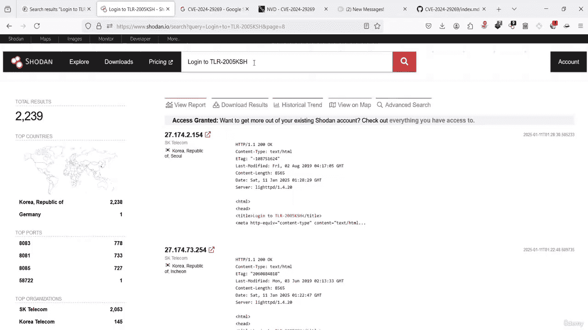
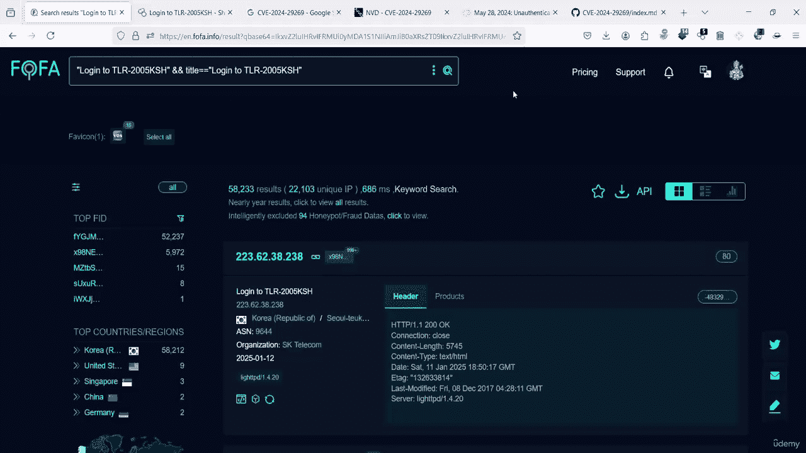
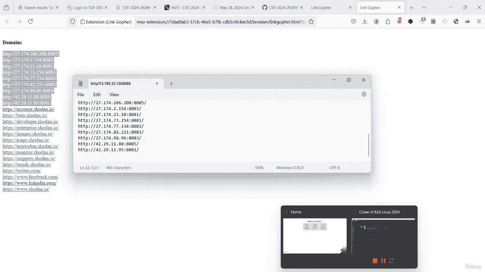
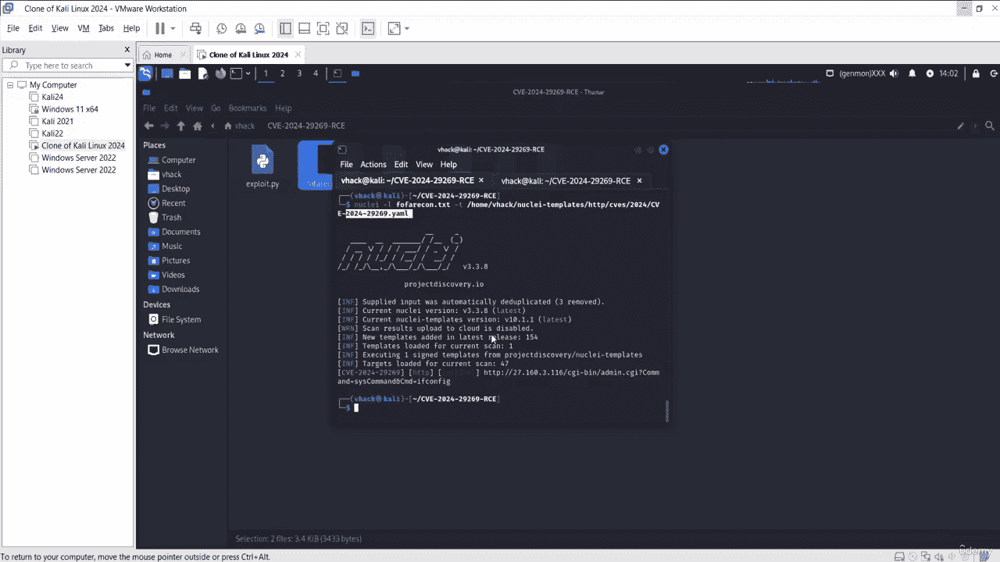
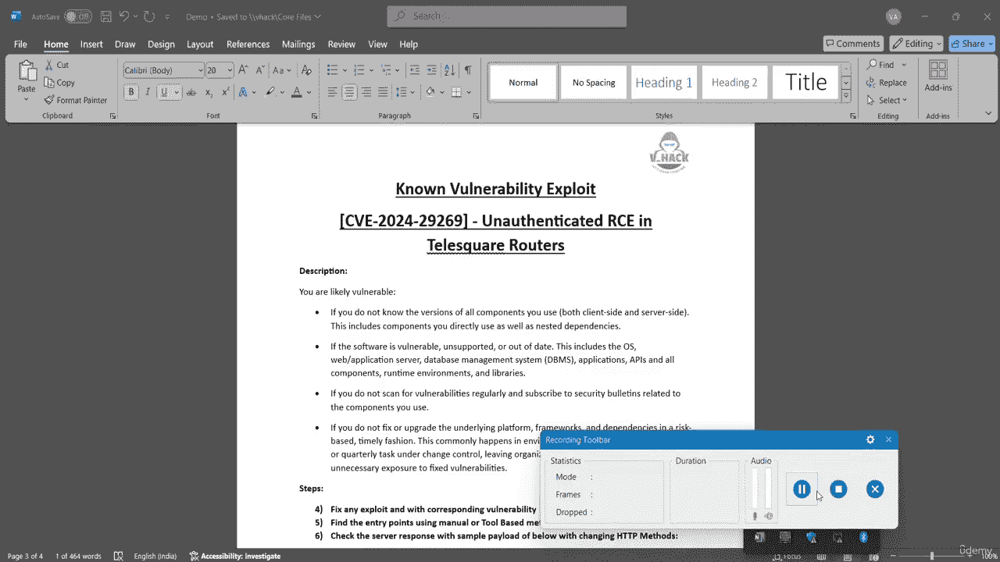

# 道德黑客：50天黑客挑战：第63节：已知漏洞利用 - CVE-2024-29269实机演示 🔓

在本节课中，我们将学习如何针对已知漏洞进行实机攻击演示。本节内容围绕 CVE-2024-29269 这一漏洞展开，该漏洞影响 Telequa 路由器，属于未经身份验证的远程代码执行漏洞。我们将会一起看完整个演示过程，了解如何从零开始找到目标页面，提取 IP 地址，并使用工具验证漏洞是否存在。无论你是刚开始接触渗透测试，还是希望复习已知漏洞利用的流程，这节课都会用最直白的方式为你拆解每一个步骤。

## 漏洞背景与核心概念

上一节我们介绍了 Web 攻击的整体框架，本节中我们来看看具体的已知漏洞利用案例。

CVE-2024-29269 是一个影响 Telequa 路由器的安全漏洞。简单来说，攻击者不需要任何登录凭据，就可以在目标设备上执行任意代码。这种漏洞非常危险，因为它绕过了身份验证，直接给攻击者打开了系统的大门。

其核心特征可以用公式表示：

CVE-2024-29269 = Telequa 路由器 + 未经身份验证 + 远程代码执行

漏洞的概念验证代码在 2024 年发布，利用过程相当简单。我们只需要确定目标设备是否运行在特定的时间段内，并确认它是 Telequa 路由器，就可以开始后续的攻击步骤。

## 寻找目标页面

在了解了漏洞基本概念之后，本节中我们来看看如何定位可能存在漏洞的目标设备。

以下是寻找目标页面的具体步骤：

- 使用 Google 搜索技巧，也可以使用 Shodan 等搜索引擎来查找暴露在公网上的 Telequa 路由器。
- 在搜索结果中找到目标设备对应的 URL 地址。
- 记下这个 URL，因为它是我们后续提取 IP 地址和验证漏洞的入口。

你不需要复杂的编程技能，只需要知道如何组合搜索关键词，就能快速找到候选目标。找到 URL 之后，我们就可以进入下一阶段，从页面信息中提取出具体的 IP 地址。

## 提取 IP 地址

找到目标 URL 之后，本节中我们来看看如何从中提取 IP 地址。

以下是提取 IP 地址的操作说明：

- 打开刚才找到的目标页面，查看其中包含的服务器信息。
- 从页面或相关扫描结果中提取出目标设备的 IP 地址。
- 将提取到的 IP 地址复制到记事本文件中，方便后续统一管理。

这一步非常关键，因为所有的扫描和攻击都需要基于准确的 IP 地址进行。把 IP 地址保存到文本文件后，我们就可以准备使用漏洞扫描工具了。

## 使用 Nuclei 模板进行扫描

IP 地址准备好之后，本节中我们来看看如何使用 Nuclei 工具进行漏洞扫描。

Nuclei 是一款基于模板的漏洞扫描工具。在开始扫描之前，请确保你安装了最新版本的 Nuclei 模板库，其中包含 CVE-2024-29269 对应的检测规则。

以下是扫描操作的关键点：

- 加载保存了所有提取 IP 地址的文本文件。
- 选中与 CVE-2024-29269 相关的 YAML 模板文件，该文件中包含了该漏洞的完整描述。
- 运行扫描命令，让工具自动对目标 IP 进行探测。

扫描命令的逻辑可以简化为：

nuclei -t cve-2024-29269.yaml -l 目标IP列表.txt

执行完成后，工具会输出扫描结果，告诉我们哪些目标可能存在该漏洞。

## 验证漏洞存在

扫描完成之后，本节中我们来看看如何判断目标是否真的存在漏洞。

在演示中，扫描工具共检测了 47 个目标，结果列表中大约有 3 个重复项。在这 47 个目标当中，有一个特定目标显示出对 2024 年该漏洞的弱点。这意味着该设备大概率存在 CVE-2024-29269 漏洞，攻击者可以利用它进行远程代码执行。

确认漏洞存在后，你就可以根据概念验证文档的说明，继续执行后续的攻击操作。这就是针对已知漏洞组件的完整利用流程。

## 本节总结

在本节课中，我们一起学习了已知漏洞利用的完整流程，包括 CVE-2024-29269 漏洞的基本概念、如何寻找目标 URL、如何从结果中提取 IP 地址、如何使用 Nuclei 模板进行扫描，以及如何确认目标是否存在远程代码执行漏洞。希望这些内容能帮助你更好地理解已知漏洞利用的实战步骤。
