# 道德黑客：04：LLMNR中毒攻击实验 🎯


在本节课中我们将要学习LLMNR中毒攻击的完整原理与实验演示。LLMNR的全称是链路本地多播名称解析协议，是Windows系统中用来在域名系统无法解析时进行名称查询的机制。攻击者可以利用这个机制伪造响应，诱使受害机器泄露用户名和加密后的密码哈希，再通过离线破解工具还原明文密码。本节内容适合初学者，会用大白话把每一步都讲清楚，确保你能听懂并动手实践。


## 一、什么是LLMNR协议 🔍

上一节我们介绍了渗透测试的基本流程，本节中我们来看看Windows环境下的名称解析机制。

当一台Windows电脑想要访问某个域名、主机名或IP地址时，它通常会按照固定顺序寻找目标。首先检查本地Hosts文件，其次查看本地DNS缓存，如果都找不到，就会把请求发送到配置好的DNS服务器。如果DNS服务器也无法解析，系统就会启用LLMNR协议，在局域网内广播询问：谁是这个主机名？

这个过程可以用下面的公式来简单表示：

名称解析顺序 = 本地Hosts文件 → 本地DNS缓存 → DNS服务器 → LLMNR/NBTNS广播

LLMNR的全称是Link-Local Multicast Name Resolution，中文叫链路本地多播名称解析。它和NBTNS（NetBIOS名称服务）是Windows中最常见的两个名称解析协议。当正常的DNS查询失败后，系统会自动回退到这两个协议，通过局域网广播来尝试解析名称。

以下是LLMNR工作的关键特点：

- 仅在DNS解析失败后才会启用
- 使用局域网广播发送查询请求
- 任何在同一网段的主机都可以响应请求
- 响应中可能包含用户凭据的哈希值


## 二、LLMNR中毒攻击原理 🧪

在了解了LLMNR的基本工作方式之后，本节中我们来看看攻击者如何利用这个机制进行中毒攻击。

LLMNR中毒攻击属于中间人攻击的一种，攻击核心在于欺骗和响应伪造。具体攻击流程如下：

第一步，受害机器尝试访问一个不存在的主机名，比如“fake-server-3”。
第二步，受害机器依次检查本地Hosts文件、本地DNS缓存和DNS服务器，全部无法解析。
第三步，受害机器启用LLMNR协议，向整个局域网广播查询请求，询问谁是“fake-server-3”。
第四步，攻击者监听到这个广播请求，立即冒充目标主机，告诉受害机器：“我就是你要找的主机”。
第五步，受害机器信任这个伪造响应，向攻击者发送用户名和NTLMv2密码哈希，用于身份验证。
第六步，攻击者捕获这个哈希值，再使用离线破解工具尝试还原明文密码。

这个攻击涉及三个角色，分别是受害机器、域名服务器和攻击机器。在实验环境中，这三台机器必须处于同一个IP网段，才能保证广播请求能够正常传递。

以下是攻击过程的简化逻辑：

受害机器请求不存在主机 → DNS解析失败 → LLMNR广播查询 → 攻击者伪造响应 → 受害机器发送凭据哈希 → 攻击者捕获哈希


## 三、实验环境搭建 🖥️

在掌握攻击原理之后，本节中我们来看看如何搭建实验环境。


本次实验需要准备三台虚拟机，它们必须位于同一个IP网段中，确保网络互通。以下是具体的机器配置：


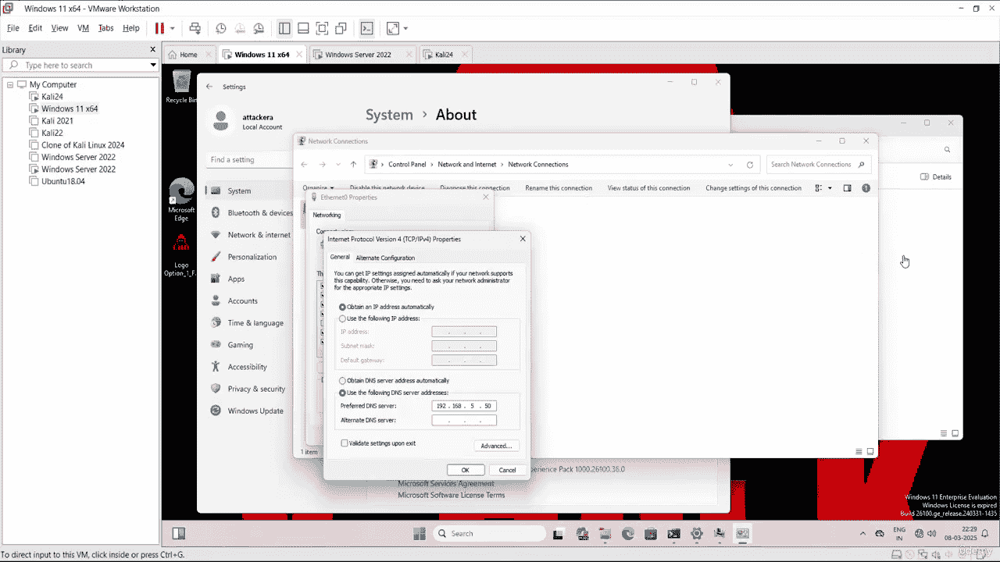

第一台机器是受害机器，运行Windows 11系统，加入名为“mrv.local”的Active Directory域。它的IP地址是192.168.5.129，用户名是attacker，密码是password1。

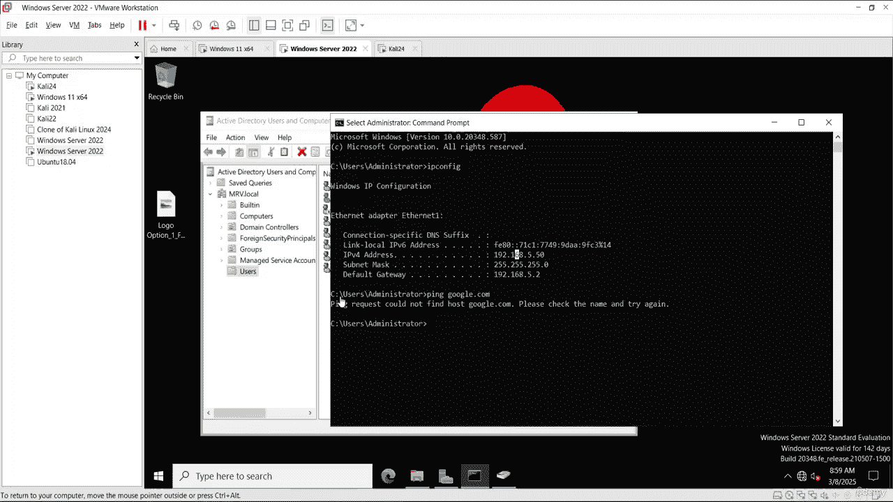

第二台机器是域控服务器，运行Windows Server 2022，域名是mrv.local，IP地址是192.168.5.130。它充当网络中的DNS服务器，负责处理域内名称解析请求。


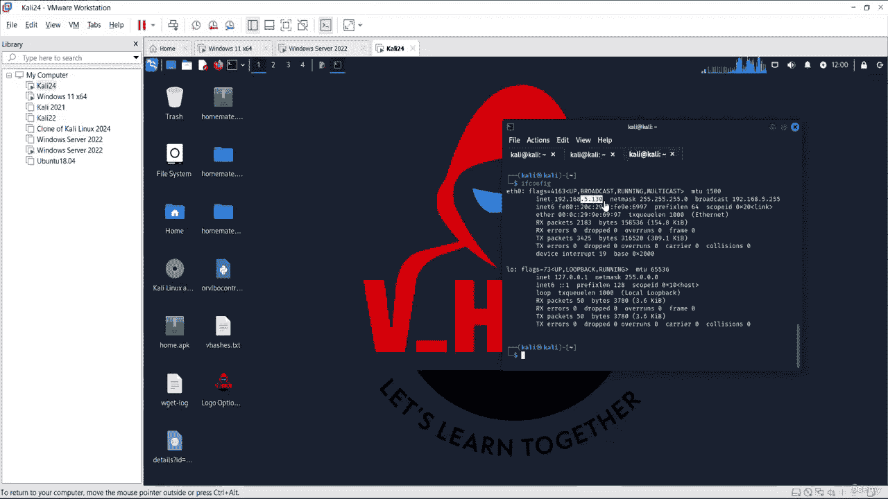

第三台机器是攻击机器，运行Kali Linux或类似系统，IP地址处于同一网段。攻击机上安装了Responder工具，用于监听并伪造LLMNR响应。

以下是环境搭建的关键要求：

- 三台机器必须在同一个IP网段，例如192.168.5.x系列
- 受害机器必须是Active Directory域的成员
- DNS服务器指向域控制器
- 攻击机上需预先安装Responder

搭建完成后，我们需要确认域控已经正确分配了静态DNS地址，这样所有名称解析请求在失败后都会交给LLMNR协议处理，为攻击创造条件。


## 四、攻击演示与凭据捕获 🎣

环境搭建好之后，本节中我们来看看如何执行LLMNR中毒攻击并捕获凭据。

首先在攻击机上启动Responder工具。Responder是一款专门用于LLMNR和NBTNS中毒的渗透测试工具，它可以监听局域网内的名称解析广播，并自动回复伪造的响应。启动命令如下：

```bash
responder -I eth0
```

这里的`-I`参数指定监听的网卡接口，`eth0`表示以太网接口。命令执行后，Responder会进入监听模式，等待受害机器的广播请求。

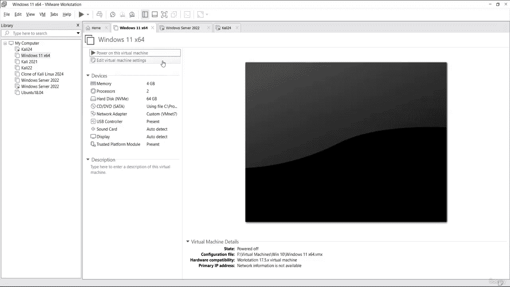


接下来在受害机器上尝试访问一个不存在的主机名，例如在资源管理器地址栏输入`\\fake-server-3`。受害机器会先检查本地Hosts文件，找不到后查询Active Directory域控，域控也无法解析，于是发送LLMNR广播到整个局域网。


此时攻击机上的Responder会捕获到这个请求，并伪装成`fake-server-3`回复受害机器。受害机器收到回复后，会认为找到了目标主机，进而向攻击机发送当前登录用户的用户名和NTLMv2密码哈希。

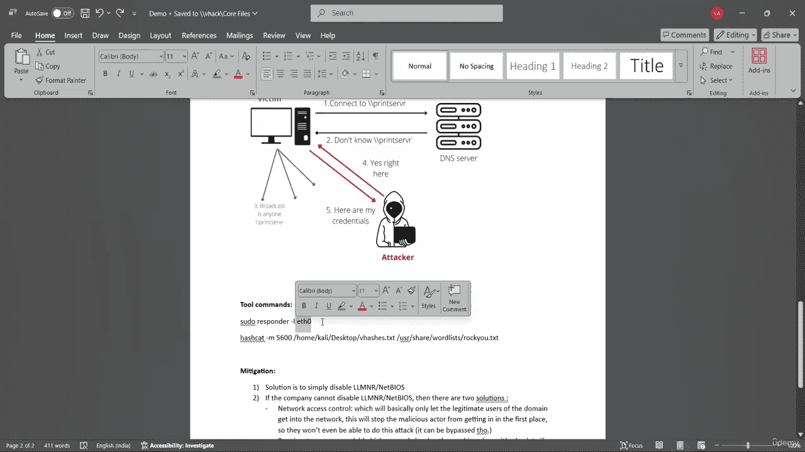

Responder会将捕获到的哈希值保存到本地文件中，通常位于攻击机的日志目录。我们可以打开这个文件，查看捕获到的完整哈希字符串，包括用户名、系统名称和加密后的哈希值。


## 五、离线破解密码哈希 🔓


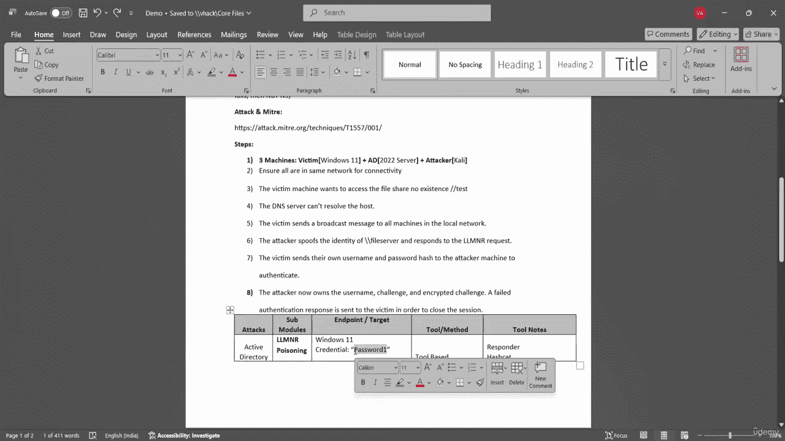

捕获到密码哈希之后，本节中我们来看看如何使用Hashcat进行离线破解。

Hashcat是一款强大的密码破解工具，支持多种哈希算法。针对LLMNR攻击捕获的NTLMv2哈希，我们需要指定正确的哈希模式编号。在Hashcat中，NTLMv2对应的模式编号是5600。

破解命令的基本格式如下：

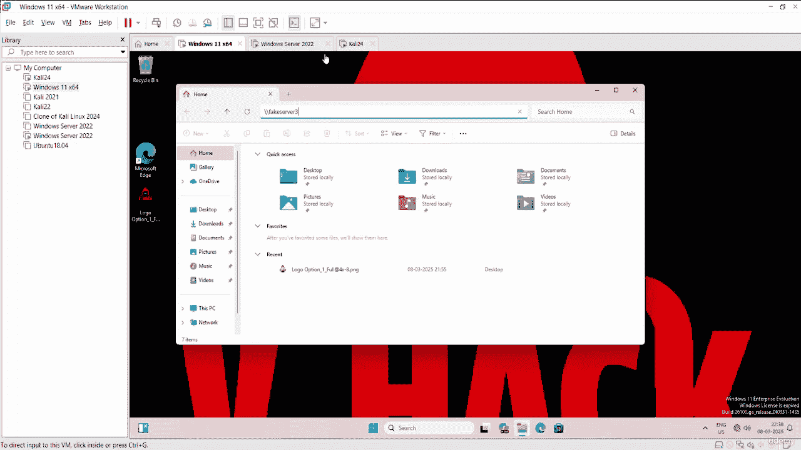

```bash
hashcat -m 5600 哈希文件 字典文件
```

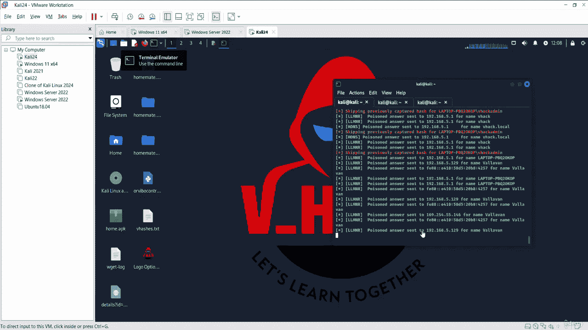

这里的`-m`参数用于指定哈希类型，`5600`表示NTLMv2。哈希文件就是Responder保存的捕获结果，字典文件包含常见的候选密码。

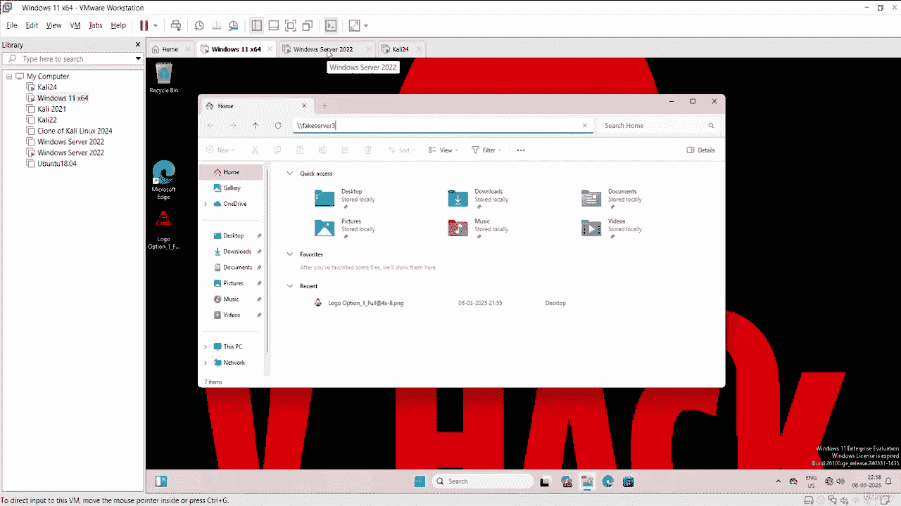

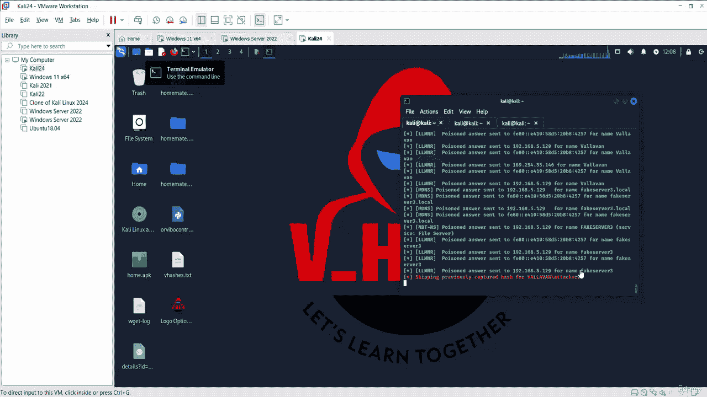

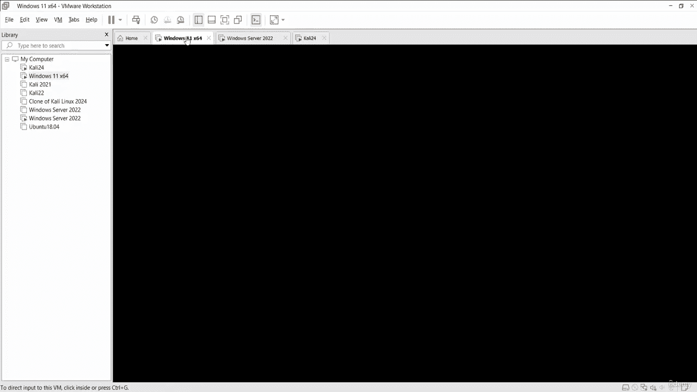

执行破解命令后，Hashcat会对字典中的每一个密码进行哈希计算，并与捕获的哈希值比对。如果找到匹配项，就会显示出明文密码。在本次实验中，我们捕获到的哈希对应的明文密码是`password1`。

破解完成后，可以使用以下命令查看结果：

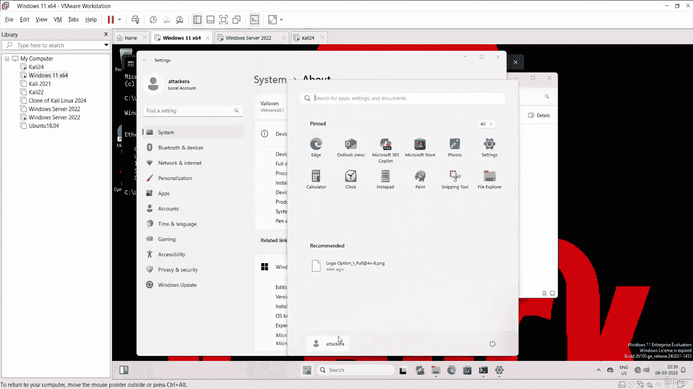


```bash
hashcat -m 5600 哈希文件 字典文件 --show
```

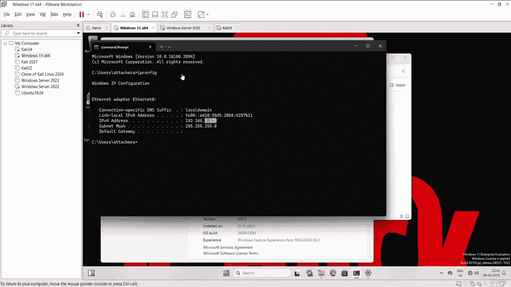

`--show`参数用于展示已经破解成功的哈希及其对应的明文密码。这样我们就完成了从网络嗅探到明文密码还原的全过程。


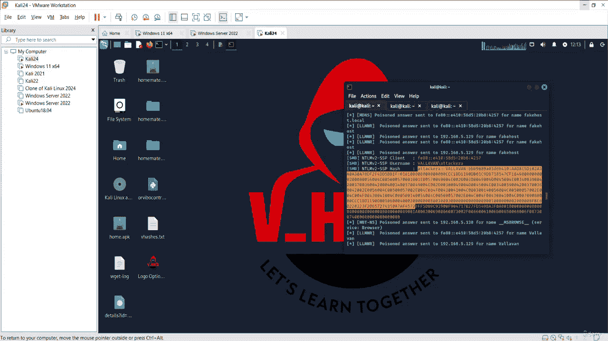

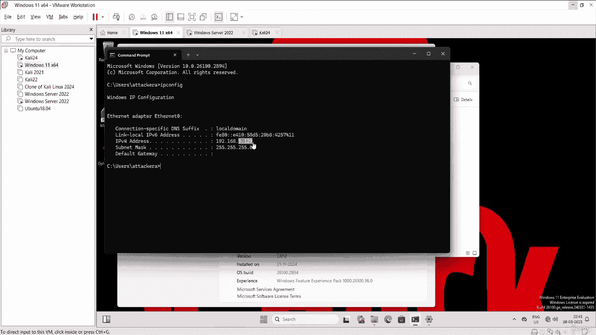

## 六、防御与缓解措施 🛡️

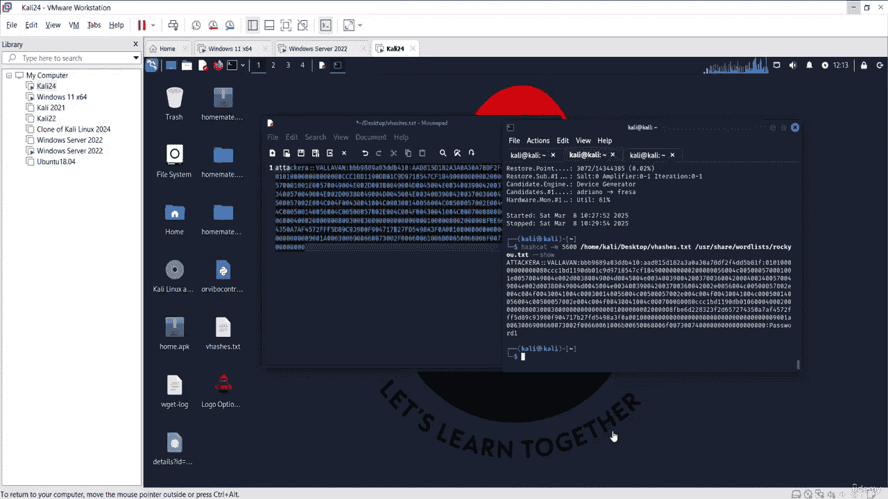

了解攻击方法之后，本节中我们来看看如何防御LLMNR中毒攻击。

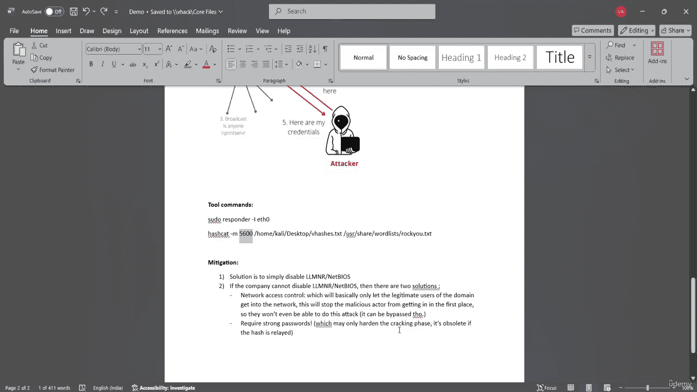

最直接的防御方法是禁用不需要的名称解析协议。如果组织中不依赖LLMNR或NBTNS，可以通过组策略直接禁用这两个协议，从根本上消除攻击面。禁用后，当DNS解析失败时，系统不会再发送广播请求，攻击者也就无法伪造响应。

除了禁用协议，还可以采取以下补强措施：

- 部署网络准入控制（NAC），限制未授权设备接入内网
- 提高密码复杂度要求，增加离线破解的难度
- 使用特殊字符和更长的密码，使字典攻击和暴力破解失效
- 定期审计内网流量，发现异常的名称解析广播

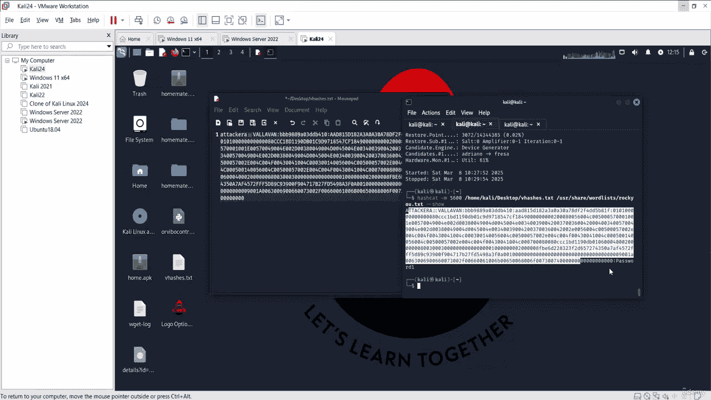

需要注意的是，即使启用了防火墙或其他安全设备，如果LLMNR协议仍然开启，攻击者只要在同一网段内，依然可能发动此类攻击。因此，协议层面的禁用是最有效的根治手段。


## 七、本节总结 📝

本节课中我们一起学习了LLMNR中毒攻击的完整原理、实验环境搭建、攻击演示、密码破解以及防御措施。

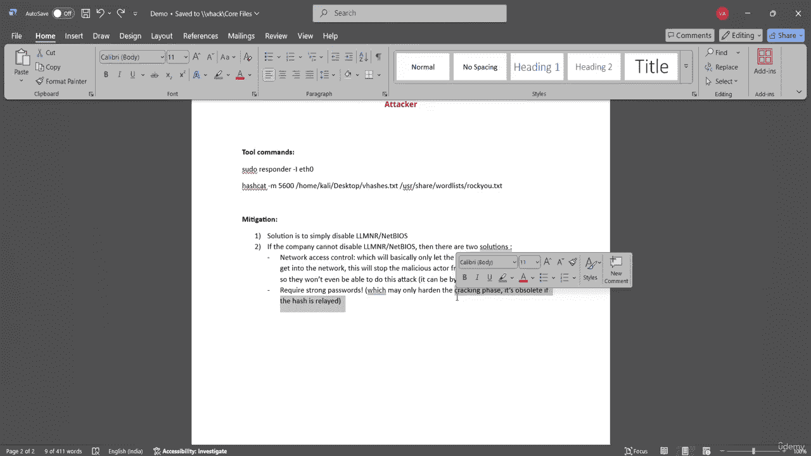

我们首先介绍了LLMNR协议的工作流程，说明当DNS无法解析时，Windows系统会回退到本地广播查询。接着详细拆解了中毒攻击的六个步骤，从发起对不存在主机名的请求，到攻击者伪造响应、捕获NTLMv2哈希，最后使用Hashcat破解出明文密码`password1`。在实验环节中，我们配置了包含Windows 11受害机、Windows Server域控和Kali攻击机的三机互通环境，并使用Responder工具完成了凭据捕获。最后，我们讨论了禁用LLMNR/NBTNS、部署网络准入控制和加强密码策略等防御方法。

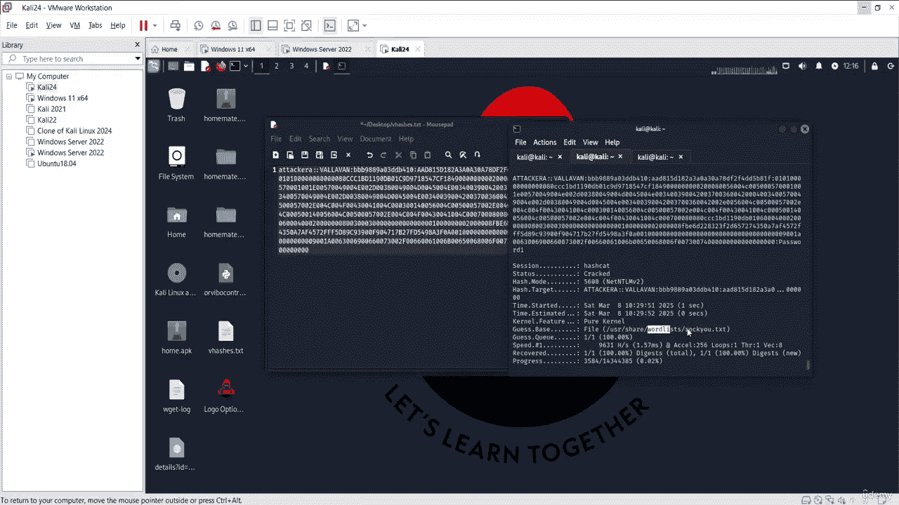

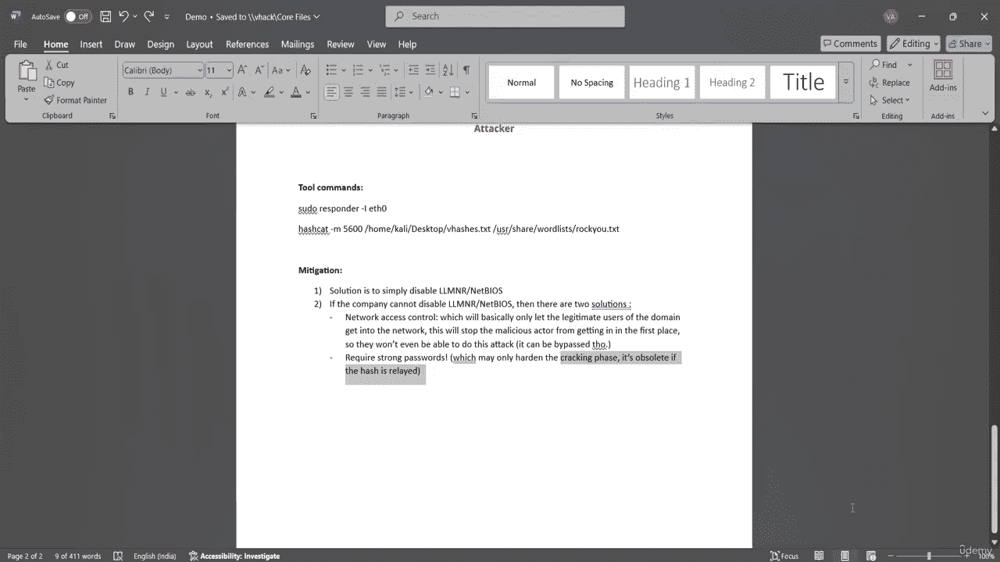

希望这节课对你有所帮助，我们下一课再见。

