# 道德黑客实战：第50天：使用BloodHound进行Active Directory枚举 🛡️

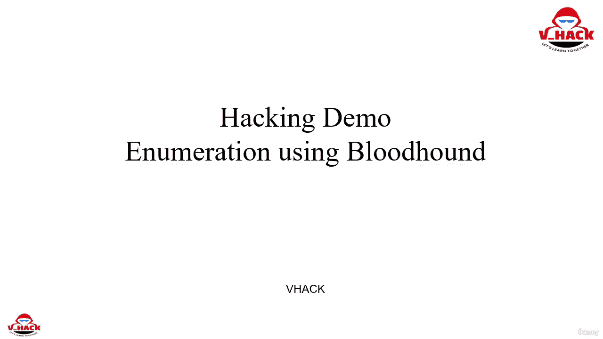

## 课程概述

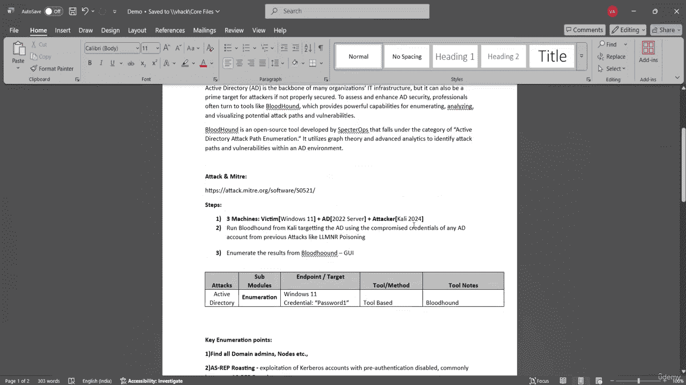

在本节课中我们将要学习如何使用BloodHound工具对Active Directory域环境进行枚举分析。Active Directory可以简单理解为企业内部的账户与权限管理系统，而域控制器则是这个系统的核心服务器。通过本节课，你将掌握如何从已获取的凭据出发，采集域内的用户、计算机和组信息，并将采集结果导入BloodHound图形界面，进而发现域内的隐藏关系和潜在攻击路径。课程还会演示如何定位域管理员、高价值目标以及基于Kerberos的攻击条件，帮助你从防御者的角度理解攻击者是如何分析内网环境的。

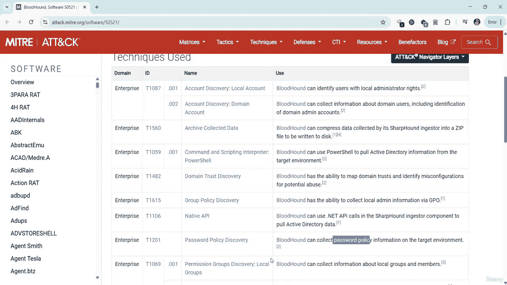

## 实验环境准备

上一节我们介绍了如何通过LLMNR中毒等方式获取受害主机的凭据，本节中我们来看看如何利用这些凭据去枚举Active Directory。实验环境中一共涉及三台系统，第一台是受害主机，第二台是Active Directory域控制器，第三台是攻击者主机。攻击者会使用在之前步骤中破解出的明文密码来运行枚举工具，具体的账户和密码信息将在后续命令中体现。

以下是本次实验所需的核心工具与命令格式，你可以直接参考这段代码进行操作：

```bash
bloodhound-python -d <域名> -u <用户名> -p <密码> -ns <域控制器IP地址> -c all
```

这条命令的作用是使用指定的域账户凭据，向目标域控制器发起枚举请求，收集域内的所有对象信息，并将结果保存为JSON文件。稍后我们会把这些文件上传到BloodHound的图形界面中进行可视化分析。

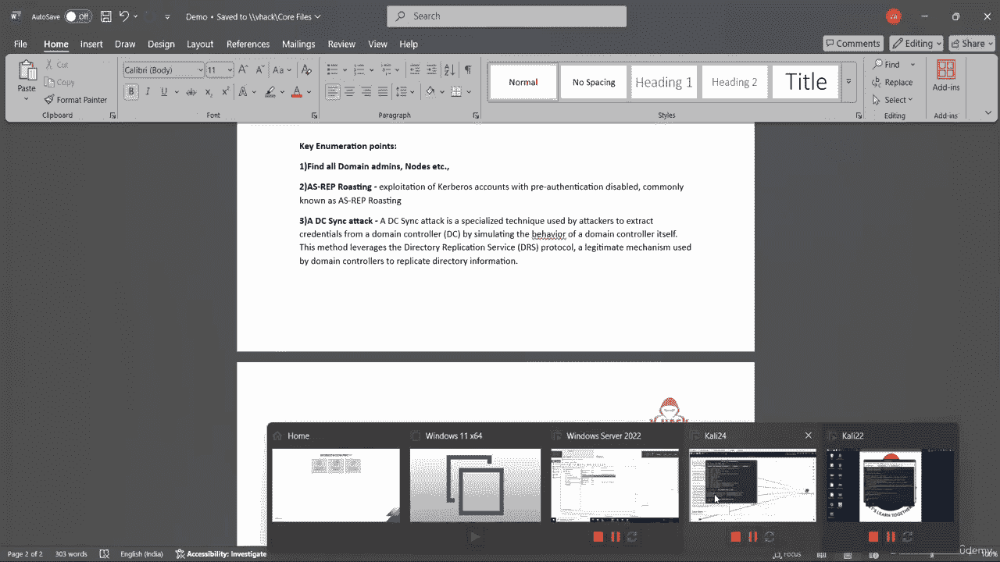

## BloodHound工具核心概念

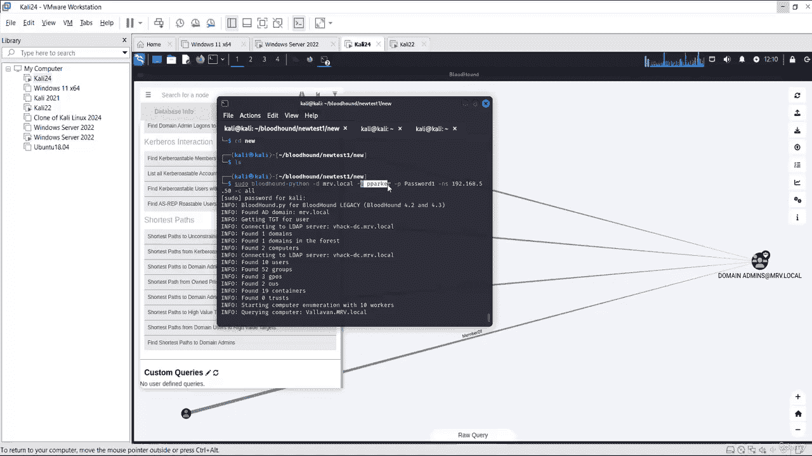

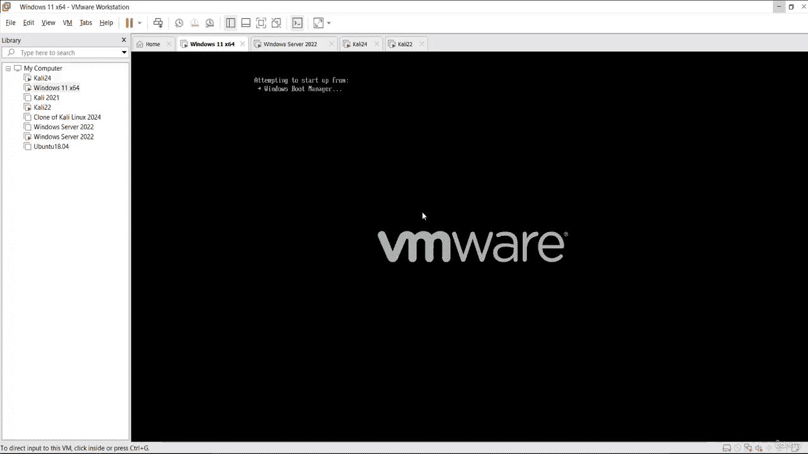

在了解了采集命令之后，我们先来认识一下BloodHound工具本身。BloodHound是一个开源的内网侦察工具，专门用于发现Active Directory环境中的隐藏关系，并据此识别可能的攻击路径。它的核心价值可以用下面这个简单公式来描述：

```
攻击路径 = 攻击者可控账户 → 账户间的关联关系 → 目标高权限账户
```

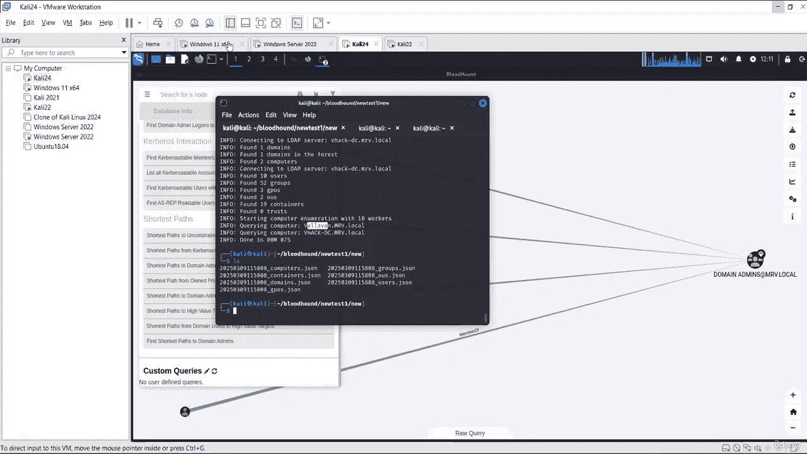

通过这个工具，安全人员或攻击者可以快速定位哪些用户拥有本地管理员权限，哪些账户属于域管理员，以及域内的密码策略是如何配置的。在实战中，它相当于一把“关系扫描仪”，能够把复杂的域权限关系以图形的方式展现出来，让分析过程更加直观。

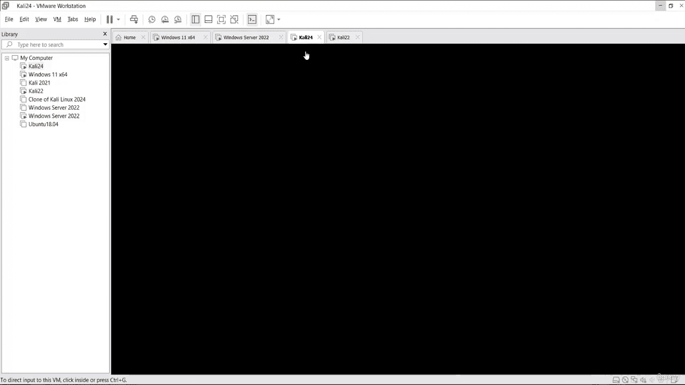

## 运行BloodHound采集域信息

接下来我们进入实际操作阶段。攻击者会在自己的主机上运行BloodHound采集工具，使用之前已经破解出的受害主机密码，针对目标域控制器发起枚举。采集完成后，工具会生成一系列JSON格式的数据文件，这些文件记录了域内的用户、计算机、组以及它们之间的权限关系。

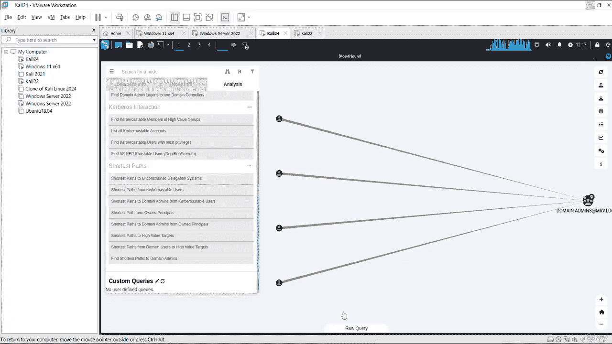

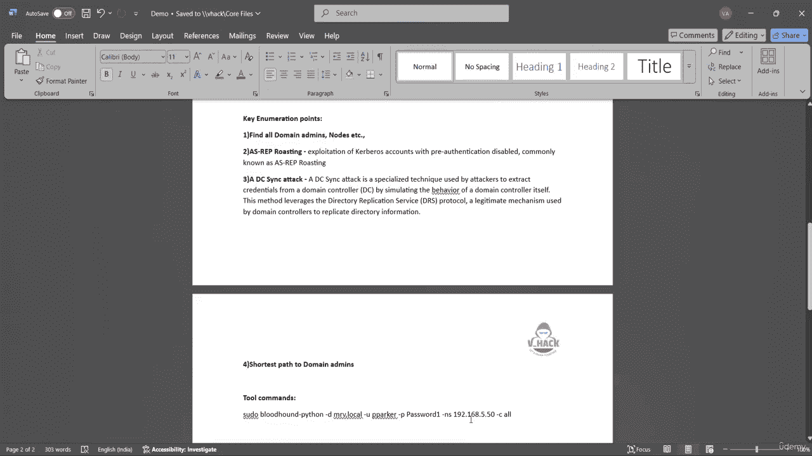

以下是本次操作中观察到的关键采集结果摘要：

- 成功发现整个森林中的一个域。
- 发现两台计算机对象，其中一台是域控制器，另一台是客户端主机。
- 发现多个用户账户和多个安全组。
- 采集过程中使用的受害主机密码为password1，对应的域账户已经在之前的攻击步骤中被妥协。

## 导入数据并分析图形关系

当采集工作完成后，我们需要把生成的JSON文件上传到BloodHound的图形用户界面。上传完成后，界面会自动解析文件内容，并以节点和连线的形式展示域内对象之间的关系。这样就可以直观地看到哪些账户拥有哪些权限，以及攻击者可以通过哪些路径逐步提升权限。

以下是图形界面中常见的预置分析查询类型，它们分别对应不同的安全评估场景：

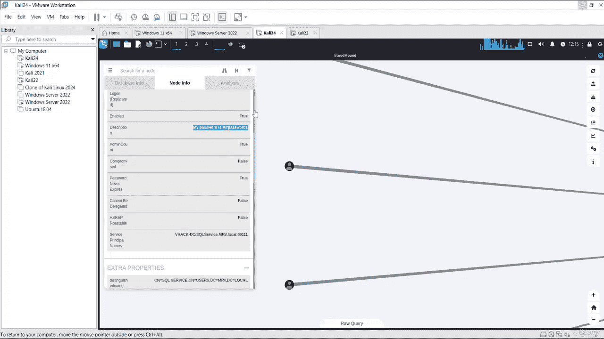

- 查询域内所有拥有域管理员权限的账户。
- 查询拥有危险特权或敏感权限的账户。
- 查询到达域管理员的最短攻击路径。
- 查询与Kerberos预身份验证相关的易受攻击账户。

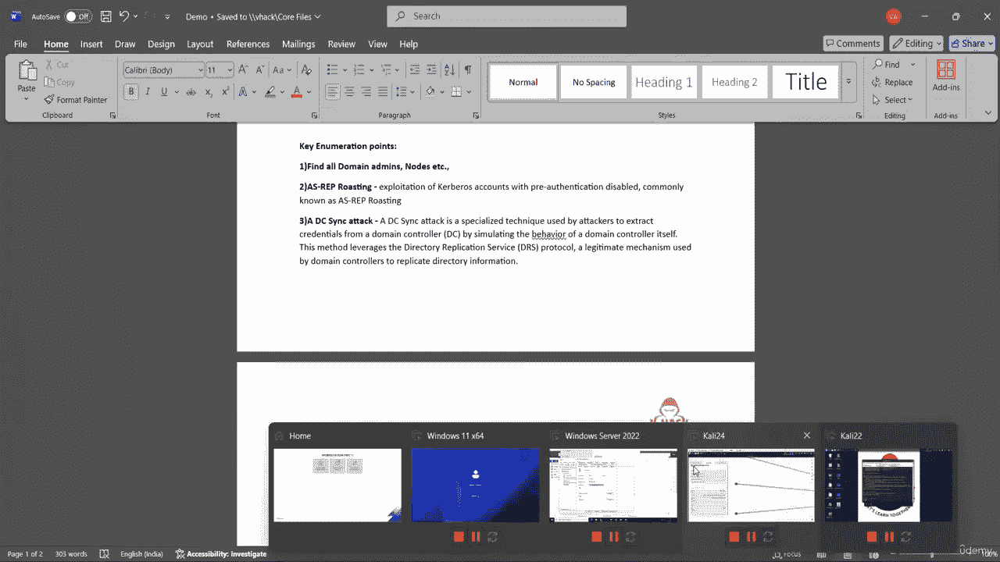

## 发现域管理员与敏感账户信息

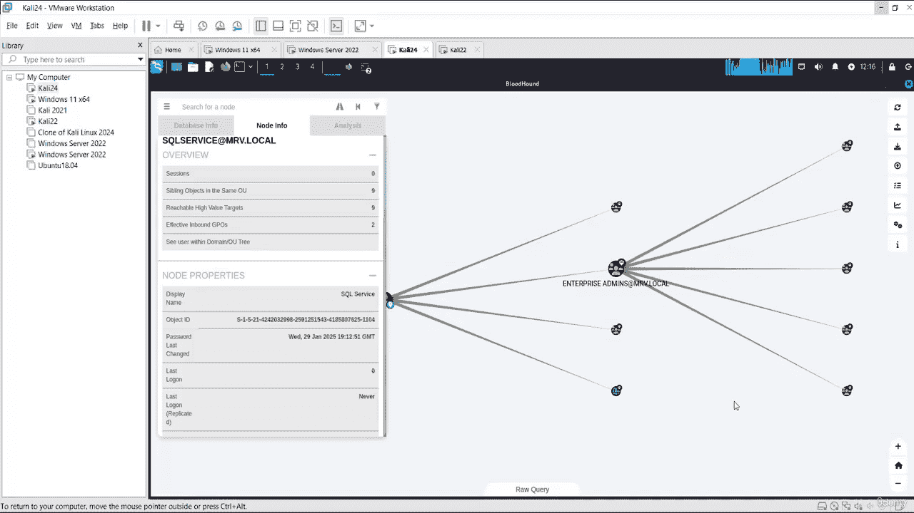

在图形界面中，我们首先来看如何定位所有的域管理员账户。执行相关查询后，界面会列出属于域管理员组的用户，例如Tester、SQL Service、EVki以及Administrator等账户。你可以在Active Directory管理工具中对照验证这些账户的组成员身份，确保查询结果准确无误。

这里有一个初学者容易忽略的细节，即账户的描述字段有时会包含敏感信息。例如，SQL Service账户的描述中直接写着“我的密码是password one”，这种信息一旦被攻击者发现，就可以直接用于横向移动。因此在实际环境中，管理员应当避免在账户描述中记录明文密码或其他敏感凭据。

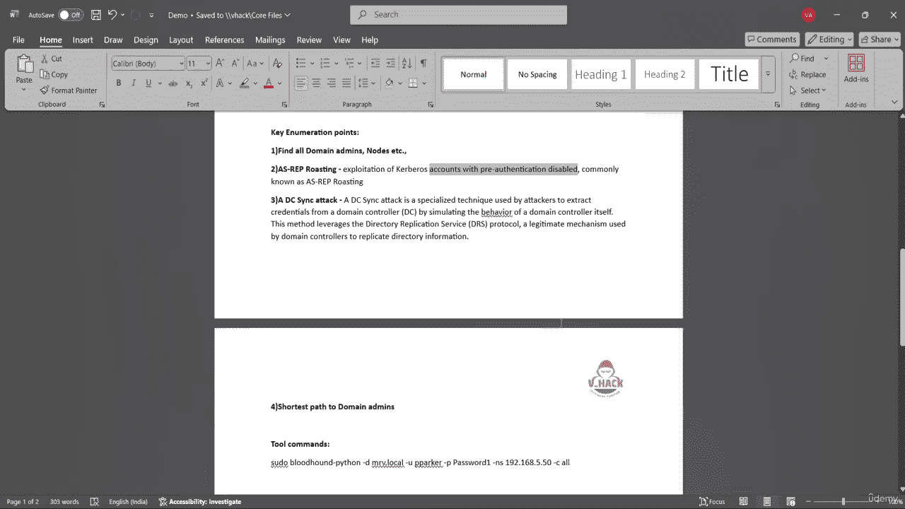

## 分析高价值目标与攻击路径

找到域管理员之后，我们还可以进一步分析高价值目标。所谓高价值目标，是指那些对域管理员、企业管理员、域控制器或服务器操作员等关键角色拥有间接控制权限的账户。BloodHound会把这些账户的权限关系画在图上，让分析人员一眼看出哪些普通用户实际上可以通过一系列关联最终接触到域管理员权限。

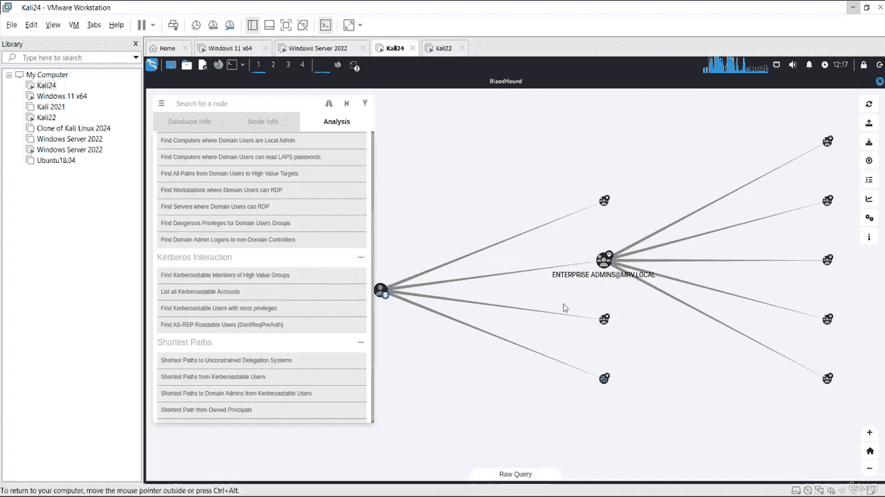

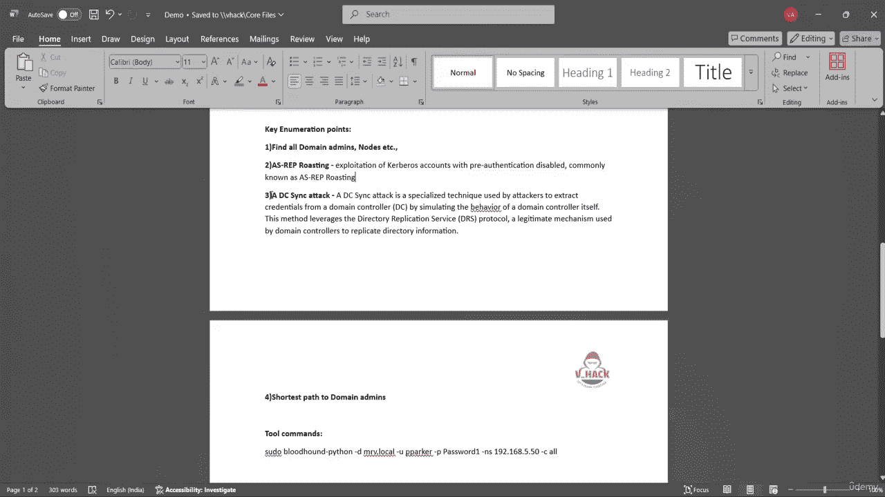

除了高价值目标，本次实验还演示了如何探索特定的攻击条件。例如某些基于Kerberos的攻击需要满足“预身份验证被禁用”这个前提条件，这可以通过以下表达式来理解：

```
攻击可行条件 = 账户的Kerberos预身份验证状态 ＝ 禁用
```

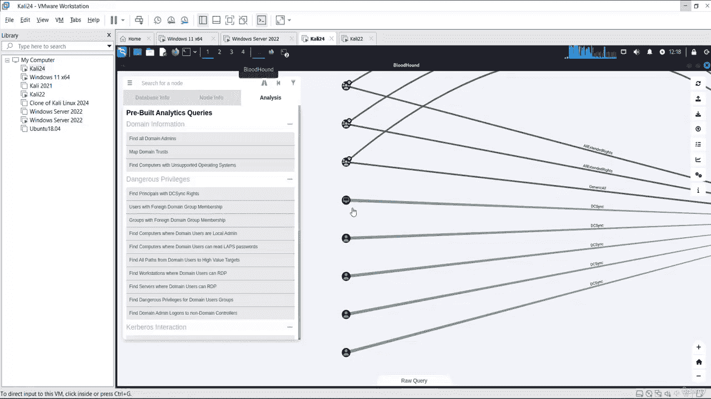

在默认数据下，针对AS-REP易受攻击账户的查询可能暂时没有返回结果。但如果我们在域中故意启用一个禁用预身份验证的账户，重新采集并上传数据，就可以在图形界面中发现该账户，从而验证该攻击向量的存在。

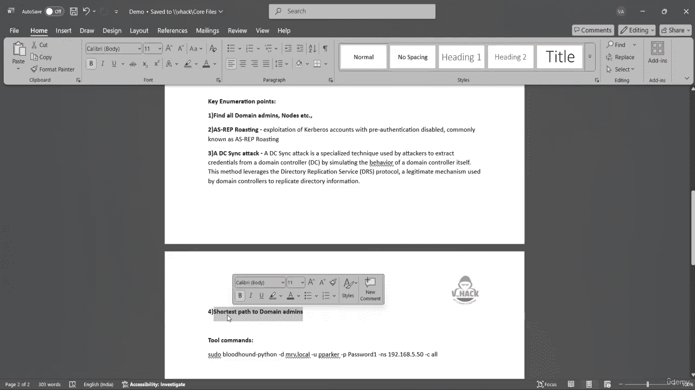

## DCSync攻击路径分析

第三个演示场景围绕DCSync攻击展开。DCSync是一种模拟域控制器行为的攻击技术，攻击者借此从域控制器拉取账户密码哈希。要发起这种攻击，目标账户通常需要满足两个条件：一是拥有DCSync相关权限，二是是域管理员组的成员。

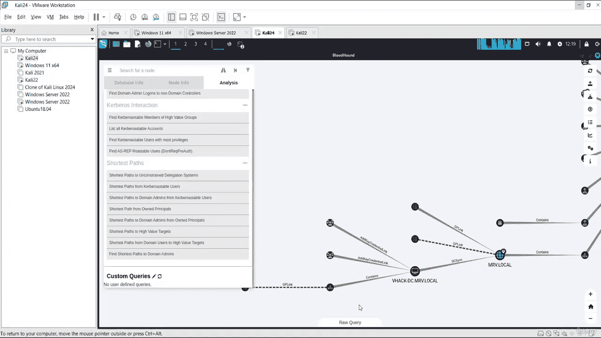

以下是分析DCSync攻击路径的关键步骤，你可以依此在BloodHound中进行验证：

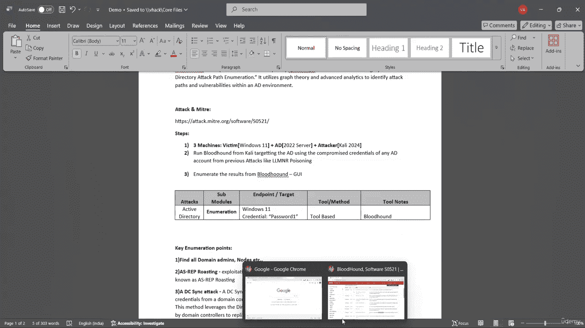

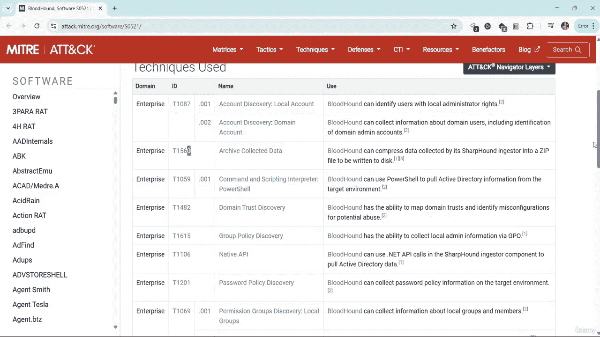

1. 在查询界面选择目标域。
2. 执行查找拥有DCSync权限的主体操作。
3. 观察返回的账户列表，例如Tester、SQL Service和Administrator等。
4. 在Active Directory中验证这些账户是否属于域管理员组。

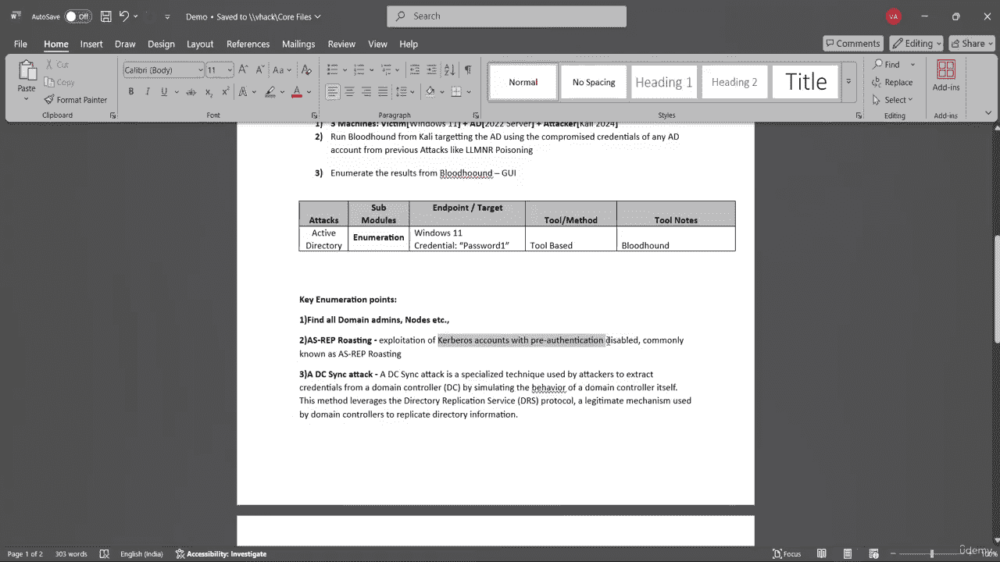

通过以上步骤，你可以清晰地看到哪些账户既具备DCSync权限，又处于高权限组中，从而评估域控制器面临的凭据泄露风险。

## 最短攻击路径分析

除了单一攻击技术，BloodHound还能帮助分析到达域管理员的最短路径。这对理解攻击者如何以最少步骤提权非常有帮助。执行“到达域管理员的最短路径”查询后，界面会展示从企业管理员、Administrator或其他组成员出发，经过不同的权限关联，最终触达域管理员的完整链条。

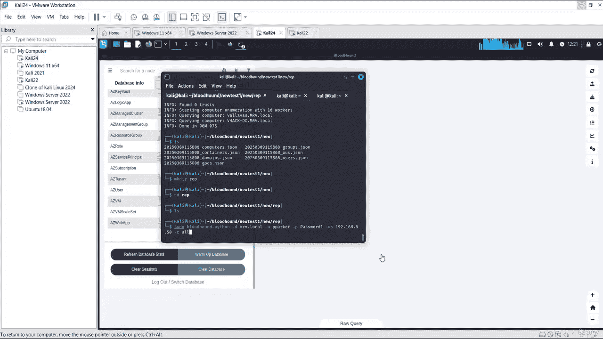

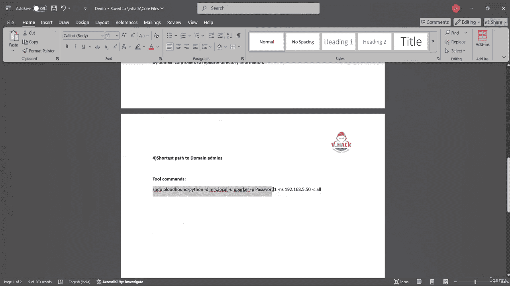

这些关联关系可能包括组成员身份、组策略对象链接，或者其他访问控制权限。防御人员可以根据这些路径，及时收紧不必要的权限授予，降低被攻击者利用的可能性。

## 重新上传数据并验证AS-REP攻击条件

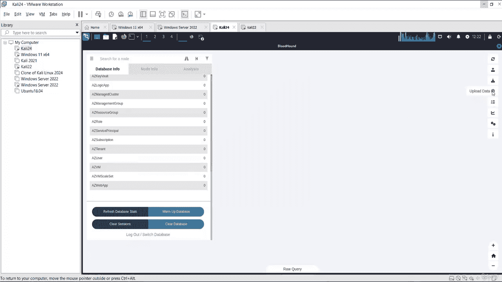

前面我们提到过，某些攻击需要启用特定账户的特殊配置才能被发现。在本节的后半部分，我们演示了如何上传新数据来验证AS-REP Roasting攻击条件。首先需要在域中创建或修改一个账户，例如名为Ibiki的账户，并将其Kerberos预身份验证设置为禁用。

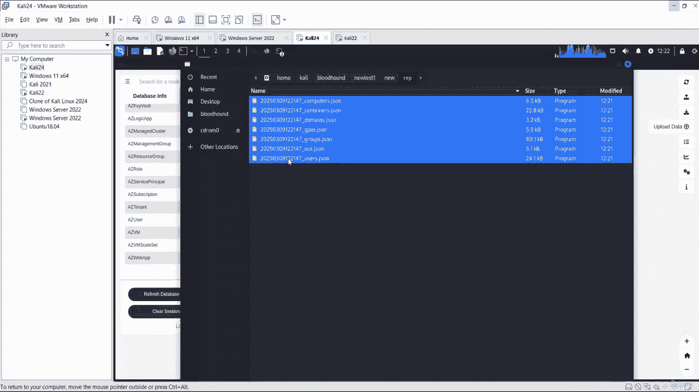

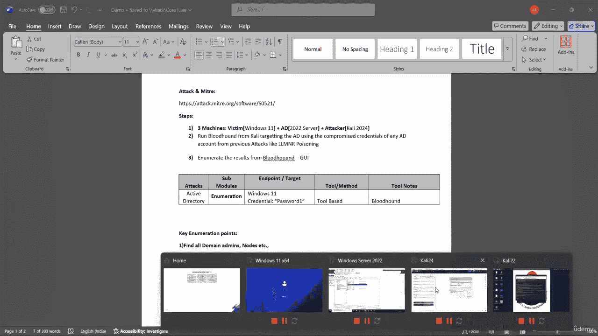

以下是重新上传数据的操作流程，请按顺序执行：

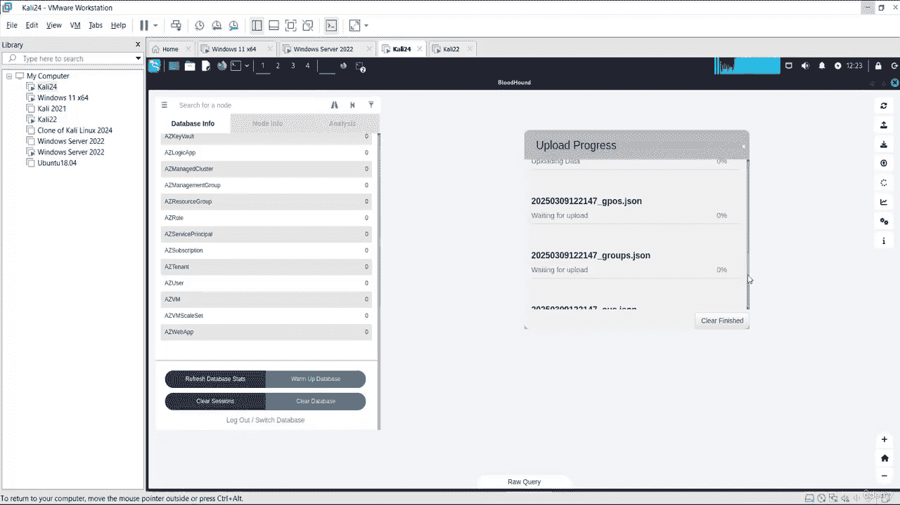

1. 清除BloodHound界面中的旧数据库，避免新旧数据混淆。
2. 在本地创建一个新文件夹，用于存放重新采集的JSON文件。
3. 在新文件夹中运行BloodHound采集命令，使用已修改预身份验证状态的账户凭据。
4. 采集完成后，将生成的全部JSON文件上传到BloodHound图形界面。
5. 等待上传完成，上传时间取决于文件大小，通常需要几分钟。

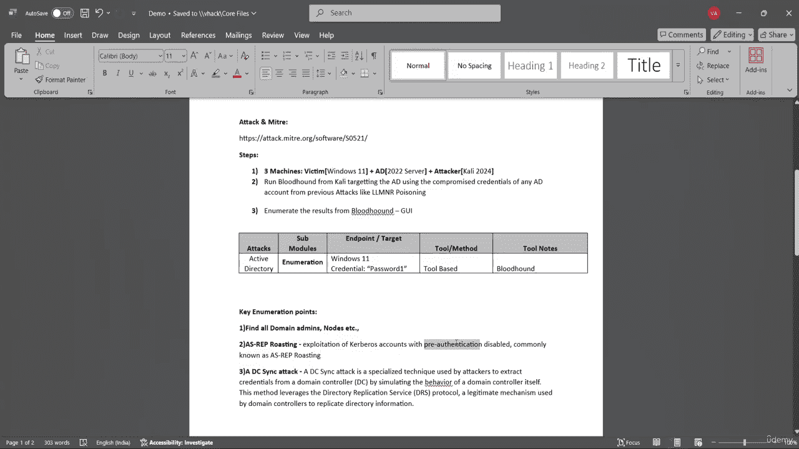

上传完成后，再次进入Kerberos相关分析选项，执行查找AS-REP易受攻击账户的查询。此时你会发现，之前没有数据的查询现在返回了结果，新启用禁用预身份验证的账户会出现在列表中。这表明我们已经成功通过数据采集和图形分析，验证了该攻击条件的存在。

## 课程总结

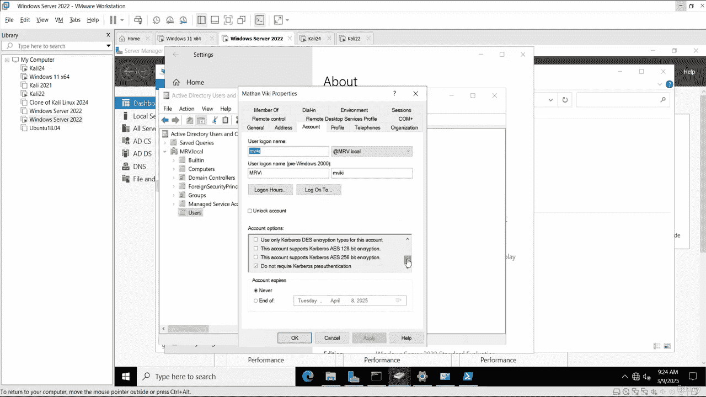

本节课中我们一起学习了如何使用BloodHound对Active Directory域环境进行枚举分析。我们首先介绍了实验环境和采集命令，了解了BloodHound作为开源侦察工具的核心作用，即揭示域内隐藏关系并识别攻击路径。接着我们演示了如何使用破解后的凭据运行采集工具，将JSON结果上传到图形界面，并从中发现域管理员、敏感账户描述信息、高价值目标以及基于Kerberos的攻击条件。

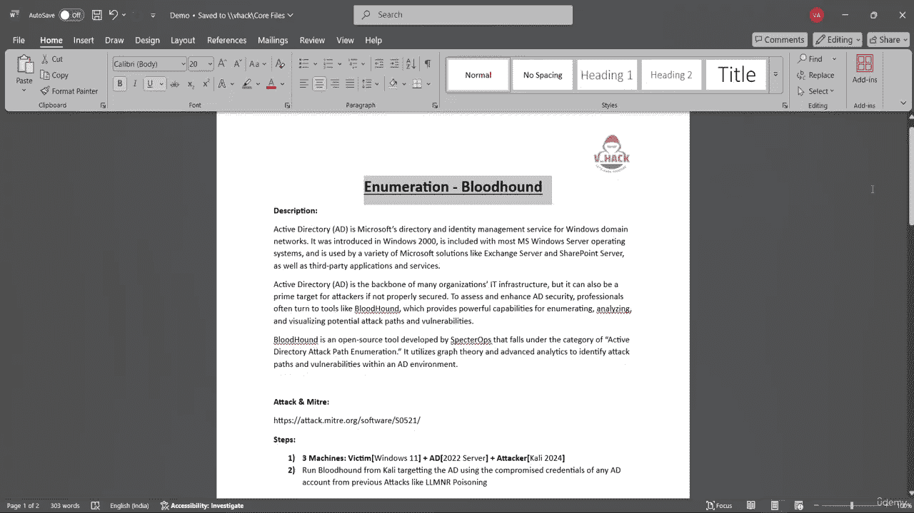

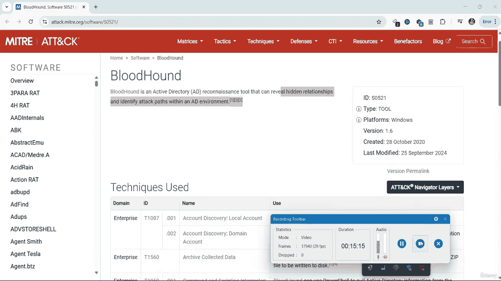

在后续部分，我们还分析了DCSync攻击路径、到达域管理员的最短攻击路径，并通过重新上传数据验证了AS-REP Roasting的预身份验证条件。希望你喜欢本节模块的内容，我们下一节课再见。
