# 🔐 Udemy - Ethical Hacking：50-Day Hacker Challenge：50 Real Attacks：06：Active Directory - Kerberoasting [Lab Target]

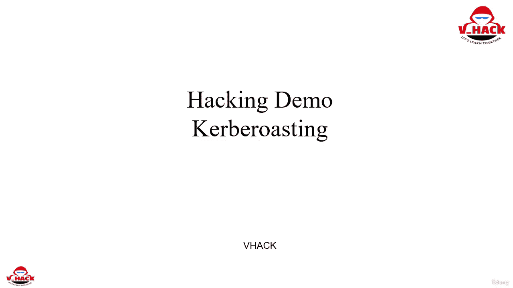

## 课程概述

在本节课中，我们将一起学习针对 Active Directory 基础设施的 Kerberoasting 攻击。这是一个非常经典的内网渗透场景，特别适合初学者理解域环境中的身份验证机制及其潜在弱点。我们会先解释 Kerberos 协议的基本工作方式，然后分析攻击者如何利用该协议中的缺陷，从普通域账户逐步提升到域管理员权限。最后，我们会通过 Impacket 工具包进行实际演示，展示如何获取服务主体名称、捕获 TGS 票据，并尝试离线破解密码。希望这节课的内容能帮助你建立对 Active Directory 攻击的直观认识，并为后续的学习打下基础。

---

## 1. Kerberoasting 与 Kerberos 协议基础

在开始讲解攻击手法之前，我们首先需要了解 Kerberoasting 所依赖的底层协议。Kerberos 是一种广泛用于 Windows 环境中的身份验证协议，绝大多数企业域控制器都依赖它来验证用户和服务的身份，因此掌握它的工作原理是理解后续攻击的前提。

简单来说，Kerberos 的工作流程基于令牌机制。客户端首先会向域控制器请求一个特殊的令牌，Active Directory 的票据授予系统会根据这个令牌决定是否允许客户端向票据授予服务发起请求。整个过程可以用下面这个关系式来概括：

```
客户端请求令牌 -> 域控制器验证身份 -> 颁发票据授予票据 (TGT) -> 请求服务票据 (TGS)
```

理解这个流程后，你就会发现，票据系统的核心在于“令牌”和“票据”，而攻击者正是盯上了其中的某个环节，从而发起 Kerberoasting 攻击。

---

## 2. Kerberoasting 的攻击原理与弱点

上一节我们介绍了 Kerberos 协议的基本工作方式，本节中我们来看看攻击者如何利用其弱点实施 Kerberoasting。

Kerberoasting 的弱点在于，如果我们掌握了任何一个有效 Active Directory 账户的凭据，就可以利用这个账户发起针对域的请求。这些凭据可能来自之前的攻击手段，例如 LLMNR 毒化等。一旦拿到有效的用户名和密码，我们就可以借助 Impacket 工具包中的相关工具，针对指定的域控制器进行攻击。

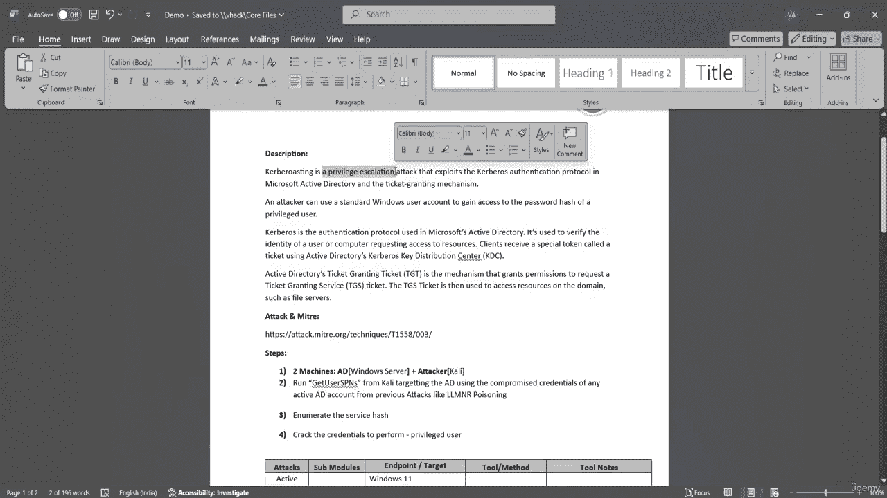

具体工作流程如下：

- 受害者或普通用户通过域控制器请求票据授予系统。
- 握手验证通过后，系统会请求票据授予服务，也就是 TGS。
- 如果域中存在与域名关联的服务主体名称，即 SPN，则会连同 TGS 一起返回给请求者。

下面这段伪代码展示了攻击者利用弱点的核心思路：

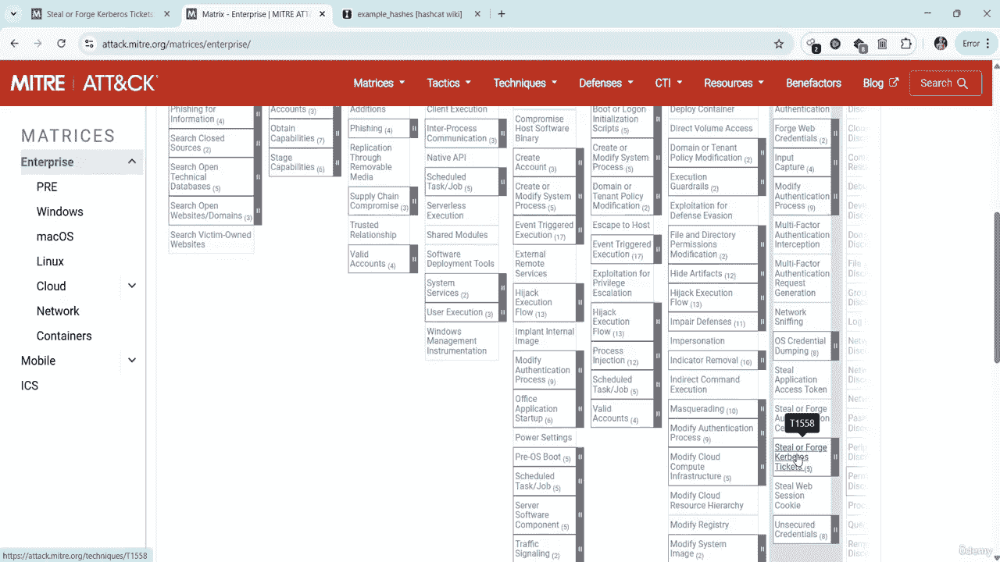

```
若 拥有有效域账户凭据:
    使用 Impacket 工具请求 TGS
    从返回结果中提取 SPN 与 TGS 哈希
    将 TGS 哈希离线破解，获取明文密码
    完成从普通账户到特权账户的提权
```

这就是 Kerberoasting 攻击的本质：通过合法账户凭据，诱导域控制器返回带有 SPN 的服务票据，从而为后续的密码破解和权限提升创造条件。

---

## 3. MITRE ATT&CK 框架中的分类

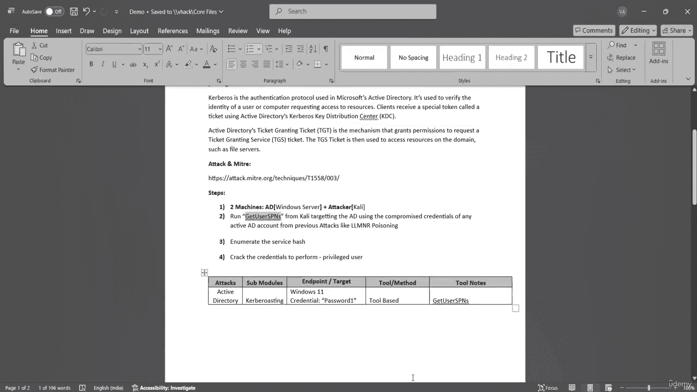

刚才我们分析了攻击原理，本节中我们来看看这个技术在 MITRE ATT&CK 框架中属于哪个类别。

根据 MITRE ATT&CK 知识库，Kerberoasting 被归类在凭据访问（Credential Access）范畴下，具体对应的技术编号是 T1558，即票据授予服务票据（Ticket Granting Service Ticket）。这个分类告诉防御者和攻击者，该技术的主要目标是窃取和利用身份验证凭据，而不是直接破坏系统，因此在进行检测和防护时应重点关注凭据相关的行为。

---

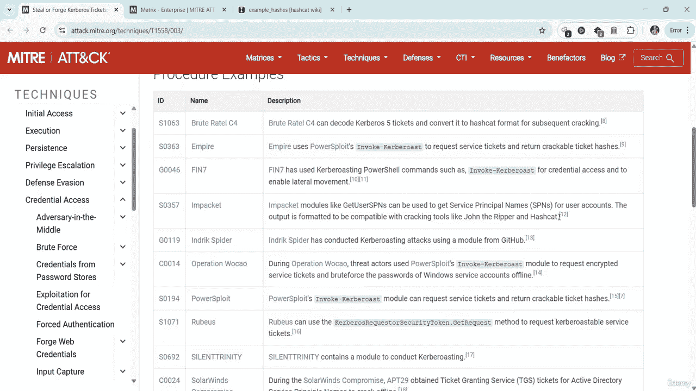

## 4. 攻击获取的内容与后续利用方式

了解完框架分类后，本节中我们来看看攻击者在实施 Kerberoasting 后究竟能拿到什么，以及这些资料能用来做什么。

攻击完成后，攻击者通常能够获得以下内容：

- 目标账户的服务主体名称（SPN）。
- 票据授予服务票据（TGS）。
- 可用于离线破解的哈希值。

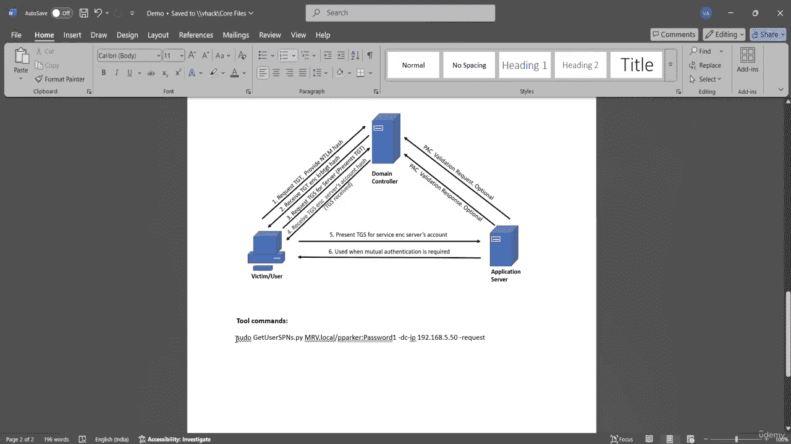

有了这些资料，攻击者可以使用 John the Ripper 或 Hashcat 等工具，对密码进行离线暴力破解。这一步的主要目的是从普通域账户提升到域管理员等特权账户，从而获得对域内更多资源的控制权。

整个攻击过程需要两个角色参与：攻击者与受害者。攻击者使用 Impacket 工具包中的属性和模块来完成请求和提取操作，而受害者则是域中的普通用户或服务账户。

---

## 5. 实操演示：使用 Impacket 获取服务主体名称

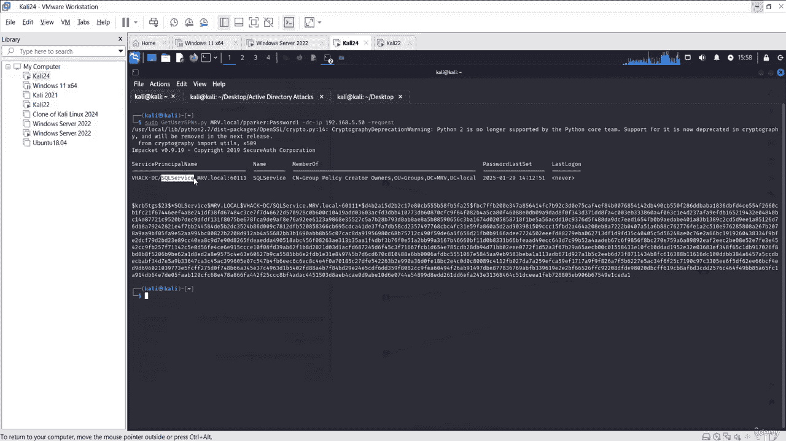

介绍完理论背景后，本节中我们来看看如何在实际环境中操作。

我们将在攻击者的 Kali Linux 虚拟机上使用 Impacket 工具包中的 GetUserSPNs 模块。这是一个专门用于获取用户记录中服务主体名称的模块，获取到 SPN 后，还可以配合 John the Ripper 或 HashCat 对捕获的哈希进行离线破解。

以下是演示中使用的命令示例：

```bash
GetUserSPNs.py -request '域名/.local' '用户名':'密码' -dc-ip 目标域控制器IP
```

在实际操作中，域名部分使用了 .local 后缀，用户名和密码是之前通过 LLMNR 毒化已经收集到的有效凭据，目标 IP 地址是域控制器，例如 10.10.50.50，并且加上 -request 参数来请求 TGS。输入命令后，系统会生成相应的输出结果。

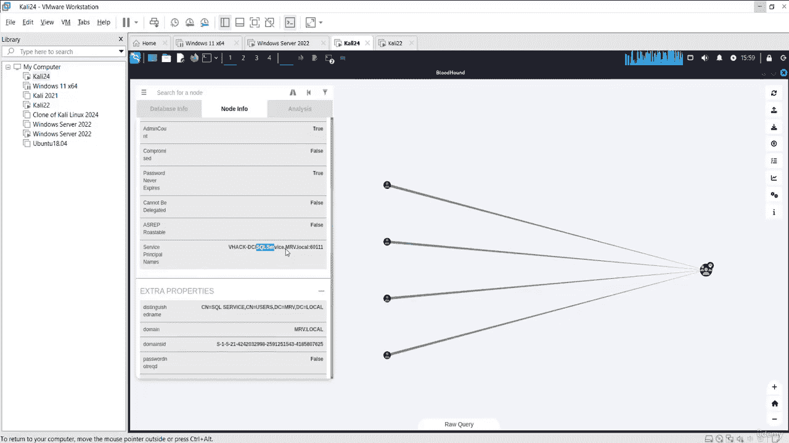

从返回结果中我们可以看到，服务主体名称是 SQL.service。为了验证这个结果，我们可以结合之前收集的枚举信息进行交叉确认。例如，在 tester 等普通域账户下，通常看不到 SPN 相关的名称，只能看到密码过期时间、上次登录时间等基本属性。但如果是 SQL 服务账户，则会显示显示名称，例如 “your skill service”，并且明确列出了服务主体名称，即 ESQL service。这就是我们从枚举中得到的结果，ESQL service 就是目标服务主体名称。

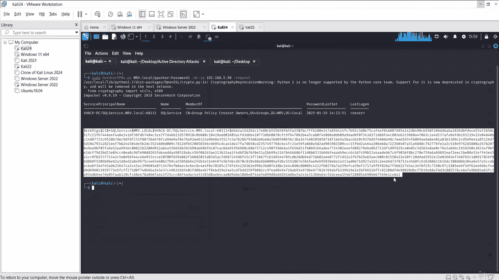

---

## 6. 获得 TGS 后的利用路径

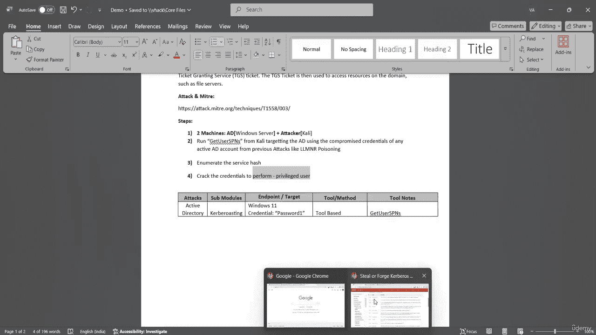

刚才我们完成了 SPN 的枚举并成功接收到了 TGS 值，进入了攻击流程的第四步。本节中我们来看看拿到 TGS 后可以做什么。

最直接的做法是将 TGS 复用到任意应用服务器上。假设域内有一台文件服务器，攻击者可以持续呈现收到的 TGS，从而绕过正常的身份验证，直接获取对该应用服务器的访问权限。当然，在本次演示中，我们主要关注的是第四步之后的另一种选择，即不直接复用 TGS，而是按照 MITRE ATT&CK 框架的说明，利用捕获到的凭据尝试破解明文密码。

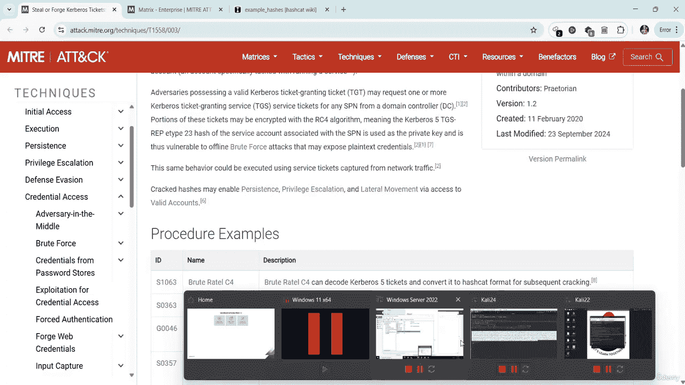

---

## 7. 离线破解 TGS 与权限提升

在上一节我们提到了可以对 TGS 进行离线破解，本节中我们来看看具体如何操作，以及破解成功后意味着什么。

攻击者可以使用 John the Ripper 或 Hashcat 等破解工具，对提取到的哈希值进行暴力破解。操作思路非常直白：先将哈希保存到文本文件中，然后选用较大的字典文件，例如 rockyou.txt，再指定对应的哈希模式进行破解。在 Hashcat 中，针对 Kerberoasting 票据通常使用 -m 13100 参数，因为这类 Kerberos 票据通常以特定标记开头，Hashcat 可以据此识别并处理。

破解所需的时间主要取决于目标账户密码的复杂程度。如果密码较弱，可能很快就能跑出明文；如果密码复杂，则可能需要更长时间。无论在什么环境下，攻击者只需要一个有效的域账户凭据，就有机会通过上述流程拿到域管理员级别的账户。

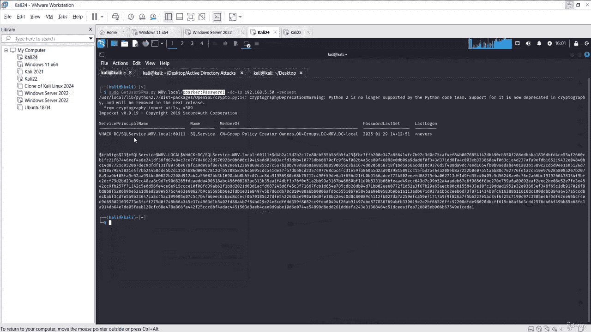

在本次演示中，我们最终获得的特权账户正是 SQL service。这与我们之前的枚举结果非常吻合，该账户在域中具备域管理员身份。通过这次实操，我们清楚地看到了如何从一个普通的有效账户出发，一步步利用 Kerberos 协议的弱点完成权限提升。

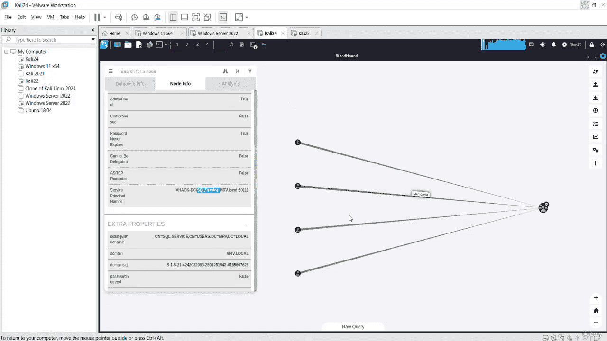

---

## 课程总结

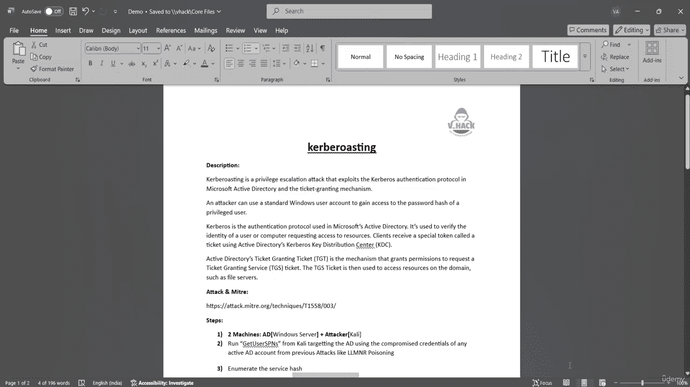

本节课中，我们一起学习了 Active Directory 环境下的 Kerberoasting 攻击。我们首先回顾了 Kerberos 协议的基础，理解了票据授予系统如何基于令牌工作，然后分析了攻击者如何利用有效域账户凭据获取 SPN 和 TGS，并通过 John the Ripper 或 Hashcat 进行离线破解，最终实现从普通账户到域管理员账户的提权。最后，我们在 Kali Linux 上使用 Impacket 的 GetUserSPNs 模块完成了完整的演示，验证了整个攻击链条的可行性。希望这节课的内容对你有所帮助，我们下一节课再见。
