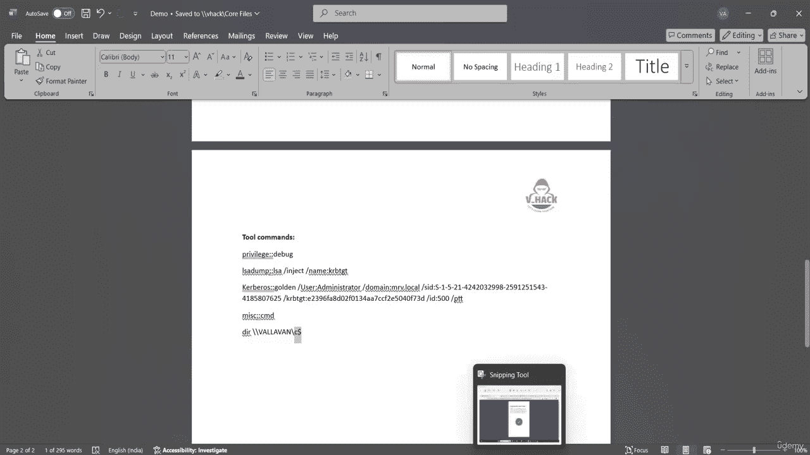
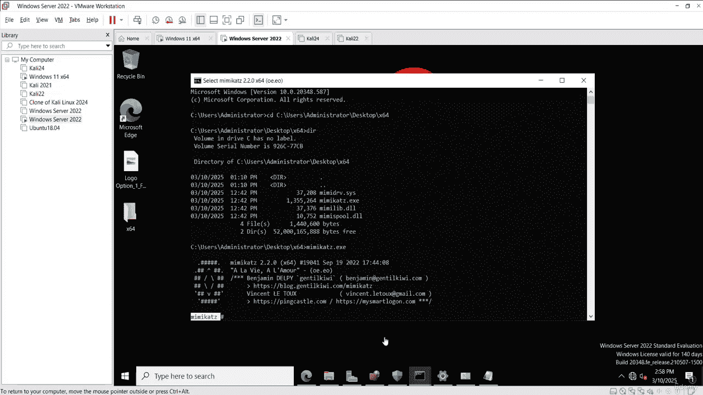
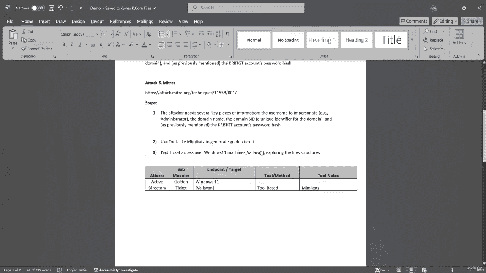
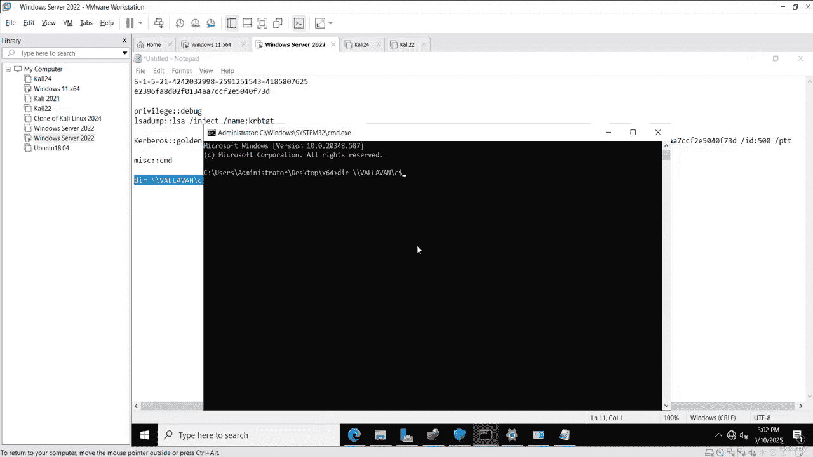
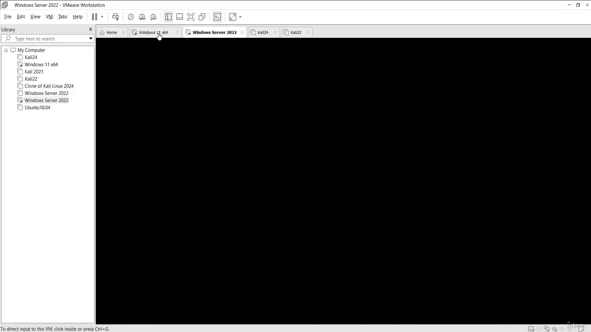
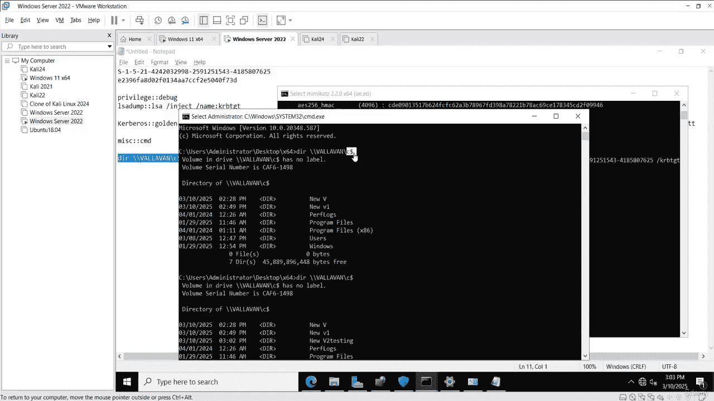
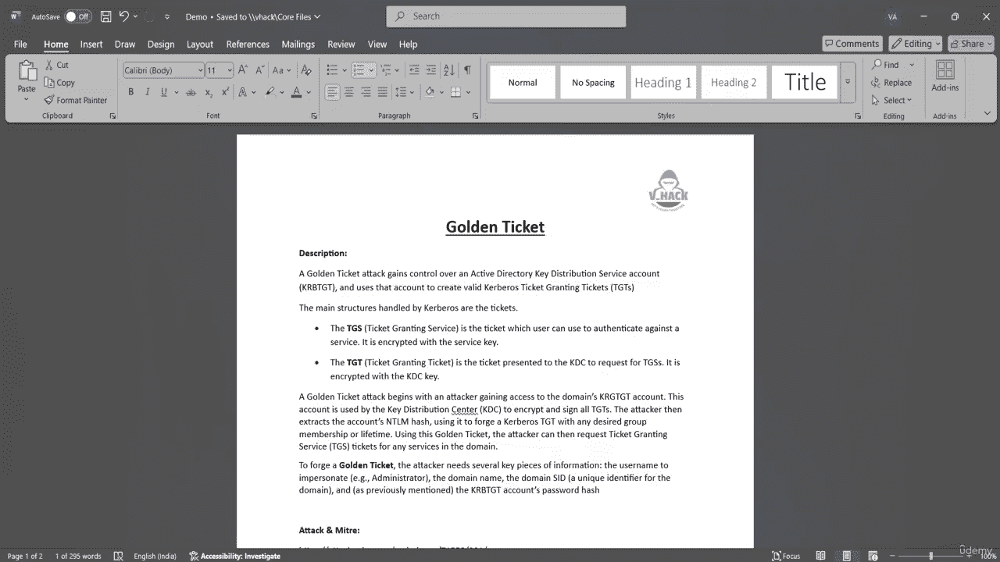

# 道德黑客：第68课：Active Directory 黄金票据实验 🎫


在本节教程中，我们将学习 Active Directory 环境下的黄金票据攻击。黄金票据是一种高危的凭据访问攻击，攻击者一旦获取，就可以在域内访问任何对象、任何服务以及任何机器。本节内容适合初学者，我们会用大白话解释 Kerberos 认证协议、票据授予票据与服务票据的区别，以及如何使用 Mimikatz 工具生成伪造的黄金票据。课程还会演示如何在目标机器上验证攻击效果，确保你理解整个攻击链条的完整过程。


## 一、什么是黄金票据

黄金票据的核心思想非常直接。攻击者不是去破解某个单独服务的密码，而是伪造一个拥有最高权限的票据，从而获得对整个域的完全控制权。

公式描述如下：

**黄金票据 = 伪造的 TGT + 域管理员权限 + 对所有服务的访问权**

这里的 TGT 是票据授予票据，它是 Kerberos 认证流程中的关键凭证。正常情况下，TGT 只允许用户申请访问特定服务的票据。而黄金票据让攻击者可以绕过这个限制，直接访问域内的任意资源。

从攻击严重程度来看，黄金票据相当于攻击者拿到了域控制器的主钥匙。一旦攻击者拥有这个票据，就可以在不被发现的情况下，以任何用户身份访问任何服务器、工作站或域服务。

上一节我们介绍了 Active Directory 基础架构的攻击面，本节中我们来看看黄金票据是如何利用 Kerberos 协议的设计特点来实现域内横向移动与持久化访问的。


## 二、核心概念：Kerberos 协议与票据类型

在开始攻击之前，我们需要先理解几个核心概念。这些概念是理解黄金票据攻击的基础，请仔细阅读。

以下是 Kerberos 认证协议中涉及的主要角色与票据类型：

- **KDC**：密钥分发中心，全称是 Key Distribution Center。它是域控制器上运行的服务，负责处理票据的签发与验证。
- **KRBTGT**：密钥分发服务账户，也就是 KDC 服务账户。这个账户的密码哈希是生成黄金票据的关键材料。
- **TGT**：票据授予票据，Ticket Granting Ticket。用户先向 KDC 请求 TGT，拿到后才能申请访问具体服务的票据。
- **TGS**：票据授予服务，Ticket Granting Service。TGS 根据用户持有的 TGT，签发访问特定服务的票据。

代码形式表示整个认证流程如下：

```
用户请求 TGT -> KDC 验证身份 -> 签发 TGT
用户持 TGT 请求访问 SQL 服务器 -> TGS 验证 TGT -> 签发访问 SQL 服务器的服务票据
用户使用服务票据访问 SQL 服务器
```

在黄金票据攻击中，攻击者不再走正常的申请流程，而是直接伪造 TGT。公式可以表示为：

**伪造 TGT = KRBTGT 密码哈希 + 域 SID + 目标用户身份 + 域名**

有了这个伪造的 TGT，攻击者就可以向 TGS 申请访问任意服务的票据，而不需要知道任何普通用户的密码。

刚才我们了解了 Kerberos 协议的基本票据类型，接下来我们来看看发动黄金票据攻击需要准备哪些关键信息。


## 三、攻击所需条件

要成功生成黄金票据，攻击者需要提前收集以下几项关键信息。缺少任何一项，都无法完成票据伪造。

以下是必须获取的攻击条件清单：

1. **域 SID**：域安全标识符，用于标识整个 Active Directory 域。
2. **KRBTGT 密码哈希**：KDC 服务账户的密码哈希，这是签署伪造票据的秘密密钥。
3. **域名**：目标域的完整名称，本实验中域名是 Mr.V.local。
4. **目标用户身份**：攻击者想要伪装的用户，例如 Administrator，其 RID 通常是 500。

这些信息通常在攻击者已经获得域管理员权限或能够访问域控制器内存后，通过 Mimikatz 等工具从 LSASS 进程中导出。拿到域 SID 和 KRBTGT 密码哈希后，攻击者就拥有了制作黄金票据的全部原材料。

上一节我们列出了攻击所需的关键条件，本节中我们来看看这些条件在 MITRE ATT&CK 框架中的定位。


## 四、MITRE ATT&CK 框架定位

安全研究人员会将攻击手法映射到 MITRE ATT&CK 知识库中，方便防御方理解攻击阶段并制定检测规则。黄金票据攻击的定位如下：



- **战术**：凭据访问（Credential Access）
- **技术**：T1558.001，票据伪造（Ticket Forgery）
- **阶段**：后利用阶段（Post Exploitation）

这意味着黄金票据攻击通常发生在攻击者已经完成初始访问、代码执行和权限提升之后。攻击者在拿到系统控制权后，会从凭据存储中提取敏感信息，进而生成黄金票据以维持对域的长期控制。

这种攻击属于凭据访问类别，因为攻击者的核心目标是窃取或伪造身份凭据，而不是直接破坏系统。理解这一点有助于防御人员在日志审计中重点关注异常的票据请求与 Kerberos 认证行为。

刚才我们了解了黄金票据在攻击框架中的位置，接下来我们进入具体的实验操作步骤。




## 五、实验操作步骤

在本节实验中，我们将使用 Mimikatz 工具来生成黄金票据，并通过目标机器 111 进行验证。目标机器名称是 111，域名是 Mr.V.local。

以下是详细的操作步骤：

1. **进入调试模式**：以管理员身份运行 Mimikatz，并输入 `privilege::debug` 命令，获取系统调试权限，以便访问 LSASS 进程内存。
2. **提取 KRBTGT 信息**：使用 `lsadump::lsa` 或 `lsadump::dcsync` 命令，导出域控制器上 KRBTGT 账户的 SID 与密码哈希。
3. **生成黄金票据**：使用 `kerberos::golden` 命令，指定用户名为 Administrator，域名为 Mr.V.local，域 SID 为之前导出的值，KRBTGT 密码哈希为导出的哈希值， RID 设为 500，并加上 `/ptt` 参数直接将票据注入当前会话。
4. **打开命令提示符**：在生成票据后，打开一个新的命令提示符窗口，此时当前会话已经持有黄金票据。
5. **访问目标机器**：使用 `dir \\111\c$` 或类似命令，直接访问目标机器 111 的 C 盘共享，验证是否可以浏览目录和文件。

执行完成后，如果命令提示符成功列出了目标机器的文件夹，说明黄金票据已经生效，攻击者已经获得了对目标机器的完全访问权限。

上一节我们列出了具体的操作步骤，本节中我们来看看如何在目标机器上验证攻击结果。


## 六、演示验证与结果分析

在实验演示中，攻击者已经在 Mimikatz 中成功生成了黄金票据，并将其注入当前会话。此时，攻击者打开一个新的命令提示符窗口，尝试访问名为 111 的 Windows 11 机器。


通过访问 `\\111\c$` 共享，攻击者可以看到目标机器上的多个文件夹，例如 New V1、user 以及 Windows 相关目录。攻击者甚至可以在这些目录中创建新文件夹，并读取其中的文件内容。

这证明了黄金票据的威力：攻击者不需要知道目标机器的本地管理员密码，也不需要进行任何额外的漏洞利用，仅凭伪造的 Kerberos 票据，就可以访问域内任意机器上的任意对象和服务。



验证过程的逻辑可以简化为：



**持有黄金票据 -> 访问任意域内机器 -> 浏览任意共享文件夹 -> 读取或修改任意文件**



这个演示仅作为概念证明。在实际攻击中，攻击者可以利用同样的方式访问域控制器、数据库服务器、文件服务器以及任何加入域的工作站，从而实现对整个 Active Directory 环境的完全控制。

刚才我们完成了演示验证，接下来我们对本节教程的核心内容进行总结。


## 七、总结

本节课中我们一起学习了 Active Directory 环境下的黄金票据攻击。我们了解了黄金票据的定义，即通过伪造 Kerberos 票据授予票据（TGT），使攻击者能够访问域内所有服务和对象。我们还回顾了 Kerberos 协议的核心组件，包括 KDC、KRBTGT、TGT 与 TGS，并明确了发动攻击所需的域 SID、KRBTGT 密码哈希、域名和目标用户身份。



在实验部分，我们使用 Mimikatz 工具生成了黄金票据，并将其注入当前会话。通过访问目标机器 111 的共享文件夹，验证了攻击者可以在不知道目标机器密码的情况下，浏览并操作域内任意机器的文件。

黄金票据之所以危险，是因为它让攻击者拥有了对 Active Directory 的完全控制权，相当于拥有了域的主钥匙。防御人员应当重点监控异常的 Kerberos 认证请求、票据授予行为以及 Mimikatz 工具的使用痕迹，以便及时发现并响应这类攻击。



希望你喜欢本节课程，我们下节课再见。
