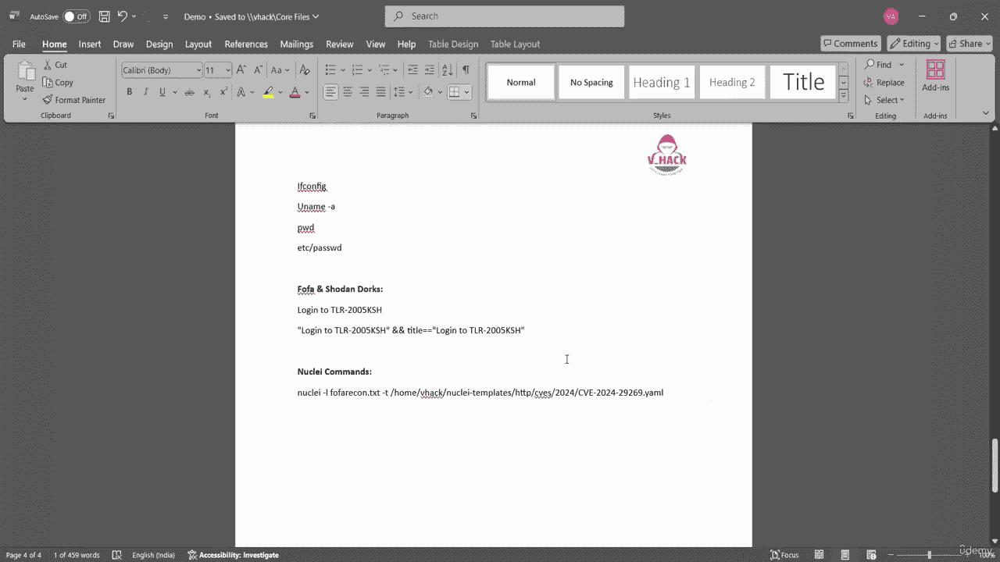
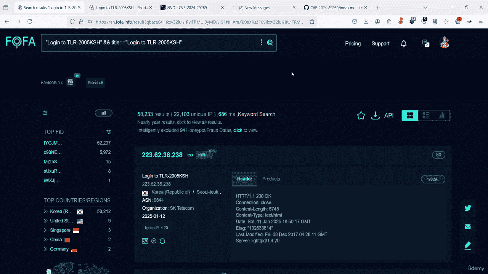
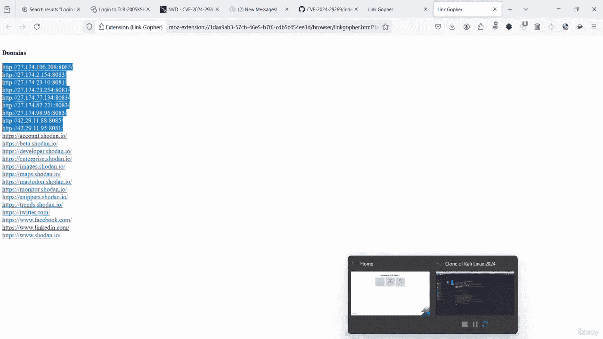
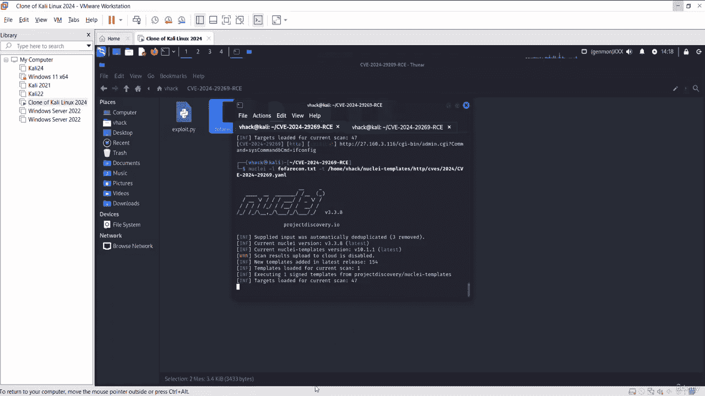
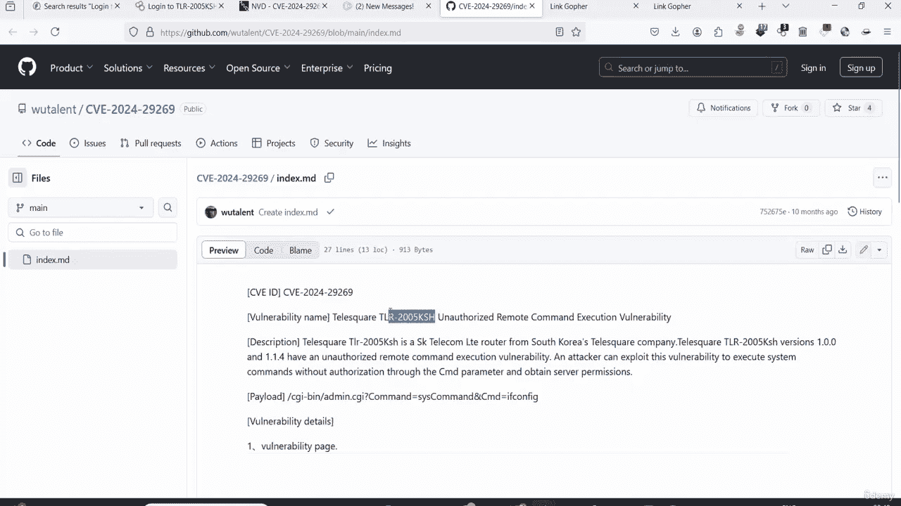
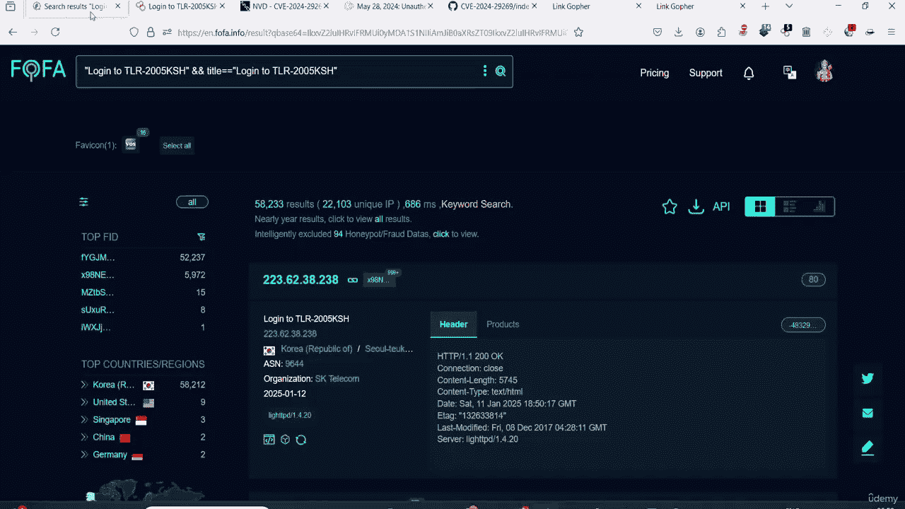
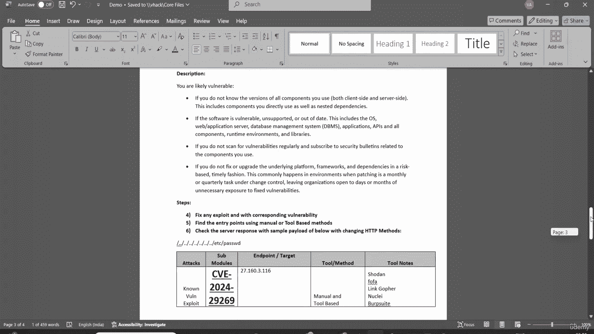

# 🛡️ Ethical Hacking：第2章：已知漏洞利用 - CVE-2024-29xxx [实战目标]


在本节课中，我们将学习如何利用已知漏洞攻击目标系统，重点围绕 CVE-2024-29xxx 进行讲解，并在真实目标上完成完整演示。本节内容使用大白话解释，适合完全没有基础的初学者。我们会先了解什么是已知漏洞，再准备攻击载荷，最后在目标系统上执行命令并提取信息。请跟随步骤逐一操作，不要跳过任何环节，这样才能保证每一次尝试都能得到明确的结果。


## 什么是已知漏洞利用

上一节我们介绍了渗透测试的基本流程，本节中我们来看看已知漏洞具体是如何被利用的。

已知漏洞利用是指攻击者使用已经被公开记录的安全漏洞，来入侵目标系统或执行未经授权的命令。每个漏洞都有一个编号，比如 CVE-2024-29xxx，这个编号就像身份证号一样，方便我们查询漏洞详情和对应的利用方法。在本例中，该漏洞允许攻击者通过网络远程向目标发送特制数据，从而在目标系统上运行攻击者指定的代码。

核心概念可以用下面的公式描述：

```text
漏洞利用成功率 = 目标是否存在漏洞 × 载荷是否匹配 × 网络是否可达
```

简单来说，如果目标运行了含有漏洞的软件版本，并且我们能够把攻击代码发送过去，那么就有可能获得目标系统的控制权。


## 环境准备与目标确认

在开始攻击之前，我们需要先确认目标系统是否真的存在 CVE-2024-29xxx 漏洞，否则浪费时间也是没有意义的。



以下是搭建实验环境并确认目标的基本步骤：

- 确认目标的 IP 地址或域名，并在浏览器中尝试访问
- 检查目标运行的服务版本，重点关注 version2 相关组件
- 准备好攻击载荷文件，通常是一个文本文件，里面包含要执行的命令
- 使用 Google docs 等协议工具，构造目标可以访问的 URL 地址
- 备份原始文本文件，以免操作失误导致数据丢失

完成以上准备后，我们就可以进入下一阶段的攻击载荷构造了。




## 构造攻击载荷

有了目标信息之后，下一步就是制作攻击载荷，也就是用来触发漏洞的恶意数据。

攻击载荷通常包含系统命令，当目标系统处理这些数据时，就会执行我们指定的操作。常见的载荷形式包括命令注入字符串、文件上传路径，或者是指向外部资源的 URL。我们需要将载荷放入目标系统能够识别的位置，比如某个文件数组参数里，或者通过管理员后台提交。



下面是一个简单的载荷构造示例：



```python
# 示例：构造命令注入载荷
payload = "system_command_injection"
target_url = "http://target-domain.com/file_array?input=" + payload
```

请注意，载荷中的命令必须和目标系统支持的命令格式一致，否则目标会直接拒绝执行。


## 实战演示：提取控制器信息

上一节我们介绍了如何构造攻击载荷，本节中我们来看看如何在真实目标上执行演示，并提取关键信息。

演示过程大致分为以下几个步骤：

- 访问目标站点的第一个演示入口
- 使用 M extract controller 模块，向目标发送中间件请求
- 获取目标当前工作目录，通常使用 pwd 命令查看
- 复制目标系统中的文本文件内容，保存到本地
- 在目标文件数组 URL 中插入攻击链接，等待目标执行

执行完这些操作后，如果目标系统存在漏洞，我们会看到命令执行的返回结果，比如当前目录路径或者文件内容。这一步是验证漏洞是否成立的关键。


## 多点命令注入与管理后台利用

除了单点攻击，很多实际场景中还需要在多个位置尝试命令注入，以提高成功率。

我们可以在目标站点的不同页面中重复发送命令注入载荷，特别是管理员后台界面。攻击者通常会尝试以下路径：

- 管理员登录页面（admin UI）
- iPhone 或移动端接口
- 本地数据接口（local R）
- 外部订单接口（external AP order）

在每个位置都尝试注入相同的命令载荷，直到其中某个位置返回预期结果为止。如果某个页面返回了英文记录，说明我们成功绕过了某些非漏洞组件的过滤。


## 漏洞验证与结果分析

攻击执行完成后，我们需要检查目标返回的内容，确认是否真的利用了漏洞，而不是触发了普通错误。



验证方法包括以下几点：



- 检查返回结果中是否包含我们发送的命令执行输出
- 确认是否绕过了目标系统的过滤机制
- 对比攻击前后的系统状态变化
- 记录每一次尝试的详细信息，方便后续分析

如果验证成功，说明 CVE-2024-29xxx 在该目标上确实可利用，我们就完成了一次远程代码执行攻击。


## 总结



本节课中我们一起学习了已知漏洞利用的基本概念，重点分析了 CVE-2024-29xxx 漏洞，并完成了从环境准备、载荷构造到实战演示的全过程。我们还学习了如何在多个位置进行命令注入，以及如何验证攻击是否成功。希望这节课能帮助你理解真实漏洞攻击的步骤，并在以后的学习中继续进步。


