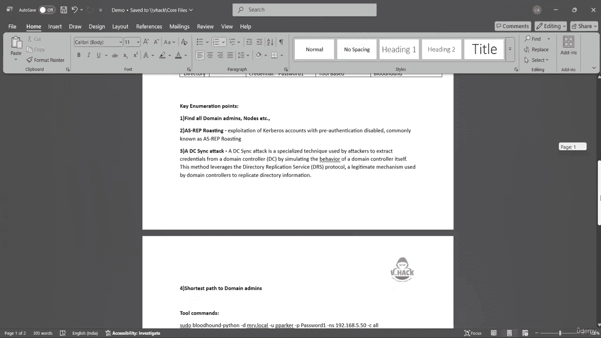
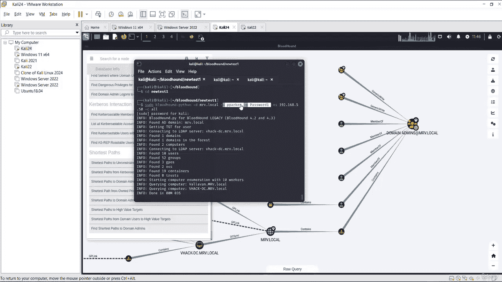
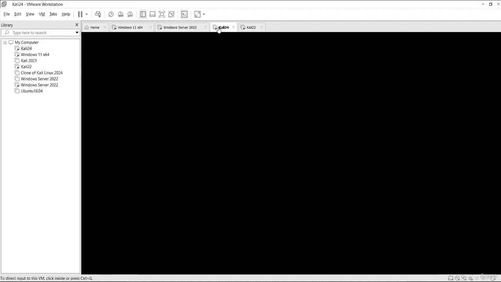
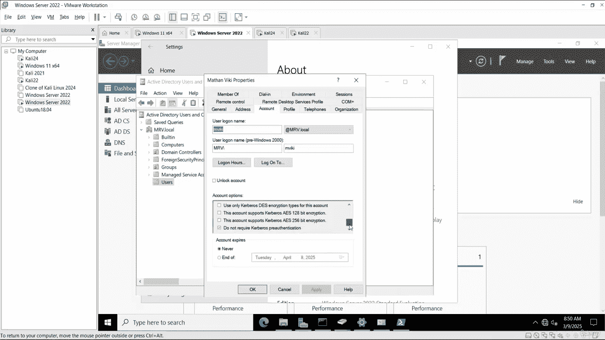
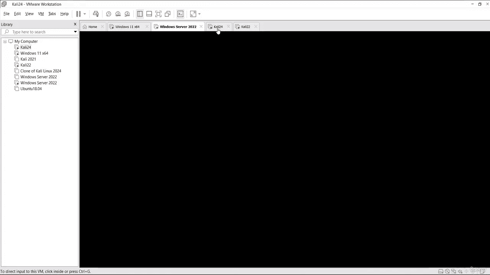
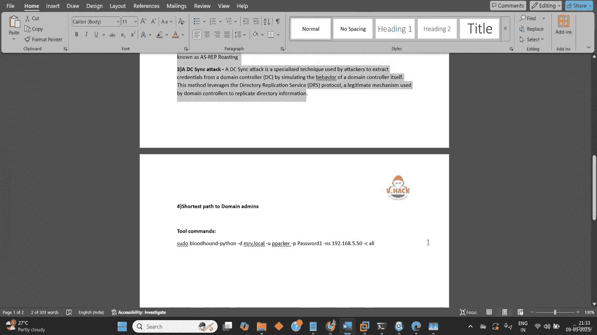

# 🛡️ 道德黑客：第 5 章：使用 BloodHound 进行 Active Directory 枚举


在本节课中我们将要学习如何使用 BloodHound 对 Active Directory 进行枚举。Active Directory 是 Windows 域环境的核心目录服务，它记录了域内所有用户、计算机、组和权限关系。BloodHound 是一款开源工具，能够把这些复杂关系转化为图形化攻击路径，帮助渗透测试人员快速找到从普通用户到域管理员的捷径。

本节内容紧承上一节关于凭证获取和后渗透的介绍，重点放在图形化枚举和攻击路径分析上。我们会使用 SharpHound 采集数据，将其导入 Neo4j 数据库，再通过 BloodHound 界面查找域管理员和其他高价值目标。


## 什么是 Active Directory 枚举

上一节我们介绍了凭证收集与后渗透的基本概念，本节中我们来看看 Active Directory 枚举的具体含义。枚举就是从目标系统中提取有用信息的过程，比如域名、用户列表、计算机名、组成员关系、密码策略等。在 Active Directory 环境下，这些信息构成了攻击者规划后续移动路径的基础。

Active Directory 枚举的核心可以用下面这个简单公式来理解：

信息提取 = 域名 + 用户 + 计算机 + 组成员 + 权限关系

有了这些信息，攻击者就能绘制出域内的攻击图谱，找出哪些账户可以被利用，哪些路径可以通向最高权限。



以下是 Active Directory 枚举常见的采集对象：
- 域名（Domain Name）
- 域用户列表（Domain Users）
- 域控制器计算机名（Domain Controllers）
- 安全组成员关系（Security Group Memberships）
- 密码策略与账户策略（Password Policy & Account Policy）
- 域信任关系（Domain Trust）


## BloodHound 工具简介

在了解了枚举的基本概念后，本节中我们来看看 BloodHound 是如何工作的。BloodHound 是一款开源的 Active Directory 攻击路径分析工具，它依赖图数据库 Neo4j 来存储采集到的域对象关系，并通过前端界面将关系可视化为节点和边。

BloodHound 的核心逻辑可以表示为：



攻击路径 = 起始账户 → 权限关系 → 目标账户（如域管理员）

换句话说，BloodHound 会告诉你：如果你控制了某个普通用户，通过哪些组嵌套或委派关系，最终可以拿到域管理员权限。



以下是 BloodHound 的主要功能模块：
- 数据采集（Data Collection）：使用 SharpHound 采集 Active Directory 数据
- 数据存储：将采集结果以 JSON 格式上传到 Neo4j
- 路径查询：使用内置 Cypher 查询语句寻找攻击路径
- 图形可视化：将域对象和权限关系以节点图形式展示


## 环境准备与 SharpHound 数据采集

上一节我们介绍了 BloodHound 的基本原理，本节中我们来看看如何搭建环境并采集目标域数据。在实验环境中，我们通常需要一台已妥协的 Windows 受害机，以及一台运行 BloodHound 界面和 Neo4j 数据库的攻击机。

假设实验域为 `MRV.local`，域控制器 IP 为 `50.50.50.50`。我们使用合法域用户 `Brown Parker` 及其密码登录受害机，以此身份运行采集工具。

以下是 SharpHound 采集数据的常用命令示例：

```powershell
SharpHound.exe -c All
```

或者使用 PowerShell 版本：

```powershell
Invoke-BloodHound -CollectionMethod All
```

执行完成后，SharpHound 会生成若干个 JSON 文件，这些文件里包含了域内用户、计算机、组、会话、本地管理员权限等全部信息。我们需要把这些 JSON 文件从受害机拷贝到攻击机，准备上传到 BloodHound。


## 数据上传与 Neo4j 可视化

在完成数据采集之后，本节中我们来看看如何将 JSON 数据上传到 BloodHound，并在 Neo4j 中进行可视化展示。首先确保攻击机上已经启动了 Neo4j 服务，并打开 BloodHound 的图形界面。





在 BloodHound 界面左侧，你会看到上传按钮。点击上传，选择刚才从受害机导出的所有 JSON 文件，一次性导入数据库。上传完成后，BloodHound 会自动解析文件，并将域对象及其关系绘制成图形节点。

以下是上传和可视化的基本步骤：
1. 启动 Neo4j 数据库服务
2. 打开 BloodHound 前端界面
3. 点击“上传”按钮，选择 JSON 文件
4. 等待导入完成，查看图形化的域关系图
5. 使用预设查询或自定义 Cypher 语句筛选攻击路径


## 攻击路径分析与高价值目标查找

数据上传完成后，本节中我们来看看如何分析攻击路径，并找出域中的高价值目标。高价值目标通常是指拥有敏感权限的账户，比如域管理员（Domain Admin）、企业管理员（Enterprise Admin）、账户操作员（Account Operator）以及运行 SQL 服务的服务账户。

攻击路径的判断逻辑可以简化为：

目标权限 = 当前控制的账户 + 可利用的权限关系 + 最短路径长度

BloodHound 提供多种内置查询，可以帮助你快速定位通向域管理员的最短路径。例如，你可以查询“找出所有可以通过本地管理员权限到达域控制器的用户”，或者“找出所有属于域管理员组的账户”。

以下是常见的高价值目标类型：
- 域管理员（Domain Admin）：拥有域内最高权限
- 企业管理员（Enterprise Admin）：拥有整个森林的最高权限
- 账户操作员（Account Operator）：可以修改大部分用户账户
- SQL 服务账户（SQL Service Account）：通常运行在高权限下，且可能存在 Kerberoasting 风险
- 被禁用但仍保留敏感权限的账户（Disabled Accounts with Sensitive Rights）

在图形界面中，红色节点通常表示高价值或敏感对象，点击节点可以查看其详细属性和所有入站/出站关系。


## 常见攻击向量：AS-REP Roasting 与 Kerberoasting

在掌握了攻击路径分析之后，本节中我们来看看 BloodHound 还能帮助发现哪些具体的攻击向量。其中两种比较典型的攻击是 AS-REP Roasting 和 Kerberoasting，它们都利用 Active Directory 的身份验证机制缺陷来获取账户哈希。

AS-REP Roasting 的前提条件是用户账户不要求预身份验证（Does not require pre-authentication）。这种情况下，攻击者可以向域控制器请求该用户的 TGT 响应，并离线破解出密码。

判断条件可表示为：

易受 AS-REP Roasting 攻击 = 用户账户未启用“要求预身份验证”

Kerberoasting 则针对拥有服务主体名称（SPN）的服务账户。攻击者可以请求服务票据，并离线破解服务账户密码。

判断条件可表示为：

易受 Kerberoasting 攻击 = 账户拥有 SPN 且可请求服务票据

以下是 BloodHound 中可检测的常见攻击向量：
- 不要求预身份验证的用户（AS-REP Roasting 候选者）
- 拥有 SPN 的服务账户（Kerberoasting 候选者）
- 具有不受约束委派权限的账户（Unconstrained Delegation）
- 可以通过强制更改密码攻击的账户（Force Change Password）

查找这些目标时，建议优先处理那些同时拥有高价值权限且存在上述缺陷的账户，因为它们是通向域管理员的最短路径上的关键节点。


## 实验演示：查找域管理员最短路径

前面几节我们介绍了环境准备、数据采集、上传可视化以及常见攻击向量，本节中我们来看看一个完整的实验演示。在实验环境中，我们使用测试用户 `tester` 作为起始点，尝试在 BloodHound 中查找从 `tester` 到域管理员的最短攻击路径。

首先，在 BloodHound 界面中选择查询“Find shortest path to Domain Admins”，系统会计算所有可能路径，并按长度排序。如果 `tester` 是某个本地管理员组的成员，而该组又可以访问域控制器，那么 BloodHound 就会高亮显示这条路径。

以下是查找最短路径的操作步骤：
1. 在 BloodHound 查询面板中选择“Shortest Paths to Domain Admins”
2. 输入起始账户名，例如 `tester`
3. 点击运行查询，观察返回的图形路径
4. 检查路径上的每个节点，确认利用方式（如本地管理员、组嵌套、委派等）
5. 如果路径中包含被禁用账户，记录其“Disabled”属性，评估是否可重新启用或利用

在实际演示中，有时候查询不会返回任何数据。这通常意味着当前采集的信息不完整，或者目标账户确实不存在可利用的攻击路径。此时需要重新运行 SharpHound 采集更多数据，或者更换其他起始账户再次尝试。


## 课程总结

本节课中我们一起学习了使用 BloodHound 对 Active Directory 进行枚举的完整流程。我们了解了 Active Directory 枚举的基本概念，掌握了 BloodHound 与 SharpHound 的工作原理，学会了如何采集 JSON 数据、上传到 Neo4j 并进行图形化可视化，还学习了如何分析攻击路径、寻找高价值目标，以及识别 AS-REP Roasting 和 Kerberoasting 等常见攻击向量。



通过本节课的学习，你应该能够在实验环境中独立完成一次基于 BloodHound 的 Active Directory 枚举，并从图形化结果中找出通向域管理员的潜在路径。希望你喜欢本节课程，我们下节课再见。
