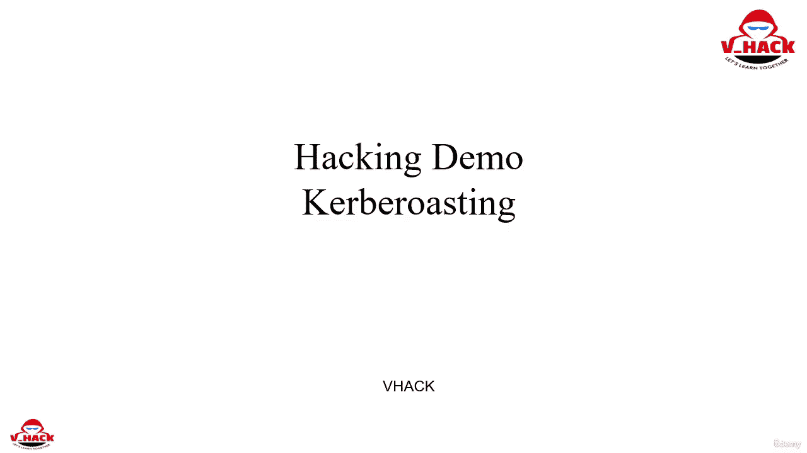
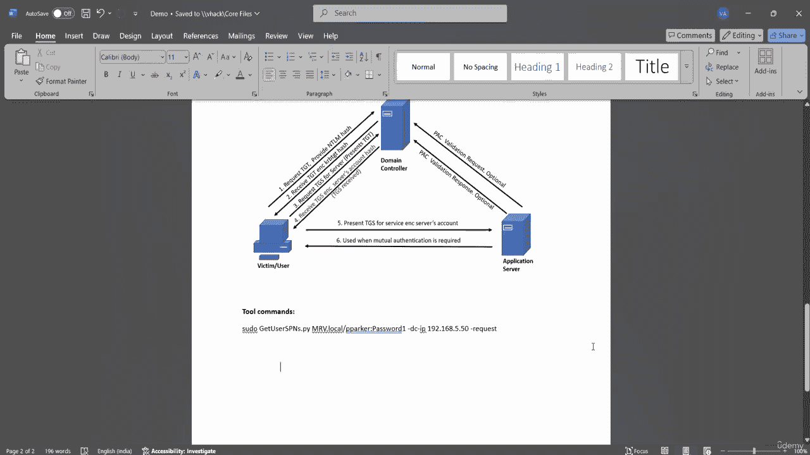
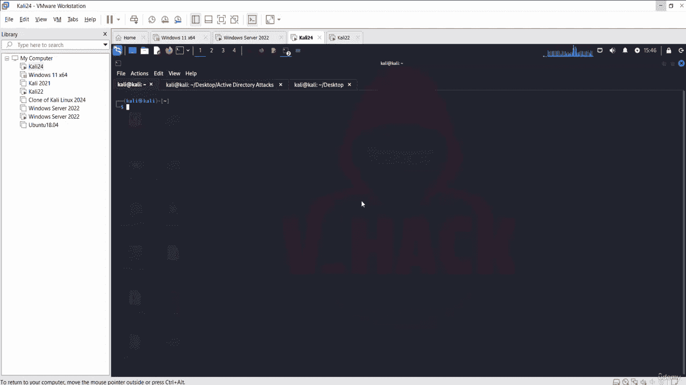
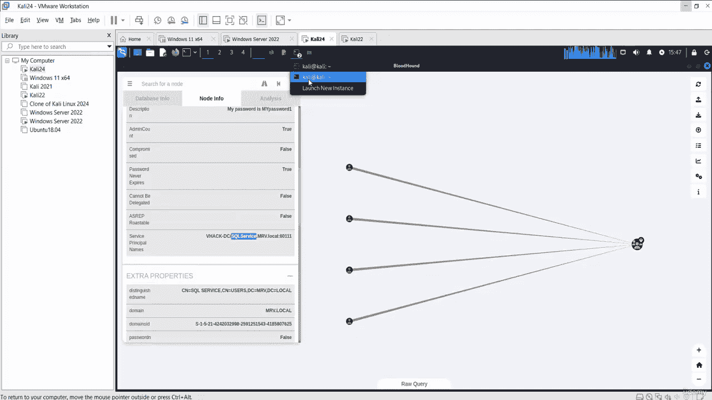
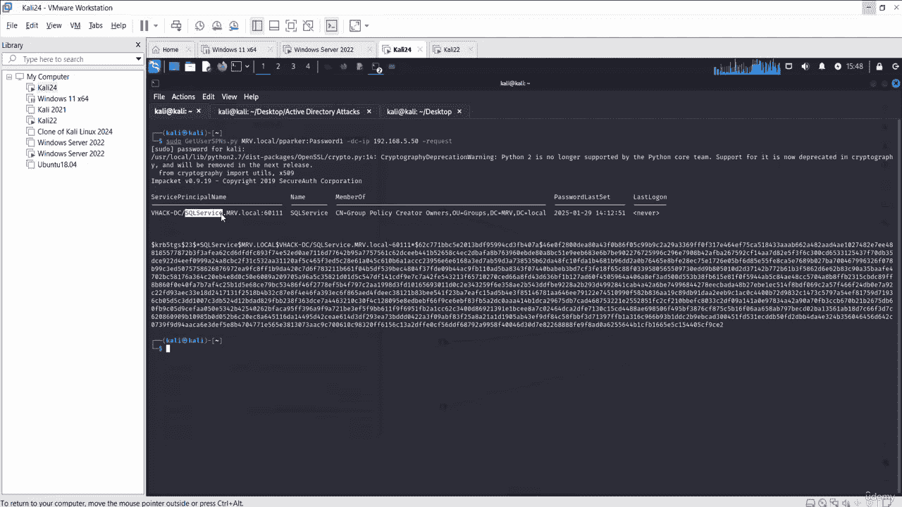
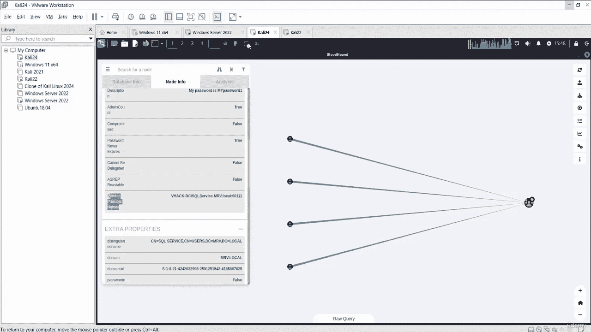
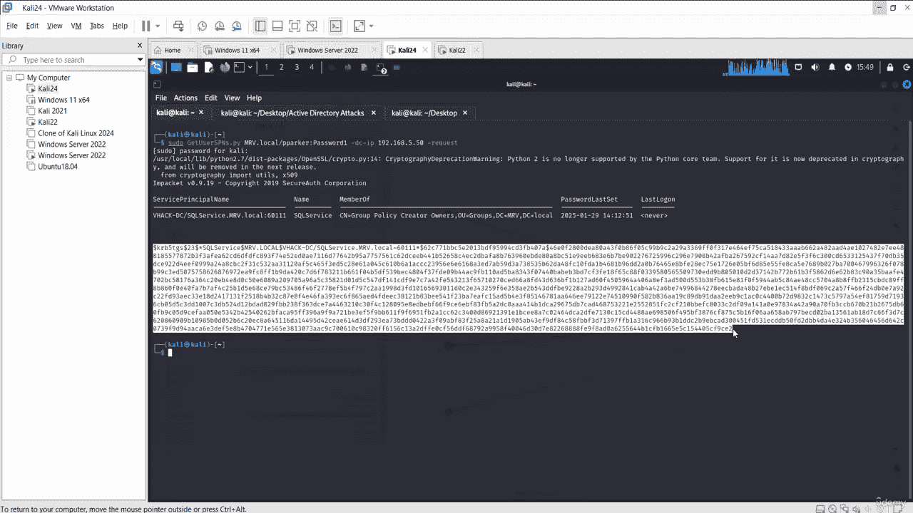
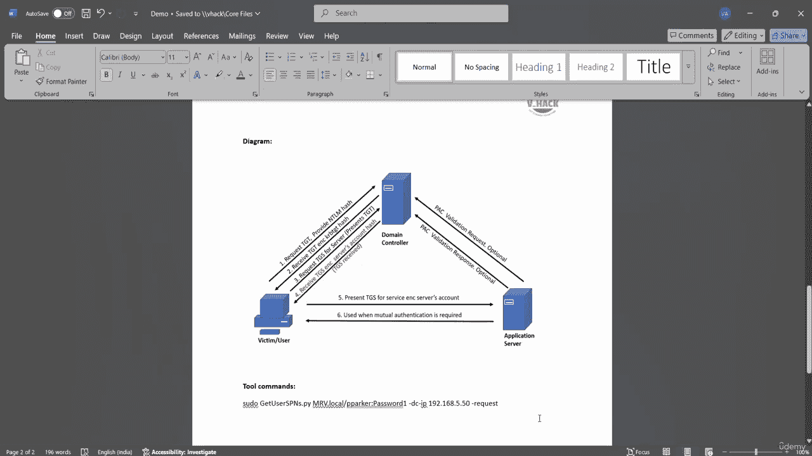
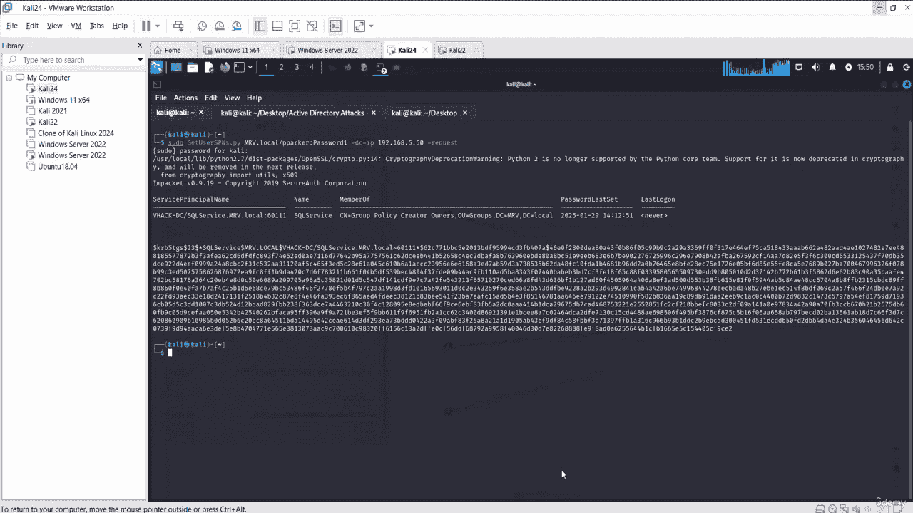
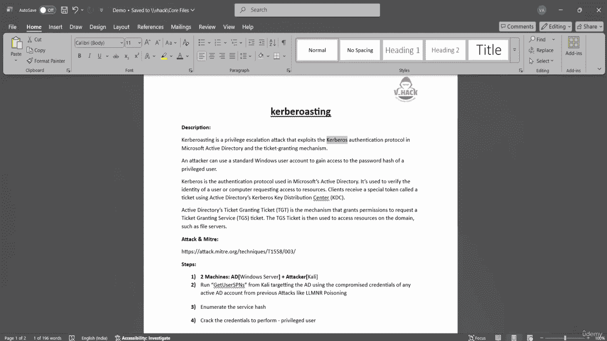

# Ethical Hacking：50-Day Hacker Challenge：6：Active Directory - Kerberoasting 实验目标 🎯




在本节课中，我们将一起学习Active Directory环境下的Kerberoasting攻击实验。你将了解Kerberos认证协议的基本运作方式，掌握攻击者如何窃取服务票据并离线破解密码，以及在目标机器中配置服务主体名称的完整流程。内容会尽量用大白话讲解，即使你是初学者，也能跟上每一个步骤，理解攻击背后的原理与实操要点。


## Kerberos认证协议基础

首先，我们来看看Active Directory中用于身份验证的核心协议。本节将介绍Kerberos协议的基本组成与票据授予机制。

Active Directory使用Kerberos协议来处理域内用户的身份验证。在这个机制中，认证服务负责验证用户身份并分发初始票据，让用户证明自己是合法的域成员。系统中还存在一种叫做TGS的服务，也就是票据授予服务，它的作用是根据用户持有的票据，签发访问特定服务的凭据。如果攻击者能够中毒或妥协现有的凭据，就可能利用这些票据获取不正当的访问权限。这里涉及到的凭据票据，就是在TGS授予服务中被签发的内容，也是后续攻击的关键对象。

以下是Kerberos认证中涉及的几个关键角色：

- 认证服务器：验证用户身份并发放初始票据
- 票据授予服务器（TGS）：为用户提供访问特定服务的票据
- 服务主体：运行特定网络服务的账户，例如SQL服务
- 客户端：请求访问服务的用户或计算机


## Kerberoasting攻击原理



了解了认证流程之后，本节中我们来看看攻击者是如何利用这个流程进行攻击的。Kerberoasting的核心思路可以用下面这个公式来描述：



```
攻击流程 = 请求服务票据 + 提取加密票据 + 离线暴力破解服务账户密码
```

攻击者不需要直接登录目标服务器，只需要向域控制器请求一个服务票据。这个票据会使用服务账户的密码进行加密。攻击者把票据拿到本地之后，就可以在不被发现的情况下，离线尝试各种密码组合，直到把服务账户的密码跑出来为止。在这个过程中，攻击者会伪造或窃取票据，重点针对拥有服务主体名称的账户，从而绕过正常的交互式登录限制。


## 实验环境与目标机器

理论讲完了，接下来我们进入实际的实验环境。本节中我们来看看目标机器的设置方式。

我们需要在目标机器层面配置相应的安全策略，确保实验环境能够正确模拟真实的Active Directory域环境。目标机器上会预置一些用户账户，这些账户将用于演示攻击的完整过程，包括不同权限级别的账户与服务账户。

以下是实验中涉及的关键账户：

- 域管理员：拥有域内最高权限的管理账户
- tester：普通测试用户账户
- SQL service：运行SQL Server服务的服务账户




## 服务账户与SPN配置

有了目标机器和账户之后，本节中我们来看看如何配置服务主体名称，这是实施Kerberoasting攻击的前提条件。

在Active Directory的属性页面中，管理员可以为服务账户设置服务主体名称，简称SPN。SPN告诉客户端如何在网络中找到特定的服务实例。以SQL服务为例，它的SPN会包含服务类型、主机名和端口号等信息。只有当服务账户正确绑定了SPN之后，攻击者才能针对该账户发起票据请求，进而实施票据窃取与破解。





```
SPN格式示例：MSSQLSvc/sqlserver.corp.local:1433
```



以下是SPN配置需要注意的要点：



- 服务主体名称必须在账户属性中明确填写
- 不同的服务类型使用不同的SPN前缀
- 查看SPN详情时，需要检查账户的完整属性信息


## 密码策略与攻击影响

攻击成功与否，很大程度上取决于域中的密码策略设置。本节中我们来看看密码复杂度如何影响Kerberoasting的效果。

当攻击者拿到加密的服务票据后，能否破解出明文密码，完全取决于密码策略的强度。如果域策略要求的密码长度足够长、复杂度足够高，那么离线破解的难度就会大幅增加。攻击者需要考虑时间窗口，也需要考虑密码是否符合策略中的复杂性要求。无论是普通用户还是特权用户，只要其服务账户的密码不够强，都可能成为Kerberoasting攻击的目标。

以下是影响攻击成功率的主要因素：



- 域密码策略的长度与复杂度要求
- 服务账户密码的更新频率
- 攻击者可用的计算资源与破解时间窗口


## 总结



在本节课中，我们一起学习了Active Directory中Kerberoasting攻击的基本原理、Kerberos认证协议的工作流程、目标机器与服务账户的配置方法，以及密码策略对攻击结果的影响。希望你能掌握这些内容，并在后续的演示中继续跟进学习。
