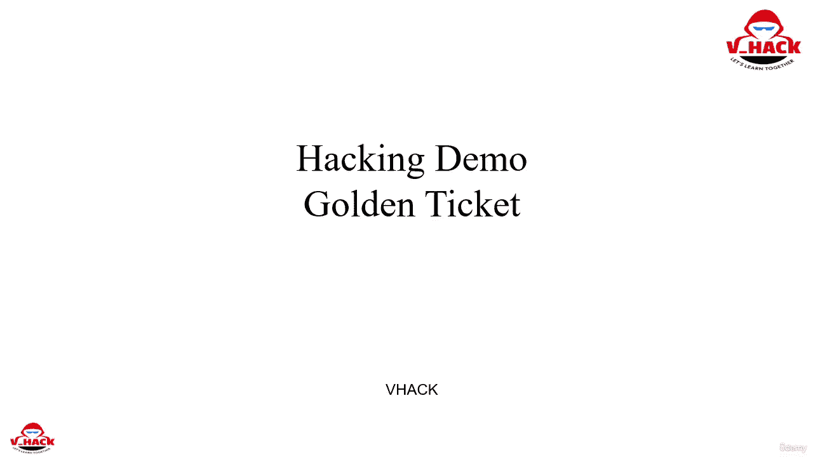
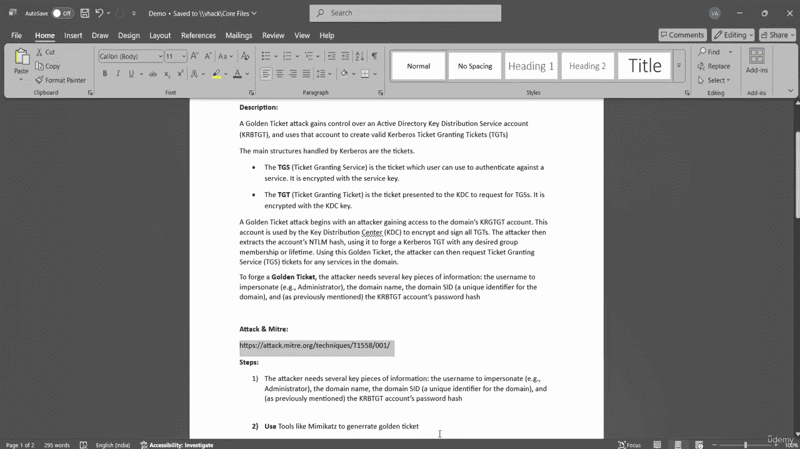
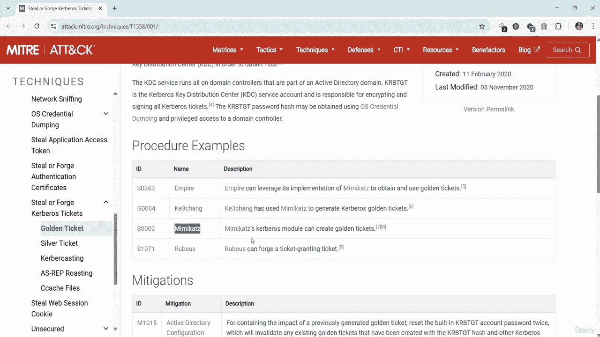
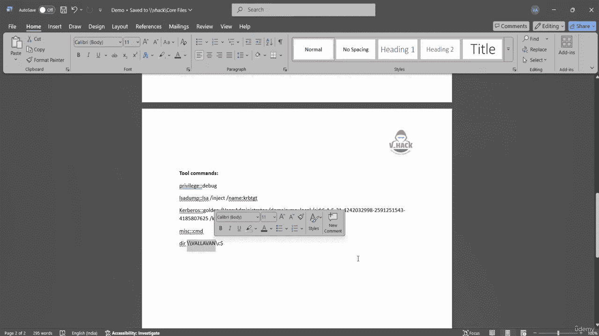
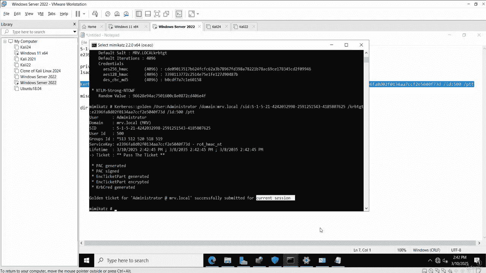
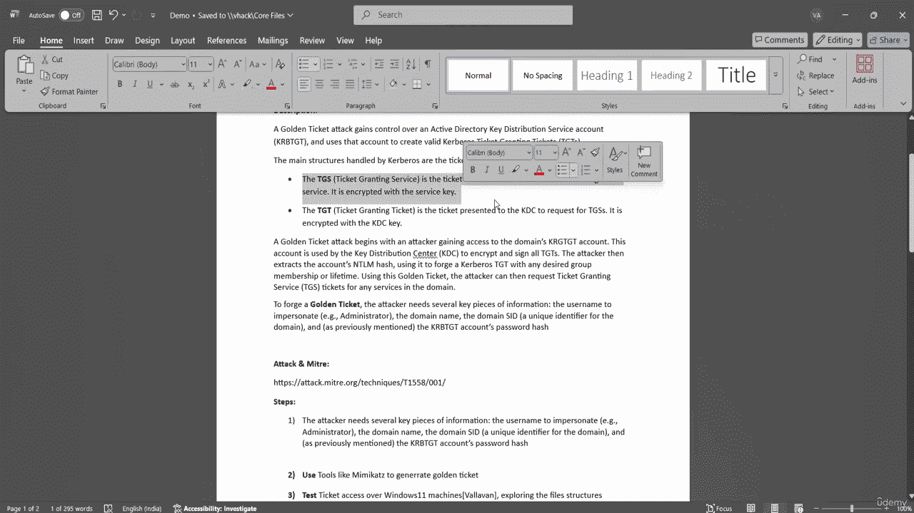
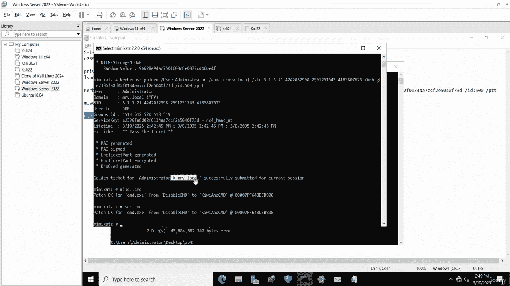
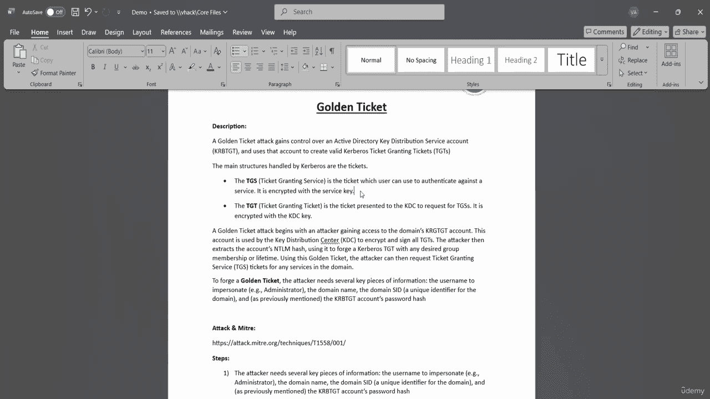

# 🎫 Udemy - Ethical Hacking：50-Day Hacker Challenge：50 Real Attacks：7：Active Directory - Golden Ticket



## 本节课概述

在本节课中，我们将一起学习Active Directory环境中的Golden Ticket，也就是黄金票据攻击。本节课会告诉你，当攻击者只拿到一台内网机器的权限时，如何利用域凭据和Kerberos协议伪造高权限票据，进而获取域控制器级别的访问权限。我们会使用Mimikatz等工具，详细讲解生成票据的具体参数，并演示在Windows虚拟机中完成整个攻击流程，让初学者也能听懂每一步在做什么。




## 一、黄金票据攻击的核心概念

在这一部分，我们先搞清楚什么是黄金票据，以及它在Active Directory中扮演什么角色。

黄金票据是一种基于Kerberos协议的伪造凭证。攻击者只要拿到域的KRBTGT账户哈希，就可以伪造任意用户的票据，包括域管理员。因为域控制器会信任用KRBTGT密钥加密的票据，所以持有这张票据就相当于拥有了域内的通行证。



以下是黄金票据的核心公式：

```text
Golden Ticket = Encrypt(KRBTGT_Hash, UserInfo + Privileges + Lifetime)
```

这个公式的意思是：用KRBTGT账户的密码哈希对用户信息、权限和有效期进行加密，生成一张域控制器会信任的票据。


## 二、初始访问与域凭据

在上一节中我们介绍了如何在Active Directory环境中获得初始访问权限，本节中我们来看看如何利用已经拿到的域凭据进行黄金票据攻击。

在实际的攻击场景里，攻击者通常只控制一台内网机器。这时候，初始访问的权限可能比较低，但只要能导出域相关的凭据，就有机会提升到域管理员级别。域凭据的访问等级决定了我们能做什么，如果只是普通用户凭据，可能只能查询部分信息；如果是高权限账户，则可以直接生成黄金票据。

以下是常见的获取凭据方式：

- 使用Mimikatz导出内存中的明文密码或哈希
- 使用PowerShell读取已保存的凭据
- 从本地安全机构子系统服务中提取票据


## 三、实验环境准备

在介绍完凭据获取之后，本节中我们来看看如何搭建实验环境，为后面的攻击做准备。

我们需要一台Windows 11虚拟机，并安装好Mimikatz工具。同时，要在虚拟机中创建接收文件的文件夹，用来存放生成的票据文件。环境准备好之后，后续的操作才会顺利进行，避免因为找不到文件或者权限不足而导致攻击失败。

以下是环境准备的步骤：

1. 安装Windows 11虚拟机，并加入Active Directory域
2. 下载并解压Mimikatz到指定目录
3. 在C盘创建接收文件夹，例如C:\Tickets
4. 确认虚拟机能与域控制器正常通信



文件结构建议如下：

```text
C:\
  Tickets\
    golden.kirbi
    mimicikatz.exe
```


## 四、使用Mimikatz生成黄金票据

在上一节中我们完成了环境准备，本节中我们来看看如何使用Mimikatz生成黄金票据。

Mimikatz是一个功能强大的凭据提取和票据操作工具。在生成黄金票据时，需要使用kerberos::golden模块，并传入域名、KRBTGT哈希、用户名等参数。只要参数填对了，Mimikatz就会帮我们造出一张看起来完全合法的域票据。

以下是生成命令的代码示例：

```powershell
kerberos::golden /user:Administrator /domain:corp.local /krbtgt:<KRBTGT_HASH> /id:500 /startoffset:0 /endin:600 /renewmax:10080 /ptt
```

参数含义如下：

- /user：伪造的用户名，例如Administrator
- /domain：域名，例如corp.local
- /krbtgt：KRBTGT账户的NTLM哈希值
- /id：用户RID，500通常代表域管理员
- /ptt：将票据直接注入当前会话

执行命令后，Mimikatz会生成一张伪造的Kerberos票据，并尝试将其注入当前Windows会话中，这样我们就可以用这个身份去访问域内资源了。






## 五、票据验证与服务访问

在生成了黄金票据之后，本节中我们来看看如何验证票据是否生效，并利用它访问域内服务。

生成票据后，需要在命令提示符或PowerShell中确认票据已经注入成功。可以使用klist命令查看当前会话中的Kerberos票据列表。如果列表里出现了刚才伪造的Administrator票据，说明攻击成功，票据已经生效。

以下是验证步骤：

1. 打开命令提示符（CMD）
2. 输入klist命令，查看票据列表
3. 确认出现刚才伪造的Administrator票据
4. 尝试访问域控制器的共享文件夹或服务

如果票据生效，你应该能够使用域管理员身份访问原本需要高权限才能进入的资源。例如，可以直接访问域控制器的共享文件夹，或者执行需要域管理员权限的操作，从而完成对域的控制。


## 六、完整攻击流程回顾

在上一节中我们完成了票据验证，本节中我们把整个黄金票据攻击流程串联起来，方便你理解每一个环节是如何衔接的。

完整流程如下：

1. 获取初始访问权限，控制一台内网机器
2. 使用Mimikatz导出域凭据，特别是KRBTGT账户哈希
3. 在Windows虚拟机中配置Mimikatz环境，创建接收文件夹
4. 使用kerberos::golden生成黄金票据，指定域管理员用户名和RID
5. 将票据注入当前会话，并用klist验证
6. 利用有效票据访问域内服务，完成权限提升

整个过程的关键在于KRBTGT哈希。只要这个哈希不被更改，攻击者就可以随时生成新的黄金票据，维持对域的长期控制，甚至在域管理员修改密码后依然拥有潜在的入侵路径。




## 本节课总结



在本节课中，我们一起学习了Active Directory中的黄金票据攻击。我们介绍了黄金票据的核心原理、所需的域凭据、Mimikatz生成命令及其参数，以及如何在Windows 11虚拟机中完成票据生成和验证。希望通过本节课，你能够理解Kerberos票据的工作方式，并掌握黄金票据攻击的基本操作流程。
